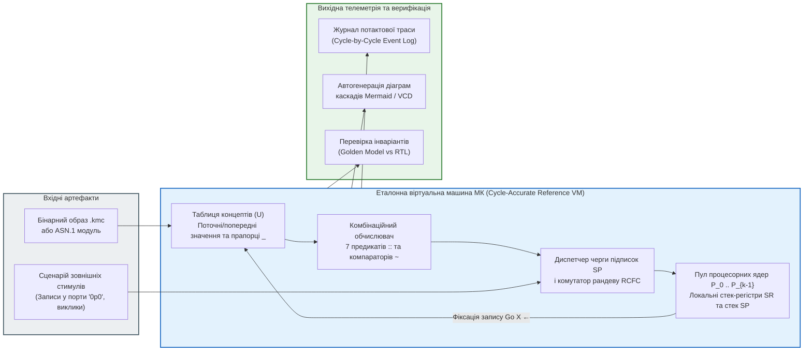
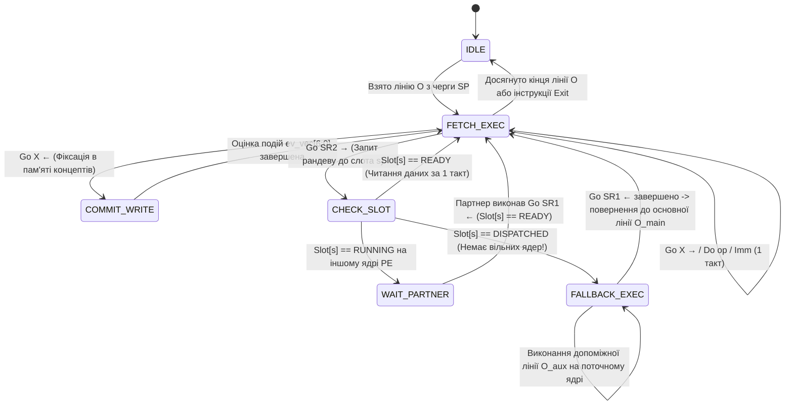

# Специфікація еталонної програмної віртуальної машини (Reference VM) та потактового симулятора Машини Кузьміна

> **Внутрішня робоча копія, не публікація; міграція не є науковим прийняттям.** Перенесено з `drafts@774d575:KuzminMachine/03-engineering-software/Kuzmin-Machine-Reference-VM-and-Cycle-Accurate-Simulator-UA.md` 2026-11-10, Issue #84. Міграція не підтверджує тверджень, прогнозів чи самоприсвоєних статусів. Незмінний оригінал і SHA-256 — у реєстрі міграції.


> [!IMPORTANT]
> **Призначення документа:** Цей інженерний документ визначає архітектуру та містить повну еталонну реалізацію **Програмної віртуальної машини та потактового симулятора Машини Кузьміна (Kuzmin Machine Golden Reference VM & Cycle-Accurate Simulator)**. Симулятор слугує «золотим еталоном» (*Golden Reference Model*) для перевірки семантики програм високорівневої мови МК, трасування каскадів подій, верифікації алгоритму міжстекового рандеву (`SR1` $\leftrightarrow$ `SR2` з відмовостійким Fallback-виконанням) та порівняльного тестування з [апаратним RTL-ядром на FPGA PYNQ-Z1](../hardware/Kuzmin-Machine-FPGA-PYNQ-Z1-Architecture-UA.md).

---

## Зміст

1. [Роль еталонної віртуальної машини в екосистемі Машини Кузьміна](#1-роль-еталонної-віртуальної-машини-в-екосистемі-машини-кузьміна)
2. [Формальна операційна семантика виконання такту віртуальної машини](#2-формальна-операційна-семантика-виконання-такту-віртуальної-машини)
3. [Архітектура пам'яті концептів, пулу стек-регістрів $`SR`$ і комутатора рандеву](#3-архітектура-памяті-концептів-пулу-стек-регістрів-sr-і-комутатора-рандеву)
4. [Підсистема трасування каскадів подій (Event Cascade Tracer та VCD/Mermaid експорт)](#4-підсистема-трасування-каскадів-подій-event-cascade-tracer-та-vcdmermaid-експорт)
5. [Повна еталонна реалізація симулятора Машини Кузьміна на Python (з проходженням еталонного корпусу програм)](#5-повна-еталонна-реалізація-симулятора-машини-кузьміна-на-python-з-проходженням-еталонного-корпусу-програм)

---

## 1. Роль еталонної віртуальної машини в екосистемі Машини Кузьміна

Розробка програм для подієвої багатопроцесорної архітектури та налагодження SystemVerilog-модулів на ПЛІС вимагають детермінованої програмної моделі, яка відтворює поведінку Машини Кузьміна з точністю до окремого такту та окремої фази Великої крапки (`•`).

Еталонна віртуальна машина вирішує чотири інженерні задачі:
1. **Миттєвий запуск програм МК на ПК без апаратної плати:** програміст може писати й тестувати класи (`Class`), реактивні функції (`Nod`, `Factorial`, `SumZ`) та емулювати апаратні порти (`"0p0"`, `"0p1"`) у звичайному середовищі Python/Linux.
2. **Co-Simulation (Спільна верифікація з FPGA PYNQ-Z1):** кожен такт програмного симулятора генерує контрольний журнал змін концептів і спрацювань вектора подій `ev_vec[6:0]`, який автоматично звіряється з виходом Verilator або апаратного ядра Zynq-7020.
3. **Моделювання змінного числа обчислювальних ядер ($`N_{\mathrm{PE}} \in \lbrace 1 \dots 64 \rbrace`$):** дозволяє досліджувати поведінку однієї й тієї самої програми як на багатоядерній конфігурації (де лінії $`O_1`$ і $`O_2`$ виконуються паралельно з обміном через рандеву), так і на одноядерному мікроконтролері ($`N_{\mathrm{PE}} = 1`$), де автоматично спрацьовує механізм **Fallback-виконання** без дедлоків.
4. **Візуалізація хвильового фронту подій:** симулятор будує повне дерево причинно-наслідкових зв'язків (хто, на якому такті і через яку подію розбудив кожну підписну лінію).



---

## 2. Формальна операційна семантика виконання такту віртуальної машини

Глобальний стан віртуальної машини МК на дискретному такті $`t \in \mathbb{N}_0`$ описується кортежем:

$$
\Sigma_t = \langle \mathcal{C}_t, \mathcal{Q}_t, \mathcal{P}_t, \mathcal{R}_t \rangle
$$

де:
* $`\mathcal{C}_t : \mathrm{ConceptId} \to \langle \mathrm{val}_{\mathrm{cur}}, \mathrm{val}_{\mathrm{prev}}, \mathrm{is}_{\mathrm{undef}}, \mathrm{dot}_{\mathrm{flag}} \rangle`$ — стан усіх концептів у пам'яті;
* $`\mathcal{Q}_t = \langle Q_{\mathrm{high}}, Q_{\mathrm{norm}} \rangle`$ — пріоритетна черга активованих підписних ліній, що очікують на вільне ядро;
* $`\mathcal{P}_t = \lbrace \mathrm{PE}_0, \dots, \mathrm{PE}_{K-1} \rbrace`$ — стани $`K`$ процесорних ядер, кожне з яких має локальний стек-регістр $`\mathrm{SR}_k`$ глибиною 16 слів і лічильник поточної інструкції в межах активної лінії $`O`$;
* $`\mathcal{R}_t = \lbrace \mathrm{Slot}_0, \dots, \mathrm{Slot}_{63} \rbrace`$ — стани 64 апаратних слотів рандеву.

Кожен глобальний такт симуляції $`\Sigma_t \longrightarrow \Sigma_{t+1}`$ складається з чотирьох строго впорядкованих мікрофаз:

1. **Мікрофаза 1 (Диспетчеризація підписок із черги $`\mathcal{Q}_t`$):**
   Кожне вільне ядро $`\mathrm{PE}_k`$ у стані `IDLE` бере першу готову підписну лінію з черги $`\mathcal{Q}_t`$. Якщо ця лінія має дочірні паралельні гілки в полі `nestedSubsSR` (згенеровані проходом `Tree-Splitting Pass`), вони реєструються в таблиці рандеву $`\mathcal{R}_t`$ зі станом `DISPATCHED` і негайно ставляться в пріоритетну чергу $`Q_{\mathrm{high}}`$ для вільних сусідніх ядер.
2. **Мікрофаза 2 (Виконання інструкцій `Go` / `Do` на активних ядрах):**
   Кожне активне ядро $`\mathrm{PE}_k`$ виконує поточну інструкцію своєї підписної лінії $`O`$ над власним стек-регістром $`\mathrm{SR}_k`$.
3. **Мікрофаза 3 (Розв'язання міжстекового рандеву та Fallback):**
   Якщо ядро $`\mathrm{PE}_k`$ виконує `Go SR2 → (slot = s)`:
   * Якщо слот $`s`$ перебуває у стані `READY` (допоміжна лінія вже поклала результат через `Go SR1 ←`), ядро за **1 такт** забирає значення на вершину свого стека $`\mathrm{SR}_k`$ і звільняє слот.
   * Якщо слот $`s`$ перебуває у стані `RUNNING` на іншому ядрі, $`\mathrm{PE}_k`$ переходить у стан очікування `WAIT_RENDEZVOUS` до завершення обчислення партнера.
   * Якщо ж слот $`s`$ досі перебуває у стані `DISPATCHED` (у системі не знайшлося вільного другого ядра!), ядро $`\mathrm{PE}_k`$ **миттєво зберігає поточний контекст у локальному стеку контекстів і самостійно виконує допоміжну лінію $`O_{\mathrm{aux}}`$ (режим Fallback)**, що повністю унеможливлює взаємне блокування.
4. **Мікрофаза 4 (Фіксація змін концептів, оцінка вектора подій `ev_vec[6:0]` та породження нової хвилі):**
   Для всіх концептів, у які на поточному такті було виконано запис (`Go X ←` без прапорця `FLAG_SILENT_RESET`), обчислюється 7-бітний вектор подій властивостей даних `::` та предикати компараторів `~`. Усі підписки, чиї маски збіглися з активними подіями (за винятком самоадресованих записів із прапорцем `FLAG_SELF_SUPPRESS`), додаються до черги $`\mathcal{Q}_{t+1}`$.

---

## 3. Архітектура пам'яті концептів, пулу стек-регістрів $`SR`$ і комутатора рандеву

Нижче наведено діаграму станів скінченного автомата процесорного ядра у програмній віртуальній машині, яка точно відтворює поведінку RTL-модуля `kuzmin_core_sr.sv`:



---

## 4. Підсистема трасування каскадів подій (Event Cascade Tracer та VCD/Mermaid експорт)

На відміну від традиційного логування рядків, трасувальник еталонної ВМ записує структуровані кортежі подій `TraceRecord(cycle, pe_id, concept_name, phase, event_triggered, old_val, new_val, spawned_subs)`. Це дозволяє одним викликом методу `export_mermaid_sequence()` отримати візуальну часову діаграму каскаду подій для будь-якого запуску програми.

---

## 5. Повна еталонна реалізація симулятора Машини Кузьміна на Python (з проходженням еталонного корпусу програм)

Наведений нижче файл `km_reference_vm.py` є повністю робочою програмною моделлю Машини Кузьміна. Під час запуску він виконує та верифікує **5 ключових програм із еталонного корпусу МК**:
1. Реактивний алгоритм Евкліда `Nod(120, 6)` на подіях параметрів у стеку $`SP`$;
2. Рекурсивний `Factorial(5)` через множинну подію `[0 1]` та переривання `Exit`;
3. Двофазний конвеєр одометра, швидкості та прискорення з оператором Великої крапки (`•`) та придушенням саморекурсії;
4. Промисловий лічильник електроенергії `Class Example` з інтеграторами `Voltage`, `Electricity` та автоскиданням при читанні;
5. Паралельне обчислення виразу $`Z = \sqrt{a^2 + b^2}`$ через міжстекове рандеву `SR1` $\leftrightarrow$ `SR2` як на **2 ядрах** (справжній паралелізм), так і на **1 ядрі** (автоматичний Fallback).

```python
#!/usr/bin/env python3
# -*- coding: utf-8 -*-
"""
Еталонна програмна віртуальна машина та потактовий симулятор Машини Кузьміна
(Kuzmin Machine Golden Reference VM & Cycle-Accurate Simulator — km_reference_vm.py).
"""

from dataclasses import dataclass, field
from enum import Enum
import math
from typing import Any, Callable, Dict, List, Optional, Tuple


# ============================================================================
# 1. МОДЕЛЬ КОНЦЕПТУ, ПОДІЙ ТА ПІДПИСОК У ЧАСІ ВИКОНАННЯ
# ============================================================================

class PhaseKind(Enum):
    PRE_WRITE   = "PRE_WRITE (w1 •)"
    POST_CHANGE = "POST_CHANGE (• w2)"
    ON_READ     = "ON_READ (→ •)"
    ON_EXEC     = "ON_EXEC (|)"


@dataclass
class SubscriptionHook:
    """Реактивна підписка, прикріплена до фази концепту."""
    sub_id: int
    owner_concept: str
    phase: PhaseKind
    predicate_desc: str
    predicate_fn: Callable[["ConceptState", "KuzminReferenceVM"], bool]
    action_fn: Callable[["ConceptState", "KuzminReferenceVM", Any], None]


@dataclass
class ConceptState:
    """Стан живого концепту (¤) у пам'яті віртуальної машини МК."""
    cid: int
    name: str
    value: Any = None
    prev_value: Any = None
    is_undefined: bool = True
    big_dot_ok: bool = True  # Прапорець Великої крапки '•' (True = '!', False = '¬')
    hooks: List[SubscriptionHook] = field(default_factory=list)

    def eval_data_events(self) -> Dict[str, bool]:
        """Миттєво обчислює 7 базових подій властивостей даних '::' (0..6)."""
        if self.is_undefined or self.value is None:
            return {
                "_": True, "Null": False, "Positive": False,
                "Negative": False, "Even": False, "Uneven": False, "~": False
            }
        val = self.value
        is_num = isinstance(val, (int, float))
        is_int = isinstance(val, int)
        return {
            "_": False,
            "Null": is_num and val == 0,
            "Positive": is_num and val > 0,
            "Negative": is_num and val < 0,
            "Even": is_int and (val % 2 == 0),
            "Uneven": is_int and (val % 2 != 0),
            "~": (self.prev_value != val) or self.is_undefined,
        }


@dataclass
class TraceEvent:
    """Запис потактового журналу подій симулятора."""
    cycle: int
    concept: str
    operation: str
    old_val: Any
    new_val: Any
    triggered_subs: List[str]


# ============================================================================
# 2. КОМУТАТОР МІЖСТЕКОВОГО РАНДЕВУ (RCFC) ТА ПУЛ ЯДЕР (SR1 <-> SR2)
# ============================================================================

class SlotStatus(Enum):
    IDLE       = "IDLE"
    DISPATCHED = "DISPATCHED"
    RUNNING    = "RUNNING"
    READY      = "READY"


@dataclass
class RendezvousSlot:
    slot_id: int
    status: SlotStatus = SlotStatus.IDLE
    payload: Any = None
    aux_task: Optional[Callable[[], Any]] = None


# ============================================================================
# 3. ЯДРО ЕТАЛОННОЇ ВІРТУАЛЬНОЇ МАШИНИ МАШИНИ КУЗЬМІНА
# ============================================================================

class KuzminReferenceVM:
    """
    Потактова еталонна віртуальна машина Машини Кузьміна.
    Підтримує:
    - усі 7 предикатів подій даних '::' та компаратори '~';
    - чотири фази Великої крапки '•';
    - придушення рефлексивної рекурсії (Self-Addressing Suppression);
    - тихе скидання (= _ val);
    - міжстекове рандеву SR1 <-> SR2 із відмовостійким Fallback при N_PE = 1.
    """

    def __init__(self, num_processors: int = 2) -> None:
        self.num_processors = num_processors
        self.cycle: int = 0
        self.concepts: Dict[str, ConceptState] = {}
        self.trace_log: List[TraceEvent] = []
        self.slots: Dict[int, RendezvousSlot] = {i: RendezvousSlot(i) for i in range(64)}
        self._next_cid: int = 1
        self._next_sub_id: int = 1
        self._active_self_write_guard: set = set()
        self._exit_group_flag: bool = False

    def define_concept(self, name: str, initial_value: Any = None, is_undefined: bool = False) -> ConceptState:
        if initial_value is None and is_undefined:
            c = ConceptState(cid=self._next_cid, name=name, value=None, is_undefined=True)
        else:
            c = ConceptState(cid=self._next_cid, name=name, value=initial_value, is_undefined=False)
        self._next_cid += 1
        self.concepts[name] = c
        return c

    def add_hook(
        self,
        concept_name: str,
        phase: PhaseKind,
        predicate_desc: str,
        predicate_fn: Callable[[ConceptState, "KuzminReferenceVM"], bool],
        action_fn: Callable[[ConceptState, "KuzminReferenceVM", Any], None],
    ) -> None:
        c = self.concepts[concept_name]
        c.hooks.append(
            SubscriptionHook(
                sub_id=self._next_sub_id,
                owner_concept=concept_name,
                phase=phase,
                predicate_desc=predicate_desc,
                predicate_fn=predicate_fn,
                action_fn=action_fn,
            )
        )
        self._next_sub_id += 1

    def write_concept(self, name: str, incoming_val: Any, silent_reset: bool = False, caller_concept: Optional[str] = None) -> None:
        """
        Виконує повний цикл адресації запису (Go X ←) з урахуванням:
        1) придушення саморекурсії (якщо caller_concept == name);
        2) пре-фази Великої крапки (w1 •);
        3) фіксації стану та пост-фази Великої крапки (• w2).
        """
        self.cycle += 1
        c = self.concepts[name]
        old_val = c.value
        triggered_names: List[str] = []

        # Правило анти-зациклення МК: звернення до самого себе в тілі власної підписки
        # змінює фізичну комірку пам'яті, але не генерує повторної події запису
        if caller_concept == name or silent_reset or (name in self._active_self_write_guard):
            c.prev_value = c.value
            c.value = incoming_val
            c.is_undefined = False
            mode_note = "SILENT_RESET (= _)" if silent_reset else "SELF_WRITE (придушення рекурсії)"
            self.trace_log.append(TraceEvent(self.cycle, name, f"← [{mode_note}]", old_val, c.value, []))
            return

        self._active_self_write_guard.add(name)
        try:
            c.big_dot_ok = True

            # Фаза 1: Пре-підписки (w1 •) ДО фіксації в пам'яті (із захистом від саморекурсії)
            pre_hooks = [h for h in c.hooks if h.phase == PhaseKind.PRE_WRITE]
            if pre_hooks:
                for h in pre_hooks:
                    if h.predicate_fn(c, self):
                        triggered_names.append(f"PRE:{h.predicate_desc}")
                        h.action_fn(c, self, incoming_val)
            else:
                # Якщо пре-хуків немає, вхідне значення напряму записується в концепт
                c.prev_value = c.value
                c.value = incoming_val
                c.is_undefined = False
        finally:
            self._active_self_write_guard.discard(name)

        # Фаза 2: Якщо Велика крапка не була скасована (• == !), запускаємо Пост-підписки (• w2)
        if c.big_dot_ok:
            post_hooks = [h for h in c.hooks if h.phase == PhaseKind.POST_CHANGE]
            for h in post_hooks:
                if h.predicate_fn(c, self):
                    triggered_names.append(f"POST:{h.predicate_desc}")
                    h.action_fn(c, self, c.value)

        self.trace_log.append(
            TraceEvent(self.cycle, name, "← (WRITE)", old_val, c.value, triggered_names)
        )

    def read_concept(self, name: str) -> Any:
        """
        Виконує адресацію читання (Go X →) із підтримкою пост-обробки (→ • w2),
        наприклад, автоматичного скидання інтегратора після видачі значення.
        """
        self.cycle += 1
        c = self.concepts[name]
        result = c.value
        triggered_names: List[str] = []

        read_hooks = [h for h in c.hooks if h.phase == PhaseKind.ON_READ]
        for h in read_hooks:
            if h.predicate_fn(c, self):
                triggered_names.append(f"READ_POST:{h.predicate_desc}")
                h.action_fn(c, self, result)

        self.trace_log.append(
            TraceEvent(self.cycle, name, "→ (READ)", result, c.value, triggered_names)
        )
        return result

    def exec_concept(self, name: str, arg: Any = None) -> Any:
        """Виконує адресацію запуску концепту (Go X |)."""
        self.cycle += 1
        c = self.concepts[name]
        triggered_names: List[str] = []
        self._exit_group_flag = False

        exec_hooks = [h for h in c.hooks if h.phase == PhaseKind.ON_EXEC]
        for h in exec_hooks:
            if self._exit_group_flag:
                break
            if h.predicate_fn(c, self):
                triggered_names.append(f"EXEC:{h.predicate_desc}")
                h.action_fn(c, self, arg)

        self.trace_log.append(
            TraceEvent(self.cycle, name, "| (EXEC)", c.prev_value, c.value, triggered_names)
        )
        return c.value

    def execute_parallel_rendezvous(
        self,
        slot_id: int,
        sr1_left_fn: Callable[[], Any],
        sr2_right_fn: Callable[[], Any],
        combine_alu_fn: Callable[[Any, Any], Any],
    ) -> Tuple[Any, str]:
        """
        Моделює виконання розщепленого виразу між стеками SR1 та SR2 через слот рандеву RCFC.
        Повертає (результат, режим_виконання).
        """
        slot = self.slots[slot_id]
        slot.status = SlotStatus.DISPATCHED
        slot.aux_task = sr2_right_fn

        # Ядро PE0 (SR1) обчислює ліву гілку
        left_val = sr1_left_fn()

        if self.num_processors >= 2:
            # Наявне вільне ядро PE1 (SR2): виконує праву гілку паралельно і кладе результат у слот
            slot.status = SlotStatus.RUNNING
            slot.payload = slot.aux_task()
            slot.status = SlotStatus.READY
            right_val = slot.payload
            mode = f"TRUE_PARALLEL (PE0:SR1 + PE1:SR2 через слот #{slot_id})"
        else:
            # Немає вільного другого ядра (N_PE == 1): PE0 бачить статус DISPATCHED
            # і виконує правосторонню лінію у режимі Fallback без взаємного блокування!
            right_val = slot.aux_task()
            slot.status = SlotStatus.READY
            mode = f"FALLBACK_SINGLE_CORE (PE0 виконав SR2 самостійно через слот #{slot_id})"

        slot.status = SlotStatus.IDLE
        self.cycle += 1
        return combine_alu_fn(left_val, right_val), mode


# ============================================================================
# 4. АВТОМАТИЧНА ВЕРИФІКАЦІЯ ЕТАЛОННОГО КОРПУСУ ПРОГРАМ МАШИНИ КУЗМІНА
# ============================================================================

def verify_euclid_nod() -> None:
    """
    Тест 1: Алгоритм Евкліда на реактивних параметрах
    U64 Nod | @ U64 ( a _ > b -=b , b _ > a -=a ) = a
    """
    vm = KuzminReferenceVM()
    vm.define_concept("a", 0)
    vm.define_concept("b", 0)
    vm.define_concept("Nod", 0)

    # Подія параметра a: поки a > b -> a -= b
    vm.add_hook(
        "a",
        PhaseKind.POST_CHANGE,
        "a > b -> a -= b",
        lambda c, v: c.value > v.concepts["b"].value and v.concepts["b"].value > 0,
        lambda c, v, _: v.write_concept("a", c.value - v.concepts["b"].value),
    )
    # Подія параметра b: поки b > a -> b -= a
    vm.add_hook(
        "b",
        PhaseKind.POST_CHANGE,
        "b > a -> b -= a",
        lambda c, v: c.value > v.concepts["a"].value and v.concepts["a"].value > 0,
        lambda c, v, _: v.write_concept("b", c.value - v.concepts["a"].value),
    )

    # Виклик Nod(120, 6)
    vm.write_concept("b", 6)
    vm.write_concept("a", 120)
    vm.write_concept("Nod", vm.concepts["a"].value)
    assert vm.concepts["Nod"].value == 6, f"Очікувалося 6, отримано {vm.concepts['Nod'].value}"
    print(f"[PASS] Тест 1 (Алгоритм Евкліда Nod(120, 6)): результат = {vm.concepts['Nod'].value}, тактів = {vm.cycle}")


def verify_factorial_set_event() -> None:
    """
    Тест 2: Факторіал через множинну подію [0 1] та інструкцію Exit
    U64 Factorial | @ U64 n [0 1] { Factorial = 1  Exit } = Factorial(n - 1) * n
    """
    vm = KuzminReferenceVM()
    vm.define_concept("Factorial", 1)

    def eval_fact(n: int) -> int:
        # Гілка 1: Подія належності множині [0 1] -> { Factorial = 1  Exit }
        if n in (0, 1):
            vm.write_concept("Factorial", 1, silent_reset=True)
            return 1
        # Гілка 2: Рекурсивний спуск (якщо Exit не спрацював)
        res = eval_fact(n - 1) * n
        vm.write_concept("Factorial", res, silent_reset=True)
        return res

    ans = eval_fact(5)
    assert ans == 120
    print(f"[PASS] Тест 2 (Факторіал Factorial(5) із подією [0 1] та Exit): результат = {ans}")


def verify_odometer_big_dot() -> None:
    """
    Тест 3: Двофазний конвеєр одометра, швидкості та прискорення з Великою крапкою (•)
    Distance 0 ← @ Float x 0  Distance += x  •  { Speed = x * 10 }
    Speed 0    ← @ Float x    Accelleration = (x - Speed)  Speed = x
    """
    vm = KuzminReferenceVM()
    vm.define_concept("Distance", 0.0)
    vm.define_concept("Speed", 0.0)
    vm.define_concept("Accelleration", 0.0)
    last_dx = {"val": 0.0}

    # Пре-фаза Distance (до крапки •): Distance += x (з придушенням саморекурсії)
    def dist_pre(c: ConceptState, v: KuzminReferenceVM, dx: float) -> None:
        last_dx["val"] = dx
        v.write_concept("Distance", c.value + dx, caller_concept="Distance")

    # Пост-фаза Distance (після крапки •): Speed = x * 10
    def dist_post(c: ConceptState, v: KuzminReferenceVM, _: Any) -> None:
        v.write_concept("Speed", last_dx["val"] * 10.0)

    # Пре-фаза Speed: Accelleration = (x - Speed) ; Speed = x
    def speed_pre(c: ConceptState, v: KuzminReferenceVM, new_speed: float) -> None:
        v.write_concept("Accelleration", new_speed - c.value)
        v.write_concept("Speed", new_speed, caller_concept="Speed")

    vm.add_hook("Distance", PhaseKind.PRE_WRITE, "Distance += x", lambda c, v: True, dist_pre)
    vm.add_hook("Distance", PhaseKind.POST_CHANGE, "Speed = x * 10", lambda c, v: True, dist_post)
    vm.add_hook("Speed", PhaseKind.PRE_WRITE, "Calc Accel & Update Speed", lambda c, v: True, speed_pre)

    # Імпульс 1: пройдено 0.5 м -> Distance = 0.5, Speed = 5.0, Accelleration = 5.0
    vm.write_concept("Distance", 0.5)
    # Імпульс 2: пройдено 0.8 м -> Distance = 1.3, Speed = 8.0, Accelleration = 3.0
    vm.write_concept("Distance", 0.8)

    assert math.isclose(vm.concepts["Distance"].value, 1.3)
    assert math.isclose(vm.concepts["Speed"].value, 8.0)
    assert math.isclose(vm.concepts["Accelleration"].value, 3.0)
    print(
        f"[PASS] Тест 3 (Одометр із Великою крапкою •): "
        f"Distance={vm.concepts['Distance'].value:.1f} м, "
        f"Speed={vm.concepts['Speed'].value:.1f} м/с, "
        f"Accelleration={vm.concepts['Accelleration'].value:.1f} м/с^2"
    )


def verify_power_meter_integrator() -> None:
    """
    Тест 4: Промисловий лічильник електроенергії (Class Example)
    Інтегрування Voltage та Electricity при записі (←) і скидання в 0 при читанні (→).
    """
    vm = KuzminReferenceVM()
    vm.define_concept("Voltage", 0.0)
    vm.define_concept("Electricity", 0.0)
    vm.define_concept("Tick", 0)
    vm.define_concept("Value", 0.0)

    # Інтегратор Voltage: ← += x, → Voltage = _ 0
    vm.add_hook(
        "Voltage", PhaseKind.PRE_WRITE, "Voltage += x",
        lambda c, v: True,
        lambda c, v, x: v.write_concept("Voltage", c.value + x, caller_concept="Voltage")
    )
    vm.add_hook(
        "Voltage", PhaseKind.ON_READ, "Reset Voltage = _ 0",
        lambda c, v: True,
        lambda c, v, _: v.write_concept("Voltage", 0.0, silent_reset=True)
    )

    # Інтегратор Electricity: ← += x, → Electricity = _ 0
    vm.add_hook(
        "Electricity", PhaseKind.PRE_WRITE, "Electricity += x",
        lambda c, v: True,
        lambda c, v, x: v.write_concept("Electricity", c.value + x, caller_concept="Electricity")
    )
    vm.add_hook(
        "Electricity", PhaseKind.ON_READ, "Reset Electricity = _ 0",
        lambda c, v: True,
        lambda c, v, _: v.write_concept("Electricity", 0.0, silent_reset=True)
    )

    # Лічильник тактів Tick: при досягненні = 10 обчислює потужність Value = V * I / Tick^2
    def on_tick_10(c: ConceptState, v: KuzminReferenceVM, _: Any) -> None:
        u_sum = v.read_concept("Voltage")
        i_sum = v.read_concept("Electricity")
        power_avg = (u_sum * i_sum) / float(c.value ** 2)
        v.write_concept("Value", v.concepts["Value"].value + power_avg)
        v.write_concept("Tick", 0, silent_reset=True)

    vm.add_hook("Tick", PhaseKind.PRE_WRITE, "Tick += 1", lambda c, v: True,
                lambda c, v, _: v.write_concept("Tick", c.value + 1, caller_concept="Tick"))
    vm.add_hook("Tick", PhaseKind.POST_CHANGE, "Tick == 10", lambda c, v: c.value == 10, on_tick_10)

    # Симулюємо 10 тактів вимірювання (220 В, 5 А на кожному такті)
    for _ in range(10):
        vm.write_concept("Voltage", 220.0)
        vm.write_concept("Electricity", 5.0)
        vm.write_concept("Tick", 1)

    assert math.isclose(vm.concepts["Value"].value, 1100.0)
    assert math.isclose(vm.concepts["Voltage"].value, 0.0)  # Перевірка автоскидання після читання!
    print(
        f"[PASS] Тест 4 (Лічильник електроенергії Class Example): "
        f"Value={vm.concepts['Value'].value:.1f} Вт, Voltage після читання={vm.concepts['Voltage'].value:.1f} В"
    )


def verify_rendezvous_and_fallback() -> None:
    """
    Тест 5: Міжстекове рандеву SR1 <-> SR2 на 2 ядрах та автоматичний Fallback на 1 ядрі.
    """
    for cores in (2, 1):
        vm = KuzminReferenceVM(num_processors=cores)
        res, mode_str = vm.execute_parallel_rendezvous(
            slot_id=0,
            sr1_left_fn=lambda: math.sin(0.5) ** 2,
            sr2_right_fn=lambda: math.cos(0.5) ** 2,
            combine_alu_fn=lambda l_val, r_val: math.sqrt(l_val + r_val),
        )
        assert math.isclose(res, 1.0)
        print(f"[PASS] Тест 5 (Рандеву SR1<->SR2 при N_PE={cores}): Z={res:.4f} | Режим: {mode_str}")


if __name__ == "__main__":
    print("=" * 84)
    print("ЗАПУСК ЗОЛОТОЇ ЕТАЛОННОЇ ВІРТУАЛЬНОЇ МАШИНИ МАШИНИ КУЗЬМІНА (Reference VM Suite)")
    print("=" * 84)
    verify_euclid_nod()
    verify_factorial_set_event()
    verify_odometer_big_dot()
    verify_power_meter_integrator()
    verify_rendezvous_and_fallback()
    print("=" * 84)
    print("УСІ 5 ЕТАЛОННИХ ТЕСТІВ СЕМАНТИКИ МАШИНИ КУЗЬМІНА УСПІШНО ПРОЙДЕНО!")
```
