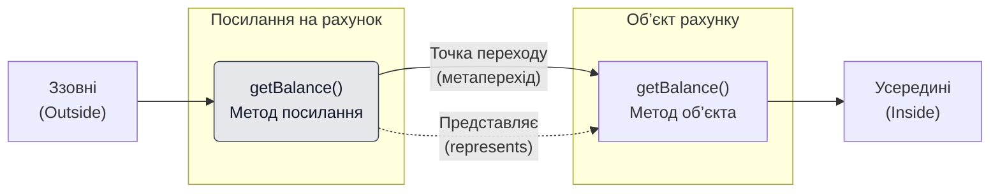
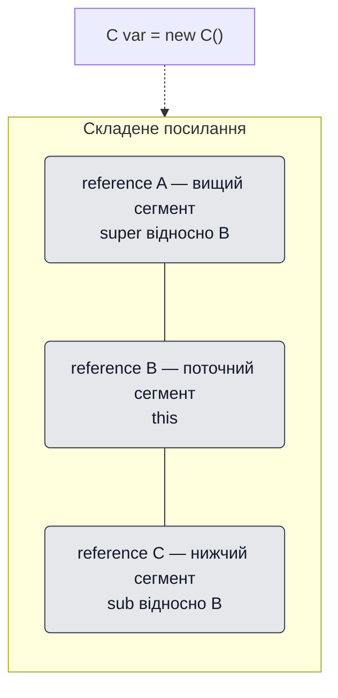
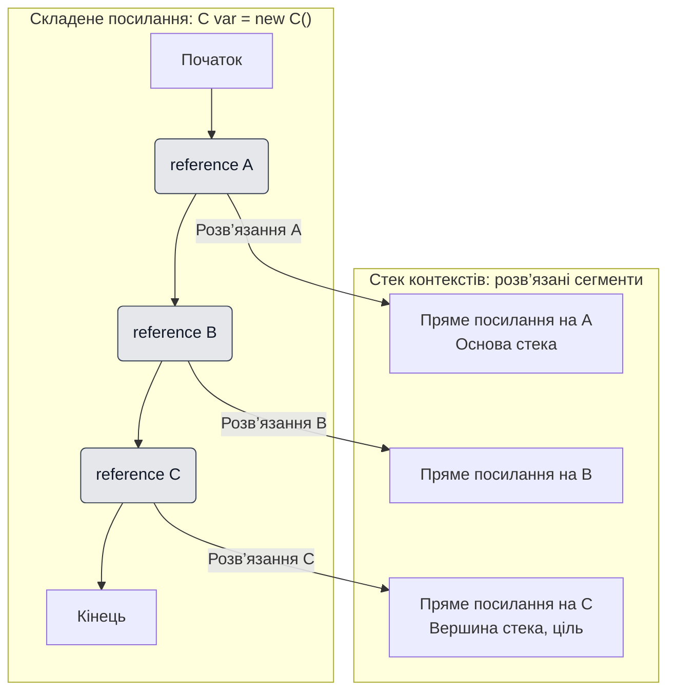
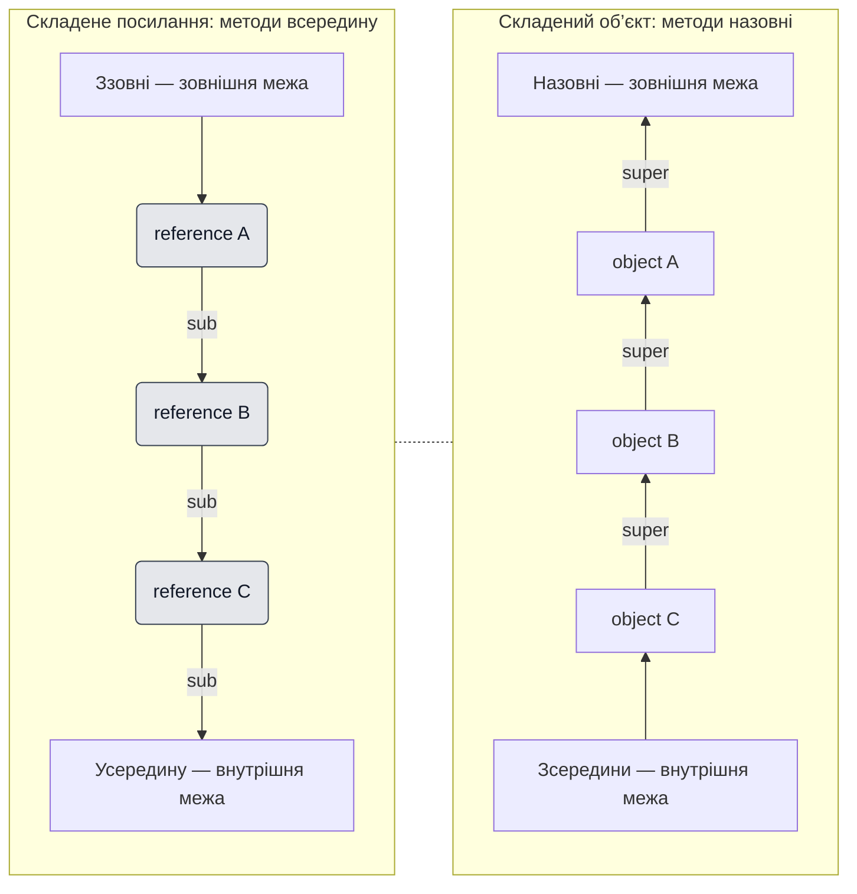

# Концепти та концепт-орієнтоване програмування

> **Внутрішня робоча копія, не публікація; міграція не є науковим прийняттям.** Перенесено з `drafts@774d575:KuzminMachine/01-concepts-and-theory/Concepts_And_Concept-Oriented_Programming_UA.md` 2026-11-10, Issue #84. Міграція не підтверджує тверджень, прогнозів чи самоприсвоєних статусів. Незмінний оригінал і SHA-256 — у реєстрі міграції.


**Автор:** Alexandr Savinov (Александр Савінов).

**Афіліації автора в оригіналі:**

1. Кафедра інформатики III, Боннський університет (Department of Computer Science III, University of Bonn).
2. Інститут математики та інформатики Академії наук Молдови (Institute of Mathematics and Computer Science, Academy of Sciences of Moldova).

**Оригінал:** Savinov, Alexandr. *Concepts and Concept-Oriented Programming*. Journal of Object Technology, vol. 7, no. 3, March–April 2008, pp. 91–106. Видавець, зазначений у статті: ETH Zurich, Chair of Software Engineering. © JOT, 2008.

**Джерела:** [сторінка публікації](https://www.jot.fm/issues/issue_2008_03/article2/), [PDF видавця](https://www.jot.fm/issues/issue_2008_03/article2.pdf).

**Статус документа:** неофіційний повний український переклад наданого PDF; рисунки 1–4 реконструйовано засобами Mermaid після візуальної звірки з оригіналом.

**Версія перекладу:** 1.0.0. **Дата:** 2026-11-10.

> **Примітки до перекладу — не частина оригіналу.** Авторські твердження, оцінки та плани передано відповідно до статті 2008 року; переклад не є їх незалежною перевіркою. Відомості про автора також стосуються часу публікації. Термін *concept* передано як «концепт», *reference* — «посилання», *reference resolution* — «розв’язання посилання», *inclusion* — «включення». Тут описано CoP Савінова, а не модель концептів Машини Кузьміна.
>
> Фрагменти коду, включно з ідентифікаторами, коментарями та нумерацією рядків лістингів, збережено мовою оригіналу. Це авторський ілюстративний синтаксис, а не готовий код Java чи C++. Реконструкції рисунків передають смислові зв’язки, але не відтворюють точну геометрію оригінальних ілюстрацій. Пояснення особливостей реконструкцій позначено окремо.
>
> Переклад виконано з файла `Concepts_and_Concept-Oriented_Programming.pdf`, 16 сторінок. SHA-256 наданого файла: `ff57078e4b298174687940a4e3cf34435df3c07d5701425ab45d2853c6882c7f`.

---

## Анотація

У статті ми вводимо нову конструкцію мови програмування, названу **концептом**, яку визначаємо як пару двох класів: класу посилань і класу об’єктів. Екземпляри класу посилань передаються за значенням і призначені для непрямого представлення об’єктів. Екземпляри класу об’єктів передаються за посиланням. Кожний концепт має батьківський концепт, заданий відношенням включення концептів. Підхід, у якому замість класів використовують концепти, називаємо **концепт-орієнтованим програмуванням** (*concept-oriented programming*, CoP). CoP покликане узагальнити об’єктно-орієнтоване програмування (ООП). Зокрема, концепти узагальнюють звичайні класи, а включення концептів — успадкування класів в ООП. Цей підхід дозволяє програмістові описувати не лише об’єкти, а й посилання, які стають невіддільною та повноправною частиною програми. Під час виконання об’єкти програми існують у віртуальному ієрархічному адресному просторі, а CoP надає засоби ефективного проєктування такого простору для кожної конкретної предметної області.

## 1. Вступ

Припустімо, що змінна зберігає посилання на об’єкт банківського рахунку. Цю змінну потім використовують, щоб отримати баланс рахунку за допомогою його методу, наприклад `account.getBalance()`. В ООП нам нічого не відомо про формат посилання й операції, за допомогою яких здійснюється доступ до представленого об’єкта. Компілятор надає примітивні, тобто вбудовані, посилання, а програміст має ілюзію миттєвого доступу до об’єктів. Однак це лише ілюзія: під час доступу до об’єкта за лаштунками завжди щось відбувається. Іншими словами, будь-який доступ до об’єкта спричиняє потенційно складну послідовність прихованих операцій. Наприклад, якщо банківський рахунок представлено посиланням Java, то за кожного звернення JVM має перетворити його на дескриптор пам’яті, який операційна система, своєю чергою, має перетворити на адресу в пам’яті; далі цю адресу обробляють процесор та інше апаратне забезпечення. Якщо цільовий об’єкт представлено певним різновидом віддаленого посилання, один виклик методу знову породжує послідовність операцій на різних рівнях організаційної структури розподіленої системи. Отже, функції **представлення об’єктів і доступу до них** (*object representation and access*, ORA), навіть якщо вони приховані, можуть становити значну частину загальної складності системи, а тому для їх опису потрібні відповідні засоби.

Вище ми навели два приклади, у яких посилання мають певну внутрішню структуру та пов’язані з ними функції, що неявно активуються під час доступу до об’єктів на рівні середовища виконання. У цих та багатьох інших випадках формат посилань і функції доступу надаються у вигляді стандартної бібліотеки або проміжного програмного забезпечення. Одна з проблем такого традиційного підходу полягає в тому, що нам часто потрібно визначати власні посилання зі своїм форматом і пов’язаними процедурами доступу. Тоді використання універсальних стандартних посилань із вбудованою функціональністю може стати обмеженням. Наприклад, відомо, що створення та видалення великої кількості дуже малих об’єктів є вкрай неефективною процедурою. Робота з віддаленими об’єктами потребує спеціальних посилань, які кодують інформацію про їхнє розташування, та спеціальних процедур доступу на основі певного мережевого протоколу. Використання персистентних об’єктів також ґрунтується на специфічних вимогах до їхніх ідентифікаторів і правил доступу. В усіх цих випадках природно було б розробити спеціальний менеджер пам’яті з окремим контейнером, який ураховує особливості своїх об’єктів.

Звісно, ці та багато інших проблем можна розв’язати за допомогою спеціальних можливостей операційної системи, наприклад локальної купи, проміжного програмного забезпечення на кшталт CORBA або RMI, бібліотек на кшталт Hibernate чи шаблонів програмування, наприклад проксі. Проте проблема залишається: стандартні підходи застосовні лише до стандартних ситуацій, для яких їх розроблено, тоді як ми хотіли б знайти метод для довільного випадку. Іншими словами, нам потрібен метод моделювання посилань із будь-яким форматом і будь-якою поведінкою. Припускаємо, що заздалегідь невідомо, для чого використовуватимуть посилання та які об’єкти вони представлятимуть. Програмістові може знадобитися багато типів посилань для різних цілей, залежно від конкретної програми. Крім того, ORA-функції посилань і функції об’єктів мають наскрізний характер, їх не можна легко відокремити, і моделювати їх слід разом. Отже, ідея полягає в тому, щоб функціональність, яка зазвичай є частиною апаратури, операційної системи, проміжного програмного забезпечення або бібліотеки, можна було описати в самій програмі тим самим кодом, що й будь-які інші функції.

У цій статті ми пропонуємо розв’язання, засноване на розширенні об’єктно-орієнтованої мови програмування шляхом уведення нових мовних конструкцій і механізмів. Тоді програміст не залежить від наявного середовища з його стандартними механізмами ORA. Натомість запропонований підхід дозволяє створювати власні внутрішні контейнери з віртуальною системою адресації, у яких існуватимуть усі об’єкти. Зокрема, функціональність проміжного програмного забезпечення, ОС і процесора можна успішно моделювати засобами мови програмування. Побачивши вираз `account.getBalance()`, ми не можемо нічого припускати про місце розташування банківського рахунку та спосіб доступу до нього. Посилання може містити номер рахунку, тоді як сам об’єкт насправді може перебувати в базі даних на віддаленому комп’ютері. Отримання балансу може означати використання спеціального протоколу, який передбачає також операції зі спеціальною базою даних, розробленою саме для цього банку. Отже, посилання інтерпретуються як віртуальні адреси, які водночас можна прив’язувати до реальних місць розташування.

У запропонованому підході припускаємо, що об’єкти представляються і доступ до них здійснюється опосередковано, за допомогою власних посилань, описаних тією самою мовою, що й решта програми. Таким чином, посилання стають повноправними елементами й відіграють таку саму роль, як об’єкти. Вони можуть мати довільну структуру та довільну поведінку. Ми також припускаємо, що розроблення посилань є не менш важливим, ніж розроблення об’єктів. Оскільки об’єкти представлено опосередковано власними посиланнями, будь-який доступ, наприклад виклик методу чи повідомлення, запускає послідовність проміжних дій: розв’язання посилань, перевірки безпеки, транзакційні операції тощо. Проте, на відміну від наявних технологій, запропонований підхід дозволяє моделювати ці приховані операції в самій програмі як її невіддільну частину. Власні посилання створюють рівень непрямого доступу та відв’язують ідентифікатори об’єктів від наявного програмного й апаратного середовища.

Статтю побудовано так. У розділі 2 ми вводимо нову програмну конструкцію — концепт, яка узагальнює класи та лежить в основі інших описаних у статті механізмів. У розділі 3 описуємо відношення включення між концептами, яке узагальнює звичайне успадкування класів. Розділ 4 присвячено іншим важливим механізмам, зокрема дуальним методам, поліморфізму й керуванню життєвим циклом. Розділ 5 містить стислий огляд пов’язаних робіт, а в розділі 6 наведено підсумкові зауваження.

## 2. Визначення концепту

### Клас об’єктів і клас посилань

Оскільки посилання мають допускати довільну структуру та функції, їх можна моделювати тими самими засобами, що й об’єкти, — класами, які називатимемо **класами посилань**. Отже, у CoP є два різновиди класів: класи об’єктів для опису об’єктів і класи посилань для опису посилань. Наприклад, якщо ми хочемо ідентифікувати банківські рахунки за їхніми номерами, посилання можна визначити так:

```text
reference AccountReference {
  String accNo; // Identifying field
  ... // Other members of the reference class
}
class Account {
  double balance;
  ... // Other members of the object class
}
```

Тут ми використовуємо ключове слово `reference` замість `class`, щоб позначити цей клас як клас посилань. Можна додати до нього й інші члени, наприклад поле дати відкриття та метод отримання балансу. Найважливіше те, що екземпляри класу посилань, які називатимемо **посиланнями**, передаються лише за значенням: вони не мають власних посилань і призначені для представлення об’єктів. Натомість екземпляри класу об’єктів передаються за посиланням, тобто завжди існує певне посилання, яке представляє такий об’єкт. Важливим наслідком уведення класів посилань є те, що об’єкти можуть представлятися власними посиланнями, а не лише примітивними. Тоді програма поділяється на два різновиди сутностей — об’єкти й посилання, — кожний із власною структурою та функціями.

Використовувати класи посилань і класи об’єктів окремо можливо, але не дуже зручно, адже посилання й об’єкти існують не окремо, а як дві сторони тієї самої сутності. Щоб моделювати ці два головні елементи будь-якої програми в їхній нерозривній єдності, ми пропонуємо нову програмну конструкцію — **концепт**, тобто пару, що складається з одного класу посилань і одного класу об’єктів. За такого підходу замість окремого визначення класу рахунків і класу посилань на рахунки слід визначити один концепт, що містить обидва:

```text
concept Account // One name for the pair of classes
  reference { // Reference class of the concept
    String accNo;
    ... // Other members of the reference class
  }
  class { // Object class of the concept
    double balance;
    ... // Other members of the object class
  }
```

Зауважмо, що тепер класи об’єктів і класи посилань уже не можна використовувати окремо. Натомість потрібно застосовувати їх попарно, використовуючи назви концептів. Підхід, у якому замість класів використовують концепти, називаємо **концепт-орієнтованим програмуванням** (CoP). Таким чином, у CoP концепти використовують там, де в ООП застосовують класи: для оголошення типів змінних, полів, параметрів, повернених значень тощо. Наприклад, у такому коді всі типи є концептами:

```text
Account account = getAccount("Alexandr Savinov");
Person person = account.getOwner();
Address addr = person.getAddress();
```

За цим фрагментом насправді неможливо визначити, чи це програма ООП, чи CoP. Якщо використані типи `Account`, `Person` і `Address` визначено як звичайні класи, це програма ООП. Якщо їх визначено як концепти, це програма CoP. Головна відмінність CoP від ООП полягає в тому, що змінні зберігають власні посилання у форматі, визначеному класом посилань відповідного концепту. Наприклад, змінна `account` зберігає номер рахунку, а змінна `person` може зберігати номер паспорта та дату народження, які ідентифікують власника рахунку. Натомість в ООП усі ці змінні зберігали б примітивні посилання, надані компілятором.

Цікава й важлива властивість концептів полягає в тому, що вони можуть надавати два визначення одного методу — у класі посилань і в класі об’єктів. Їх називаємо **дуальними методами**. Наприклад, метод `getBalance` можна визначити і в класі посилань, і в класі об’єктів концепту `Account`. Тоді виникає питання: яке визначення слід використовувати під час кожного виклику? Щоб усунути цю неоднозначність, застосовуємо такий принцип:

> Методи посилань концепту мають пріоритет над його методами об’єктів.

Іншими словами, застосувати метод до посилання означає застосувати метод посилання, а не метод об’єкта (рис. 1). Наприклад, вираз `account.getBalance()` використає визначення, надане в класі посилань концепту `Account`. Отримавши керування, метод посилання може вирішувати, як продовжувати роботу. Зокрема, він може викликати дуальний метод об’єкта. Момент передавання керування від посилання до об’єкта називаємо **метапереходом** (*meta-transition*).

Цей принцип означає, що посилання перехоплюють будь-який доступ до представленого об’єкта. Це цілком природно, адже без примітивного посилання ми просто не можемо виконати метод об’єкта. Саме посилання знає, де перебуває об’єкт і як отримати до нього доступ, зокрема як викликати його методи. Якщо один із дуальних методів відсутній, тобто програміст його не визначив, припускаємо існування певної реалізації за замовчуванням. Теоретично зручніше вважати, що обидва визначення доступні завжди.

**Рисунок 1. Посилання та об’єкт.** *Mermaid-реконструкція Figure 1 оригіналу, с. 95.*



> **Примітка до реконструкції.** Суцільні стрілки передають напрямок доступу, пунктирна — відношення представлення. Штрихову вертикальну межу *Turn point* оригіналу передано підписом переходу між методами. Передавання керування методу об’єкта залежить від поведінки методу посилання; схема не стверджує, що воно відбувається за будь-якого виклику.

### Розв’язання посилань

Об’єктами програми, представленими власними посиланнями, можна маніпулювати так, ніби це звичайні безпосередньо доступні об’єкти ООП. Тобто в CoP ми зберігаємо повну ілюзію прямого миттєвого доступу через власні посилання. Проте виникає питання: як саме можна отримати доступ до опосередковано представленого об’єкта, якщо його примітивне посилання недоступне? Справді, якщо змінна `account` зберігає номер рахунку, метод `getBalance()` не можна виконати безпосередньо, адже примітивне посилання на об’єкт невідоме. Теоретично рахунок може перебувати будь-де у світі, оскільки його посилання є віртуальною адресою. Отже, будь-яке посилання потрібно розв’язати, перш ніж стане можливим реальний доступ до представленого об’єкта.

Завдання розв’язання посилання виконує спеціальний **метод продовження** (*continuation method*) класу посилань. Цей метод автоматично викликається для відповідного посилання, коли має відбутися доступ до представленого об’єкта. Після розв’язання посилання послідовність доступу продовжується. Зокрема, метод, викликаний програмістом, можна застосувати до знайденого об’єкта. Замість повернення розв’язаного посилання метод продовження позначає точку, у якій посилання вже розв’язане, і тоді компілятор знає, де можна продовжити доступ. Це дозволяє виконувати потрібні дії до та після доступу. Припускаємо, що точка продовження міститься там, де викликається наступний, вкладений метод продовження.

Лістинг 1 показує приклад методу продовження, який перетворює номер рахунку, що становить це посилання, на відповідне примітивне посилання. Він завантажує значення примітивного посилання з певного сховища (рядок 5). Потім продовжує виконання, застосовуючи метод продовження до отриманого посилання (рядок 6). Нарешті, він зберігає стан об’єкта назад у сховищі (рядок 7). Якщо ми застосуємо певний метод до об’єкта рахунку, насправді його буде викликано в рядку 6, оскільки саме тут знайдено реальне місце розташування об’єкта. Таким чином, кожний доступ неявно огортається методом продовження посилання.

**Лістинг 1. Метод продовження.**

```text
01 concept Account
02   reference {
03     String accNo;
04     void continue() {
05       Object o = load(this.accNo);
06       o.continue(); // Proceed
07       save(this.accNo, o);
08     }
09     ...
10   }
11   class {
12     ...
13   }
```

## 3. Включення концептів

### Складені посилання

Концепти не існують ізольовано: кожний концепт має батьківський концепт, указаний у його визначенні за допомогою відношення включення, яке формально позначаємо знаком `<`. Таке позначення використовують у теорії впорядкованих множин, зокрема у формальному аналізі концептів, а знак «менше» означає кількість елементів в екстенсіоналі. Якщо концепт `B` включено в `A`, це записують як `B < A` — «B менше за A», де `A` називають батьківським концептом, або надконцептом, а `B` — дочірнім концептом, або підконцептом. Корінь ієрархії включення концептів позначаємо `Root`:

$$
\forall C,\quad C < \mathrm{Root}.
$$

У коді включення концепту задаватиметься ключовим словом `in`, за яким іде ім’я батьківського концепту, наприклад:

```text
concept A in Root ... // By default
concept B in A ... // B < A
concept C in B ... // C < B
```

Припустімо, що концепт в ієрархії включення використовується як тип певної змінної. Тоді за замовчуванням ця змінна міститиме послідовність посилань усіх концептів, починаючи від кореня й закінчуючи цим концептом. Таку послідовність називаємо **складеним посиланням** (*complex reference*), а кожну її частину — **сегментом посилання**. Об’єкт, представлений одним сегментом посилання, називаємо **сегментом об’єкта**. Наприклад, якщо концепт `C` включено в `B`, а той — у `A`, посилання на `C` складатиметься з трьох сегментів посилання, формат яких визначено класами посилань концептів `A`, `B` і `C` (рис. 2).

Складені посилання є аналогами структурованих або багаторівневих адрес в ієрархічному просторі, наприклад поштових адрес. Кожний наступний сегмент посилання є локальним ідентифікатором відносно попереднього сегмента. Кореневий концепт представляє найзовнішніший простір — глобальний простір, у якому існують усі об’єкти, — тоді як кожний новий підконцепт описує внутрішній підпростір свого батьківського концепту. Кожний об’єкт у цій ієрархії має базовий об’єкт, який також називаємо його **контекстом**. У коді поточний сегмент посилання позначаємо ключовим словом `this`. Попередній, вищий сегмент позначаємо словом `super`, а наступний, нижчий — словом `sub`.

**Рисунок 2. Структура складеного посилання.** *Mermaid-реконструкція Figure 2 оригіналу, с. 97.*



> **Примітка до реконструкції.** Як і в оригіналі, `this` відповідає сегменту B. Значення `super` і `sub` тут показано відносно нього, а не як незмінні властивості A і C. Лінії між сегментами позначають структуру складеного посилання, а не виклики методів; змінна містить усе складене посилання.

### Послідовність розв’язання

Якщо об’єкт представлено одним сегментом посилання, доступ до нього здійснюється через метод продовження цього посилання. Якщо об’єкт представлено складеним посиланням із багатьох сегментів, кожний із них можна окремо розв’язати його методом продовження. Підхід, за якого окремі сегменти посилання розв’язуються щоразу, коли потрібен доступ до представленого сегмента об’єкта, називаємо **розв’язанням на вимогу** (*resolution on demand*). Головна проблема цього методу — багаторазове повторне розв’язання тих самих сегментів посилань, адже до частин об’єкта зазвичай звертаються багато разів. Зокрема, кожне звернення до батьківського об’єкта з дочірнього спричинятиме розв’язання того самого сегмента батьківського посилання. Якщо відбудеться 100 викликів базових методів, сегмент базового посилання буде розв’язано 100 разів.

Щоб подолати цю проблему, ми пропонуємо механізм **попереднього розв’язання** (*resolution in advance*). Цей підхід передбачає розв’язання сегментів посилання **до** фактичного доступу. Послідовність розв’язання починається з першого, вищого сегмента, потім переходить до наступних і закінчується останнім, нижчим сегментом. Результат кожного розв’язання зберігається в спеціальній структурі даних — **стеку контекстів** (*context stack*, рис. 3). Стек зростає в міру розв’язання кожного наступного сегмента. Спочатку він порожній. Після розв’язання першого сегмента `A` він містить пряме, примітивне посилання на перший контекст — перший сегмент об’єкта. Результат розв’язання другого сегмента `B` кладеться на вершину стека контекстів, який тепер містить два прямі посилання, і так далі до останнього сегмента. Зрештою, кількість елементів стека дорівнює кількості сегментів складеного посилання, що розв’язується: у цьому прикладі їх три. Вершина стека контекстів є прямим посиланням на цільовий об’єкт концепту `C`.

Найважливіша властивість цього механізму полягає в тому, що батьківські об’єкти безпосередньо доступні зі своїх дочірніх об’єктів і не потребують розв’язання. Тому кожна поява ключового слова `super` у коді означає прямий доступ із використанням примітивного посилання зі стека контекстів. Оскільки функціональність концепту зазвичай ґрунтується на використанні батьківських концептів, цей механізм істотно підвищує продуктивність: він гарантує, що за кожного використання складеного посилання будь-який його сегмент розв’язується лише один раз.

**Рисунок 3. Розв’язання посилання та стек контекстів.** *Mermaid-реконструкція Figure 3 оригіналу, с. 98.*



> **Примітка до реконструкції.** Збережено послідовність A → B → C та відповідність кожного сегмента отриманому прямому посиланню. Три комірки стека — результати одного проходу, а не три незалежні стеки. В оригіналі комірки намальовано горизонтально; тут їх розташування визначає Mermaid, а основу й вершину позначено явно. Стрілки до комірок означають збереження результатів розв’язання, не додаткові виклики методів об’єктів.

## 4. Інші механізми

### Дуальні методи

Тепер припустімо, що посилання має багато сегментів, кожний із яких реалізує один метод. Виникає питання: яке визначення буде використано, якщо викликати цей метод для складеного посилання? Наприклад, якщо концепти `A`, `B` і `C` реалізують метод `doSomething`, а ми викликаємо його для посилання на об’єкт концепту `C`, який саме метод потрібно виконати? Раніше ми припускали, що методи посилань перехоплюють методи об’єктів, але в цьому випадку є багато методів посилань, визначених у різних сегментах. Щоб усунути цю неоднозначність, застосовуємо такий принцип (рис. 4, ліворуч):

> Батьківські методи посилань мають пріоритет над дочірніми методами посилань, тобто перевизначають їх.

Іншими словами, батьківські методи посилань вищих сегментів перехоплюють усі звернення до дочірніх методів посилань нижчих сегментів. У нашому прикладі спочатку буде викликано `doSomething` посилання `A`, і лише після цього можна викликати `doSomething` посилань `B` і `C`. Дочірні методи посилань викликають за допомогою ключового слова `sub`.

Важливе застосування цього принципу — механізм перевизначення методів. Проте напрямок такого перевизначення протилежний звичайному напрямку в ООП: базові методи посилань перевизначають дочірні методи посилань. Якщо ми визначаємо метод класу посилань, його можна перевизначити в базовому класі посилань. Це правило цілком природне й безпосередньо випливає з необхідності перехоплювати всі вхідні запити зовнішнім простором, перш ніж вони потраплять до будь-якого внутрішнього простору. Таким чином, батьківські методи посилань захищають дочірні методи посилань від прямого використання ззовні.

Для методів об’єктів цей принцип має звичайний напрямок, як в ООП (рис. 4, праворуч):

> Дочірні методи об’єктів мають пріоритет над батьківськими методами об’єктів, тобто перевизначають їх.

Це означає, що коли ми викликаємо певний метод об’єкта, реалізований усіма класами об’єктів в ієрархії, компілятор використає визначення, надане цим класом об’єктів: ми кажемо, що цей метод перевизначає батьківські методи. Після цього метод може продовжити роботу, викликаючи свої батьківські методи за допомогою ключового слова `super`. Таким чином, дочірні методи об’єктів захищають батьківські методи об’єктів від прямого використання зсередини.

**Рисунок 4. Дуальні методи.** *Mermaid-реконструкція Figure 4 оригіналу, с. 99.*



> **Примітка до реконструкції.** Лівий ланцюжок передає доступ ззовні всередину: A → B → C через `sub`; правий — доступ зсередини назовні: C → B → A через `super`. Однойменні сегменти A, B і C утворюють пари «посилання — об’єкт»; пунктир між групами узагальнює три горизонтальні лінії відповідності оригіналу. Це два правила пріоритету й продовження доступу, а не вимога виконувати обидва ланцюжки повністю за кожного виклику.

### Успадкування та поліморфізм

У CoP пари «посилання — об’єкт» під час виконання існують в ієрархії, яку моделює відношення включення концептів. У цій ієрархії об’єкт має один батьківський об’єкт — контекст — і багато дочірніх об’єктів — розширень. Контекст є спільним для багатьох розширень; доступ до нього здійснюється через ключове слово `super`. До розширень можна звертатися через їхні локальні посилання, а до поточного розширення — через ключове слово `sub`. На відміну від ООП, де всі сегменти об’єкта існують разом, поруч один з одним, а базовий об’єкт не є спільним, у CoP сегменти об’єктів існують окремо та мають власні посилання. Наприклад, якщо `Button` успадковує `Panel`, то в ООП кожний об’єкт кнопки складається з двох частин, які створюються й існують разом та мають одне спільне примітивне посилання. У CoP ці дві частини будуть окремими об’єктами з власними посиланнями. Крім того, один сегмент панелі — контекст — може мати багато сегментів кнопок, тобто одна панель включає багато кнопок. Таким чином, CoP змінює семантику успадкування. Дочірні об’єкти стають більш спеціалізованими завдяки існуванню в контексті батьківського об’єкта поряд з іншими дочірніми об’єктами, а не через ототожнення себе з контекстом. Іншими словами, в ООП кнопка **«є панеллю»** (*is a*), тоді як у CoP кнопка **«є в панелі»** (*is in*). Цікаво, що цей підхід узагальнює підхід ООП, оскільки зводиться до нього, коли дочірні концепти не визначають власних класів посилань.

В ООП поліморфізм ґрунтується на перевизначенні базових методів методами дочірніх класів. Тоді виконуваний метод залежить від фактичного класу об’єкта. Вибір, або диспетчеризація, здійснюється спеціальним вбудованим механізмом, наприклад таблицею вказівників на функції (`vtbl`). У будь-якому разі буде виконано лише один метод. У CoP це не так: виклик методу фактично є послідовністю кроків, які виконуються в різних концептах. Послідовність починається з базового посилання, а потім переходить до дочірніх посилань. Кожний проміжний метод робить власний внесок в оброблення поточного запиту, після чого делегує його далі, дочірнім концептам. Залежно від фактичного типу об’єкта ми отримуватимемо різні ланцюжки оброблення.

Наприклад, припустімо, що концепт `SavingsAccount` включено в концепт `Account` (лістинг 2), тож один рахунок може мати багато ощадних рахунків, а також інші типи підрахунків. Обидва концепти реалізують метод `getBalance`. Метод `Account` перевіряє, чи справді існує дочірній об’єкт (рядок 5), а потім повертає або власний баланс (рядок 5), або баланс дочірнього рахунку (рядок 6). У коді ми можемо оголосити змінну базового типу `Account`, і тоді баланс, який поверне `getBalance`, залежатиме від фактичного типу об’єкта. Якщо об’єкт належить до концепту `Account` (рядок 24), отримаємо одну поведінку. Якщо він належить до концепту `SavingsAccount` (рядок 26), отримаємо іншу.

Зауважмо, що `SavingsAccount` припускає можливість існування внутрішніх об’єктів (рядок 15). Тобто його реалізовано в концепт-орієнтований спосіб, де методи є проміжними елементами оброблення: вони звідкись отримують запит, а потім спрямовують його кудись далі для подальшого оброблення. Поліморфну поведінку визначає програміст, який пише проміжні методи, кожний із яких робить внесок у загальне оброблення. Пізніше ми можемо включити новий дочірній концепт у `SavingsAccount`, наприклад для опису певного конкретного типу ощадних рахунків; він увійде до загального ланцюжка доступу, отримуючи запити від свого батьківського концепту.

**Лістинг 2. Динамічний поліморфізм.**

```text
01 concept Account
02   reference {
03     String accNo;
04     double getBalance() {
05       if(sub == null) return balance;
06       else return sub.getBalance();
07     }
08   }
09   class { double balance = 10.0; }
10
11 concept SavingsAccount
12   reference {
13     String subAccNo;
14     double getBalance() {
15       if(sub == null) return balance;
16       else return sub.getBalance();
17     }
18   }
19   class { double balance = 20.0; }
20
21 Account account;
22 double balance;
23 account = findAccount(); // Real type is Account
24 balance = account.getBalance(); // = 10.0
25 account = findSavingsAccount();// Type SavingsAccount
26 balance = account.getBalance();// = 20.0
```

> **Примітка до перекладу.** У рядку 11 оригінального лістингу немає `in Account`, хоча супровідний текст прямо задає включення `SavingsAccount` у `Account`. Код збережено без мовчазного виправлення.

З цього прикладу бачимо, що той самий метод, застосований до змінної одного типу, може давати різну поведінку залежно від фактичного типу посилання, яке в ній зберігається. У CoP такий виклик методу є послідовністю дій, пов’язаних із сегментами посилання. Кожне проміжне посилання й об’єкт можуть робити внесок в оброблення запиту доступу. В ООП поліморфізм набагато простіший і зводиться до вибору методу, визначеного у фактичному класі об’єкта, який повністю перевизначає свої базові методи. Отже, метод, який за замовчуванням виконується в ООП, є лише останнім кроком послідовності дій, що виконується в CoP. Цікаво, що CoP не гарантує досягнення останнього методу, який відповідає фактичному типу об’єкта, тоді як в ООП це відбувається завжди. Базові методи посилань перевизначають дочірні методи й можуть завершити оброблення будь-коли, без продовження. Наприклад, базовий метод може породити виняток через обмеження безпеки або нестачу ресурсів. Такий підхід гнучкіший, оскільки оброблення запиту розподілене між усіма складниками на різних рівнях, а не зосереджене в одному класі.

### Керування життєвим циклом

В ООП створення об’єкта передбачає автоматичне виділення необхідних ресурсів, представлених примітивним посиланням, і подальшу ініціалізацію нового об’єкта, реалізовану конструктором класу. Перша частина — створення посилання — є прихованою процедурою, яку надає компілятор із використанням наявного середовища виконання. Другу частину — ініціалізацію — програміст контролює через конструктор класу. Видалення об’єкта також охоплює дві процедури: очищення об’єкта в деструкторі класу та звільнення ресурсів, яке програміст не контролює.

У CoP обидва завдання реалізовано в концептах: концепт відповідає і за виділення та звільнення посилання, і за ініціалізацію та деініціалізацію об’єкта. Отже, програміст отримує повний контроль над цими спеціальними процедурами через дуальні методи. Для створення екземпляра концепту використовується спеціальний метод створення, а видалення реалізується спеціальним методом видалення. Як і інші методи, створення та видалення є дуальними: їх можна реалізувати і в класі посилань, і в класі об’єктів. Метод створення чи видалення об’єкта є аналогом звичайного конструктора чи деструктора в ООП. Його роль — ініціалізувати новий об’єкт одразу після створення посилання на нього та очистити об’єкт безпосередньо перед видаленням його посилання. Методи створення й видалення посилань відповідають за ініціалізацію та очищення посилання. Їхня роль полягає у виділенні або звільненні пов’язаних ресурсів, зокрема пам’яті.

Методи створення й видалення мають таку саму послідовність доступу, як інші методи. Наприклад, якщо потрібно створити новий ощадний рахунок, ми оголошуємо змінну, а потім викликаємо метод створення:

```text
SavingsAccount account.create();
```

Оскільки цей об’єкт представлено двома сегментами посилання — `Account` і `SavingsAccount`, — створення починається з першого. Приклад його реалізації наведено в лістингу 3. Він генерує унікальний ідентифікатор нового базового рахунку (рядок 6), після чого виділяє системні ресурси для цього об’єкта (рядок 7). Тобто саме тут ми фактично створюємо новий об’єкт із його примітивним посиланням. Рядок 7 також є точкою виклику методу створення об’єкта — конструктора (рядок 15). Після створення об’єкта рахунку ми можемо дозволити можливим дочірнім об’єктам зробити внесок у цей процес (рядок 8). Якщо цей об’єкт є `SavingsAccount`, тут буде створено його розширення. Нарешті, коли дочірні об’єкти створено, ми зберігаємо в асоціативному контейнері відповідність між новим номером рахунку та примітивним посиланням (рядок 9). Надалі метод продовження використовує цю інформацію для розв’язання посилань під час доступу до рахунку. Метод створення `SavingsAccount` можна реалізувати так само. Єдина відмінність полягає в тому, що він виконуватиметься в контексті щойно створеного базового рахунку. Зокрема, відображення номерів підрахунків у примітивні посилання зберігатиметься в базовому об’єкті (рядок 14), а не у статичній змінній (рядок 1).

**Лістинг 3. Створення об’єкта.**

```text
01 static Map map = new Map();
02 concept Account
03   reference {
04     String accNo;
05     void create() {
06       this.accNo = getUniqueNo();
07       Object o.create();
08       if(sub != null) sub.create();
09       map.add(accNo, o);
10     }
11   }
12   class {
13     double balance;
14     Map map = new Map();
15     void create() { balance = 0; }
16   }
```

Важлива особливість цієї послідовності створення полягає в тому, що базовий об’єкт не обов’язково потрібно щоразу створювати. Натомість можна вибрати вже наявний базовий об’єкт, спільний для багатьох дочірніх об’єктів. Наприклад, новий ощадний рахунок можна створити для особи, яка вже має базовий рахунок. Інший приклад — батьківський концепт, який реалізує контейнер: тоді створення об’єкта означає вибір уже наявного контейнера. Новий контейнер буде створено лише тоді, коли всі наявні контейнери заповнено. Інакше процедура створення спробує знайти для нового об’єкта наявний контейнер. Навіть коли новий об’єкт справді потрібно створити, ми не зобов’язані викликати системні процедури. Цей підхід дозволяє тримати в базовому концепті пул примітивних посилань та інших системних ресурсів замість виділення й звільнення їх для кожного об’єкта. Таким чином, програміст повністю контролює процедуру створення. Видалення реалізується так само, за винятком того, що порядок операцій зазвичай обертається: ми переходимо до дочірніх об’єктів, а потім, повертаючись, послідовно видаляємо батьківські.

## 5. Пов’язані роботи

Функціональність ORA існує на всіх рівнях організації системи. Наприклад, доступ до пам’яті, який виконує процесор, є не однією дією, а багатьма внутрішніми мікроциклами. Операційна система додає новий рівень непрямого доступу, надаючи власні дескриптори пам’яті для ідентифікації та доступу до об’єктів у глобальній або локальній купі. Проміжне програмне забезпечення, наприклад CORBA чи RMI [Mon06], пропонує додаткові механізми ORA, спрямовані на конкретні завдання, як-от віддалений доступ. Середовище виконання мови може реалізувати власний контейнер об’єктів зі специфічною логікою непрямого доступу, як у Java чи C#. Крім того, таке середовище може надавати спеціальні засоби опосередкування доступу, зокрема рефлексію або динамічні проксі, які забезпечують прозору взаємодію викликів методів і динамічну реалізацію довільних інтерфейсів [Blo00]. Загальним підходом до зміни поведінки мовних конструкцій, зокрема функцій ORA, є протокол метаоб’єктів [Kic91, Kic93].

Описаний підхід має на меті надати мовні засоби опису непрямих ORA, тому важливо порівняти його з наявними мовними підходами до цієї проблеми. Найпростіший спосіб організації непрямого доступу засобами мови — дотримання певної дисципліни або шаблону. Один із найпоширеніших шаблонів — проксі: клас, який імітує цільовий клас. Інший шаблон, придатний для опосередкування доступу, — ланцюжок відповідальності. Як і будь-які шаблони, ці методи досить специфічні та потребують значного обсягу ручного супроводу, оскільки компілятор не знає їхньої семантики й не може допомогти з підтримкою. Цікавий підхід до моделювання посилань — розумні вказівники [Str91]. Проте це не спеціалізований метод, а радше пристосування універсального механізму шаблонів до завдання моделювання посилань.

Набагато фундаментальніший підхід пропонує **аспектно-орієнтоване програмування** (АОП) [Kic97]. У ньому будь-який доступ до об’єкта може запускати досить складні проміжні дії, які аспекти неявно вставляють у потрібні точки коду. Проте цей підхід не надає засобів моделювання власних посилань і непрямого доступу. Крім того, напрямок залежності між модулями протилежний тому, що використовується в CoP; докладніше див. [Sav05, Sav07]. Інший споріднений підхід ґрунтується на використанні міксинів — абстрактних підкласів [Bra90, Sma98]. Зокрема, він подібний до CoP та АОП здатністю огортати певний цільовий код іншим методом за допомогою ключового слова `around`.

Механізм дуальних методів у CoP подібний до методів `super/inner` класів [Gol04], реалізованих у мові програмування Beta. Зокрема, методи `inner` спроєктовано так, що вони реалізують ту саму послідовність доступу, що й методи посилань. Однак механізм `super/inner` реалізовано як доповнення до звичайних класів. Тому його можна розглядати як розширення ООП, покликане надати засоби захисту об’єктів ззовні. У CoP таку поведінку реалізовано за допомогою цілком іншого підходу — концептів.

Запропонований підхід пов’язаний також із так званими контекстно-орієнтованими методами, які мають на меті внести залежність від контексту в програмування [Con05]. Ці методи вводять мовні конструкції та механізми, які дозволяють програмістові поміщати об’єкти в контекст, що змінює їхню поведінку під час виконання. Наприклад, у мові ContextL це робиться ключовим словом `in-layer`, тоді як у CoP ми використовуємо `in`, що узагальнює успадкування, та `super` для доступу до контексту. Контекстна орієнтація також пов’язана з технологією, відомою як ін’єкція залежностей.

Існують й інші механізми моделювання непрямого доступу: анотації в атрибутно-орієнтованому програмуванні, мовно-орієнтоване програмування та предметно-орієнтовані мови, багатовимірне розділення відповідальностей, суб’єктно-орієнтоване програмування. Проте деякі підходи до програмування з такою самою назвою насправді ґрунтуються на зовсім інших поняттях і не пов’язані з нашою роботою [Voi92, Mcc99].

Раніше ми вже описували підхід до програмування з використанням концептів, який називаємо **CoP-I** [Sav05]. Підхід, описаний у цій статті, а також у [Sav07], називаємо **CoP-II**. Хоча вони використовують ту саму програмну конструкцію, відмінність істотна. А саме, ми змінили роль складників концепту: у CoP-II, тобто в цій статті, припускаємо, що посилання представляють об’єкти цього концепту, тоді як у CoP-I припускали, що посилання представляють об’єкти дочірніх концептів.

## 6. Висновки

У статті ми описали новий підхід до програмування, заснований на використанні концептів замість класів і включення замість успадкування. Цей підхід зворотно сумісний з ООП. Одним із його головних здобутків є повне визнання посилань як повноправних сутностей програми нарівні з об’єктами. Функції, інкапсульовані в об’єктах і посиланнях, ортогональні, і це можна розглядати як продовження дуже загального та глибокого принципу **розділення відповідальностей** (*Separation of Concerns*), сформульованого Дейкстрою [Dij76]. Іншими словами, будь-яка програма складається з двох типів функціональності, які потрібно принципово розділяти.

Уводячи поняття концепту в мови програмування, ми можемо ефективно моделювати посилання та проміжні функції, які неявно виконуються під час доступу до об’єкта. Однак це також змінює спосіб розроблення системи. Дія в CoP — не окрема операція, а послідовність кроків оброблення, які виконують проміжні об’єкти на шляху до цілі. У багатьох випадках ця проміжна прихована функціональність становить більшу частину складності системи. Це веде до зміни парадигми, оскільки ми більше не можемо дотримуватися принципу миттєвої дії. Натомість у CoP будь-яка дія є непрямою і потребує певного середовища для поширення. Моделювання таких базових середовищ стає однією з головних цілей проєктування — замість моделювання класів об’єктів, як в ООП. Методи в CoP не є кінцевими точками оброблення, а відіграють проміжну роль: вони звідкись отримують керування та передають його кудись далі. Їх автоматично запускають щоразу, коли запит перетинає межу. Отже, найцікавіші події відбуваються за лаштунками, без явної дії програміста, а CoP надає належні засоби моделювання такого погляду на систему.

У цьому новому підході об’єкти розглядаються як такі, що існують у віртуальному просторі з власною структурованою системою адресації. Насправді цей простір може відігравати важливішу роль, ніж функціональність внутрішніх об’єктів. Він подібний до межі живої клітини або державного кордону, що реалізує спільні функції, важливі для будь-якого внутрішнього елемента. Доступ до об’єкта можливий лише через перетин меж просторів, у яких він існує, тому простір завжди втручається в оброблення будь-якого запиту. Отже, проєктування належного віртуального простору для системи є надзвичайно важливим, і CoP надає ефективні засоби для цього на рівні мови програмування.

CoP розробляється разом із новим підходом до моделювання даних — **концепт-орієнтованою моделлю** [Sav06, Sav07a]. Зокрема, CoP надає механізм фізичного представлення даних і доступу до них. Надалі ми плануємо тісніше інтегрувати ці два підходи. Інша мета — розробити експериментальну мову програмування, засновану на запропонованих концепт-орієнтованих принципах.

## Список літератури

> Бібліографічні назви, авторські написання та позначення джерел збережено мовою оригіналу. Статус «accepted» у [Sav07a] наведено станом на час публікації статті.

- **[Blo00]** Blosser, J. *Explore the Dynamic Proxy API*. Java World, November 2000. http://www.javaworld.com/javaworld/jw-11-2000/jw-1110-proxy.html
- **[Bra90]** Bracha, G., Cook, W. *Mixin-based inheritance*. Proc. OOPSLA/ECOOP’90, ACM SIGPLAN Notices, 25(10), 303–311, 1990.
- **[Con05]** Constanza, P., Hirschfeld, R. *Language constructs for context-oriented programming*. In Dynamic Languages Symposium, co-located with OOPSLA’05, 2005.
- **[Dij76]** Dijkstra, E.W. *A Discipline of Programming*. Prentice Hall, 1976.
- **[Gol04]** Goldberg, D.S., Findler, R.B., Flatt, M. *Super and inner: together at last!* Proc. OOPSLA’04, 116–129, 2004.
- **[Kic91]** Kiczales, G., Rivieres, J., Bobrow, D.G. *The Art of the Metaobject Protocol*. MIT Press, 1991.
- **[Kic93]** Kiczales, G., Ashley, J.M., Rodriguez, L., Vahdat, A., Bobrow, D.G. *Metaobject protocols: Why we want them and what else they can do*. In: Paepcke, A. (ed.), *Object-Oriented Programming: The CLOS Perspective*, 101–118, MIT Press, 1993.
- **[Kic97]** Kiczales, G., Lamping, J., Mendhekar, A., Maeda, C., Lopes, C., Loingtier, J.-M., Irwin, J. *Aspect-Oriented Programming*. Proc. ECOOP’97, LNCS 1241, 220–242, 1997.
- **[Mcc99]** McConnell, B. *Concept-oriented programming*. Dr. Dobb’s Journal, 24(6), 90–96, 1999.
- **[Mon06]** Monson-Haefel, R. *Enterprise JavaBeans*. O’Reilly, 2006.
- **[Sav05]** Savinov, A. *Concept as a Generalization of Class and Principles of the Concept-Oriented Programming*. Computer Science Journal of Moldova, 13(3), 292–335, 2005.
- **[Sav06]** Savinov, A. *Grouping and Aggregation in the Concept-Oriented Data Model*. Proc. SAC’06, 482–486, 2006.
- **[Sav07]** Savinov, A. *Concepts and their Use for Modelling Objects and References in Programming Languages*. Technical Report, Institute of Mathematics and Computer Science, Moldavian Academy of Sciences, 43 pp., 2007.
- **[Sav07a]** Savinov, A. *Concept-Oriented Model*. Encyclopedia of Database Technologies and Applications, editors: Rivero, L.C., Doorn, J.H., Ferraggine, V.E. (accepted).
- **[Sma98]** Smaragdakis, Y., Batory, D. *Implementing layered designs with mixin-layers*. Proc. ECOOP’98, 550–570, 1998.
- **[Sop]** *Subject-Oriented Programming*. http://www.research.ibm.com/sop/
- **[Str91]** Stroustrup, B. *The C++ Programming Language*, 2nd edition. Addison Wesley, 1991.
- **[Voi92]** Voinov, A.V. *Netlog — A Concept Oriented Logic Programming Language*. Proc. LPAR’92, 357–368, 1992.

## Про автора

Александр Савінов (Ph.D.) на час публікації є дослідником кафедри інформатики III Боннського університету, Німеччина. Він здобув ступінь MS у Московському фізико-технічному інституті 1989 року та Ph.D. у Технічному університеті Молдови 1993 року. Його основні наукові інтереси охоплюють методології програмування, моделювання даних і керування знаннями із застосуванням до розподілених систем, однорангових технологій, ґрід-обчислень, вебсервісів, семантичної павутини та інших галузей. Він є автором нової загальної теорії систем, названої концепт-орієнтованою парадигмою; див. http://conceptoriented.com. Попередні наукові інтереси охоплювали експертні системи, нечітку логіку та інтелектуальний аналіз даних. Див. також: http://conceptoriented.com/savinov.
