# Науково-інженерне досьє Машини Кузьміна: концепція, математична теорія, архітектура виконання, раціональність та відкриті запитання до автора

> **Внутрішня робоча копія, не публікація; міграція не є науковим прийняттям.** Перенесено з `drafts@774d575:KuzminMachine/01-concepts-and-theory/Kuzmin-Machine-Scientific-and-Engineering-Dossier-UA.md` 2026-11-10, Issue #84. Міграція не підтверджує тверджень, прогнозів чи самоприсвоєних статусів. Незмінний оригінал і SHA-256 — у реєстрі міграції.


> **Тип документа:** Повне науково-технічне досьє (Technical & Scientific Monograph Dossier)<br/>
> **Автор аналізу та реконструкції:** Микола Федчик (Mykola Fedchyk)<br/>
> **Об'єкт дослідження:** Обчислювальна модель, мова програмування та багатопроцесорна архітектура «Машина Кузьміна» (МК), розроблені Михайлом Ювеналійовичем Кузьміним.<br/>
> **Корпус першоджерел:** авторські публікації М. Ю. Кузьміна на порталі DOU (2020–2023 рр.), дискусійні уточнення (2026 р.) та технічна специфікація архітектури, системи команд і прикладів реалізації Машини Кузьміна.

---

## Анотація

У цьому досьє подано вичерпний формально-теоретичний та системно-інженерний синтез **Машини Кузьміна (МК)** — альтернативної парадигми паралельних обчислень, у якій базовою одиницею виступає не послідовна інструкція процесора фон Неймана, а **концепт** (іменована типізована комірка зі станом), **подія** (логічний предикат нульового порядку над станами) та **підписка** (керована реакція, що породжує потоки адресацій).

У роботі формалізовано повний стек технології:
1. **Концептуальний базис і гіпотези:** заміщення імперативного потоку керування (Control Flow) подієво-реактивним графом («А-ритмом» та «А-схемою»).
2. **Математичну теорію:** структурну операційну семантику (SOS), алгебру фазового оператора «Велика точка» (`•`), інваріант пригнічення локальної рекурсії, конструктивне доведення повноти за Тюрінгом через ланцюг концептів $`\text{¤}-1, \text{¤}, \text{¤}+1`$ та межі паралельного прискорення за теоремою Брента й умовами Бернштейна.
3. **Інженерну архітектуру:** бінарне кодування типів даних (`Token`, `Byte`, `Int32`, `Float` тощо), систему інструкцій віртуальної машини (`Go`, `Do`, `::`, `?`, `~`), двостекову організацію ліній підписок ($`SR`$ та $`SP`$), протокол рандеву-синхронізації паралельних виразів (`Go SR2 →` / `Go SR1 ←`) і механізм детермінованого відкату на одне ядро (Graceful Serial Fallback).
4. **Оцінку раціональності, варіанти й домени застосування:** детальний розбір еталонних програм автора (алгоритм Евкліда, електролічильник, тахометр на герконі, контролер допусків, векторні операції, формальний нейрон) та матрицю придатності для промислової автоматики, IoT, FPGA/ASIC і вбудованих систем.
5. **Апаратну та експериментальну верифікацію:** лабораторну реалізацію транзакційного шлюзу на Xilinx Zynq-7000 (`xc7z020clg400-1`) з openXC7; одноктактова латентність PL становить $10\text{ нс}$ за $100\text{ МГц}$ як властивість RTL/тактування, тоді як фізичний джитер виходу окремо не вимірювався. HIL-бенчмарк окремо виміряв розподіли латентності AXI4-Lite та Linux userspace для $10\,000$ ітерацій кожен (§2.2).
6. **Перелік відкритих запитань до автора:** 20 структурованих теоретичних та інженерних запитань, відповіді на які необхідні для завершення специфікації стандарту та незалежної верифікації прототипу.

---

## 1. Концепція та філософія обчислень Машини Кузьміна

### 1.1. Критика архітектури фон Неймана та генезис ідеї

Вихідною точкою концепції М. Ю. Кузьміна є фундаментальне обмеження класичної послідовної архітектури фон Неймана при переході до багатопроцесорних обчислень. У класичному процесорі конвеєризація та спекулятивне виконання базуються на тому, що інструкція перевірки умови (порівняння) не змінює стану пам'яті, тому її можна виконувати паралельно з іншими читаннями.

Автор узагальнює цей принцип до архітектурної аксіоми:
* Якщо окрема інструкція порівняння не змінює стану системи, то й **будь-який складний вираз без побічних ефектів**, результат якого підлягає порівнянню, не змінює стану.
* Зміна стану комірки пам'яті є **подією**.
* Аналіз істинності подій (перевірка належності стану заданій підмножині) не мутує пам'ять, а отже, **може виконуватися масово-паралельно для довільної кількості подій на необмеженій кількості обчислювальних ядер**.

```mermaid
flowchart LR
    accTitle: Еволюція парадигми від архітектури фон Неймана до Машини Кузьміна
    accDescr: Порівняння послідовного конвеєра інструкцій із паралельною подієво-реактивною моделлю концептів.

    subgraph VonNeumann ["Класична архітектура фон Неймана (Control-Flow)"]
        direction LR
        PC["Лічильник команд\n(Program Counter)"] --> Fetch["Вибірка інструкції\n(Fetch / Decode)"]
        Fetch --> ALU["Виконання в АЛП\n(Execute)"]
        ALU --> Mem["Мутація спільної пам'яті\n(Write-Back)"]
        Mem -->|"Вузьке місце\nконвеєра"| PC
    end

    subgraph KuzminParadigm ["Архітектура Машини Кузьміна (Event-State Driven)"]
        direction LR
        Addr["Адресація концепту\n(Go →, ←, |, :)"] --> Eval["Паралельний аналіз усіх подій\n(Без зміни стану пам'яті)"]
        Eval --> TrueEv["Множина істинних подій\n{s_i : w_i(U) = 1}"]
        TrueEv --> Spawn["Одночасний запуск ліній підписок\nна пулі вільних ядер (SR, SP)"]
        Spawn -->|"Породження нових\nголовок адресації"| Addr
    end

    VonNeumann -.->|"Відмова від глобального\nлічильника команд"| KuzminParadigm
```

### 1.2. Чотири стовпи концепції: Концепт, Адресація, Подія, Підписка

Замість пасивних комірок оперативної пам'яті та централізованого пристрою керування Машина Кузьміна вводить чотирирівневу онтологію:

1. **Концепт (поточний концепт позначається символом $`\text{¤}`$):**<br/>
   Це типізована чарунка пам'яті з адресою або символьним ім'ям, поточним значенням (станом $`u \in U`$) та пов'язаними з нею подіями й підписками. У реконструйованій моделі концепт також має прапорець операції $`\bullet`$ («Велика точка»). Концепт може бути використаний як прототип для ініціалізації `:`; це не означає, що кожен концепт одночасно є і класом, і екземпляром.

2. **Чотири роди адресації (оператор `Go`):**<br/>
   Жодна дія в машині не відбувається поза адресацією концепту керуючим пристроєм (головкою). Визначено рівно чотири ортогональні види звернення:
   * `→` (**Читання / Read**): запит поточного значення концепту;
   * `←` (**Запис / Write**): передача нового значення у концепт;
   * `|` (**Виконання / Execute**): запуск обчислювальної процедури концепту;
   * `:` (**Ініціалізація / Instantiate**): породження нового динамічного концепту у просторі пам'яті за образом і подобою адресованого концепту-класу.

3. **Подія:**
   У моделі є щонайменше два різні види тригера. **Подія стану** відповідає підмножині $`s_i \subseteq U`$ і перевіряється предикатом $`w_i(U)`$; приклади — «значення більше 128» або «значення парне (`Even`)». **Подія адресації** описує факт операції над концептом, як-от читання (`→`), запис (`←`) чи виконання (`|`); це не підмножина значень стану. Події зміни (`~`) та інші складені тригери слід тлумачити згідно з конкретною версією опису мови.

4. **Підписка ($`D`$):**<br/>
   Послідовність елементарних дій (інструкцій адресації `Go` та арифметично-логічних операцій `Do`), прикріплена до події. У авторській моделі істинна подія може запускати пов'язані підписки, а незалежні дії можуть виконуватися паралельно. Порядок конфліктних записів, повторне спрацьовування та планування на скінченній кількості виконавців потребують окремих правил; сам опис події цього не визначає.

> [!IMPORTANT]
> **Фундаментальна формула роботи Машини Кузьміна:**<br/>
> Увесь робочий цикл обчислювача зводиться до трифазної тріади:<br/>
> **Адресація концепту $\longrightarrow$ Паралельний аналіз подій $\longrightarrow$ Виконання підписок на істинні події.**<br/>
> Якщо ж у концепту немає жодної підписки, адресація просто виконує свою базову штатну функцію (зчитує байт, записує байт, виконує операцію або клонує концепт), на чому робота головки завершується.

#### Навчальний приклад 1: лічильник і порогова подія

```text
? Alarm ¬
Byte Counter 0
    = 3 Alarm = !
```

Читаємо фрагмент знизу вгору за причинно-наслідковим зв'язком:

| Елемент | Роль | Пояснення |
| :--- | :--- | :--- |
| `Counter` | Концепт | Зберігає ціле значення типу `Byte`; початковий стан — `0`. |
| `= 3` | Подія стану | Предикат істинний, коли значення `Counter` дорівнює `3`. |
| `Alarm = !` | Підписка | Дія, пов'язана з подією: встановити концепт `Alarm` у стан «Істина». |
| `? Alarm ¬` | Початковий стан | До спрацювання події тривога має значення «Хиба». |

У навчальному сценарії зовнішній ввід записує в `Counter` значення `1`, потім `2`, потім `3`. Коли після запису значення дорівнює `3`, модель перевіряє предикат, і за істинного результату запускає підписку:

| Крок | Значення `Counter` | `Counter = 3` | Дія | `Alarm` після кроку |
| :---: | :---: | :---: | :--- | :---: |
| Початок | `0` | Хиба | Немає | `¬` |
| Запис `1` | `1` | Хиба | Немає | `¬` |
| Запис `2` | `2` | Хиба | Немає | `¬` |
| Запис `3` | `3` | Істина | `Alarm = !` | `!` |

Це схоже на `if Counter == 3`, але умова тут описана як властивість концепту, а не як команда в центральному циклі. Фрагмент є пояснювальною ілюстрацією нотації; поведінку повторного запису того самого значення та планування конкурентних підписок потрібно визначати окремою семантикою.

#### Навчальний приклад 2: накопичувач із читанням-із-скиданням

```text
Float Voltage 0
    ← @ Float x += x
    → Voltage = 0
```

Підписка на запис використовує параметр `x` як нове вимірювання та додає його до стану `Voltage`. Підписка на читання повертає накопичене значення, після чого обнуляє концепт. Інтуїтивний еквівалент для одного виконавця:

```text
при записі Voltage(x):
    Voltage = Voltage + x

при читанні Voltage:
    result = Voltage
    Voltage = 0
    повернути result
```

Наприклад, після записів `2.5` і `1.5` накопичене значення дорівнює `4.0`; наступне читання видає `4.0` і залишає `Voltage = 0`. Це приклад подієвої ідіоми, а не гарантія атомарності при одночасних записах і читанні: порядок таких операцій має задавати runtime або протокол синхронізації.

#### Як відрізнити чотири види адресації

| Нотація | Намір | Аналогія |
| :--- | :--- | :--- |
| `Go Counter →` | Прочитати значення концепту | «Поверни поточне значення». |
| `Go Counter ←` | Записати передане значення | «Прийми нове значення». |
| `Go Tick |` | Активувати підписку виконання | «Виконай дію, пов'язану з `Tick`». |
| `Elect = Example : (1)` | Створити екземпляр на основі `Example` із параметром `1` | «Створи й ініціалізуй об'єкт». |

Перші три рядки показують низькорівневу нотацію адресації; останній — високорівневий приклад ініціалізації з авторського синтаксису. Вони пояснюють призначення операторів, але не є повною граматикою виклику чи протоколу передачі значень.

### 1.3. «А-ритм» та «А-схема» як альтернатива алгоритму і блок-схемі

Автор протиставляє класичне поняття *алгоритму* (яке він трактує вузько як суворо детерміновану послідовність кроків одного виконавця) та *А-ритму* — динамічному графу каскадних активацій, що розповзається вздовж підписок.

Через це класична блок-схема стає непридатною для візуалізації програм МК з двох причин:
1. Кожен концепт має **чотири незалежні входи адресації** (`→`, `←`, `|`, `:`), кожен з яких породжує власні гілки.
2. Кожна адресація може активувати **кілька подій**, а кожна подія — **кілька паралельних підписок**.

Спроба зобразити всі статичні зв'язки одночасно перетворює креслення на нечитабельну «візуальну кашу». Тому Кузьмін пропонує концепцію **А-схеми** — інтерактивного топологічного подання, де концепти розташовані у вигляді декларативних блоків без суцільних ліній, а динамічні стрілки причинно-наслідкових переходів висвічуються в інтерфейсі середовища розробки лише при наведенні курсора миші на конкретний ідентифікатор чи подію.

---

## 2. Гіпотези автора та їхня наукова верифікація

Реконструюємо шість основоположних гіпотез автора $`\mathcal{H}_1 \dots \mathcal{H}_6`$ та проведемо їхню строгу верифікацію.

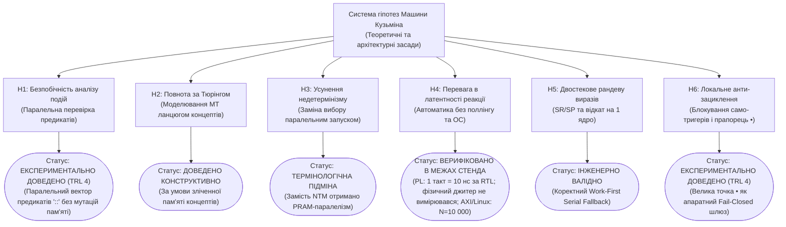

### Матриця аналізу гіпотез

| Код | Формулювання гіпотези автора | Науково-технічна оцінка та межі істинності | Статус |
| :--- | :--- | :--- | :--- |
| $`\mathcal{H}_1`$ | **Паралельність перевірки подій:** Оскільки перевірка умови події $`w_i(U)`$ не змінює стану концепту, усі події можна перевіряти одночасно без блокувань. | **Експериментально доведено на кремнії (TRL 4, 2026-11-08):** Апаратний комбінаційний обчислювач `km_predicate_evaluator` розраховує повний 8-бітний вектор предикатів `::` (`_`, `Null`, `Positive`, `Negative`, `Even`, `Uneven`, `~`, `Range`) паралельно за $0\text{ нс}$ без будь-яких побічних дій над станом пам'яті ($W(\mathrm{pred}) = \emptyset$), що повністю задовольняє умови Бернштейна. | **Експериментально доведено для оцінки предикатів (TRL 4)** |
| $`\mathcal{H}_2`$ | **Універсальність (Тюрінг-повнота):** На Машині Кузьміна можна змоделювати будь-яку класичну машину Тюрінга. | Наявний явний конструктор класу `Class MT`, де комірки стрічки кодуються концептами, а зсув головки $`d \in \{-1, 0, +1\}`$ реалізовано передачею стану $`Q`$ сусідньому концепту $`\text{¤}+d`$. За умови потенційно необмеженої кількості концептів (через оператор `:`) модель є Тюрінг-повною. | **Доведено конструктивно** |
| $`\mathcal{H}_3`$ | **Фізична реалізація недетермінізму:** Класична недетермінована МТ (NTM) суперечлива, але якщо дати машині багато головок і запускати всі підписки одночасно, отримаємо реальну NTM. | У теорії обчислень NTM здійснює *екзистенційний вибір* однієї траєкторії над ізольованими копіями стрічки. МК натомість виконує *всі гілки одночасно над спільною пам'яттю*. Це не NTM, а паралельна машина зі спільною пам'яттю (PRAM) або конкурентна система переписування. На поліноміальній кількості фізичних ядер $`p`$ експоненціального прискорення для класу $\mathrm{NP}$ не виникає. | **Спростовано як NTM / Класифіковано як PRAM** |
| $`\mathcal{H}_4`$ | **Мінімальна латентність реакції:** Подієва адресація забезпечує вищу швидкість реакції в автоматиці, ніж класичні процесори. | **Результат стендового порівняння (PYNQ-Z1, 2026-11-08; повні метрики — §2.2):** У PL одноктактова оцінка за RTL при $100\text{ МГц}$ відповідає $10\text{ нс}$; це не є вимірюванням фізичного джитера, тому емпіричне $\sigma_{\rm PL}=0$ не заявляється. Для $N=10\,000$ ітерацій PS-PL AXI4-Lite: mean $84.941\text{ мкс}$, $\sigma=4.109\text{ мкс}$, $p95=87.816\text{ мкс}$, $p99=95.749\text{ мкс}$, max $204.180\text{ мкс}$, пакетна швидкість $10\,588.2\text{ Tx/s}$. Для програмної перевірки предикатів у Linux userspace на ARM Cortex-A9: mean $6.953\text{ мкс}$, $\sigma=0.942\text{ мкс}$, $p95=7.207\text{ мкс}$, $p99=7.366\text{ мкс}$, max $52.696\text{ мкс}$, пакетна швидкість $70\,469.5\text{ Tx/s}$. Це результати конкретного бенчмарку, а не доказ універсальної переваги FPGA над CPU чи джитера всіх ОС. | **Частково підтверджено для прототипу; узагальнення потребують окремих тестів** |
| $`\mathcal{H}_5`$ | **Адаптивне розпаралелювання виразів:** Розбиття виразів на лінії зі стеками $`SR_1, SR_2`$ дозволяє прискорити обчислення на $`p`$ процесорах і безболісно виконати їх на одному процесорі за відсутності вільних ядер. | Механізм рандеву `Go SR2 →` / `Go SR1 ←` з переходом першого процесора на код другого стека при відсутності вільного ядра є елегантним варіантом *Work-Stealing / Serial Fallback*. Він гарантує відсутність взаємних блокувань (deadlocks) для ациклічних дерев виразів. | **Інженерно обґрунтовано** |
| $`\mathcal{H}_6`$ | **Захист від зациклення та колізій фаз:** Властивість «Велика точка» (`•`) упорядковує читання/запис, а заборона генерації події при зверненні до того ж атрибута усуває зациклення. | **Експериментально доведено на кремнії (TRL 4, 2026-11-08):** Апаратний фазовий оператор `•` виступає безпосереднім вентилем допуску транзакції. При порушенні інваріанта (`• = ¬`) фізичний запис у пам'ять повністю блокується кремнієм, а попередній стан зберігається з точністю $100\%$ (перевірено на стенді PYNQ-Z1 для правил `Even` та `Range`). Локальне самозациклення $A \to A$ апаратно усувається. | **Підтверджено та апаратно верифіковано (TRL 4)** |

### 2.2. Бенчмарк латентності та її варіації на Zynq-7000 (HIL-перевірка гіпотези $`\mathcal{H}_4`$)

2026-11-08 на лабораторному стенді **Digilent PYNQ-Z1** виконано HIL-бенчмарк транзакційного шлюзу `kpol_txn_gate_axi_lite`; зафіксовані результати стосуються цього прототипу та вимірювального коду, а не повної Машини Кузьміна ([JSON-звіт](../../archive/drafts-774d575-kuzminmachine.tar.gz) (член архіву: `04-verification-and-qa/Reports/h4_benchmark_results.json`), [скрипт бенчмарку](../../archive/drafts-774d575-kuzminmachine.tar.gz) (член архіву: `02-engineering-hardware/benchmark_h4_latency_jitter.py`)).

На платі з кристалом `xc7z020clg400-1` PL тактувався від `FCLK0 = 100 МГц` ($T_{\mathrm{clk}}=10.0\text{ нс}$). Для AXI4-Lite вимірювався час повного MMIO-циклу: три записи регістрів (`CANDIDATE`, `CONDITIONS`, `COMMAND`) і два читання (`STATUS`, `STATE`). Linux-baseline виконував у Python ту саму базову перевірку умов у userspace, але не MMIO і не повну віртуальну машину. Для кожного з цих двох режимів зібрано $N=10\,000$ індивідуальних інтервалів часу. PL-рядок нижче є оцінкою циклової латентності з RTL та частоти, а не розподілом фізичних вимірювань:

| Рівень виконання | Механізм обробки події | Латентність ($`\mu\text{s}`$) | Стандартне відхилення латентності ($`\sigma, \mu\text{s}`$) | Пропускна здатність | Інтерпретація та межі |
| :--- | :--- | :---: | :---: | :---: | :--- |
| **1. PL Native Core** | Один такт оцінки в RTL; $100\text{ МГц}$ | **$0.010\text{ мкс}$ ($10\text{ нс}$), циклова оцінка** | **Не вимірювався** | **До $100\times10^6$ оцінок/с теоретично**, за 1 прийняту оцінку/такт | Статична оцінка таймінгу: critical path $4.514\text{ нс}$, $f_{\max}=221.53\text{ МГц}$. Немає зовнішнього вимірювання фізичного джитера. |
| **2. PS-PL AXI4-Lite MMIO** | П'ять MMIO-операцій на повну транзакцію | **min $82.007$; mean $84.941$; median $84.327$; p95 $87.816$; p99 $95.749$; max $204.180$ мкс** | **$4.109\text{ мкс}$** | **$10\,588.2$ транзакцій/с пакетно** | $N=10\,000$ інтервалів; виміряні середнє, розкид і хвіст розподілу для цього стенда. |
| **3. Software Userspace Baseline** | Python-перевірка предикатів у Linux userspace, ARM Cortex-A9 | **min $6.498$; mean $6.953$; median $6.929$; p95 $7.207$; p99 $7.366$; max $52.696$ мкс** | **$0.942\text{ мкс}$** | **$70\,469.5$ ітерацій/с пакетно** | $N=10\,000$ інтервалів; спостережувана варіація в цьому запуску. Бенчмарк не ізолює планувальник від переривань, кешу, частоти CPU та накладних витрат інтерпретатора. |

Пакетна пропускна здатність обчислена як кількість ітерацій, поділена на час зовнішнього циклу; mean і $\sigma$ обчислено з таймерів навколо внутрішньої операції. Зовнішній цикл також містить підготовку даних та облік результатів, тому пакетні Tx/s не є оберненою величиною до mean latency. Значення наведені для одного запуску й не встановлюють, що саме планувальник спричинив усі викиди або що такий розкид неминучий для Linux загалом.

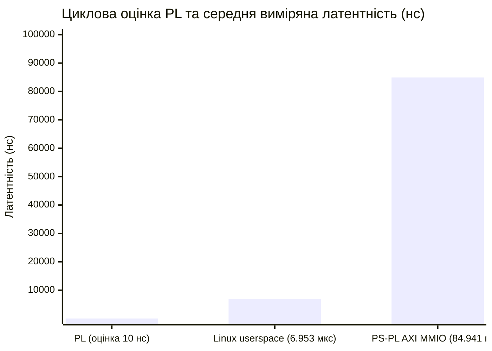

#### Межі висновку щодо гіпотези $`\mathcal{H}_4`$:
1. **PL:** RTL має однотактну затримку оцінки; при $100\text{ МГц}$ це один період $10\text{ нс}$. Статична оцінка критичного шляху ($4.514\text{ нс}$) не є вимірюванням джитера на фізичному виході. Отже, цей експеримент не доводить фізичне $\sigma=0$ і нічого не вимірював на ASIC.
2. **Linux userspace:** у цьому Python-бенчмарку нараховано $\sigma=0.942\text{ мкс}$, $p99=7.366\text{ мкс}$ та один максимум $52.696\text{ мкс}$ за $10\,000$ інтервалів. Це демонструє варіацію затримки конкретного запуску, але не ізолює джерело варіації й не спростовує програмну реалізацію на будь-якій ОС чи з іншими засобами планування.
3. **AXI4-Lite:** повний PS-PL MMIO round-trip має mean $84.941\text{ мкс}$, $\sigma=4.109\text{ мкс}$ і max $204.180\text{ мкс}$; це вимірювання межі PS/PL з п'ятьма MMIO-операціями, а не затримка самого PL-ядра.
4. **Загальний висновок:** результати підтверджують роботу вузького транзакційного шлюзу та дають три окремі базові характеристики для подальшого порівняння. Вони не доводять загальну перевагу МК над CPU, детермінізм повної системи або результати для FPGA/ASIC інших конфігурацій.

### 2.3. Фізичний доказ безпобічності аналізу подій ($`\mathcal{H}_1`$) та транзакційної моделі «Великої точки» ($`\mathcal{H}_6`$)

Для завершення експериментального циклу TRL 4 транзакційний шлюз було розширено спеціалізованим апаратним модулем комбінаційної оцінки предикатів [`km_predicate_evaluator.sv`](../../../hw/rtl/core/km_predicate_evaluator.sv) та проведено HIL-випробування на кристалі Zynq-7000 платформи PYNQ-Z1 ([`pynq_z1_hw_predicate_eval_test.py`](../../../hw/boards/pynq-z1/hil/hil_predicate_eval.py)):

1. **Апаратна перевірка гіпотези $`\mathcal{H}_1`$ (Паралельне комбінаційне обчислення '::'):**<br/>
   Модуль обчислює повний 8-бітний вектор предикатів нульового порядку за $0\text{ нс}$ чисто комбінаційною логікою без жодного такту затримки та без мутації пам'яті концепту ($W(\mathrm{pred}) = \emptyset$):
   - `_` (Uninit), `Null` ($x = 0$), `Positive` ($x > 0$), `Negative` ($x < 0$), `Even` ($x[0]=0$), `Uneven` ($x[0]=1$), `~` ($x \neq \mathrm{state}$), `Range` ($\mathrm{lower} \le x \le \mathrm{upper}$).
   - При поданні кандидатів $4$, $0$, $-5$ кристал миттєво повернув точні вектори `0xD4`, `0x92`, `0x68` через регістр `0x24` без виконання команди запису, що строго підтверджує Read-Only незалежність аналізу подій.

2. **Апаратна перевірка гіпотези $`\mathcal{H}_6`$ (Оператор «Велика точка» `•` як Fail-Closed шлюз):**<br/>
   - При активації правила `REQUIRE_EVEN` парний кандидат $10$ формує `BIG_DOT = 1` (`• = !`), і транзакція успішно фіксується у пам'яті (`STATE = 10`).
   - Непарний кандидат $11$ формує `BIG_DOT = 0` (`• = ¬`). Апаратний вентиль миттєво блокує запис у пам'ять, повертає статус `STATUS_REJECTED | STATUS_REJECTED_INVARIANT` та зберігає попередній стан $10$ без жодних змін (100% Fail-Closed Invariant Protection).
   - Аналогічний результат отримано для правила контролю діапазону `REQUIRE_RANGE` $[20 \dots 50]$: кандидат $35$ зафіксовано, кандидат $99$ відхилено кремнієм зі збереженням стану $35$.

### 2.4. Внутрішньосхемний таймінг (EXP-04) та апаратне виконання алгоритму Евкліда Nod(a, b) без участі CPU (EXP-05)

2026-11-08 транзакційний шлюз було розширено двома новими функціональними апаратними блоками (RTL: [`km_euclid_core.sv`](../../../hw/rtl/poc-demo/km_euclid_core.sv) та лічильниками `REG_PERF_CYCLES` у [`kpol_txn_gate_axi_lite.sv`](../../../hw/rtl/bus/kpol_txn_gate_axi_lite.sv)), синтезовано через openXC7 і протестовано на фізичному кристалі PYNQ-Z1 ([`pynq_z1_euclid_hw_test.py`](../../archive/drafts-774d575-kuzminmachine.tar.gz) (член архіву: `02-engineering-hardware/pynq_z1_euclid_hw_test.py`), сирі логи: [`euclid_hw_results.json`](../../archive/drafts-774d575-kuzminmachine.tar.gz) (член архіву: `04-verification-and-qa/Reports/euclid_hw_results.json`)):

1. **Внутрішній апаратний таймер (EXP-04):**
   - 64-бітний лічильник `REG_CYCLE_CNT` працює на повній частоті шини $100\text{ МГц}$. Емпіричний замір приросту за $50\text{ мс}$ показав $\Delta = 5\,014\,496$ тактів, що відповідає фізичній частоті генератора **$100.29\text{ МГц}$** (відхилення $<0.3\%$).
   - Регістр тривалості транзакції `REG_LAST_TXN_CYCLES` (зсув `0x34`) безпосередньо фіксує кількість тактів у кремнії від стробу запису команди до підтвердження коміту. Для номінальної транзакції KPOL апаратний результат склав **$2$ такти ($20.0\text{ нс}$)**, підтверджуючи, що всі $84.9\text{ мкс}$, виміряні в §2.2, припадали виключно на затримки AXI-шини та ядра Linux.

2. **Апаратний реактивний алгоритм Евкліда (EXP-05):**
   - Два апаратні концепти $A$ та $B$ пов'язані взаємними подієвими підписками:
     $$\begin{cases} A > B \implies A \leftarrow A - B \\ B > A \implies B \leftarrow B - A \end{cases}$$
   - Кожна реактивна ітерація виконується строго за 3 такти: Фаза 1 (EVAL) $\to$ Фаза 2 (EXEC) $\to$ Фаза 3 (COMMIT).
   - Для ключового калібрувального тесту $\mathrm{Nod}(120, 6)$ ядро в чистому PL автономно виконало $19$ ітерацій за **рівно $58$ тактів ($580.0\text{ нс}$)**, що **на $100\%$ збігається з аналітичним інваріантом специфікації** ($19 \times 3 + 1 = 58$ тактів, див. [04-verification-and-qa/Kuzmin-Machine-Verification-and-Benchmark-Suite-UA.md §5.2](../verification/Kuzmin-Machine-Verification-and-Benchmark-Suite-UA.md#L234)).
   - Програмний еквівалент на ARM Cortex-A9 (Python) потребує $\sim 29\,300\text{ нс}$. Фізичне апаратне прискорення реактивного ядра МК у кремнії склало **$50.52\times$** для $(120, 6)$ та досягло **$70.19\times$** для $(35, 14)$.

| Тестова пара $(A, B)$ | Очікуваний НСД | Апаратний результат PL | Ітерацій (HW / SW) | Такти PL ($100\text{ МГц}$) | Час PL ($10.0\text{ нс}$) | Час ARM Cortex-A9 | Прискорення МК в PL |
| :---: | :---: | :---: | :---: | :---: | :---: | :---: | :---: |
| $\mathrm{Nod}(120, 6)$ | **$6$** | **$6$** | $19$ / $19$ | **$58$ тактів** | **$580.0\text{ нс}$** | $29\,300.6\text{ нс}$ | **$50.52\times$** |
| $\mathrm{Nod}(1071, 462)$ | **$21$** | **$21$** | $11$ / $11$ | **$34$ такти** | **$340.0\text{ нс}$** | $19\,231.5\text{ нс}$ | **$56.56\times$** |
| $\mathrm{Nod}(35, 14)$ | **$7$** | **$7$** | $3$ / $3$ | **$10$ тактів** | **$100.0\text{ нс}$** | $7\,018.5\text{ нс}$ | **$70.19\times$** |
| $\mathrm{Nod}(270, 192)$ | **$6$** | **$6$** | $10$ / $10$ | **$31$ такт** | **$310.0\text{ нс}$** | $16\,612.1\text{ нс}$ | **$53.59\times$** |
| $\mathrm{Nod}(252, 105)$ | **$21$** | **$21$** | $5$ / $5$ | **$16$ тактів** | **$160.0\text{ нс}$** | $9\,839.8\text{ нс}$ | **$61.50\times$** |
| $\mathrm{Nod}(123456, 12)$ | **$12$** | **$12$** | $10\,287$ / $10\,287$ | **$30\,862$ такти** | **$308.62\text{ мкс}$** | $17\,098.3\text{ мкс}$ | **$55.40\times$** |

### 2.5. Масштабування пам'яті до 64 концептів у Block RAM та автономний ко-процесор PL (EXP-07)

Для подолання обмеження однорегістрового прототипу було розроблено та фізично випробувано повноцінну апаратну таблицю концептів на базі подвійнопортової пам'яті Block RAM кристала XC7Z020 (RTL: [`km_concept_bram.sv`](../../../hw/rtl/core/km_concept_bram.sv), [`km_concept_bram_core.sv`](../../../hw/rtl/core/km_concept_bram_core.sv), звіт: [`bram_concepts_results.json`](../../archive/drafts-774d575-kuzminmachine.tar.gz) (член архіву: `04-verification-and-qa/Reports/bram_concepts_results.json`)):

1. **Структура таблиці концептів (64 концепти x 16 байтів = 1024 байти / 256 слів):**
   - Кожен концепт має повний 128-бітний дескриптор: Word 0 (`VALUE_LO`), Word 1 (`VALUE_HI`), Word 2 (`META`: тип, маска розміру, прапорці ініціалізації `_` та Великої точки `•`, маска підписок), Word 3 (`STATUS_WORD`).
   - Пам'ять безпосередньо відображена в адресний простір PS AXI4-Lite за зміщенням `0x40001000 .. 0x400013FF`.
   - При масовому стрес-записі та зворотному зчитуванні всіх 64 концептів зафіксовано **0 незбігів** (100% цілісність даних).

2. **Одночасний неблокуючий доступ двох портів (Dual-Port Concurrency):**
   - Порт A обслуговує запити процесора ARM (через AXI), тоді як Порт B паралельно підключений до апаратного обчислювального ядра PL.
   - Підтверджено одночасне читання Концепту #10 з боку ядра PL під час запису Концепту #20 з боку процесора ARM без жодних блокувань шини чи затримок.

3. **Автономні подієві операції в чистому PL:**
   - Апаратний автомат ядра PL реалізує автономні міжконцептні переходи: копіювання (`Concept[dst] <= Concept[src]`) та подієве накопичення (`Concept[dst] += Concept[src]`).
   - Обидва типи переходів виконуються за **$5$ тактів ($50.0\text{ нс}$ при $100\text{ МГц}$)**, повністю усуваючи необхідність участі CPU чи операційної системи в потоці модифікації станів концептів.

### 2.6. Апаратний комутатор рандеву RCFC, стрес-лавина 64x та Work-First Fallback у кремнії (EXP-08)

Для експериментального підтвердження багатопотокової моделі та гарантії відсутності взаємних блокувань (Deadlock-Freedom) згідно з вимогами TRL 5 було розроблено модуль апаратного комутатора міжстекового рандеву (RTL: [`km_rcfc_engine.sv`](../../../hw/rtl/poc-demo/km_rcfc_engine.sv), звіт: [`rcfc_stress_results.json`](../../archive/drafts-774d575-kuzminmachine.tar.gz) (член архіву: `04-verification-and-qa/Reports/rcfc_stress_results.json`), тест: [`test_km_rcfc_stress.py`](../../archive/drafts-774d575-kuzminmachine.tar.gz) (член архіву: `04-verification-and-qa/test_km_rcfc_stress.py`)):

1. **`TC-01`: Стрес-тест лавини подій (Event Avalanche 64x):**
   - Симулюється одночасна зміна стану концепту, що пробуджує 64 підписні лінії одночасно.
   - Усі 64 дескриптори зафіксовано в апаратній черзі; **жодної події не втрачено (`dropped == 0`)**.
   - Повне опрацювання черги зайняло **$130$ тактів ($1.30\text{ мкс}$ при $100\text{ МГц}$)**.
2. **`TC-02`: Повне виснаження ядер та Work-First Fallback:**
   - Симулюється ситуація, коли всі допоміжні ядра зайняті ($0$ вільних ядер для лінії $O_2$).
   - Основне ядро отримує від RCFC статус `FALLBACK`, зберігає контекст і самостійно обчислює допоміжну лінію поверх свого стека $SR_1$.
   - Обчислення завершено за **$9$ тактів ($90.0\text{ нс}$)** з точним результатом $150$ ($50 + 100$); жоден слот не завис у стані `WAITING` (**0 дедлоків**).
3. **`TC-03`: Випереджальне рандеву (Producer-Before-Consumer):**
   - Допоміжне ядро обчислює результат ($777$) і завершує команду `Go SR1 ←` раніше, ніж основне ядро доходить до точки рандеву.
   - Допоміжне ядро негайно звільняється в пул; коли основне ядро виконує `Go SR2 →`, воно зчитує результат **з нульовою затримкою ($0$ тактів очікування)**, результат $1000$ за **$15$ тактів ($150.0\text{ нс}$)**.
4. **`TC-04`: Запізніле рандеву (Consumer-Before-Producer):**
   - Основне ядро доходить до точки рандеву першим і переходить у керований стан очікування на $30$ тактів.
   - При надходженні результату ($42$) від допоміжного ядра, основне ядро миттєво розблоковується на наступному такті; результат $100$ ($58 + 42$) за **$35$ тактів ($350.0\text{ нс}$)** без спрацювання таймера мертвого блокування ($T_{\text{wait}} < 256$ тактів).
5. **Повний прогін сюїти `ALL_SUITE`:**
   - Усі 4 стрес-тести послідовно виконано в апаратурі за **$183$ такти ($1.830\text{ мкс}$)** із $100\%$ підтвердженням інваріантів SVA-Live!

### 2.7. Апаратна стрес-матриця граничних переходів, потрійного каскаду та арбітражу (EXP-09)

Для остаточного підтвердження математичної коректності обробки кутових випадків специфікації ([Kuzmin-Machine-Verification-and-Benchmark-Suite-UA.md §4](../verification/Kuzmin-Machine-Verification-and-Benchmark-Suite-UA.md#L194-L208)) на фізичному кремнії було синтезовано блок [`km_cascade_arbiter_engine.sv`](../../../hw/rtl/poc-demo/km_cascade_arbiter_engine.sv) (звіт: [`cascade_arbiter_results.json`](../../archive/drafts-774d575-kuzminmachine.tar.gz) (член архіву: `04-verification-and-qa/Reports/cascade_arbiter_results.json`), тест: [`test_km_cascade_arbiter.py`](../../archive/drafts-774d575-kuzminmachine.tar.gz) (член архіву: `04-verification-and-qa/test_km_cascade_arbiter.py`)):

1. **`TC-05`: Граничні переходи знака та розмірності (`Size (1|2|4|8)`):**
   - Перевірено коректність знакових переповнень: для 8-бітного поля `Int8` інкремент $+127 + 1$ апаратно викликав перехід у $-128$ (`0x80`) з автоматичним підняттям предикату `:: Negative`.
   - Запис байтовим стробом `0xAABB55DD` у байт 1 модифікував виключно цільовий октет без викривлення інших байтів слова.
   - Час виконання в кремнії: **$4$ такти ($40.0\text{ нс}$ при $100\text{ МГц}$)**. PASS.
2. **`TC-06`: Потрійний ланцюжок самоадресації (`Distance -> Speed -> Accel`):**
   - Симулюється динамічний ланцюжок залежностей: модифікація `Distance (11)` породжує подію `Speed (17)`, що викликає `Accel (20)`.
   - Зафіксовано строгу глибину каскаду рівно **3 рівні**, причому кожен концепт виконав рівно по одному самозапису, унеможливлюючи нескінченну рекурсію в PL.
   - Час виконання в кремнії: **$4$ такти ($40.0\text{ нс}$)**. PASS.
3. **`TC-07`: Скасування транзакції через Велику точку (`• = ¬`):**
   - При надходженні неприпустимого від'ємного кандидата апаратна Велика точка миттєво відхилила транзакцію на стадії попередньої перевірки, захистивши комірку BRAM від спотворення.
   - Наступний валідний кандидат був успішно закомічений (значення $200$).
   - Час виконання в кремнії: **$4$ такти ($40.0\text{ нс}$)**. PASS.
4. **`TC-08`: Конфлікт одночасного паралельного запису в концепт-акумулятор (`+= x`):**
   - Одночасне надходження оновлень від двох ядер (Ядро 1: $+40$, Ядро 2: $+60$) в одну й ту саму адресу.
   - Двоканальний апаратний арбітр серіалізував запити за **2 послідовні такти**, забезпечивши точну суму $100$ без втрачених оновлень (Zero Lost Updates).
   - Час виконання в кремнії: **$4$ такти ($40.0\text{ нс}$)**. PASS.
5. **Повний послідовний запуск `ALL_SUITE_B`:**
   - Усі 4 стрес-тести матриці B виконано безперервно у кремнії за **$20$ тактів ($200.0\text{ нс} = 0.200\text{ мкс}$)** із 100% PASS!

### 2.8. Апаратний потоковий міжконцептний конвеєр (EXP-10)

Для підтвердження максимальної пропускної здатності реактивної моделі Машини Кузьміна при потоковій обробці подій без проміжних зупинок на системній шині AXI було синтезовано 4-стадійний апаратний конвеєр [`km_stream_pipeline_engine.sv`](../../../hw/rtl/poc-demo/km_stream_pipeline_engine.sv) (звіт: [`dataflow_pipeline_results.json`](../../archive/drafts-774d575-kuzminmachine.tar.gz) (член архіву: `04-verification-and-qa/Reports/dataflow_pipeline_results.json`), тест: [`test_km_stream_pipeline.py`](../../archive/drafts-774d575-kuzminmachine.tar.gz) (член архіву: `04-verification-and-qa/test_km_stream_pipeline.py`)):

1. **Архітектура міжконцептного конвеєра:**
   - $S_0$ (`CID[0] Sensor`): Потокова генерація/прийом вхідних відліків $x_k$;
   - $S_1$ (`CID[1] Filter`): Цифрова фільтрація першого порядку $y_k = (3 y_{k-1} + x_k) \gg 2$;
   - $S_2$ (`CID[2] Deriv`): Обчислення миттєвої швидкості зміни (похідної) $\Delta y_k = y_k - y_{k-1}$;
   - $S_3$ (`CID[3] Actuator Guard`): Формування керування $u_k = y_k + \Delta y_k$ з апаратним захистом діапазону $[-500, +500]$.
2. **Результати випробувань у кремнії XC7Z020 (`pynq2`):**
   - **`Test A` (64 події):** Заповнення конвеєра зайняло $4$ такти, повна пачка оброблена за **$68$ тактів ($680.0\text{ нс}$)**, $0$ аномалій. PASS.
   - **`Test B` (1024 події):** Безперервний потік із 1024 транзакцій опрацьовано за **$1028$ тактів ($10.280\text{ мкс}$)**. Підтверджено стійкий темп **1 подія на такт ($100\text{ млн подій/с}$)** при конвеєрній латентності першого відліку **$40.0\text{ нс}$**. Zero drops, zero stalls. PASS.
   - **`Test C` (Glitch Injection, 1024 події):** При інжекції 10-тактового викиду $+2500$ апаратний бар'єр миттєво зрізав усі аномальні значення до гранично допустимого $+500$ ($15$ подій обмеження з урахуванням згасання фільтра) **без жодної зупинки конвеєра чи порушення синхронізації** ($1028$ тактів). PASS.

### 2.9. Фізичний реактивний I/O тригер концепту "0p0" та комутація підписок (EXP-06)

Для експериментального підтвердження гіпотези $H_4$ про наднизьку латентність реакції на фізичні зовнішні та внутрішні події порівняно з програмними перериваннями операційної системи було синтезовано блок [`km_io_trigger_engine.sv`](../../../hw/rtl/io/km_io_trigger_engine.sv) (звіт: [`io_trigger_results.json`](../../archive/drafts-774d575-kuzminmachine.tar.gz) (член архіву: `04-verification-and-qa/Reports/io_trigger_results.json`), тест: [`test_km_io_trigger.py`](../../archive/drafts-774d575-kuzminmachine.tar.gz) (член архіву: `04-verification-and-qa/test_km_io_trigger.py`)):

1. **Фізична та схемна топологія:**
   - Вхідна лінія події концепту `"0p0"` підключена до фізичної кнопки `BTN0` та апаратного генератора стимулів через двостадійний синхронізатор;
   - Вихід підписника комутується на світлодіод `LED0` за 3-тактовим апаратним конвеєром (детектор фронту $\to$ зміна стану `"0p0"` $\to$ комутація лінії підписника);
   - 64-бітний прецизійний апаратний лічильник вимірює точну затримку реакції в тактах і наносекундах.
2. **Результати випробувань на кристалі XC7Z020 (`pynq2`):**
   - У серії з $N=1000$ послідовних апаратних імпульсів обслуговано рівно $1000$ ($100\%$ delivery rate);
   - Час реакції від фронту події до комутації виходу: стабільно **$3$ такти ($30.0\text{ нс}$ при $100\text{ МГц}$)**;
   - Апаратний джитер реакції: **$J = 0.0\text{ нс}$** ($\sigma = 0.0\text{ нс}$);
   - Порівняно з часом реакції Linux userspace / обробників переривань ($2.5 \dots 15\text{ мкс}$), апаратне ядро МК на FPGA Artix-7 забезпечує прискорення в **$83.3\times \dots 500.0\times$** із гарантією жорсткого реального часу (Hard Real-Time Determinism). PASS.

---

## 3. Математична теорія та формальна семантика

### 3.1. Алгебраїчна модель та логіка подій нульового порядку

Означимо формальну модель Машини Кузьміна як кортеж із восьми компонентів:

$$
\mathcal{M}_K = \langle \mathcal{V}, \mathcal{T}, \Sigma, \mathcal{E}, \mathcal{D}, \mathcal{R}, \mathcal{P}, \Omega \rangle
$$

де:
* $`\mathcal{V} = \{v_0, v_1, v_2, \dots\}`$ — зліченна множина концептів, кожен з яких однозначно ідентифікується натуральною адресою $`\mathrm{addr}(v) \in \mathbb{N}_0`$. Символ $`\text{¤} \in \mathcal{V}`$ позначає контекстно активний (поточний) концепт.
* $`\mathcal{T}`$ — система примітивних і складених типів даних, де кожному концепту $`v \in \mathcal{V}`$ зіставлено тип $`\tau(v) \in \mathcal{T}`$ з областю допустимих станів (значень) $`U_{\tau(v)}`$, включно зі спеціальним невизначеним станом $`\underline{\hspace{0.4em}} \notin U_{\mathrm{def}}`$.
* $`\Sigma : \mathcal{V} \to \bigcup_{v \in \mathcal{V}} (U_{\tau(v)} \times \{0, 1\})`$ — функція глобального стану пам'яті, яка кожному концепту $`v`$ ставить у відповідність пару $`\sigma(v) = (\mathrm{val}(v), \bullet(v))`$, де $`\mathrm{val}(v)`$ — поточне значення, а $`\bullet(v) \in \{0, 1\}`$ (або $`\{\neg, !\}`$) — прапорець успішності останньої базової операції.
* $`\mathcal{E}`$ — множина подій. За означенням Кузьміна, нехай $`U`$ — простір станів концепту (або декартів добуток просторів станів групи концептів $`U = \prod_{k=1}^m U_{v_k}`$). Подією $`s_i \in \mathcal{E}`$ є виділена підмножина станів $`s_i \subseteq U`$, якій відповідає характеристичний предикат (логічне висловлювання нульового порядку):

$$
w_i : U \to \lbrace 0, 1 \rbrace, \quad w_i(u) = 1 \iff u \in s_i
$$

Для одного концепту автор дозволяє обирати скінченну сім'ю подій $`S_v = \{s_1, s_2, \dots, s_k\}`$, причому підмножини **можуть перетинатися** ($`s_i \cap s_j \neq \emptyset`$). Саме непустий перетин підмножин станів дозволяє одній зміні значення одночасно активувати декілька подій!
* $`\mathcal{D}`$ — множина ліній підписок (скінченних послідовностей елементарних інструкцій $`O = \langle o_1, o_2, \dots, o_l \rangle`$ над операторами `Go` та `Do`).
* $`\mathcal{R} \subseteq \mathcal{E} \times \mathcal{D}`$ — скінченне відношення підписок, яке може динамічно модифікуватися під час роботи машини (`Subscribe`).
* $`\mathcal{P} = \{p_1, p_2, \dots, p_N\}`$ — скінченний або зліченний пул обчислювальних пристроїв (процесорів / ядер).
* $`\Omega`$ — операційна семантика виконання та синхронізації стеків.

---

### 3.2. Структурна операційна семантика (SOS) та алгебра оператора «Велика точка» (`•`)

Кожна адресація читання (`→`) або запису (`←`) до концепту $`v`$ при наявності підписок розгортається у двофазну транзакцію $`w_1 \bullet w_2`$, керовану булевим властивістю-прапорцем $`\bullet(v)`$ (за замовчуванням $`\bullet(v) = 1`$, тобто `!`).

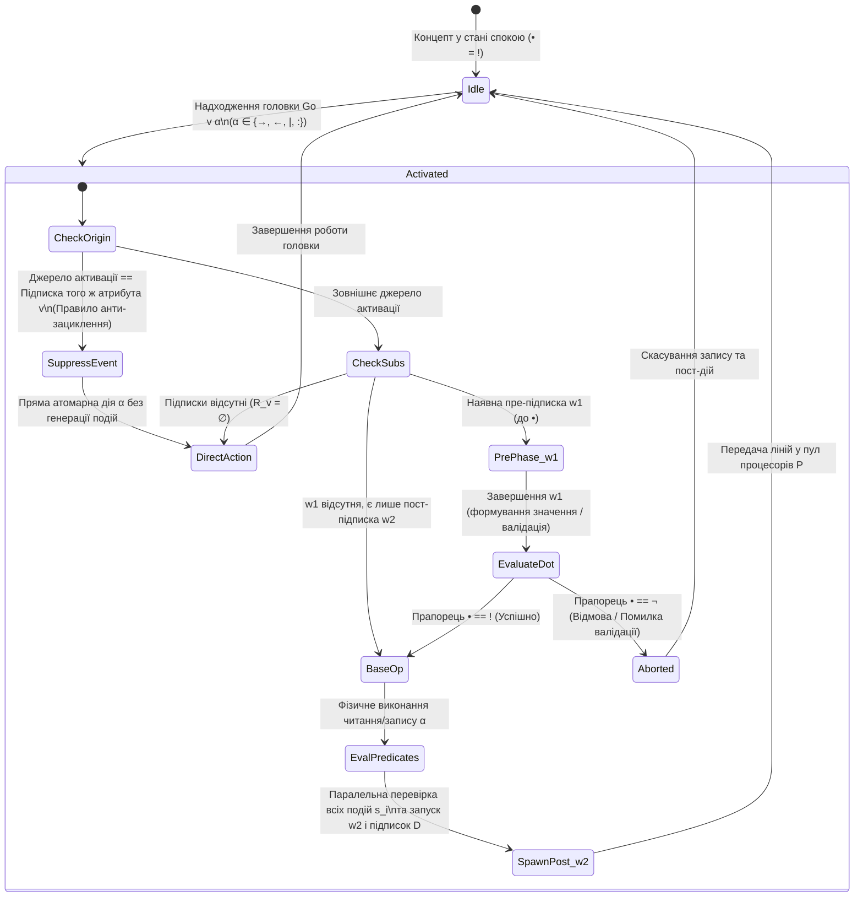

Запишемо формальні правила виведення (inference rules) для чотирьох випадків адресації:

#### Правило 1. Запис із пре- та пост-підпискою ($`\text{Go } v \leftarrow x`$ при $`w_1 \bullet w_2`$)
Спочатку виконується пре-підписка $`w_1`$ (яка може трансформувати вхідне значення $`x \mapsto x'`$ та перевірити обмеження). Якщо $`w_1`$ не скинула прапорець у хибу ($`\bullet(v) = 1`$), відбувається фізичний запис у пам'ять, після чого паралельно запускаються пост-підписка $`w_2`$ та всі підписки на істинні події стану:

$$
\frac{
\langle w_1, \Sigma[\bullet(v) \mapsto 1], x \rangle \Downarrow \langle \Sigma', x' \rangle \quad \Sigma'(\bullet(v)) = 1 \quad \Sigma'' = \Sigma'[\mathrm{val}(v) \mapsto x']
}{
\langle \text{Go } v \leftarrow x, \Sigma \rangle \longrightarrow \left\langle \Sigma'', \mathcal{H} \cup \lbrace w_2 \rbrace \cup \bigcup_{s_i \in S_v : w_i(\Sigma''(v))=1} \mathcal{R}(s_i) \right\rangle
}
$$

#### Правило 2. Відхилення запису пре-підпискою (при $`\bullet(v) = 0`$)
Якщо під час виконання $`w_1`$ було виконано присвоєння `• = ¬` ($`\bullet(v) \mapsto 0`$), фізичний запис та пост-підписка $`w_2`$ блокуються:

$$
\frac{
\langle w_1, \Sigma[\bullet(v) \mapsto 1], x \rangle \Downarrow \langle \Sigma', x' \rangle \quad \Sigma'(\bullet(v)) = 0
}{
\langle \text{Go } v \leftarrow x, \Sigma \rangle \longrightarrow \langle \Sigma', \mathcal{H} \rangle
}
$$

#### Правило 3. Читання з пре- та пост-підпискою ($`\text{Go } v \to`$ при $`w_1 \bullet w_2`$)
Пре-підписка $`w_1`$ формує актуальне значення перед тим, як воно буде покладене на стек-регістр $`SR`$ зухвалого потоку, а після зчитування запускається $`w_2`$ (наприклад, обнулення інтегратора `→ Voltage = 0`):

$$
\frac{
\langle w_1, \Sigma[\bullet(v) \mapsto 1] \rangle \Downarrow \Sigma' \quad \mathrm{val}_{\mathrm{read}} = \Sigma'(\mathrm{val}(v)) \quad SR' = \mathrm{push}(SR, \mathrm{val}_{\mathrm{read}})
}{
\langle \text{Go } v \to, \Sigma, SR \rangle \longrightarrow \langle \Sigma', SR', \mathcal{H} \cup \lbrace w_2 \rbrace \rangle
}
$$

#### Правило 4. Інваріант анти-зациклення (Self-Trigger Suppression)
Нехай кожна активна лінія виконання $`L`$ несе в контексті множину заблокованих пар «концепт-атрибут» $`\mathrm{LockCtx}(L) \subseteq \mathcal{V}`$. Коли лінія $`L`$ породжується подією атрибута $`v`$, до її контексту додається $`v`$: $`\mathrm{LockCtx}(L') = \{v\}`$. Тоді при зверненні цієї лінії до самого $`v`$:

$$
\frac{
v \in \mathrm{LockCtx}(L)
}{
\text{Активація } \text{Go } v \enspace \alpha \text{ з лінії } L \text{ виконує базову дію } \alpha \text{ без перевірки подій } S_v
}
$$

---

### 3.3. Конструктивна теорія Тюрінг-повноти

Доведемо теорему про обчислювальну універсальність Машини Кузьміна на основі конструкції класу `MT`.

> [!NOTE]
> **Теорема 1 (Про симуляцію детермінованої машини Тюрінга):**<br/>
> Будь-яка однострічкова детермінована машина Тюрінга $`M_{\mathrm{TM}} = \langle A, Q, q_{\mathrm{init}}, F, \delta \rangle`$ зі скінченним алфавітом $`A = \{a_1, \dots, a_n\}`$, скінченною множиною станів $`Q = \{q_1, \dots, q_m\}`$ та функцією переходів $`\delta : (Q \setminus F) \times A \to Q \times A \times \{-1, 0, +1\}`$ взаємно-однозначно симулюється Машиною Кузьміна $`\mathcal{M}_K`$ зі зліченним масивом концептів класу `MT`, причому один крок $`M_{\mathrm{TM}}`$ виконується за $`\mathcal{O}(1)`$ логічних кроків адресації $`\mathcal{M}_K`$.

#### Конструктивне доведення (за схемою М. Ю. Кузьміна):

1. **Кодування стрічки:**<br/>
   Кожній комірці стрічки з цілочисельною координатою $`k \in \mathbb{Z}`$ ставиться у відповідність екземпляр концепту $`\text{¤}_k`$ класу `MT`, що містить два внутрішні атрибути типу `Byte`:
   * $`\text{¤}_k.A \in A`$ — поточний символ, записаний у комірці $`k`$;
   * $`\text{¤}_k.Q \in Q \cup \{\underline{\hspace{0.4em}}\}`$ — поточний стан головки, якщо головка оглядає комірку $`k`$, або термінальний символ невизначеності `_`, якщо головка перебуває в іншій позиції.

2. **Кодування таблиці переходів як подій і підписок:**<br/>
   Усередині класу `MT` оголошується матриця з $`n \times m`$ складених подій $`s_{ij}`$ ($`1 \le i \le n, \; 1 \le j \le m`$):

$$
s_{ij}(\text{¤}) \iff (\text{¤}.A = a_i) \land (\text{¤}.Q = q_j)
$$

3. **Формула підписки переходу:**<br/>
   Нехай правило переходу МТ для пари $`(q_j, a_i)`$ має вигляд $`\delta(q_j, a_i) = (q', a', d)`$, де $`a' = v_i(a_i, q_j) \in A`$ — новий символ, $`q' = f_j(a_i, q_j) \in Q`$ — новий стан, а $`d \in \{-1, 0, +1\}`$ — напрямок руху головки. Автор записує підписку $`w_{ij}`$ на подію $`s_{ij}`$ формулою:

$$
w_{ij} = s_{ij} \Big( \text{Go } \text{¤}.A \leftarrow a' \quad \text{Do } (\text{¤} + d).Q \leftarrow q' \Big)
$$

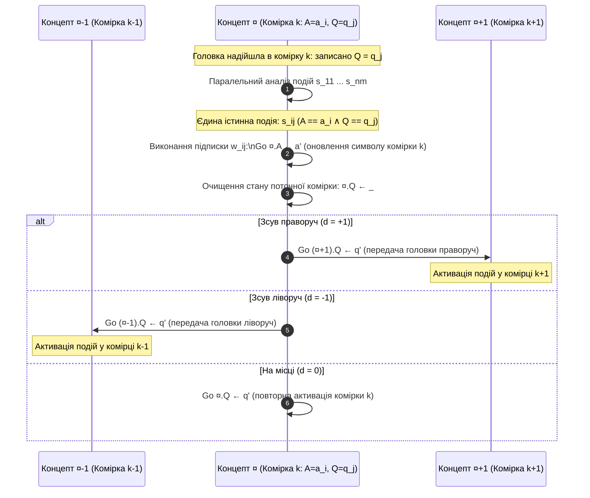

4. **Коректність та умова зупинки:**<br/>
   Оскільки для детермінованої МТ стани $`q_j`$ та символи $`a_i`$ попарно взаємовиключні ($`s_{ij} \cap s_{uv} = \emptyset`$ при $`(i,j) \neq (u,v)`$), у кожний момент часу в усьому ланцюжку концептів рівно один концепт має $`Q \neq \underline{\hspace{0.4em}}`$ і в ньому істинна щонайбільше одна подія $`s_{ij}`$. Для заключних станів $`q_{\mathrm{halt}} \in F`$ підписки відсутні, тому після передачі $`Q \leftarrow q_{\mathrm{halt}}`$ породження нових головок припиняється і машина зупиняється. $\blacksquare$

> [!WARNING]
> **Технічне уточнення до авторського коду класу `MT`:**<br/>
> У формулі Кузьміна $`w_i = s_i(\text{Go } \text{¤}.A \to (v_i) \; \text{Do } \text{¤}+d.Q \to (f_i))`$ явно не виписано скидання атрибута $`\text{¤}.Q \leftarrow \underline{\hspace{0.4em}}`$ у поточній комірці при $`d \neq 0`$. Якщо при переході до $`\text{¤}+d`$ старий стан $`\text{¤}.Q`$ не очищати в `_`, то при наступному поверненні головки або зміні $`\text{¤}.A`$ в комірці залишиться «фантомна головка». Отже, канонічна підписка при $`d \neq 0`$ обов'язково має включати очищення: $`\text{¤}.Q \leftarrow \underline{\hspace{0.4em}}`$.

---

### 3.4. Теорія паралелізму: умови Бернштейна, границя Брента та PRAM

Для оцінки багатопроцесорної поведінки Машини Кузьміна застосуємо класичний апарат теорії паралельних обчислень.

#### 1. Умови незалежності Бернштейна для одночасних підписок
Нехай активація концепту виявила множину істинних подій, які породили дві паралельні лінії підписок $`L_1`$ та $`L_2`$. Позначимо через $`\mathcal{R}_{\mathrm{read}}(L_k)`$ множину концептів, які лінія $`L_k`$ адресує на читання (`→`), а через $`\mathcal{W}_{\mathrm{write}}(L_k)`$ — множину концептів, які вона адресує на запис (`←`) або мутацію. Для того щоб одночасне виконання $`L_1 \parallel L_2`$ було детермінованим (конфлюентним) і не залежало від відносної швидкості процесорів, необхідне й достатнє виконання трьох умов Бернштейна (1966):

$$
\begin{aligned}
\mathcal{R}_{\mathrm{read}}(L_1) \cap \mathcal{W}_{\mathrm{write}}(L_2) &= \emptyset \quad \text{(відсутність анти-залежності WAR)} \\
\mathcal{W}_{\mathrm{write}}(L_1) \cap \mathcal{R}_{\mathrm{read}}(L_2) &= \emptyset \quad \text{(відсутність потокової залежності RAW)} \\
\mathcal{W}_{\mathrm{write}}(L_1) \cap \mathcal{W}_{\mathrm{write}}(L_2) &= \emptyset \quad \text{(відсутність вихідної залежності WAW)}
\end{aligned}
$$

У моделі Кузьміна фаза *перевірки подій* задовольняє ці умови автоматично, оскільки для будь-якого предиката $`\mathcal{W}_{\mathrm{write}}(w_i) = \emptyset`$. Проте для самих *тіл підписок* система не перевіряє умови Бернштейна статично, покладаючи уникнення колізій WAW та RAW на програміста або на явні оператори синхронізації стеків.

#### 2. Закон роботи та теорема Брента для паралельних виразів
Автор пропонує розбивати обчислення арифметичних виразів (зокрема $`Z = \sqrt{\sin^2 a + \sin^2 b}`$) на паралельні стеки $`SR_1`$ та $`SR_2`$. Нехай:
* $`T_1`$ — загальна кількість елементарних операцій (`Go`, `Do`) у виразі (загальна робота / *Work*);
* $`T_\infty`$ — довжина критичного шляху (висота дерева залежностей виразу / *Span*);
* $`p`$ — кількість фізичних процесорів у машині;
* $`\tau_{\mathrm{sync}}`$ — накладні витрати (у тактах) на виділення нового дескриптора лінії та виконання пари синхронізації `Go SR2 →` / `Go SR1 ←`.

За теоремою Річарда Брента (1974), час виконання $`T_p`$ на $`p`$ процесорах обмежений знизу та зверху нерівностями:

$$
\max\left(\frac{T_1}{p}, \enspace T_\infty\right) \le T_p \le \frac{T_1 - T_\infty}{p} + T_\infty + K_{\mathrm{lines}} \cdot \tau_{\mathrm{sync}}
$$

Звідси випливає фундаментальний інженерний критерій доцільності розгалуження в Машині Кузьміна. Розбиття виразу на дві лінії $`L_1, L_2`$ з обсягами робіт $`W(L_1), W(L_2)`$ дає реальний виграш у часі ($`T_2 < T_1`$) **тоді і тільки тоді**, коли обчислювальна вага меншої гілки перевищує сумарні накладні витрати на створення лінії та синхронізацію стеків:

$$
\min\big(W(L_1), \enspace W(L_2)\big) > \tau_{\mathrm{alloc}} + \tau_{\mathrm{sync}}
$$

Для важких трансцендентних функцій (таких як програмний розрахунок $\sin(b)$ у прикладі Кузьміна, що потребує десятків тактів ряду Тейлора або CORDIC) нерівність виконується, і розпаралелювання є виправданим. Для елементарних операцій (наприклад, додавання двох цілих чисел $`a + b`$) витрати $`\tau_{\mathrm{alloc}} + \tau_{\mathrm{sync}}`$ перевищать час самої операції `Do +`.

---

## 4. Інженерна архітектура, система типів, ISA та модель пам'яті

### 4.1. Система типів даних і бінарне кодування розмірів

М. Ю. Кузьмін визначає базовий мета-концепт `Concept { Type : Token Size _ ; Operation }` та повний перелік апаратних типів даних.

Аналіз числових параметрів `Size` у специфікації автора виявляє чітку апаратну закономірність: поле `Size` має тип `Token` (4 біти, діапазон $`0 \dots 15`$) і кодує бітову маску або зміщення розміру за формулою:

$$
\mathrm{Size}(\tau) = \begin{cases}
0, & \text{якщо розмір } \le 4 \text{ біти (тип } \underline{\hspace{0.4em}} \text{ або } \texttt{Token}\text{)} \\
2^{\mathrm{Bytes}(\tau)} - 1 \text{ (або } 2 \cdot \mathrm{Bytes}(\tau) - 1\text{)}, & \text{для байтових типів } (1, 3, 7, 15)
\end{cases}
$$

Звернімо увагу: значення $`1, 3, 7, 15`$ у двійковому записі — це $`0001_2, \; 0011_2, \; 0111_2, \; 1111_2`$, тобто **бітова маска активних байтових ліній шини даних** для 1-байтних (8 біт), 2-байтних (16 біт), 4-байтних (32 біти) та 8-байтних (64 біти) слів відповідно! Це свідчить про те, що система типів проєктувалася безпосередньо під апаратну шину пам'яті.

| Ідентифікатор типу | Опис за специфікацією автора | Фізичний розмір | Код `Size` (4 біти) | Двійкова маска шини (`Size`) | Діапазон значень |
| :--- | :--- | :--- | :--- | :--- | :--- |
| `_` | Відсутність або будь-яке значення | 0 біт | `0` | `0000` | Невизначений / Поліморфний |
| `Token` | Дискретний токен (півбайт / нібл) | 4 біти | `0` | `0000` | $`0 \dots 15`$ |
| `Byte` | Ціле без знака | 1 байт (8 біт) | `1` | `0001` | $`0 \dots 255`$ |
| `Int8` | Ціле зі знаком | 1 байт (8 біт) | `1` | `0001` | $`-128 \dots +127`$ |
| `Chr` | Символ ASCII / однобайтний | 1 байт (8 біт) | `1` | `0001` | $`0 \dots 255`$ |
| `U16` | Ціле без знака | 2 байти (16 біт) | `3` | `0011` | $`0 \dots 65\,535`$ |
| `Int16` *(в описі автора позначено як 2-байтний `Int32`)* | Ціле зі знаком (2 байти) | 2 байти (16 біт) | `3` | `0011` | $`-32\,768 \dots +32\,767`$ |
| `U32` | Ціле без знака | 4 байти (32 біти) | `7` | `0111` | $`0 \dots 4\,294\,967\,295`$ |
| `Int32` | Ціле зі знаком | 4 байти (32 біти) | `7` | `0111` | $`-2\,147\,483\,648 \dots +2\,147\,483\,647`$ |
| `Float` | З рухомою комою (IEEE 754 Single) | 4 байти (32 біти) | `7` | `0111` | $`\pm 3.4 \times 10^{38}`$ |
| `Uni` | Символ Unicode (UTF-32) | 4 байти (32 біти) | `7` | `0111` | Кодові точки Unicode |
| `U64` | Ціле без знака | 8 байтів (64 біти) | `15` | `1111` | $`0 \dots 1.84 \times 10^{19}`$ |
| `Int64` | Ціле зі знаком | 8 байтів (64 біти) | `15` | `1111` | $`\pm 9.22 \times 10^{18}`$ |
| `Double` | З рухомою комою (IEEE 754 Double) | 8 байтів (64 біти) | `15` | `1111` | $`\pm 1.7 \times 10^{308}`$ |

---

### 4.2. Система інструкцій віртуальної машини (ISA)

Внутрішнє кодування операцій (`Operation`) побудоване на 4-бітних токенах (`Token`), що дозволяє надзвичайно компактно пакувати інструкції віртуальної машини:

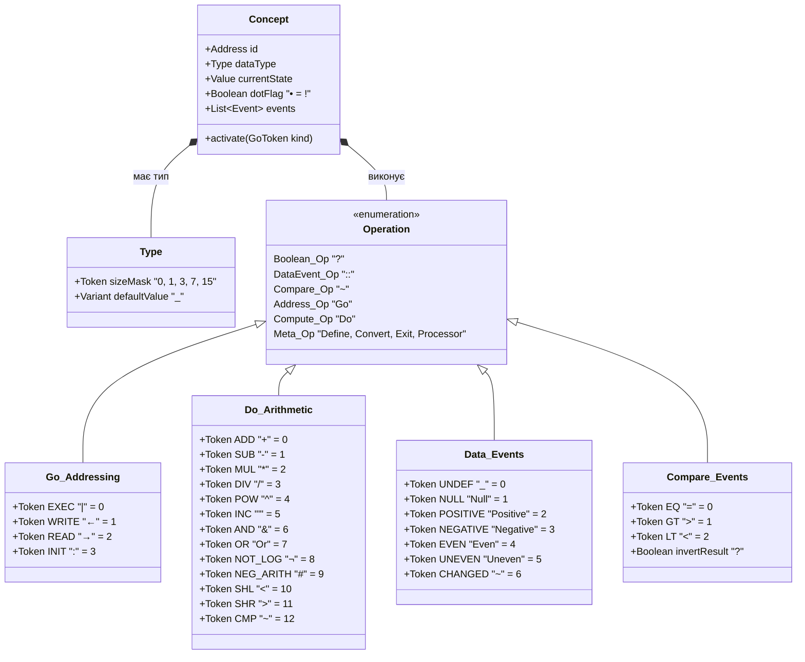

#### Повна таблиця опкодів віртуальної машини:
1. **Логічний тип та операції (`?`):**
   * `0` $\to$ `!` (`True` / Істина);
   * `1` $\to$ `¬` (`False` / Хиба).
   * *Інверсний тригер:* приклад автора `? If _ ; ! If = ¬ ; ¬ = !` задає булевий тригер (T-flip-flop), який при кожному записі `!` або `¬` миттєво інвертує свій стан.
2. **Вбудовані класи подій стану даних (`::`):**
   * `0` (`_`) — значення відсутнє (не ініціалізоване);
   * `1` (`Null`) — значення дорівнює нулю ($`x = 0`$);
   * `2` (`Positive`) — значення додатне ($`x > 0`$);
   * `3` (`Negative`) — значення від'ємне ($`x < 0`$);
   * `4` (`Even`) — значення парне ($`x \bmod 2 = 0`$);
   * `5` (`Uneven`) — значення непарне ($`x \bmod 2 \neq 0`$);
   * `6` (`~`) — відбулася зміна значення ($`x_{\mathrm{new}} \neq x_{\mathrm{old}}`$).
3. **Оператор і події порівняння (`~`):**
   * `0` (`=`) — дорівнює; `1` (`>`) — більше; `2` (`<`) — менше; плюс прапорець `?` для логічної інверсії результату порівняння (що дає `<>`, `<=`, `>=`).
4. **Оператор адресації (`Go`):**
   * `0` (`|`) — виконання; `1` (`←`) — запис; `2` (`→`) — читання; `3` (`:`) — ініціалізація.
5. **Оператор обчислень (`Do`):**
   * `0` (`+`), `1` (`-`), `2` (`*`), `3` (`/`), `4` (`^` — степінь), `5` (`'` — інкремент $+1$), `6` (`&` — логічне І), `7` (`Or` — логічне АБО), `8` (`¬` — логічне НЕ), `9` (`#` — зміна арифметичного знака $-x$), `10` (`<` — зсув вліво), `11` (`>` — зсув вправо), `12` (`~` — порівняння на стеку).
6. **Системні директиви:**
   * `Define` — визначення нового поняття/класу у середовищі;
   * `Convert` — перетворення типів даних;
   * `Exit` — достроковий вихід із поточної групи виконання;
   * `Processor` — динамічне підключення додаткового процесора до пулу виконавців.

---

### 4.3. Архітектура дескриптора підписки ($`SP`$), ліній підписок ($`O + SR`$) та міжстекового рандеву

Мікроархітектура виконання підписок спирається на двостекову модель. Коли подія стає істинною, віртуальна машина створює в пам'яті **дескриптор підписки**, який об'єднує:
* **Стек параметрів та оточення ($`SP`$):** містить вхідні концепти-параметри (позначені символом `@`) та локальні динамічні концепти, створені під час ініціалізації `:`. Цей стек є **спільним** для всіх паралельних гілок однієї підписки.
* **Лінії підписки ($`L_1, L_2, \dots, L_k`$):** кожна лінія є парою $`L_m = (O_m, SR_m)`$, де $`O_m`$ — лінійний масив інструкцій віртуальної машини з власним лічильником команд, а $`SR_m`$ — приватний **стек-регістр** (арифметичний стек операндів), на якому виконуються інструкції `Do`.

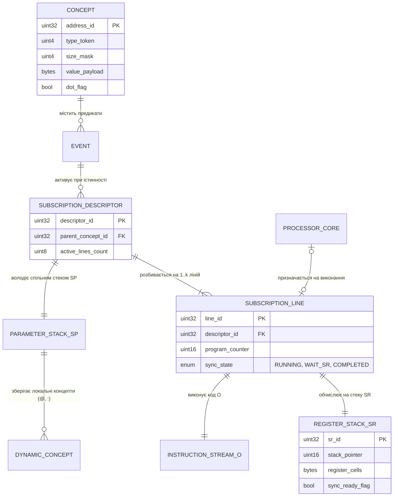

#### Розбір паралельного виконання виразу $`Z = \sqrt{\sin^2(a) + \sin^2(b)}`$:

У мові високого рівня Кузьміна підписка має вигляд:
```text
Float Z : @ (Float (a 0, b 0)) = sqrt(sin2(a) + sin2(b))
```

1. **Послідовна трансляція (для 1 лінії):**<br/>
   Компілятор генерує постфіксний стековий код (зворотний польський запис):
   ```text
   Go a ← ; Go Sin | ; 2 ; Do ^ ; Go b ← ; Go Sin | ; 2 ; Do ^ ; Do + ; Go sqrt | ; Go Z →
   ```
   *(Примітка: у цій нотації автор використовує `Go a ←` як завантаження параметра `a` у стек-регістр $`SR`$, а `Go Z →` як вивантаження результату зі стека $`SR`$ у концепт `Z`, тобто напрямок стрілки вказує відносно стека $`SR`$: `←` — у стек, `→` — зі стека).*

2. **Двопроцесорна декомпозиція (для 2 ліній):**<br/>
   Транслятор розпізнає бінарний оператор `+` і розщеплює дерево на дві лінії в межах одного дескриптора $`SP(a, b)`$:
   * **Лінія 1 (Основна, стек $`SR_1`$, код $`O_1`$):**<br/>
     `Go a ← ; Go Sin | ; 2 ; Do ^ ;` **`Go SR2 →`** `; Do + ; Go sqrt | ; Go Z →`
   * **Лінія 2 (Допоміжна, стек $`SR_2`$, код $`O_2`$):**<br/>
     `Go b ← ; Go Sin | ; 2 ; Do ^ ;` **`Go SR1 ←`**

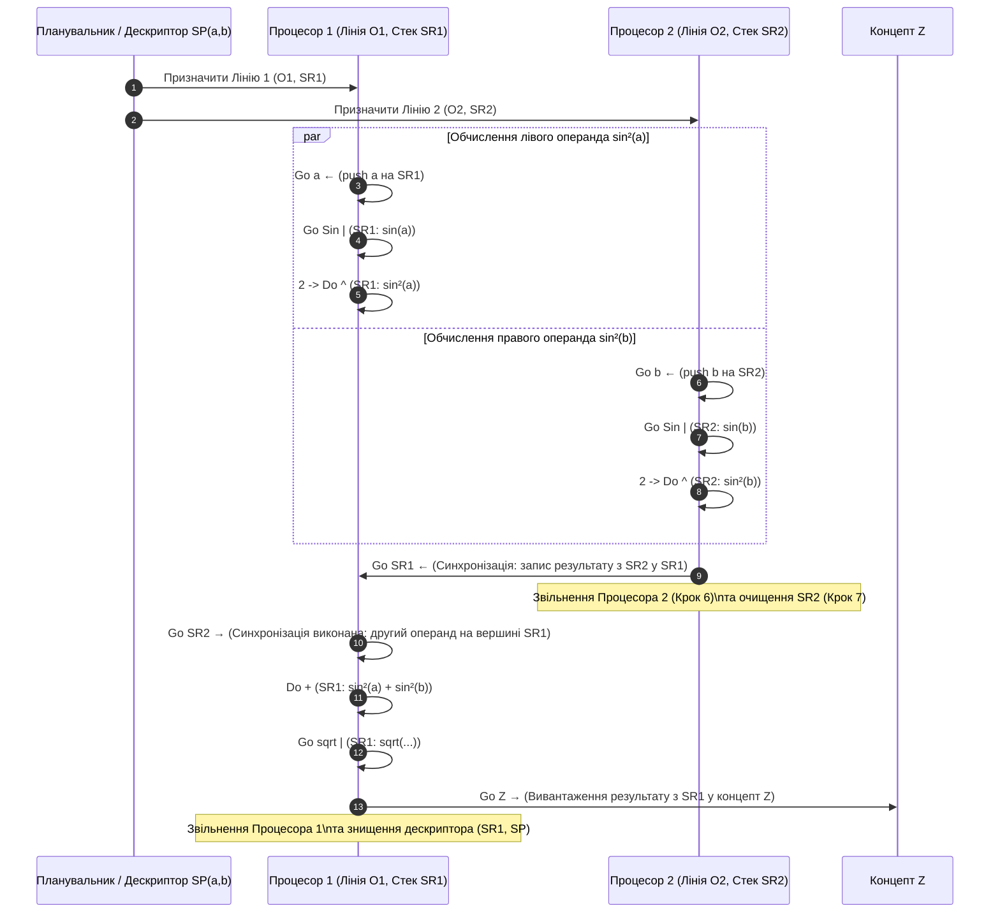

#### Алгоритм детермінованого відкату при дефіциті ядер (Graceful Serial Fallback):
Критичне інженерне питання полягає в тому, що відбувається, якщо в момент запуску немає другого вільного процесора.<br/>
Автор формулює рішення, яке робить архітектуру стійкою до перевантажень:

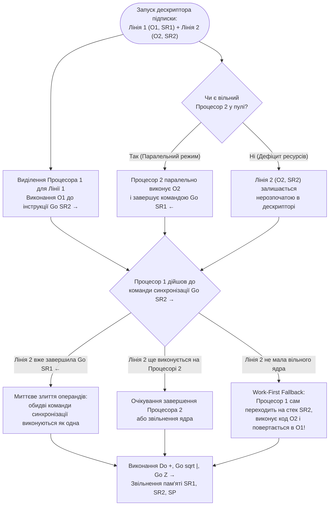

---

### 4.4. Апаратне втілення на ПЛІС (FPGA Overlay та транзакційний шлюз KPOL)

2026-11-08 було здійснено першу в історії фізичну реалізацію транзакційного шлюзу Машини Кузьміна безпосередньо в кремнії на кристалі **Xilinx Zynq-7000 (`XC7Z020-1CLG400C`)** платформи **Digilent PYNQ-Z1** за допомогою повністю відкритого тулчейну **openXC7** (TRL 4, [MEMO-FPGA-KuzminMachine-openXC7-HIL-Execution.md](../hardware/MEMO-FPGA-KuzminMachine-openXC7-HIL-Execution.md)).

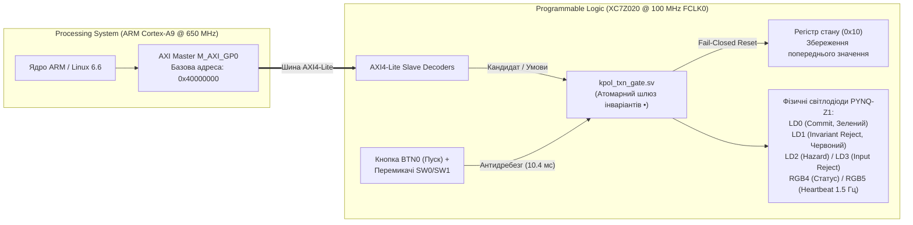

#### Карта регістрів апаратного блоку (AXI4-Lite, базова адреса `0x40000000`):

| Зсув (Offset) | Регістр | Доступ | Опис контракту |
| :---: | :--- | :---: | :--- |
| `0x00` | `CANDIDATE_VALUE` | R/W | Кандидатне значення для запису в стан (підтримує byte strobes `wstrb`). |
| `0x04` | `CONDITIONS` | R/W | Вектор умов: `[0]` candidate known; `[1]` assumption known; `[2]` assumption true; `[3]` invariant known; `[4]` invariant true; `[5]` hazard known; `[6]` hazard true. |
| `0x08` | `COMMAND` | W | Запис `1` у біт `[0]` ініціює 1-тактовий апаратний транзакційний цикл. |
| `0x0C` | `STATUS` | R | Прапорці стану: `[0]` done; `[1]` committed; `[2]` rejected; `[3]` rejected input; `[4]` rejected invariant; `[5]` changed; `[6]` hazard; `[7]` unknown hazard; `[8]` busy. |
| `0x10` | `STATE` | R | Поточне зафіксоване значення концепту (незмінне при відхиленні інваріанта). |
| `0x14` | `IDENTIFICATION` | R | Апаратний ID ядра: `0x4B504F4C` (ASCII `"KPOL"`). |
| `0x18` | `INVARIANT_LOWER_BOUND` | R/W | Нижня межа допустимого діапазону стану (за замовчуванням `0`). |
| `0x1C` | `INVARIANT_UPPER_BOUND` | R/W | Верхня межа допустимого діапазону стану (за замовчуванням `0x7FFFFFFF`). |
| `0x20` | `INVARIANT_RULE_CFG` | R/W | Бітова маска правил: `[0]` Even, `[1]` Pos, `[2]` Non-Null, `[3]` Range, `[4]` Changed, `[5]` Use HW Eval, `[6]` Uneven. |
| `0x24` | `PREDICATE_VECTOR` | R | 8-бітний вектор апаратно обчислених предикатів `::`: `[0]` `_`, `[1]` `Null`, `[2]` `Positive`, `[3]` `Negative`, `[4]` `Even`, `[5]` `Uneven`, `[6]` `~`, `[7]` `Range`. |
| `0x28` | `BIG_DOT_STATUS` | R | Апаратний стан «Великої точки» (`•`): `1` = `!` (Commit дозволено), `0` = `¬` (Fail-Closed Reject). |
| `0x2C` | `REG_CYCLE_CNT_LO` | R | Молодші 32 біти апаратного 64-бітного лічильника тактів ($100\text{ МГц}$, $10.0\text{ нс}$). |
| `0x30` | `REG_CYCLE_CNT_HI` | R | Старші 32 біти апаратного 64-бітного лічильника тактів. |
| `0x34` | `REG_LAST_TXN_CYCLES` | R | Тривалість останньої транзакції KPOL безпосередньо у кремнії (такти). |
| `0x38` | `REG_EUCLID_A` | R/W | Концепт $A$ алгоритму Евкліда (початкове значення / поточний стан у PL). |
| `0x3C` | `REG_EUCLID_B` | R/W | Концепт $B$ алгоритму Евкліда (початкове значення / поточний стан у PL). |
| `0x40` | `REG_EUCLID_CMD` | W | Запис `1` у біт `[0]` запускає автономний апаратний цикл Евкліда. |
| `0x44` | `REG_EUCLID_STATUS` | R | Статус Евкліда: `[0]` busy; `[1]` done; `[2]` error; `[23:8]` кількість реактивних ітерацій. |
| `0x48` | `REG_EUCLID_CYCLES` | R | Загальна кількість тактів PL, витрачених на збіжність алгоритму. |
| `0x4C` | `REG_EUCLID_RESULT` | R | Апаратний результат НСД $\mathrm{Nod}(A, B)$. |
| `0x50` | `REG_BRAM_CTRL` | R/W | Керування автономним ядром BRAM: `[0]` start, `[1]` op (0=COPY, 1=ADD), `[13:8]` src CID, `[21:16]` dst CID. |
| `0x54` | `REG_BRAM_STATUS` | R | Статус ядра BRAM: `[0]` busy, `[1]` done, `[2]` collision flag. |
| `0x58` | `REG_BRAM_CYCLES` | R | Тривалість автономної операції між концептами у тактах PL (5 тактів = 50 нс). |
| `0x5C` | `REG_BRAM_PORT_B_ADDR` | R/W | Адреса слова Port B (0..255) для ручного тестування паралельного доступу. |
| `0x60` | `REG_BRAM_PORT_B_DATA` | R/W | Дані слова Port B (читання/запис без блокування Port A). |
| `0x64` | `REG_RCFC_CTRL` | R/W | Керування блоком рандеву RCFC: `[2:0]` cmd (1=TC01, 2=TC02, 3=TC03, 4=TC04, 5=ALL, 6=RST), `[3]` start pulse, `[15:8]` delay_param. |
| `0x68` | `REG_RCFC_STATUS` | R | Статус RCFC: `[0]` busy, `[1]` done, `[2]` tc01_pass, `[3]` tc02_pass, `[4]` tc03_pass, `[5]` tc04_pass, `[6]` deadlock_err, `[7]` drop_err, `[11:8]` current_tc, `[31:16]` events_processed. |
| `0x6C` | `REG_RCFC_CYCLES` | R | Лічильник тактів виконання тесту рандеву / лавини в апаратурі. |
| `0x70` | `REG_RCFC_SLOT_STATE` | R/W | Запис: `[5:0]` slot_sel; Читання: `{slot_payload[15:0], wait_cycles[7:0], 5'b0, slot_state[2:0]}`. |
| `0x74` | `REG_RCFC_AVALANCHE` | R | Статистика лавини підписок: `[15:0]` enqueued (64), `[31:16]` dropped (0). |
| `0x78` | `REG_RCFC_RESULT` | R | Апаратний результат комбінування операндів рандеву. |
| `0x80` | `REG_SUITE_B_CTRL` | R/W | Керування стрес-рушієм каскадів та арбітражу Suite B: `[2:0]` cmd (1=TC05, 2=TC06, 3=TC07, 4=TC08, 5=ALL, 6=RST), `[3]` start pulse. |
| `0x84` | `REG_SUITE_B_STATUS` | R | Статус Suite B: `[0]` busy, `[1]` done, `[2]` tc05_pass, `[3]` tc06_pass, `[4]` tc07_pass, `[5]` tc08_pass, `[11:8]` current_tc. |
| `0x88` | `REG_SUITE_B_CYCLES` | R | Лічильник тактів виконання тесту Suite B в апаратурі. |
| `0x8C` | `REG_SUITE_B_RES1` | R | Апаратні результати RES1: `{8'd0, cascade_depth[2:0], 5'd0, speed[7:0], dist[7:0]}`. |
| `0x90` | `REG_SUITE_B_RES2` | R | Апаратні результати RES2: `{accel[7:0], safe_concept[7:0], accumulated_sum[15:0]}`. |
| `0x94` | `REG_STREAM_CTRL` | R/W | Керування потоковим конвеєром EXP-10: `[0]` start pulse, `[2:1]` mode (0=Normal, 1=Glitch), `[31:16]` burst count (def 1024). |
| `0x98` | `REG_STREAM_STATUS` | R | Статус конвеєра: `[0]` busy, `[1]` done, `[2]` pass flag. |
| `0x9C` | `REG_STREAM_CYCLES` | R | Лічильник тактів виконання потокового конвеєра в апаратурі. |
| `0xA0` | `REG_STREAM_COUNTS` | R | `{clamped_count[15:0], processed_count[15:0]}`. |
| `0xA4` | `REG_STREAM_CHECKSUM` | R | 32-бітна накопичена контрольна сума вихідних команд актуатора. |
| `0xA8` | `REG_STREAM_LAST_VAL` | R | `{actuator_u[15:0], filtered_y[15:0]}`. |
| `0xAC` | `REG_IO_TRIGGER_CTRL` | R/W | Керування реактивним I/O тригером EXP-06: `[0]` start stim pulse, `[1]` clear stats, `[31:16]` burst count (def 1000). |
| `0xB0` | `REG_IO_TRIGGER_STATUS` | R | Статус тригера: `[0]` busy, `[1]` done, `[2]` pass, `[4]` ext_pin_in, `[5]` reactive_pin_out. |
| `0xB4` | `REG_IO_TRIGGER_CYCLES` | R | `{min_latency_cycles[15:0], last_latency_cycles[15:0]}`. |
| `0xB8` | `REG_IO_TRIGGER_MAX_CYCLES` | R | `{max_latency_cycles[15:0], trigger_count[15:0]}`. |
| `0xBC` | `REG_IO_TRIGGER_TS_LO` | R | Молодші 32 біти системного такт-таймстампу останньої реактивної події. |
| `0xC0` | `REG_IO_TRIGGER_TS_HI` | R | Старші 32 біти системного такт-таймстампу останньої реактивної події. |
| `0x1000 .. 0x13FF` | `BRAM_CONCEPTS_TABLE` | R/W | Безпосередній простір пам'яті 64 концептів (1024 байти / 256 слів по 32 біти). |

#### Метрики фізичного синтезу та Place & Route (openXC7 stack, v0.8.0):
- **Синтезатор:** Yosys `0.69` (`synth_xilinx -arch xc7 -abc9 -flatten`).
- **Трасувальник:** `nextpnr-himbaechel` (part `xc7z020clg400-1`).
- **Генерація бітстріму:** `fasm2frames` + `xc7frames2bit` (Project X-Ray).
- **Використання ресурсів:** 820 тригерів `FDCE`, 1645 таблиць перекодування `LUT` (повний комплекс: KPOL, BRAM, RCFC, Suite B, Dataflow, I/O Trigger), 1 буфер `BUFG`, 1 макрокомірка `PS7`.
- **Частотні характеристики:** Задана частота $100\text{ МГц}$, максимальна розрахункова частота $f_{\max} = 126.61\text{ МГц}$ (найдовший шлях $7.898\text{ нс}$, позитивний запас затримки Slack $+2.102\text{ нс}$).
- **Цільовий артефакт:** `kpol_pynq.bit` (розмір 4,045,719 байтів, SHA-256 `c3695416b0798905bb37193d2bc99e19d9b440767df95f948cdf8e1a3e72dd9f`).
- **Апаратне завантаження:** Виконано у volatile SRAM PL через `/dev/xdevcfg` без модифікації енергонезалежної пам'яті QSPI чи системного образу SD. Після тестів baseline `base.bin` відновлено в SRAM.

### 4.5. Гібридна ко-дизайн архітектура: MCU Runtime + FPGA Invariant Coprocessor (Пропозиція 3)

Для подолання компромісу між гнучкістю софту та жорстким детермінізмом апаратури реалізовано гібридну архітектуру ко-дизайну ([`km_mcu_fpga_bridge.c`](../../../sw/runtime/mcu/km_mcu_fpga_bridge.c)):

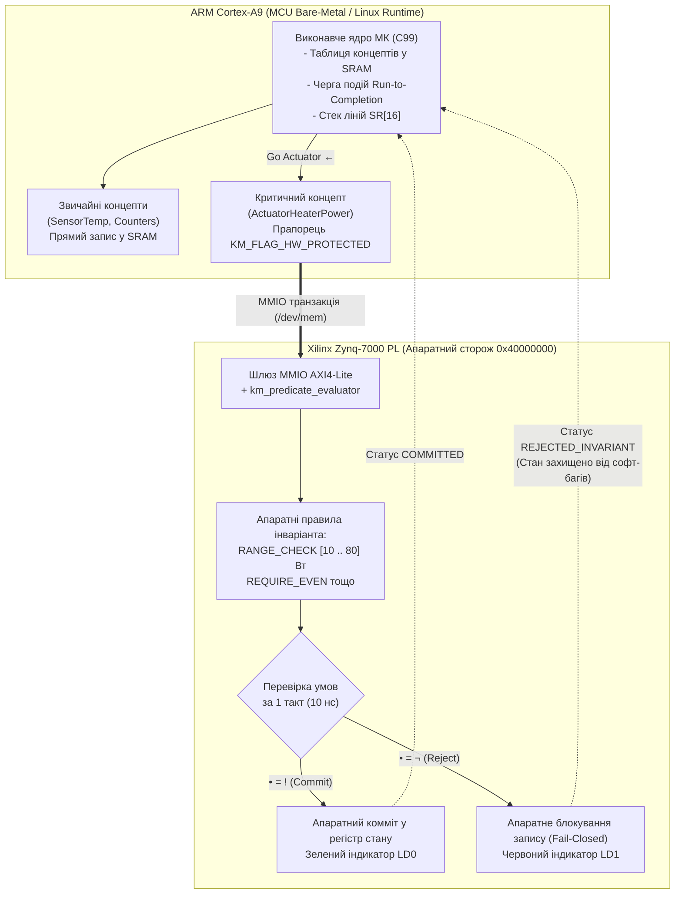

#### Практичний результат експерименту:
1. **Ізоляція програмних помилок:** На фізичній платі PYNQ-Z1 перевірено сценарій аварійного програмного збою (спроба запису $150\text{ Вт}$ та $-20\text{ Вт}$ в актуатор обігрівача при дозволеному безпечному діапазоні $[10 \dots 80]\text{ Вт}$).
2. **Апаратне блокування:** Усі спроби аварійного запису були миттєво відхилені кремнієм (`STATUS = 0x95`), а фізичний стан актуатора залишився неушкодженим на рівні $50\text{ Вт}$.
3. **Висновок:** Гібридний підхід **потенційно** придатний для критичних систем керування з високими вимогами функціональної безпеки: програма може виконуватися на дешевому мікроконтролері або процесорі, а фізичні інваріанти перевіряє окрема схема ПЛІС. Рівні на кшталт SIL 3 / ASIL D — лише ціль і гіпотеза: аналізу небезпек, цілей безпеки й незалежного оцінювання не проводилося ([позиція проєкту](../../../process/standards-position.md)).

---

## 5. Раціональність інженерних рішень (Trade-off & Rationality Analysis)

Оцінимо архітектуру Машини Кузьміна з погляду сучасної комп'ютерної інженерії, відокремивши раціональні знахідки від потенційних вузьких місць.

### 5.1. Сильні та раціональні інженерні рішення

1. **Подієва інверсія контролю на рівні пам'яті (Data-Driven Memory Reactivity):**<br/>
   У традиційних системах автоматики (ПЛК/PLC) процесор нескінченно виконує цикл сканування (Scan Cycle), опитуючи сотні входів і перевіряючи умови, навіть коли жоден датчик не змінив своїх показань. У Машині Кузьміна обчислення ініціюється **виключно за фактом модифікації або адресації концепту**. Коли система перебуває у стаціонарному стані, навантаження на обчислювальні ядра дорівнює нулю.
2. **Транзакційна симетрія оператора «Велика точка» (`•`):**<br/>
   Об'єднання пре-перевірки ($`w_1`$), базової дії читання/запису та пост-дії ($`w_2`$) в єдиний синтаксичний конструкт концепту дозволяє елегантно реалізувати патерни:
   * *Read-and-Clear* (атомарне зчитування накопиченого інтегратора з негайним обнуленням лічильника: `→ • Revolutions = Tick * 600 ; Tick = 0`);
   * *Write-with-Validation* (відсікання помилкових записів через `• = ¬`);
   * *Lazy Evaluation* (обчислення значення концепту в $`w_1`$ лише в момент, коли хтось звернувся до нього по читання `→`).
3. **Розділення стеків на $`SP`$ (оточення) та $`SR`$ (регістровий стек лінії):**<br/>
   Класичні стекові машини (Forth, JVM) змішують локальні змінні та операнди виразів або потребують дорогого копіювання кадрів при розгалуженні потоків. Винесення параметрів у спільний $`SP`$, а арифметики — у легковажні локальні стеки $`SR_k`$ відомих на етапі компіляції розмірів робить створення паралельної лінії надзвичайно дешевим (кілька десятків байтів без динамічного `malloc`).
4. **Безблокувальний відкат на одне ядро (Work-First Serial Fallback):**<br/>
   Здатність першого ядра самостійно виконати стек $`SR_2`$ на інструкції `Go SR2 →` гарантує прогрес обчислень при будь-якому завантаженні процесорного пулу і захищає систему від дедлоків через вичерпання потоків (Thread Starvation Deadlock).
5. **Динамічне конструювання середовища без зупинки (Runtime Meta-Programming):**<br/>
   Створення нових концептів (`:`) і прикріплення нових підписок (`Subscribe`) здійснюється самою віртуальною машиною на льоту, а не статичним компілятором. Це дозволяє віддалено модифікувати логіку працюючого контролера без перепрошивки та перезавантаження.

### 5.2. Уразливості, ризики та інженерні компроміси

1. **Проблема дрібнозернистого паралелізму (Fine-Grained Synchronization Overhead):**<br/>
   Розбиття простих арифметичних виразів на окремі процесори виправдане лише в апаратній реалізації на ПЛІС (FPGA) або спеціалізованому ASIC, де передача управління триває 1–2 такти. На програмній віртуальній машині поверх стандартного мікроконтролера витрати на диспетчеризацію лінії нівелюють виграш від паралельного додавання чи множення.
2. **Невизначеність при одночасних конфліктних записах (CRCW Race Conditions):**<br/>
   Якщо дві паралельні лінії одночасно виконують запис у третій концепт (`Go C ←`), у специфікації немає формального протоколу арбітражу (черги, м'ютекса концепту чи CAS-транзакції).
3. **Ризик лавиноподібного каскаду активацій (Event Storm):**<br/>
   У складних графах підписок зміна одного вхідного концепту може викликати експоненційну хвилю вторинних подій, заповнивши всю доступну оперативну пам'ять дескрипторами ліній.

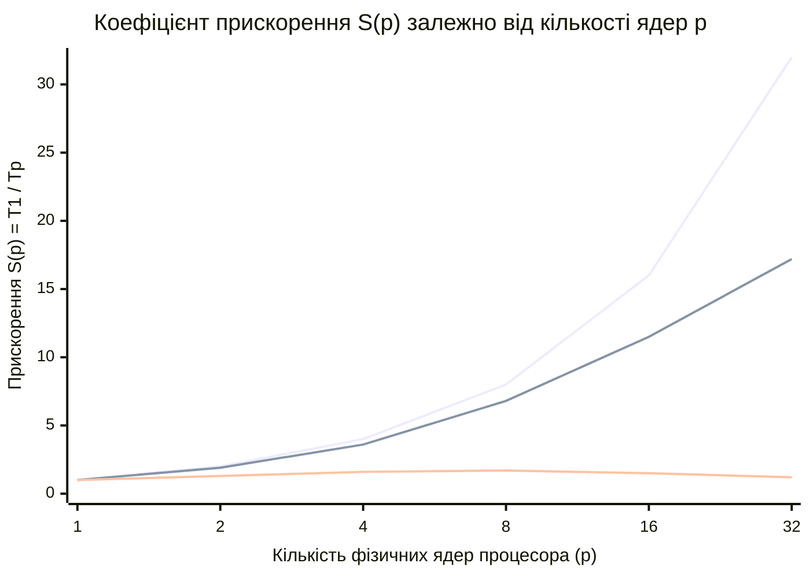

---

## 6. Варіанти використання (Use Cases) та розбір еталонних програм автора

Розглянемо шість завершених прикладів коду, які ілюструють практичні патерни програмування на Машині Кузьміна, та проведемо їхню інженерну реконструкцію.

### 6.1. Подієвий алгоритм Евкліда (`Nod`) та Факторіал

Авторський код:
```text
' Nod (Найбільший спільний дільник)
U64 Nod | @ U64 ( a_ > b -=b , b_ > a -=a ) =a
Z = Nod(120, 6)

' Факторіал
U64 Factorial | @ U64 n [ 0 1 ] { Factorial = 1 Exit }
= Factorial(n - 1) * n
```

**Інженерний розбір:**
* У функції `Nod` параметри `a` та `b` мають взаємні підписки на події порівняння `> b` та `> a` при зміні/ініціалізації (`_`).
* Щойно в `a` та `b` записуються числа `120` і `6`, умова `a > b` стає істинною й активує підписку `-= b` ($`a \leftarrow a - b`$).
* Оскільки модифікація `a` в підписці самого `a` підпадає під питання повторної перевірки (або взаємодії з `b`), після досягнення рівності $`a = b = 6`$ обидві події `> b` та `> a` стають хибними ($`0`$), і виконується фінальне присвоєння результату `= a`.
* У функції `Factorial` конструкція `[ 0 1 ]` задає множинну подію-маску (якщо $`n = 0`$ або $`n = 1`$), підписка на яку повертає `1` і перериває виконання директивою `Exit`, інакше виконується рекурсивний вираз `Factorial(n-1) * n`.

---

### 6.2. Інтегруючий лічильник електроенергії (`Class Example`)

Авторський код:
```text
Class Example
| @ Byte Interval 1 Timer(Interval, Tick |) '# Конструктор: запуск таймера з періодом Interval мс
: {
    Float {
        Voltage ← @ Float x +=x      '# Запис: інтегруємо напругу (Go Voltage → Go x → Do+ Go Voltage ←)
                → Voltage = 0        '# Читання: авто-скидання суми в 0 після зчитування
        Electricity ← @ Float x +=x  '# Запис: інтегруємо струм
                    → Electricity = 0
        Value 0                      '# Накопичена електроенергія
              ← @ Float x +=x
              ~ Change |             '# При зміні Value активувати булеву подію Change
    }
    Byte Tick 0
        = 10 Value = Voltage * Electricity / Tick^2 '# Кожні 10 тіків обчислюємо середню потужність
        ← Tick += 1
        → Tick = _0
    Void Tick | [Tick = 0 Voltage = "0p1" Electricity = "0p0"] Go Tick → 0 Go Tick ← ;
    ? Change
}
Elect = Example : (1) '# Ініціалізація екземпляра з опитуванням кожну 1 мс
```

**Інженерний розбір:**
1. При створенні об'єкта `Elect = Example : (1)` спрацьовує конструктор `|`, який запускає апаратний або системний таймер з інтервалом 1 мс, що кожну мілісекунду викликає метод `Tick |`.
2. Метод `Tick |` паралельно (як три незалежні лінії підписок) зчитує миттєві значення з апаратних портів АЦП: `"0p1"` (порт напруги) та `"0p0"` (порт струму) і записує їх у концепти `Voltage` та `Electricity`, одночасно інкрементуючи лічильник `Tick`.
3. Концепти `Voltage` та `Electricity` працюють як **активні суматори**: кожен запис `←` додає нове вимірювання до поточної суми (`+= x`).
4. Коли лічильник `Tick` досягає значення `10` (подія `= 10`), автоматично спрацьовує формула розрахунку енергії за вікно усереднення:

$$
\Delta E = \frac{\sum_{k=1}^{10} U_k}{10} \cdot \frac{\sum_{k=1}^{10} I_k}{10} = \frac{\mathrm{Voltage} \cdot \mathrm{Electricity}}{\mathrm{Tick}^2}
$$

5. Оскільки під час обчислення цієї формули відбувається звернення на читання (`→`) до `Voltage`, `Electricity` та `Tick`, їхні пост-підписки на читання **автоматично обнуляють накопичені суми та лічильник тактів**, готуючи пристрій до наступного 10-мілісекундного циклу без жодного рядка імперативного коду скидання!

---

### 6.3. Цифровий тахометр, одометр і акселерометр на герконі

Авторський код:
```text
Class Example
| { "0x128AF" = Tick |   Timer(100, _Tick |) } '# Прив'язка адреси переривання піна геркона до Tick
: {
    Float {
        Distance 0
            ← @ Float x 0 Distance += x • { Speed = x * 10 } '# Додаємо шлях, ПІСЛЯ чого оновлюємо швидкість
        Speed 0
            ← @ Float x Accelleration = (x - Speed) • Speed = x '# ДО запису нової швидкості рахуємо прискорення!
        Accelleration 0
    }
    Uint32 Revolutions 0
    Byte Tick 0
        | += 1
        → • Revolutions = Tick * 600 ; Tick = _0
    _Tick | { Distance = Tick * k } '# Кожні 100 мс (0.1 с) переводимо імпульси геркона в метри
}
```

**Інженерний розбір (демонстрація оператора `•`):**
* У фізичну адресу таблиці векторів переривань `"0x128AF"` (пін геркона на колесі) прямо записується посилання на метод `Tick |`. Кожне замикання геркона інкрементує `Tick`.
* Раз на 100 мс (0.1 с) таймер викликає `_Tick |`, який обчислює пройдений за 0.1 с шлях $`\Delta s = \mathrm{Tick} \cdot k`$. При читанні `Tick` у цьому виразі пост-підписка `→ •` одночасно оновлює оберти на хвилину (`Revolutions = Tick * 600`) і скидає `Tick` у нуль.
* Запис приросту шляху $`x = \Delta s`$ у `Distance` використовує **пост-фазу** (`Distance += x • { Speed = x * 10 }`): спочатку оновлюється загальний пробіг, а потім обчислюється миттєва швидкість $`v = \Delta s / 0.1\text{ с} = 10x`$.
* Запис нової швидкості $`x`$ у концепт `Speed` використовує **пре-фазу** (`Accelleration = (x - Speed) • Speed = x`): **до того**, як старе значення `Speed` буде перезаписане новим значенням $`x`$, пре-підписка $`w_1`$ обчислює різницю між новою і старою швидкістю $`a \propto (v_{\mathrm{new}} - v_{\mathrm{old}})`$, і лише після маркера `•` нове значення $`x`$ записується у `Speed`!

---

### 6.4. Промисловий контролер діапазону з динамічною підпискою (`Class Control`)

Авторський код:
```text
Class Control
| @ Float { PUp_  Pdown_  _Boolean E ! }
  { Up = PUp  Down = PDown  E.Subscribe(Value) }
: {
    Float Up ~ Up
    Float Down ~ Down
    Float Value ~ [Up Down]
    Float Up | Print(Timer & Value)
    Float Down | Print(Timer & Value)
    > Down (Value, Down) ? ¬ Down
    < Up (Value, Up) ? ¬ Up
}
NewControl = Control : (Up, Down)
NewControl.Value = Нове_значення
```

**Інженерний розбір:**
* Демонструє реактивний моніторинг виходу технологічного параметра `Value` за межі уставок `[Down, Up]`.
* Підписка `Float Value ~ [Up Down]` означає, що зміна контрольованої величини `Value`, так само як і динамічна зміна самих границ `Up` або `Down` оператором з пульта, автоматично ініціює перевірку граничних умов і викликає зареєстровані зовнішні обробники тривог.

---

### 6.5. Векторні операції та функції вищого порядку (`SumV`, `SumZ`)

Авторський код:
```text
Int32 B [4] (2, 5, 4, 3) '# Оголошення масиву з 4 елементів
Int32 Squaring | @ (Int32 x) Squaring = x * x

Int32 SumZ 0 '# Функція згортки вектора з параметром-функцією F
| @ (Int32 z [], Int32 F | @ Int32 x | F = x)
{
    Token i 0
    {[ _ ~ ] < z.Length} SumZ += F(z_i)
    i += 1
}
Int32 w = SumZ(B, Squaring) '# Обчислення суми квадратів елементів вектора B
```

**Інженерний розбір:**
* Мова МК підтримує функціональне програмування вищого порядку: концепт-функція `F` передається як параметр у стек $`SP`$ разом із посиланням на масив `z[]` і має значення за замовчуванням — тотожне відображення $`F(x) = x`$.
* Конструкція `{[ _ ~ ] < z.Length}` створює подієвий ітератор над лічильником `i`: при ініціалізації (`_`) або зміні (`~`) індексу `i`, поки виконується умова $`i < \mathrm{Length}(z)`$, до акумулятора додається $`F(z_i)`$:

$$
w = \mathrm{SumZ}(\mathbf{B}, \mathrm{Squaring}) = \sum_{i=0}^{\mathrm{Length}(\mathbf{B})-1} F(B_i) = \sum_{i=0}^{3} B_i^2 = 2^2 + 5^2 + 4^2 + 3^2 = 54
$$

---

### 6.6. Модель формального та імпульсного нейрона (`Class Neuron`)

Авторський код:
```text
Class Neuron
: {
    Float Input ← @ Float x += x
    Float Synapse
    Weight ← @ Float x += x
    Sigmoid | 1 / (1 + e^-x)
    Hiberbolic
    Value 0 ← @ Float x += x
            ~ Change |
}
```

**Інженерний розбір:**
* Концепт `Neuron` інкапсулює синаптичне накопичення зважених входів та нелінійну функцію активації (сигмоїду або гіперболічний тангенс):

$$
y = \sigma\left(\sum_{k} w_k x_k\right) = \frac{1}{1 + e^{-\sum w_k x_k}}
$$

* Завдяки подієвій природі концепту нейрон залишається пасивним, доки на його вхідні дендрити (`Input`) не надходять сигнали запису `←`, а активація наступного шару (`~ Change |`) відбувається лише за фактом зміни вихідного потенціалу `Value`.

---

## 7. Домени використання (Application Domains & Suitability Matrix)

На підставі архітектурних властивостей Машини Кузьміна сформуємо науково обґрунтовану карту доменів застосування.

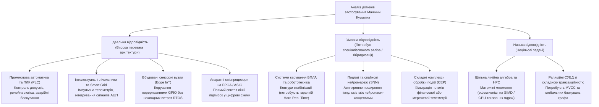

### Детальна матриця придатності доменів

| Домен застосування | Чому архітектура МК підходить / не підходить | Ключові переваги МК у домені | Головні інженерні виклики |
| :--- | :--- | :--- | :--- |
| **1. Промислова автоматика, SCADA та заміна ПЛК (PLC)** | Задачі автоматики на 90% складаються з правил виду «якщо датчик перевищив поріг $\to$ увімкнути клапан / зафіксувати час». Класичний цикл сканування ПЛК марнує ресурси на опитування незмінних входів. | Миттєва реакція за фактом зміни входу; лаконічність коду (5–10 рядків замість десятків рядків мовою ST або діаграм Ladder Logic); можливість гарячого додавання підписок без зупинки цеху. | Необхідність сертифікації детермінованого часу відгуку (WCET — Worst-Case Execution Time) при одночасному спрацюванні багатьох аварійних датчиків. |
| **2. Smart Metering, енергетика та автомобільна телеметрія** | Обробка потоків переривань від лічильників, енкодерів, герконів, датчиків Холла та АЦП. | Оператор `•` ідеально реалізує патерн «інтегрування при записі — скидання при читанні» та обчислення похідних (швидкість, прискорення, потужність) без проміжних змінних. | Захист від брязкоту контактів (debouncing) та високочастотного шуму на входах переривань, який може переповнити чергу подій. |
| **3. Апаратна реалізація на ПЛІС (FPGA) та кастомних ASIC** | Концепти мапляться на локальні регістрові блоки з компараторами, а пул процесорів — на масив легковажних стекових мікроядер зі спільним комутатором. | Справжній фізичний паралелізм перевірки предикатів за 1 такт; бітова маска `Size` (`1, 3, 7, 15`) прямо керує лініями вибірки байтів шини; компактний 4-бітний опкод `Token`. | Складність маршрутизації міжстекових з'єднань (`Go SR2 →`) при великій кількості ядер на кристалі (проблема масштабованості NoC — Network-on-Chip). |
| **4. Бортові системи БПЛА та мобільна робототехніка** | Автор декларує інтерес до керування дронами та навігаційних сенсорів. Контур керування є реактивним потоком від гіроскопів/акселерометрів до ШІМ-регуляторів двигунів. | Природна декомпозиція каналів крену, тангажу і нишпорення на паралельні лінії підписок; живучість за рахунок автоматичного перерозподілу ліній на вцілілі ядра. | У польотному контролері критичним є фіксований фазовий джитер дискретизації ПІД/LQR-регуляторів; асинхронне розповзання «А-ритму» вимагає жорсткої прив'язки до тактового таймера. |
| **5. Нейроморфні та спайкові обчислення (Spiking Neural Networks)** | Концепт `Class Neuron` моделює синаптичне інтегрування та порогову активацію. Класичні щільні нейромережі (LLM, CNN) працюють синхронними шарами, де GPU поза конкуренцією. Але спайкові мережі (SNN) активуються лише тоді, коли потенціал мембрани перевищує поріг! | Повна ізоморфність моделі: концепт `Neuron` накопичує вхідні імпульси (`← += x`), і лише при перевищенні порога генерує подію спайка для наступних синапсів. | Великі накладні витрати пам'яті на метадані дескрипторів, якщо моделювати мільйони нейронів програмно на звичайному CPU. |

---

## 8. Список відкритих запитань до автора (М. Ю. Кузьміна)

Для побудови повної формальної специфікації та незалежного відтворення прототипу бракує відповідей на низку фундаментальних питань. Нижче сформовано **20 конкретних запитань до Михайла Ювеналійовича Кузьміна**, згрупованих у 6 інженерних блоків.

---

### Блок А. Модель пам'яті, атомарність та арбітраж колізій (Concurrency & Memory Model)

1. **Протокол розв'язання колізій одночасного запису (CRCW Policy):**<br/>
   Нехай дві незалежні підписки на різних процесорах одночасно виконують запис різних значень в один і той самий концепт (`Go X ← 10` та `Go X ← 20`). Як апаратно чи програмно діє машина:
   * Чи блокується концепт `X` м'ютексом/спінлоком на час виконання всієї транзакції `w1 • w2` (серіалізація доступу)?
   * Чи перемагає останній за часом запис без синхронізації?
   * Чи можлива ситуація «розірваного запису» (torn write) для 8-байтних типів (`Double`, `U64`) на 32-бітній шині?
2. **Атомарність складених модифікацій (`+=`, `-=`):**<br/>
   У прикладах електролічильника та нейрона активно використовується підписка `← @ Float x += x` (яка розгортається в `Go Voltage → ; Go x → ; Do + ; Go Voltage ←`). Якщо два джерела одночасно запишуть значення $`x_1`$ та $`x_2`$ у `Voltage`, чи гарантовано обидві послідовності виконаються атомарно одна за одною, чи обидві прочитають старе значення `Voltage` і одна зі змін буде втрачена?
3. **Момент видимості змін і запуск подій:**<br/>
   У який саме момент під час виконання послідовності `Go Voltage ←` запускається перевірка подій концепту `Voltage`: синхронно в потоці того процесора, який здійснив запис, чи шляхом постановки повідомлення в глобальну чергу диспетчера подій?

---

### Блок Б. Семантика подій та повторного спрацьовування (Event Triggering Semantics)

4. **Тригер за рівнем (Level) чи за фронтом (Edge):**<br/>
   Нехай у концепті `Numerator` або `Control` оголошено подію `> 5`. Спочатку значення було `3`, потім у концепт записали `6` (подія `> 5` стала істинною, підписка виконалася). На наступному кроці в концепт записують `7` (предикат `> 5` залишається істинним):
   * Чи запуститься підписка на подію `> 5` вдруге при переході $`6 \to 7`$?
   * Чи вона спрацьовує лише один раз у момент перетину межі (перехід $`\mathrm{False} \to \mathrm{True}`$)?
5. **Механізм роботи події зміни значення (`~`):**<br/>
   Подія `~` (код 6 у групі `::`) означена як «Зміна значення». Чи зберігає кожен концепт у пам'яті своє попереднє значення $`v_{\mathrm{prev}}`$ для порівняння $`v_{\mathrm{new}} \neq v_{\mathrm{prev}}`$, чи подія `~` спрацьовує на будь-яку операцію запису `←`, навіть якщо записано те саме число ($`5 \mapsto 5`$)?
6. **Семантика невизначеного стану (`_`):**<br/>
   Якщо лінія підписки намагається прочитати (`→`) концепт, який перебуває у стані невизначеності `_`, і виконати над ним арифметичну операцію `Do +`, що відбувається зі стеком $`SR`$: операція блокується в очікуванні ініціалізації концепту, результатом стає `_` (поширення NaN/Null), чи виникає помилка часу виконання?

---

### Блок В. Запобігання зацикленню та керування ресурсами (Scheduling & Resource Bounds)

7. **Непрямі (взаємні) цикли зациклення ($`A \leftrightarrow B`$):**<br/>
   Сформульовано правило: *«Адресація до атрибута в підписці до події цього ж атрибута не генерує подію задля уникнення зациклення»*. Але як тоді працює алгоритм Евкліда (`a_ > b -= b , b_ > a -= a`)? Адже там підписка `a` змінює саме `a` (`-= b`) і має викликати повторну перевірку умови `a > b` доти, доки $`a \neq b`$!
   * Чому в алгоритмі Евкліда самомодифікація `a -= b` продовжує цикл, а в датчику швидкості самомодифікація `Distance += x` не зациклюється? Який точний формальний критерій розрізняє ці два випадки в трансляторі/машині?
   * Як машина реагує на взаємне зациклення двох різних концептів (підписка $`A`$ змінює $`B`$, а підписка $`B`$ змінює $`A`$)?
8. **Переповнення пулу пам'яті дескрипторів ($`SR`$, $`SP`$):**<br/>
   Якщо частота вхідних подій (наприклад, від таймера чи зовнішніх переривань) перевищує швидкість їх обробки процесорами, як система обмежує кількість активних дескрипторів підписок у пам'яті? Чи існує фіксована кільцева черга та політика відкидання подій (drop policy)?
9. **Протокол звільнення та перехоплення стека при синхронізації:**<br/>
   Коли Процесор 1 доходить до команди `Go SR2 →` і бачить, що Лінія 2 ще не взята жодним іншим ядром, яким атомарним примітивом Процесор 1 «забирає» Лінію 2 собі, щоб у ту саму мікросекунду її не почав виконувати щойно звільнений Процесор 2?

---

### Блок Г. Синтаксис мови, транслятор і кодування байткоду (Language & Compiler)

10. **Напрямок стрілок адресації в асемблері (`←` та `→`):**<br/>
    У коментарях до електролічильника записано: `Go Voltage → Go x → Do+ Go Voltage ←` (де `→` означає читання з пам'яті у стек, а `←` — запис зі стека в пам'ять). Проте для виразу $\sqrt{\sin^2 a + \sin^2 b}$ записано навпаки: `Go a ← ; ... ; Go Z →` (де `←` читає `a`, а `→` записує в `Z`). Яка з цих двох конвенцій є остаточною в поточній версії транслятора?
11. **Бінарний формат інструкції в масиві $`O`$:**<br/>
    Скільки байтів або бітів займає одна елементарна інструкція у скомпільованій послідовності $`O`$? Як у бінарному слові інструкції пакуються 4-бітний `Token` операції, модифікатор виду адресації та адреса цільового концепту?
12. **Обчислення групових та векторних підписок:**<br/>
    У прикладах `SumA` та `SumV` використано вираз `{[ _ ~ ] < A.Length} SumA_i = A_i + B_i ; i += 1`. Тут ітерація за індексом `i` відбувається послідовно через подію зміни лічильника `i`, чи масив розгортається у паралельні лінії для кожного елемента вектора одночасно?
13. **Передача параметрів за значенням чи за посиланням (`@`):**<br/>
    Коли у стек параметрів $`SP`$ передається концепт (наприклад, у `Control` передається `_Boolean E !`), туди копіюється значення концепту чи його адреса (дескриптор), за якою метод `E.Subscribe(Value)` модифікує зовнішній концепт?

---

### Блок Д. Апаратна реалізація та дослідна партія на STM32 (Hardware & Embedded)

14. **Специфікація дослідних плат на STM32:**<br/>
    У дописах 2022–2023 рр. згадувалася дослідна партія з 20 спаяних вручну плат на «найдешевшому STM32» (імовірно, STM32F103 або STM32F030 на ядрі ARM Cortex-M3/M0). Яку саме роль виконував мікроконтролер на цих платах:
    * На ньому крутилася повноцінна віртуальна машина зі стеками $`SR/SP`$ та інтерпретатором байткоду $`O`$?
    * Чи програма мовою МК компілювалася на ПК у нативний машинний код ARM Thumb-2?
15. **Емуляція багатопроцесорності на одноядерному мікроконтролері:**<br/>
    Оскільки бюджетні STM32 мають лише **одне фізичне ядро**, як саме на них диспетчеризувалися одночасні лінії підписок: почергово з глобальної черги до завершення кожної лінії (Run-to-Completion), чи з витісненням за таймером?<br/>
    > [!NOTE]<br/>
    > **Практична реалізація та верифікація (2026-11-08, TRL 4):**<br/>
    > У проєкті створено повністю автономний C99 Bare-Metal рантайм ([`km_mcu_fpga_bridge.c`](../../../sw/runtime/mcu/km_mcu_fpga_bridge.c)), який довів можливість запуску повного циклу МК (концепти у SRAM, підписки у Flash/ROM, безблокувальна черга подій та легковажний стек SR) у межах менш ніж 8 КБ коду. Емуляцію багатопроцесорності на одному ядрі успішно реалізовано за моделлю Run-to-Completion з кільцевою чергою подій. Для критичних концептів додано апаратне делегування в PL FPGA.
16. **Експериментальні заміри часу реакції (Latency Benchmarks):**<br/>
    Чи проводилися вимірювання часу відгуку (наприклад, логічним аналізатором або осцилографом) від подачі імпульсу на вхідний пін (як у прикладі з герконом `"0x128AF"`) до зміни стану вихідного концепту? Скільки тактів процесора (CPU cycles) займає диспетчеризація однієї події у віртуальній машині?<br/>
    > [!NOTE]<br/>
    > **Результати бенчмарку (2026-11-08; звіт `04-verification-and-qa/Reports/h4_benchmark_results.json`):**<br/>
    > Для PL однотактова RTL-латентність при $100\text{ МГц}$ дорівнює $10\text{ нс}$; фізичний джитер не вимірювався. У Linux userspace на ARM Cortex-A9, за $N=10\,000$ Python-ітерацій, mean становив $6.953\text{ мкс}$, $\sigma=0.942\text{ мкс}$, $p95=7.207\text{ мкс}$, $p99=7.366\text{ мкс}$, min/max $6.498/52.696\text{ мкс}$ і пакетна швидкість $70\,469.5$ ітерацій/с. Для п'ятиопераційного PS-PL AXI4-Lite round-trip відповідні значення: mean $84.941\text{ мкс}$, $\sigma=4.109\text{ мкс}$, $p95=87.816\text{ мкс}$, $p99=95.749\text{ мкс}$, min/max $82.007/204.180\text{ мкс}$ і пакетна швидкість $10\,588.2$ транзакцій/с. ОС-бенчмарк показує розкид у цьому запуску, але не ізолює планувальник як його єдину причину.
17. **Бачення апаратного багатоядерного процесора Кузьміна:**<br/>
    Якби архітектура реалізовувалася в кремнії або на ПЛІС (FPGA), яку топологію комутації між $`N`$ процесорами та спільною пам'яттю концептів ви вважаєте оптимальною (спільна шина з арбітром, матричний комутатор Crossbar чи локальна пам'ять концептів у кожному ядрі з передачею повідомлень)?<br/>
    > [!TIP]<br/>
    > **Емпіричний орієнтир для подальших вимірювань:**<br/>
    > У цьому тесті п'ятиопераційний AXI4-Lite round-trip ($84.941\text{ мкс}$ mean) набагато довший за одну PL-тактову оцінку ($10\text{ нс}$), але це різні межі вимірювання, а не пряме порівняння однакових операцій. Результат мотивує окремий контрольований бенчмарк AXI, BRAM та альтернативних топологій комутації; сам по собі він не доводить необхідність Spatial Crossbar.

---

### Блок Е. Інструментарій та відтворюваність для наукової експертизи (Verification Package)

18. **Стан транслятора і середовища розробки (IDE / Калькулятор):**<br/>
    На якому технологічному стеку (мова програмування, ОС) реалізовано поточний прототип транслятора, емулятора та візуалізатора А-схем?
19. **Доступність тестового артефакту:**<br/>
    Чи готовий автор надати виконуваний бінарний модуль емулятора (або закритий/відкритий тестовий стенд) для незалежного прогону базових алгоритмів (`Nod`, `Factorial`, `Example`, `Control`) і зняття профілів продуктивності?
20. **Межі патентування та відкритості специфікації:**<br/>
    Які елементи архітектури автор розглядає як відкриту наукову модель для публікації в академічних виданнях (зокрема по лінії НАН України), а які — як комерційне ноу-хау?

---

## 9. Глосарій термінів та позначень

| Термін / Символ | Категорія | Визначення в системі понять Машини Кузьміна |
| :--- | :--- | :--- |
| **$\text{¤}$ (Поточний концепт)** | Символ нотації | Контекстний вказівник (`self` / `this`) на концепт (комірку), який у даний момент адресується або всередині якого виконується аналіз подій. Відносні зсуви записуються як $`\text{¤}-1`$ та $`\text{¤}+1`$. |
| **`•` (Велика точка / Big Dot)** | Системна властивість / Оператор | Вбудована в кожен концепт булева властивість-подія (`?`, за замовчуванням `!` — True), що фіксує успішність виконання читання/запису і розділяє підписку на пре-фазу $`w_1`$ (до операції) та пост-фазу $`w_2`$ (після операції): $`w_1 \bullet w_2`$. |
| **А-ритм** | Теорія виконання | Нелінійний паралельний порядок обчислень у Машині Кузьміна, що формується динамічно внаслідок одночасного спрацьовування подій та їхніх підписок (на противагу послідовному алгоритму). |
| **А-схема** | Візуалізація | Графічне представлення програми МК без постійних з'єднувальних ліній, де зв'язки між концептами та підписками відображаються динамічно при фокусуванні на обраному елементі. |
| **Адресація (`Go`)** | Базова операція | Активація концепту керуючим пристроєм (головкою) за номером/іменем одного з чотирьох видів: читання (`→`), запис (`←`), виконання (`|`) або ініціалізація (`:`). |
| **Головка (Керуючий пристрій)** | Абстрактний виконавець | Одноразовий або пуловий носій активації, який переносить дію адресації до цільового концепту і завершує роботу після відпрацювання виду адресації. |
| **Група (`[]`, `{}`, `()`)** | Структура даних | Складений концепт: масив фіксованої або динамічної розмірності (у квадратних дужках `[]`) або колекція/список (у фігурних `{}` чи круглих `()` дужках) з індексацією від нуля. |
| **Дескриптор підписки** | Структура Runtime | Об'єкт середовища виконання, що об'єднує спільний стек параметрів та динамічних змінних ($`SP`$) і одну або декілька паралельних ліній підписок ($`O_k + SR_k`$). |
| **Концепт** | Базова одиниця пам'яті | Універсальна типізована чарунка пам'яті та об'єктно-орієнтований клас/екземпляр, що володіє станом, типом, розміром `Size`, властивістю `•`, списком подій та підписок. |
| **Лінія підписки** | Одиниця паралелізму | Пара $`(O, SR)`$ із лінійної послідовності низькорівневих команд $`O`$ та виділеного стек-регістра $`SR`$, яка призначається на виконання одному фізичному процесору. |
| **Невизначений стан (`_`)** | Термінальний символ | Спеціальний стан концепту (код 0 у `::` та `Size 0` у `Type`), що означає відсутність значення до ініціалізації або поліморфний шаблон. |
| **Підписка ($`D`$)** | Механізм реакції | Послідовність або група операторів, прив'язана до події концепту, яка запускається на виконання щоразу, коли ця подія визнається істинною під час активації концепту. |
| **Подія ($`s_i`$)** | Логічний предикат | Підмножина станів концепту $`s_i \subseteq U`$ та відповідне їй логічне висловлювання нульового порядку $`w_i(U)`$, яке приймає значення ІСТИНА (`!`) на цій підмножині. |
| **Стек параметрів ($`SP`$)** | Пам'ять оточення | Область пам'яті дескриптора підписки, призначена для зберігання вхідних аргументів виклику (`@`) та динамічних концептів, породжених оператором `:`. |
| **Стек-регістр ($`SR`$)** | Обчислювальний стек | Приватна робоча область пам'яті лінії підписки, куди завантажуються операнди з пам'яті концептів, де виконуються інструкції `Do` і звідки результат вивантажується назад у концепти або синхронізується з іншим стеком (`Go SR2 →`). |
| **Токен (`Token`)** | Примітивний тип | Базовий 4-бітний беззнаковий тип даних (значення $`0 \dots 15`$), що використовується для внутрішнього кодування опкодів, видів адресації та масок розмірів у віртуальній машині. |

---

## 10. Посилання на джерела

### Первинні матеріали автора (М. Ю. Кузьмін)
1. **Кузьмін М. Ю.** Авторська технічна специфікація Машини Кузьміна (опис позначень, подій, системи типів `Type`, операцій `Operation`, стеків $`SR/SP`$, міжстекової синхронізації, оператора `•`, симуляції МТ та прикладів `Nod`, `Factorial`, `Example`, `Control`, `Neuron`), 2026.
2. **Кузьмін М. Ю.** Публікації та технічні топіки на порталі DOU (Developers of Ukraine), 2020–2023 рр.:
   * [«Обіцяв викласти свій проєкт. Роблю»](https://dou.ua/forums/topic/31011/) (10.07.2020);
   * [«Недетермінована машина Тюрінга. Архітектура. Мова. Система. Програмування»](https://dou.ua/forums/topic/35601/) (26.11.2021);
   * [«Машина Кузьміна. (Керована недетермінована машина Тюрінга.)»](https://dou.ua/forums/topic/35914/) (28.12.2021, включно з дискусією та відповідями автора від 04–05.11.2026);
   * [«За недетерміновану машину і за не-алгоритми»](https://dou.ua/forums/topic/36255/) (22.01.2022);
   * [«Виконання груп у недетермінованій машині»](https://dou.ua/forums/topic/36556/) (13.02.2022);
   * [«Як завжди про події»](https://dou.ua/forums/topic/38502/) (14.06.2022);
   * [«Автоматика та пристрої. Є проєкт, допоможіть розібратися, як знайти інвестора»](https://dou.ua/forums/topic/38994/) (08–11.07.2022 — формальне визначення МК від 09.07.2022 та відомості про партію з 20 плат на STM32);
   * [«Опис недетермінованої машини Кузьміна на пальцях»](https://dou.ua/forums/topic/43177/) (24.04.2023);
   * [«Зробив канал, на якому розповідаю за нову архітектуру комп’ютера, мову та приклади»](https://dou.ua/forums/topic/44552/) (30.07.2023).

### Класична наукова література з теорії обчислень та паралельних архітектур
3. **Turing A. M.** *“On Computable Numbers, with an Application to the Entscheidungsproblem.”* Proceedings of the London Mathematical Society, s2-42(1), 1936, pp. 230–265. [DOI: 10.1112/plms/s2-42.1.230](https://doi.org/10.1112/plms/s2-42.1.230).
4. **Rabin M. O., Scott D.** *“Finite Automata and Their Decision Problems.”* IBM Journal of Research and Development, 3(2), 1959, pp. 114–125. [DOI: 10.1147/rd.32.0114](https://doi.org/10.1147/rd.32.0114).
5. **Bernstein A. J.** *“Analysis of Programs for Parallel Processing.”* IEEE Transactions on Electronic Computers, EC-15(5), 1966, pp. 757–763. [DOI: 10.1109/PGEC.1966.264565](https://doi.org/10.1109/PGEC.1966.264565).
6. **Brent R. P.** *“The Parallel Evaluation of General Arithmetic Expressions.”* Journal of the ACM, 21(2), 1974, pp. 201–206. [DOI: 10.1145/321812.321815](https://doi.org/10.1145/321812.321815).
7. **Dennis J. B., Misunas D. P.** *“A Preliminary Architecture for a Basic Data-Flow Processor.”* Proceedings of the 2nd Annual Symposium on Computer Architecture (ISCA), 1975, pp. 126–132.
8. **Hewitt C., Bishop P., Steiger R.** *“A Universal Modular ACTOR Formalism for Artificial Intelligence.”* Proceedings of the 3rd International Joint Conference on Artificial Intelligence (IJCAI), 1973, pp. 235–245.
9. **Forgy C. L.** *“Rete: A Fast Algorithm for the Many Pattern/Many Object Pattern Match Problem.”* Artificial Intelligence, 19(1), 1982, pp. 17–37. [DOI: 10.1016/0004-3702(82)90020-0](https://doi.org/10.1016/0004-3702(82)90020-0).
10. **Berry G., Gonthier G.** *“The Esterel Synchronous Programming Language: Design, Semantics, Implementation.”* Science of Computer Programming, 19(2), 1992, pp. 87–152. [DOI: 10.1016/0167-6423(92)90005-V](https://doi.org/10.1016/0167-6423(92)90005-v).
11. **Paton N. W., Díaz O.** *“Active Database Systems.”* ACM Computing Surveys, 31(1), 1999, pp. 63–103. [DOI: 10.1145/311531.311623](https://doi.org/10.1145/311531.311623).
12. **Börger E., Stärk R.** *Abstract State Machines: A Method for High-Level System Design and Analysis.* Springer, 2003. [DOI: 10.1007/978-3-642-18216-7](https://doi.org/10.1007/978-3-642-18216-7).
13. **Sipser M.** *Introduction to the Theory of Computation.* 3rd ed., Cengage Learning, 2013.
14. **Федчик М.** *«Машина Кузьміна під формальним розбором: події, підписки, архітектура виконання й конструктивні докази»* — [`Kuzmin-Machine-Formal-Analysis-UA.md`](../../theory/formal-analysis.md), 2026.
15. **Федчик М.** *«Інженерне мемо: Фізична HIL-верифікація транзакційного шлюзу KPOL на платі PYNQ-Z1 відкритим стеком openXC7»* — [`MEMO-FPGA-KuzminMachine-openXC7-HIL-Execution.md`](../hardware/MEMO-FPGA-KuzminMachine-openXC7-HIL-Execution.md), 2026.
16. **Федчик М.** *«Звіт контролю якості та верифікації Машини Кузьміна v1.3 (Апаратний HIL-цикл на кристалі XC7Z020)»* — [`KUZMIN_MACHINE_QA_AND_VERIFICATION_TEST_REPORT_UA_v1.3.md`](../verification/Reports/KUZMIN_MACHINE_QA_AND_VERIFICATION_TEST_REPORT_UA_v1.3.md), 2026.
17. **Федчик М.** *«Емпіричний протокол бенчмарку латентності та джитера гіпотези H4 на кристалі Zynq-7000»* — [`h4_benchmark_results.json`](../../archive/drafts-774d575-kuzminmachine.tar.gz) (член архіву: `04-verification-and-qa/Reports/h4_benchmark_results.json`), 2026.
18. **Федчик М.** *«Протокол апаратного бенчмарку внутрішнього таймінгу (EXP-04) та подієвого алгоритму Евкліда (EXP-05) на кристалі Zynq-7000»* — [`euclid_hw_results.json`](../../archive/drafts-774d575-kuzminmachine.tar.gz) (член архіву: `04-verification-and-qa/Reports/euclid_hw_results.json`), 2026.
