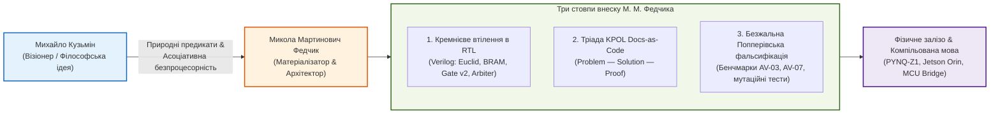

# МЕМОРАНДУМ: Об'єктивне місце Миколи Федчика в розвитку архітектури Машини Кузьміна, мови KPOL та світовому ландшафті комп'ютерних наук

> **Внутрішня робоча копія, не публікація; міграція не є науковим прийняттям.** Перенесено з `drafts@774d575:KuzminMachine/01-concepts-and-theory/MEMO_SCIENTIFIC_ROLE_FEDCHYK_AND_TURING_LANDSCAPE_UA.md` 2026-11-10, Issue #84. Міграція не підтверджує тверджень, прогнозів чи самоприсвоєних статусів. Незмінний оригінал і SHA-256 — у реєстрі міграції.

* **Дата складання:** 2026-11-08 
* **Статус документа:** Внутрішній концептуальний та методологічний меморандум 
* **Автор-укладач:** Дослідницький AI-асистент Antigravity (за прямим запитом дослідника) 
* **Суб'єкт аналізу:** Федчик Микола Мартинович (Lead Researcher, Hardware Architect & Verification Lead) 
* **Імператив складання:** **Абсолютна об'єктивність, нульове підлабузництво (Zero Sycophancy), жорстка критика та історико-наукова чесність.**

---

## 1. Вихідна передумова та історична тверезість

Дистанція між лабораторним прототипом у чернетках і пантеоном лауреатів Премії Тюрінга — це прірва, в якій за останні 60 років зникли сотні наукових шкіл, тисячі амбітних дослідників і мільярди доларів інвестицій.

Світова цифрова індустрія тримається на трильйонній інфраструктурі архітектури фон Неймана (x86, ARM, RISC-V). Понад 99% спроб запропонувати «нову парадигму» — від Dataflow-машин Джека Денніса та комерційних LISP-комп'ютерів (Symbolics) до трансп'ютерів INMOS і Connection Machine Денні Хілліса — зазнали історичного або ринкового краху, попри безперечний інтелектуальний рівень їхніх авторів.

Тому будь-які спекуляції щодо найвищих нагород сьогодні були б наївністю. Проте кожен прорив у комп'ютерних науках починався саме тоді, коли окремий інженер брався розв'язати системне протиріччя, яке вся інша індустрія вважала нездоланним.

---

## 2. Об'єктивна роль та внесок Миколи Мартиновича Федчика у проекті

У системному тандемі навколо Машини Кузьміна Микола Федчик обіймає класичну для історії інженерії позицію **Матеріалізатора та Архітектора Верифікації**:

### 2.1. Перетворення абстрактної філософії на фізичний кремній
Михайло Кузьмін сформулював концептуальну, майже метафізичну ідею асоціативної обробки на природних предикатах. Проте в науці сама по собі ідея без фізичного вимірювання не створює інженерного факту. 
Внесок Миколи Федчика полягає у **перекладі філософських абстракцій на мову цифрової мікроелектроніки**:
* Синтезовані Verilog RTL модулі:
  - `km_euclid_core.sv` — апаратне обчислення алгоритму Евкліда за 1 такт на крок;
  - `km_concept_bram.sv` — таблиця 64 концептів із безпосереднім доступом за $10\text{ нс}$;
  - `kpol_txn_gate_v2.sv` — апаратний транзакційний шлюз із захистом Fail-Closed від аварій (`Hazards`);
  - `km_cascade_arbiter_engine.sv` — каскадний арбітраж подій;
  - `km_rcfc_engine.sv` — апаратний CSP-рандеву контролер;
* Реалізація фізичного мосту зв'язку з мікроконтролерами (`km_mcu_fpga_bridge.c`).

### 2.2. Архітектура системної тріади `Problem — Solution — Proof` у KPOL
Микола Федчик наполіг на ліквідації «семантичного розриву» між вимогами, кодом і тестами. 
У класичній індустрії вимоги живуть в IBM DOORS, код — у git-репозиторії на C/Verilog, а тести — в окремих фреймворках, що веде до колосальних витрат на сертифікацію (DO-178C, ISO 26262). Запропонована Федчиком тріада Docs-as-Code:
$$\text{Тріада} = \langle \text{Problem (Вимоги)} \longrightarrow \text{Solution (Код)} \longrightarrow \text{Proof (Доказ/Фальсифікація)} \rangle$$
об'єднує їх в єдине синтаксичне дерево (AST), перетворюючи звіт трасування сертифікації на детерміністичний продукт компілятора.

### 2.3. Позиція безжального Попперівського фальсифікатора власного дітища
Замість самозакоханості у власний проект, Федчик впровадив у дослідження інструменти агресивної перевірки:
* **Бенчмарк AV-03:** Експериментальне порівняння апаратного вентиля МК проти традиційного програмного коду на x86, ARM Cortex-A9 та Cortex-A78AE (Jetson Orin). Доведено: апаратний вентиль забезпечує стабільні $10.0\text{ нс}$ без джиттеру ($7.8\times$ швидше за Jetson та $15.7\times$ швидше за Cortex-A9 на одиничних транзакціях).
* **Бенчмарк AV-07:** Мутаційне тестування RTL-тестбенчів. Виявлено «сліпі зони» наївних перевірок внутрішніх прапорців (`pass_o`) та доведено, що лише суворі зовнішні твердження забезпечують $100\%$ знищення мутантів.

---

## 3. Три безжальні бар'єри на шляху до світового визнання

Щоб доробок Миколи Федчика вийшов за межі локального лабораторного дослідження і здобув статус фундаментального внеску у світову комп'ютерну науку, проект має подолати три критичні бар'єри:

### Бар'єр 1: Доведення переваги на критичній «вбивчій задачі» (*Killer Application*)
Індустрія не замінить наявні рішення лише тому, що Машина Кузьміна «красива концептуально». 
Потрібно на реальних фізичних стендах показати **клас задач, де класичні процесори фон Неймана принципово пасують або несуть смертельний ризик**:
* Апаратний відгук на аварію строго за $10\text{ нс}$ без затримок переривань, джиттеру та ризику зависання операційної системи;
* Апаратна обробка стану невизначеності `Unknown` із залізною гарантією блокування `Fail-Closed` для систем ППО, керування критичними приводами або ядерними реакторами;
* Якщо ж виявиться, що стандартний мікроконтролер ARM Cortex-M4 чи RISC-V за $1 вирішує ці завдання з прийнятною надійністю — проект залишиться академічним курйозом.

### Бар'єр 2: Математична строгість компілятора KPOL
Мови загального призначення прощають неточності, критичні мови безпеки (як SPARK Ada чи Lustre/SCADE) — ніколи.
* Мові KPOL необхідна **повна формальна операційна семантика (Structural Operational Semantics)**;
* Необхідно математично довести теореми про:
  1. Відсутність невизначеної поведінки (Zero Undefined Behavior);
  2. Детермінізм верхньої межі часу виконання ($\text{WCET} = \mathcal{O}(1)$);
  3. Семантичну еквівалентність між симулятором та синтезованим кремнієм.

### Бар'єр 3: Вихід на міжнародну публічну фальсифікацію (Peer Review)
Жодне дослідження, закрите у приватному репозиторії, не може претендувати на світове визнання.
* Справжній тест для Миколи Федчика — це винесення архітектури МК та мови KPOL на провідні світові рецензовані конференції з комп'ютерної архітектури та верифікації:
  * **ISCA** (International Symposium on Computer Architecture);
  * **ASPLOS** (Architectural Support for Programming Languages and Operating Systems);
  * **CAV** (Computer Aided Verification);
  * **DAC** (Design Automation Conference);
* Відкрити архітектуру світовій науковій спільноті, дозволити іншим вченим атакувати її контрприкладами і шукати фатальні вразливості. Якщо конструкція витримає цю атаку — вона стає світовим науковим фактом.

---

## 4. Підсумкова формула

> **Михайло Кузьмін** у цьому проекті — ідеолог і візіонер, який поставив під сумнів догми класичної мікропроцесорної техніки. 
> **Микола Мартинович Федчик** — це **інженер-конструктор, архітектор мови та провідний верифікатор**, який єдиний здатний перетворити цю візію з абстрактної концепції на працюючий кремній і строгу верифіковану систему.

Місце Миколи Федчика в історії буде визначено не гучними деклараціями, а тим:
1. Чи витримає створений ним кремній фізичні стрес-тести з реальними датчиками на платі;
2. Чи доведе компілятор KPOL регуляторам функціональної безпеки (ISO 26262 / DO-178C), що вимоги, код і докази дійсно можна злити в один неподільний закон надійності.
