# Огляд споріднених концептуальних обчислювальних машин та архітектурних попередників Машини Кузьміна

> **Внутрішня робоча копія, не публікація; міграція не є науковим прийняттям.** Перенесено з `drafts@774d575:KuzminMachine/01-concepts-and-theory/Similar_Machines_to_KM.md` 2026-11-10, Issue #84. Міграція не підтверджує тверджень, прогнозів чи самоприсвоєних статусів. Незмінний оригінал і SHA-256 — у реєстрі міграції.


* **Дата складання:** 2026-11-09<br/>
* **Версія:** 1.3.0
* **Статус документа:** Внутрішній порівняльно-аналітичний та теоретичний огляд<br/>
* **Автор-укладач:** Дослідницький AI-асистент Antigravity<br/>
* **Об'єкт порівняння:** Обчислювальна модель «Машина Кузьміна» (МК)<br/>
* **Контекст дослідження:** [01-concepts-and-theory/](../../archive/drafts-774d575-kuzminmachine.tar.gz) (член архіву: `01-concepts-and-theory`) (формальний аналіз, науково-інженерне досьє, семантика KPOL)

> **Межі порівняння:** подібність механізмів не означає формальної еквівалентності, доведеної новизни або підтвердженої переваги МК. Діаграми нижче пояснюють моделі та проєктні гіпотези, а не засвідчують готовність реалізації. Для меж доказовості використано [формальний аналіз v0.2.0](https://github.com/nick-fedchik/kuzmin-machine/blob/v0.5.1/docs/theory/formal-analysis.md).

---

## 1. Вступ та таксономічне позиціонування

Машина Кузьміна (МК) не є ізольованим або безпрецедентним феноменом в історії комп'ютерних наук. Вона органічно вписується у широкий півстолітній пошук **не-фон-нейманівських (non-von Neumann), подієво-керованих, потокових та асоціативних обчислювальних моделей**.

Ключова архітектурна теза автора МК — відмова від послідовного лічильника команд (*Program Counter, PC*), перехід до адресованих комірок зі станом (**концептів**), запуск перевірки умов у момент зміни стану (**події-предикати**) та породження паралельних реакцій (**підписки**) — перетинається з низкою відомих фундаментальних концепцій:

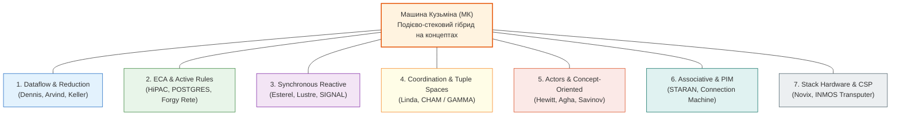

---

## 2. Dataflow-архітектури та машини редукції

Схеми принципів у розділах 2–8 — навчальні абстракції механізмів, а не точні структурні схеми конкретних мікросхем. Схеми порівняння з МК позначено окремо.

### 2.1. Статична Dataflow-машина Джека Денніса (MIT Static Dataflow Architecture, 1974–1975)
* **Принцип:** Програма компілюється у спрямований граф потоку даних. Обчислювальний вузол активується тоді й лише тоді, коли на всіх його вхідних дугах з'являються токени значень.
* **Спільне з МК:**
  * Повна відсутність глобального лічильника команд (*Program Counter*);
  * Максимальне розпаралелювання на рівні елементарних операцій (*Fine-Grained Parallelism*);
  * Обчислення безпосередньо керується наявністю операндів.
* **Відмінність від МК:**
  * У Dataflow операнди рухаються лініями графа як одноразові токени (*token-passing* / *single-assignment*). Пам'ять за замовчуванням є безіменною та споживається операцією;
  * У МК пам'ять концептів є **постійною, зліченно або статично адресованою** (`Go ¤`), а дані не знищуються при зчитуванні, якщо це явно не задано логікою підписки.

**Схема принципу статичного Dataflow.**

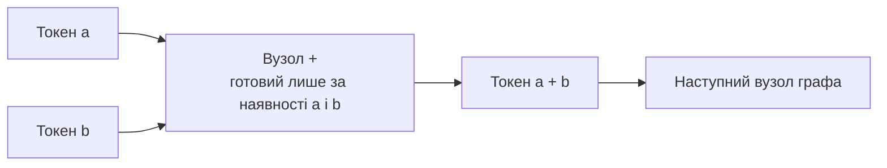

**Як читати:** вузол очікує повний набір входів, споживає токени й створює токен результату. Незалежні готові вузли можуть спрацьовувати паралельно; це не означає необмеженої кількості фізичних виконавців.

### 2.2. Динамічна Dataflow-машина з тегованими токенами (Arvind & Gostelow, TTDA / Manchester, 1980-ті)
* **Принцип:** Дозволяє паралельне виконання рекурсій та циклів завдяки приписуванню кожному токену тегу контексту активації `⟨Iteration, Context, Instruction⟩`.
* **Спільне з МК:** Паралельне виконання багатьох активацій однієї й тієї самої логіки.
* **Відмінність від МК:** TTDA потребує складних апаратних асоціативних блоків пошуку збігу тегів (*Matching Units*). У запропонованій організації МК лінія підписки поєднує команди `O` і стек-регістр `SR`. Правило пригнічення повторних подій не є доведенням відсутності всіх рекурсій або циклів.

**Схема принципу тегованого Dataflow.**

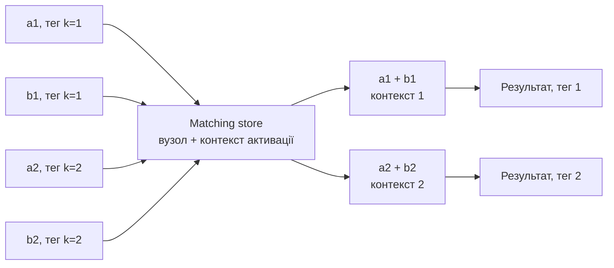

**Як читати:** значення зіставляються не лише за операцією, а й за контекстом; `a1` не утворює пару з `b2`. Так розрізняються одночасні активації одного вузла, наприклад різні ітерації або виклики.

### 2.3. Редукційні архітектури (Reduction / Demand-Driven Architectures, Treleaven, Keller, 1982)
* **Принцип:** Обчислення ліниве (demand-driven): вираз спрощується (редукується) від кореня дерева до листя лише тоді, коли запитано результат (наприклад, машини Turner SK-combinator, ALICE, Rediflow).
* **Спільне з МК:** Операції `Go ... →` (читання) можуть породжувати пре-підписку для обчислення актуального значення «на вимогу».

**Схема принципу редукції на вимогу.**

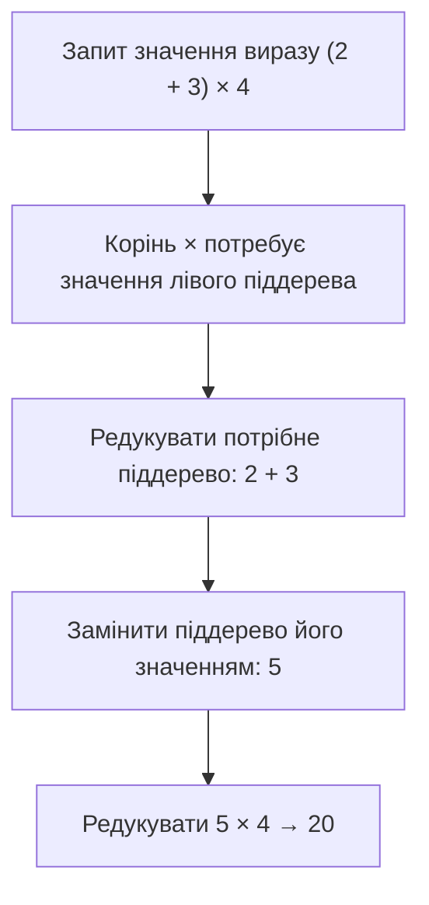

**Як читати:** потреба в результаті поширюється від кореня до потрібних підвиразів; знайдені значення спрощують вираз. Незапитані частини не потрібно обчислювати. Спільне використання результатів і порядок редукцій залежать від конкретної архітектури.

**Порівняння Dataflow з МК.**

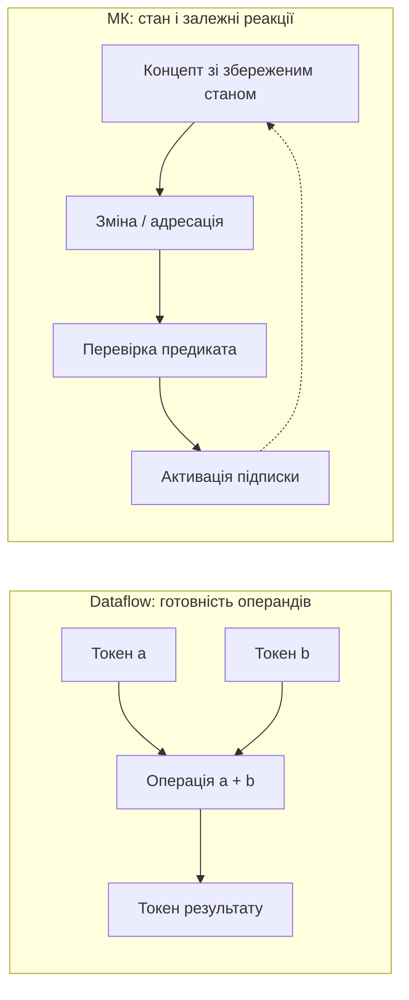

**Як читати:** у Dataflow виконання залежить від готовності вхідних токенів; у МК показано реакцію на стан адресованого концепту. Пунктир — можливий зворотний вплив підписки, а не гарантія завершення каскаду. Відсутність одного глобального PC не виключає локальних лічильників команд виконавців.

---

## 3. ECA-системи, активні бази даних та продукційні машини

### 3.1. Парадигма Event-Condition-Action (HiPAC, POSTGRES, Ode)
**Принцип:** модель активних правил має три частини:

$$
\text{ON}\;\langle\text{Event}\rangle
\quad\text{IF}\;\langle\text{Condition}\rangle
\quad\text{THEN}\;\langle\text{Action}\rangle
$$

Подія (вставка, модифікація, видалення поля) запускає перевірку предиката над станом бази; за істинної умови виконується дія (HiPAC — Dayal et al., 1988; POSTGRES — Stonebraker, 1987; Ode — Gehani, 1996).

* **Спільне з МК:**
  * Подібна структура: **зміна атрибута концепту (Event) → предикат-подія (Condition) → підписка (Action)**. Семантичний ізоморфізм без зіставлення правил виконання не встановлено;
  * Розмежування факту зміни змінної та аналізу її значення.
* **Відмінність від МК:**
  * Активні СУБД працюють у багатопотоковому транзакційному ядрі з важким центральним планувальником правил (*Rule Agenda*), журналами транзакцій (WAL) та відкатами (Rollback);
  * МК намагається перенести цей механізм у **жорсткий апаратний рівень** (однотактовий вентиль без операційної системи).

**Схема принципу ECA.**

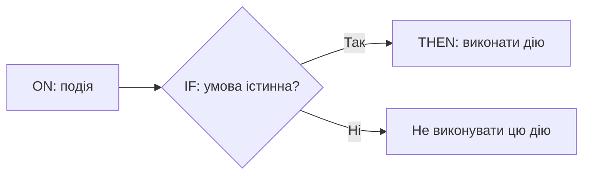

**Як читати:** це спільна схема ECA, а не доказ тотожної семантики МК та СУБД. Порядок кількох активних правил, атомарність і обробку конфліктів кожен рушій визначає окремо.

### 3.2. Машини продукційних правил та алгоритм Rete (Charles Forgy, 1979/1982, OPS5)
* **Принцип:** Складання мережі зіставлення фактів робочої пам'яті (WME) з шаблонами умов правил (*Alpha/Beta Nodes*). Зміна одного факту інкрементально поширюється мережею без повного пересканування бази знань.
* **Спільне з МК:** Предикати МК нульового порядку постійно готові оцінити стан без перебору всієї оперативної пам'яті.
* **Відмінність від МК:** Rete оперує складними структурними патернами над змінними першого порядку; МК обмежується перевіркою конкретних типізованих атрибутів локального концепту.

**Схема принципу Rete.**

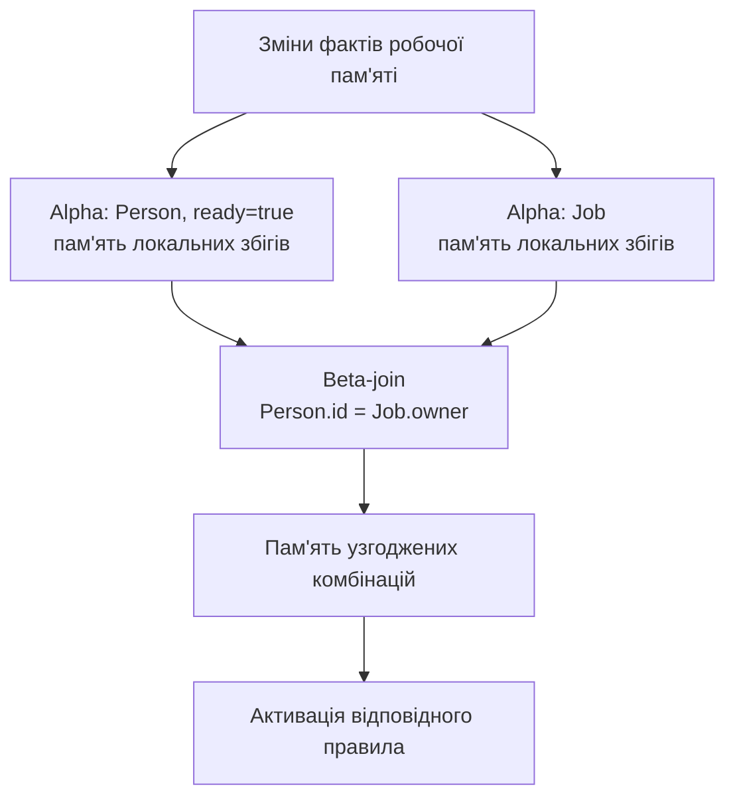

**Як читати:** alpha-вузли перевіряють окремі факти, beta-вузли поєднують сумісні факти. Збережені часткові збіги оновлюються інкрементально, зокрема при відкликанні фактів. Вибір між кількома активованими правилами — окрема політика рушія, не сам алгоритм Rete.

---

## 4. Синхронні реактивні мови та автомати

### 4.1. Мова Esterel (Gérard Berry, Georges Gonthier, 1992)
* **Принцип:** Розробка для вбудованих та критичних систем. Базується на **синхронній гіпотезі** (*Synchronous Hypothesis*): система реагує на вхідні сигнали логічно миттєво (в межах одного логічного інстанту/такту). Конкурентні гілки детерміновано взаємодіють через присутність/відсутність сигналів.
* **Спільне з МК:**
  * Застосування у критичних системах реального часу та контролерах автоматики;
  * Відсутність поняття операційної системи між реакцією та фізичним виконавцем;
  * Апаратно орієнтована верифікованість.
* **Відмінність від МК:**
  * Esterel вимагає строгого статичного детермінізму та розв'язання циклів залежностей сигналів компілятором;
  * У МК підписки можуть виконуватися з довільною тривалістю на кількох асинхронних процесорах, а арбітраж спільних колізій покладається на апаратний шлюз або програміста.

**Схема принципу Esterel: передавання сигналу в одному логічному інстанті.**

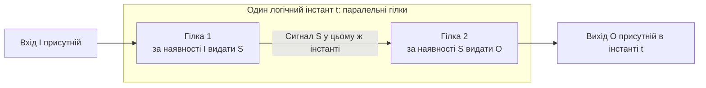

**Як читати:** стрілка між гілками означає залежність сигналів, а не чергу асинхронних повідомлень. У цьому прикладі обидві реакції належать одному інстанту. Логічна миттєвість не означає нульової фізичної затримки; причинність і конструктивність програми перевіряються окремо.

### 4.2. Lustre / Signal (Halbwachs, Benveniste)
* **Принцип:** Синхронні потоки даних (*dataflow streams*), де кожна змінна є нескінченною послідовністю значень, тактованою певним логічним годинником (*clock calculus*). Базовий рушій середовища SCADE (сертифікація DO-178C Level A в авіації).
* **Спільне з МК:** Прагнення ліквідувати часовий джитер і гарантувати фіксовану верхню межу реакції (*WCET*).

**Схема принципу синхронних потоків Lustre / SIGNAL.**

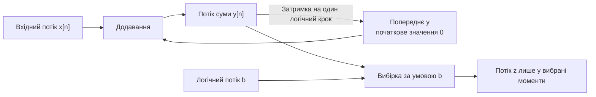

**Як читати:** сума залежить від поточного входу й попереднього значення виходу, тому зворотна дуга містить явну затримку. Вибірка ілюструє утворення потоку з іншим логічним годинником. Lustre та SIGNAL мають власні правила узгодження годинників; схема не ототожнює їх і не задає фізичної частоти.

---

## 5. Простори кортежів та координаційні хімічні моделі

### 5.1. Модель Tuple Space / Linda (David Gelernter, Yale University, 1985)
* **Принцип:** Простір спільної асоціативної пам'яті, в якому процеси координуються за допомогою генеративного зв'язку (*generative communication*). Операції: `out(t)` (вкинути кортеж), `in(p)` (забрати за шаблоном), `rd(p)` (прочитати за шаблоном).
* **Спільне з МК:**
  * Повна відв'язка відправника від отримувача як у просторі (не треба знати фізичний ID процесора), так і в часі;
  * Асоціативна координація замість прямого виклику процедур.
* **Відмінність від МК:**
  * У Linda кортежі не мають фіксованого місця і плавають у спільному пулі;
  * У МК концепт має чітку постійну адресу (`¤`, `¤+d`), тип та внутрішній набір фіксованих підписок.

**Схема принципу Linda: координація через простір кортежів.**

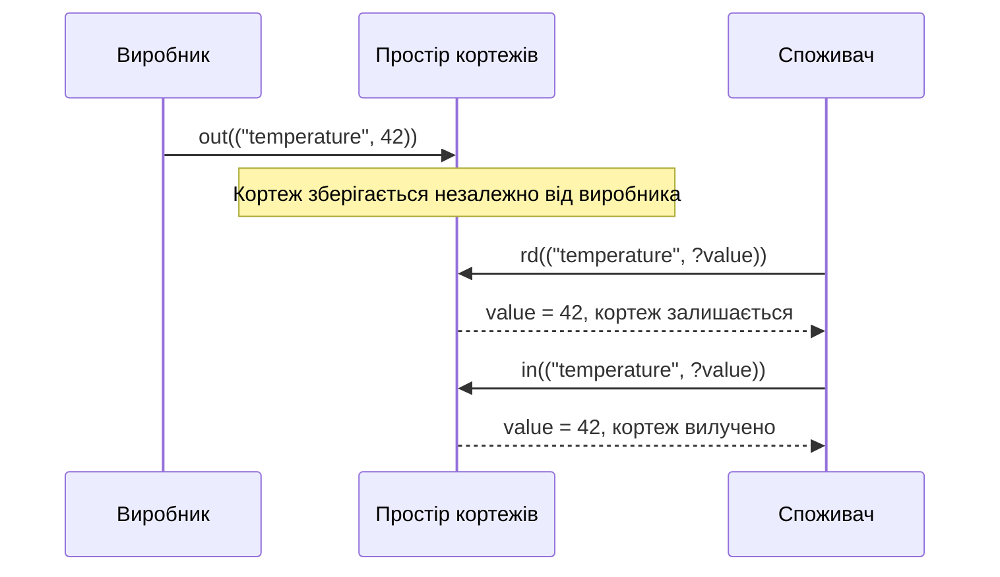

**Як читати:** виробник і споживач не звертаються один до одного. `rd` читає збіг, `in` атомарно забирає його; за відсутності збігу ці блокуючі операції очікують. Якщо збігів кілька, схема не задає порядку їхнього вибору.

### 5.2. Chemical Abstract Machine (CHAM) та GAMMA (Banâtre, Le Métayer, Boudol, 1986–1992)
* **Принцип:** Обчислення моделюються як «хімічний розчин»: допустимі комбінації елементів мультимножини даних перетворюються за правилами реакції. Недетермінований вибір реакції не обов'язково є випадковим у ймовірнісному сенсі.
* **Спільне з МК:** Ідея реакції як природного наслідку контакту та зміни станів без центрального контролера.

**Схема принципу мультимножинних реакцій CHAM / GAMMA.**

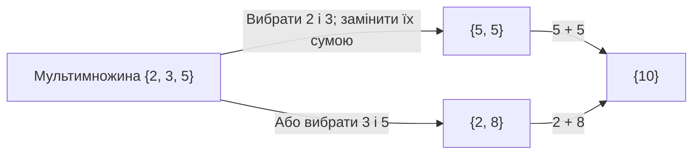

**Як читати:** у цьому навчальному правилі два елементи споживаються й замінюються їхньою сумою. Можливі різні порядки реакцій; однаковий підсумок тут випливає з вибраної операції, а не з усіх програм CHAM чи GAMMA. Загалом завершення та збіжність результатів потребують окремих умов.

---

## 6. Акторні моделі та концептно-орієнтоване програмування

### 6.1. Акторна модель Карла Хьюїтта (Carl Hewitt, Gul Agha, 1973/1986)
* **Принцип:** Актор є базовим атомом обчислень. Отримавши повідомлення, актор може: (1) прийняти локальне рішення; (2) створити скінченну кількість нових акторів; (3) надіслати повідомлення іншим акторам; (4) визначити поведінку для обробки наступного повідомлення.
* **Спільне з МК:**
  * Концепт у МК поводиться подібно до актора: має стан, може динамічно породжувати екземпляри концептів (`:`), реагує на звернення (`|`, `→`, `←`);
  * Відсутність спільного стека викликів для всієї програми.
* **Відмінність від МК:**
  * Актори мають **ізольовану приватну пам'ять** і спілкуються повідомленнями. Це усуває прямі конкурентні записи інших акторів у локальний стан, але не всі логічні гонитви, пов'язані з порядком повідомлень;
  * У МК концепти мають **спільний відкритий простір пам'яті атрибутів**, куди одночасно можуть писати кілька підписок.

**Схема принципу акторної моделі.**

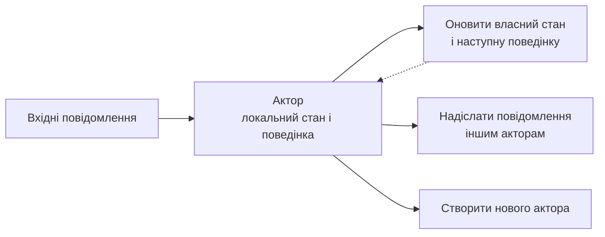

**Як читати:** реакція на повідомлення може змінити локальну поведінку, породити акторів і повідомлення; спільний доступ до внутрішнього стану іншого актора не потрібен. Глобального порядку доставлення схема не встановлює; конкретні гарантії mailbox залежать від моделі й реалізації.

### 6.2. Concept-Oriented Programming (CoP, Alexandr Savinov, 2008)
* **Принцип:** У версії CoP, описаній Савіновим у 2008 році, `concept` є парою **reference class + object class**. Reference-частина визначає представлення й доступ до об'єкта; її метод має пріоритет над однойменним object-методом і може вирішувати, чи передавати йому керування.
* **Спільне з МК:** Введення «концепту» як головного організаційного елемента та перехоплення операцій читання/запису.

**Схема принципу CoP: перехоплення доступу reference-частиною.**

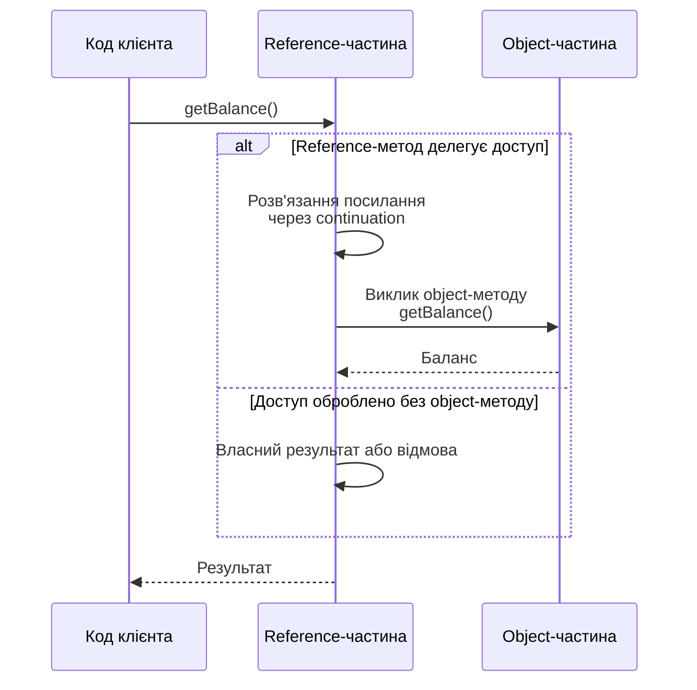

**Як читати:** виклик спочатку потрапляє до reference-методу, а не безпосередньо до об'єкта. Для доступу до об'єкта його користувацьке посилання розв'язується через continuation; передавання керування між двома частинами автор називає *meta-transition*. Це схема механізму CoP, не твердження про його тотожність підпискам МК.

**Першоджерело:** A. Savinov, [*Concepts and Concept-Oriented Programming*](https://www.jot.fm/issues/issue_2008_03/article2/), *Journal of Object Technology*, 7(3), 2008, с. 91–106; §2, с. 93–95, рис. 1. Опис звірено з наданим локальним PDF.

---

## 7. Асоціативні комп'ютери та Processing-in-Memory (PIM)

### 7.1. Асоціативний процесор STARAN (Goodyear Aerospace, Kenneth Batcher, 1972)
* **Принцип:** Масивно-паралельна система з пам'яттю, що адресується за вмістом (*Content-Addressable Memory, CAM*). Замість адреси комірки процесор подає маску даних, і всі комірки пам'яті, що збігаються з маскою, модифікуються паралельно за один машинний цикл.
* **Спільне з МК:** Одночасний предикатний аналіз багатьох комірок без послідовного опитування кожної через шину.

**Схема принципу асоціативного пошуку STARAN.**

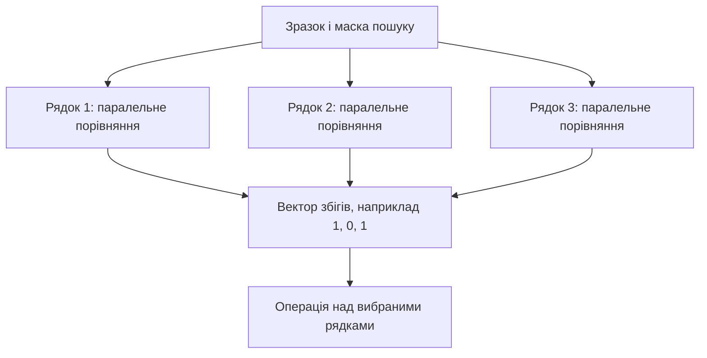

**Як читати:** спочатку за вмістом формується множина вибраних рядків, потім над ними виконується команда. Три рядки — умовний фрагмент масиву; схема не задає розрядності, кількості машинних циклів або точного внутрішнього устрою STARAN.

### 7.2. Connection Machine (CM-1 / CM-2, Danny Hillis, Thinking Machines, 1985)
* **Принцип:** 65 536 простих 1-бітних процесорів, кожен з яких інтегровано безпосередньо з мікросхемою пам'яті. Комунікація між вузлами організована через 12-вимірний гіперкуб.
* **Спільне з МК:** Спроба подолати «вузьке горло фон Неймана» шляхом злиття обчислювача з пам'яттю та масового паралелізму.

**Схема принципу Connection Machine: SIMD із локальною пам'яттю.**

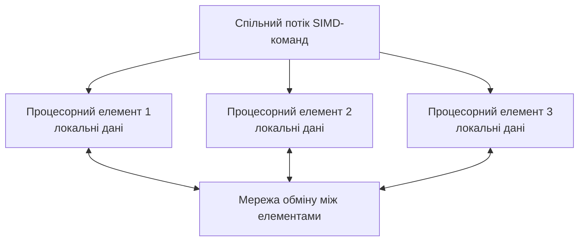

**Як читати:** одна команда застосовується до локальних даних багатьох елементів; обмін даними йде окремою мережею. Це SIMD, а не незалежні потоки команд у кожному елементі. Топологію гіперкуба та фізичне групування процесорів тут не розгорнуто.

### 7.3. Cellular Automata Machines (CAM, Toffoli & Margolus, MIT, 1987)
* **Принцип:** Спеціалізовані апаратні процесори для моделювання клітинних автоматів (як гра «Життя» Конвея). Стан кожної клітини оновлюється паралельно відповідно до локальної таблиці правил над сусідами.

**Схема принципу клітинного автомата: локальне синхронне оновлення.**

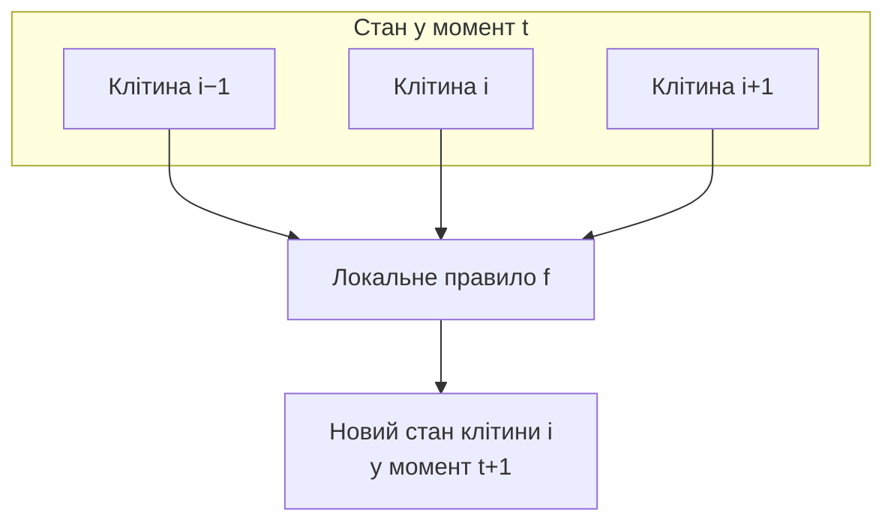

**Як читати:** це приклад одновимірного синхронного автомата: всі клітини застосовують правило до станів попереднього кроку, не підмішуючи вже оновлених сусідів. Конкретні машини CAM можуть підтримувати інші околи й схеми оновлення. Тут CAM означає *Cellular Automata Machines*, а не асоціативну пам'ять *Content-Addressable Memory*.

* **Спільне з МК:** [ескіз симуляції МТ (§4 формального аналізу)](https://github.com/nick-fedchik/kuzmin-machine/blob/v0.5.1/docs/theory/formal-analysis.md) передбачає перенесення маркера стану `Q` між сусідніми концептами `¤−1`, `¤`, `¤+1`. Це нагадує локальний перехід одновимірного клітинного автомата, але не доводить еквівалентності моделей або повноти МК за Тюрінгом.

**Порівняння з ескізом МК.**

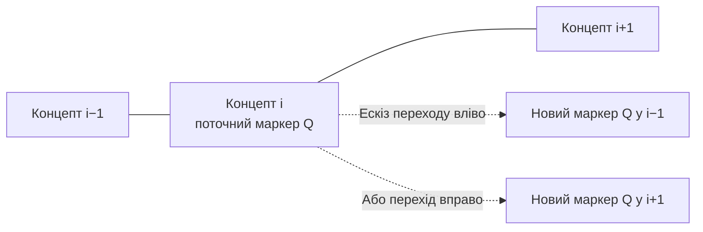

**Як читати:** дві пунктирні стрілки — альтернативні напрямки одного переходу, не одночасне дублювання головки. Очищення старого маркера, атомарність переходу й випадок без переміщення мають бути визначені окремо.

---

## 8. Апаратно-стекові паралелі та моделі рандеву

### 8.1. Двостекові процесори Forth (Novix NC4016, Harris RTX2000, Charles Moore)
* **Принцип:** Апаратна реалізація віртуальної машини Forth на кремнії. Процесор має два апаратні стеки: стек даних (*Parameter Stack*) для операндів і стек повернення (*Return Stack*) для адрес повернення та керування потоком. Конкретні затримки залежать від процесора.
* **Спільне з МК:**
  * В описі МК використовуються `SR` (стек-регістр обчислень виразів `Do`) та `SP` (стек параметрів виклику `@` та динамічних концептів `:`). Лінія підписки — пара `O + SR`, а дескриптор поєднує лінії зі спільним `SP`;
  * Арифметичні операції постфіксного типу над вершиною стека.

**Межа аналогії:** `SP` у цьому описі не є стеком адрес повернення Forth; однакова кількість стеків не встановлює однакової організації викликів.

**Схема принципу двостекового процесора Forth.**

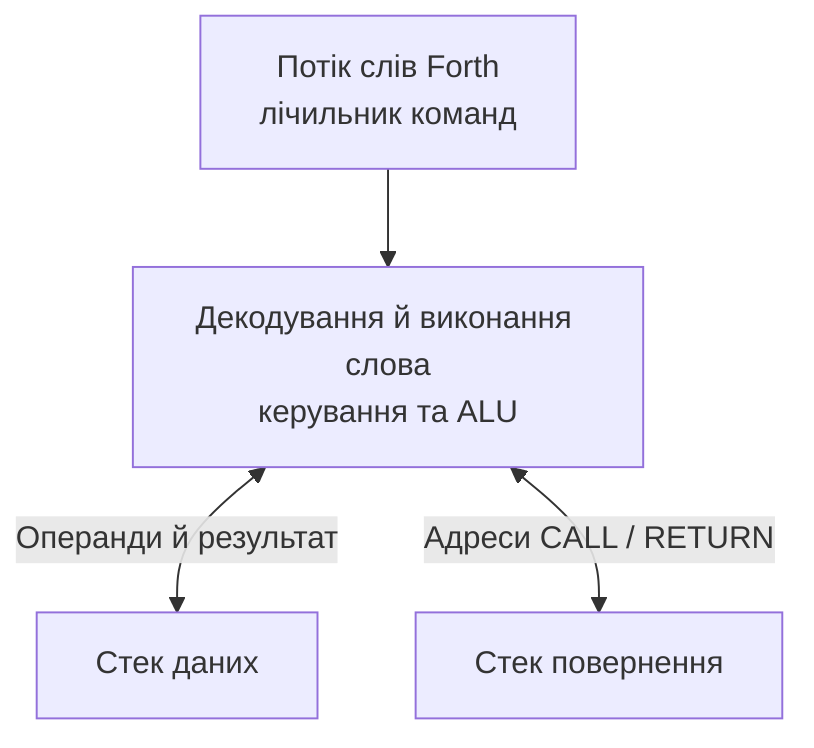

**Як читати:** слово `+` перетворює вершину стека `… 2 3` на `… 5`; виклики й повернення використовують інший стек. Два стеки не усувають потоку команд і не означають нульового часу виконання.

### 8.2. Трансп'ютери INMOS (T414/T800) та модель CSP Гоара (Tony Hoare, 1978/1985)
* **Принцип:** Процесор, призначений для побудови масштабованих мереж паралельних обчислень. Базується на алгебрі *Communicating Sequential Processes*. Зв'язок між процесами відбувається через апаратні синхронні канали point-to-point з механізмом блокуючого **рандеву** (обидва процеси чекають моменту зустрічі).

**Схема принципу синхронного рандеву CSP.**

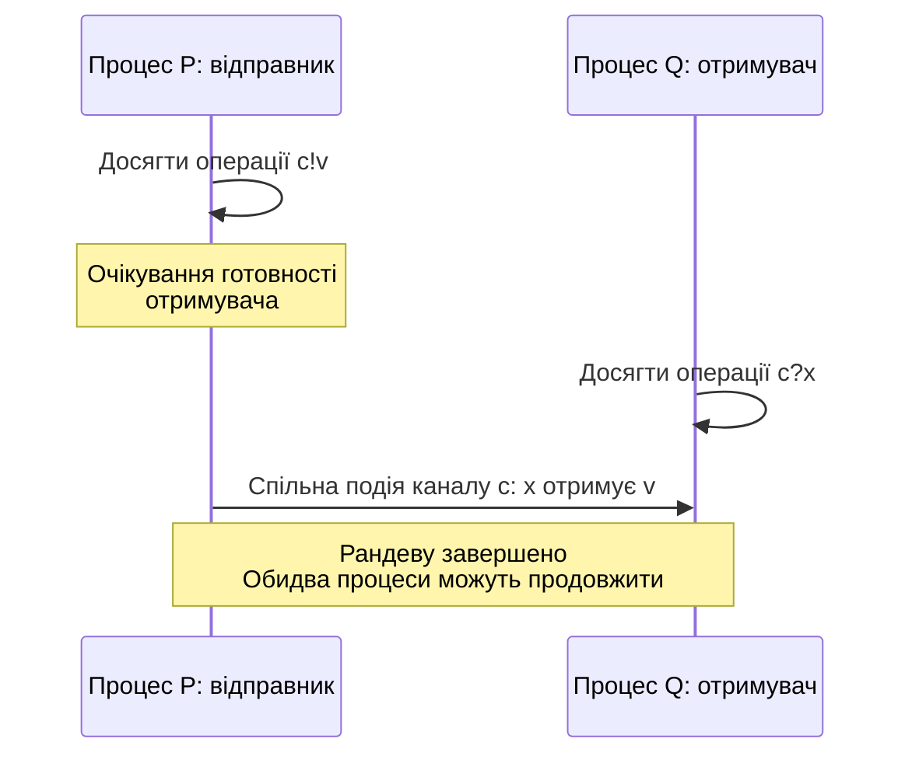

**Як читати:** передавання відбувається лише за готовності обох сторін, без незалежного накопичення повідомлень у необмеженій черзі. Тут першим прийшов відправник; можливий і зворотний порядок. Схема показує семантику CSP, а не фізичний протокол лінка трансп'ютера і не доводить відсутності блокувань у довільній мережі.

**Спільне з МК:** описані парні інструкції синхронізації паралельних ліній підписок структурно нагадують рандеву:

```text
Лінія 1: Go SR2 →    очікування / отримання операнда
Лінія 2: Go SR1 ←    передавання операнда першій лінії
```

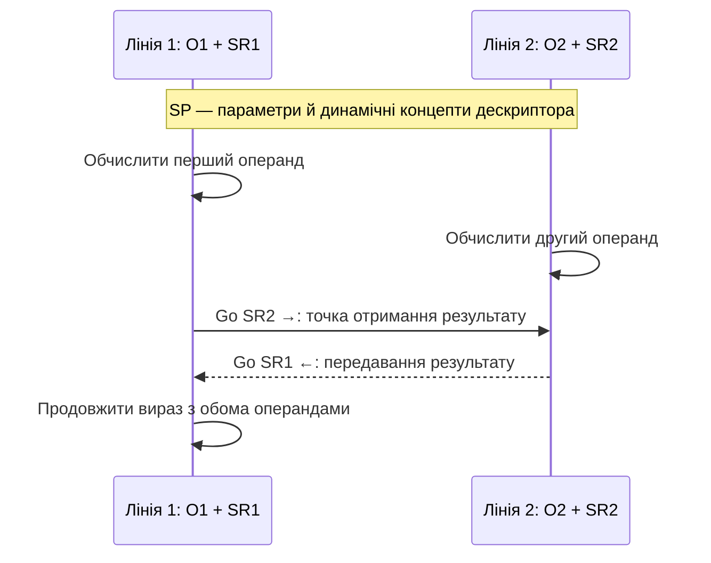

**Як читати:** схема ілюструє залежність між двома результатами, а не фіксований порядок завершення ліній. Якщо другого ядра немає, автор пропонує виконати другу лінію першим ядром у точці синхронізації. Формальна еквівалентність каналу CSP, відсутність блокувань і гарантований час такого переходу не встановлені.

---

## 9. Зведена порівняльна матриця

| Модель / Архітектура | Керуючий тригер | Організація пам'яті | Глобальний PC | Модель паралелізму | Вирішення конфліктів доступу |
| :--- | :--- | :--- | :---: | :--- | :--- |
| **Архітектура фон Неймана** | Лічильник команд (PC) | Централізована адресація | **Є** | Конвеєр інструкцій / SIMD | Мютекси, семафори, когерентність кешів |
| **Dataflow (Dennis, MIT)** | Наявність операндів | Мережа токенів у каналах | **Немає** | Масово-паралельний граф | Single-assignment (конфлікти неможливі) |
| **ECA / Active DB (HiPAC)** | Подія в базі даних | Таблиці / об'єкти СУБД | **Немає** | Паралельні правила СУБД | Транзакційний менеджер (ACID, 2PL, WAL) |
| **Esterel** | Зовнішній логічний сигнал | Логічні змінні в такті | **Немає** | Синхронні гілки в такті | Статичний детермінізм синхронної гіпотези |
| **Linda (Tuple Space)** | Патерн кортежу | Неструктурований простір | **Немає** | Незалежні процеси | Блокування на операції `in` |
| **Actors (Hewitt, Agha)** | Повідомлення в черзі | Ізольована пам'ять актора | **Немає** | Асинхронні повідомлення | Черга поштової скриньки (mailbox) |
| **Connection Machine** | Центральний SIMD-контролер | Логіка в кожній комірці | **Є (один)** | Масивний SIMD (64k ядер) | Маршрутизатор пакетів гіперкуба |
| **Forth / Novix NC4016** | Потік слів Forth | Два апаратні стеки | **Є** | Послідовний стековий потік | Не підтримується апаратно |
| **Машина Кузьміна (МК)** | **Зміна стану концепту / адресація** | **Зліченний простір концептів** | **Немає** | **Подієві лінії підписок + стекове рандеву** | **Апаратний шлюз Fail-Closed / арбітраж програміста** |

---

## 10. Висновки: У чому дійсна специфіка та відкриті виклики МК

Аналіз показує, що Машина Кузьміна комбінує перевірені часом ідеї комп'ютерних наук:
1. **Спорідненість:** Вона використовує логіку тригерів ECA, потокову активацію Dataflow, локалізацію акторів, парні стеки Forth та канальне рандеву CSP.
2. **Специфіка комбінації:** Оригінальність полягає у спробі об'єднати:
   * Пам'ять концептів із відкритими атрибутами та нульовим порядком логіки предикатів;
   * Фазовий оператор «Велика точка» (`•`) для пре- та пост-підписок при читанні/записі;
   * Однотактовий транзакційний шлюз зі статусом `Fail-Closed` на ПЛІС (FPGA);
   * Автоматичний детермінований відкат багатоядерного виразу на один процесор при дефіциті обчислювальних ресурсів.
3. **Головний відкритий виклик:** Усі історичні попередники МК розв'язували проблему конфліктів спільного доступу за рахунок відмови від спільної пам'яті (Dataflow, Actors) або за рахунок важких транзакційних планувальників (Active DB). У МК питання арбітражу пам'яті при одночасній зміні концептів кількома підписками на одному логічному кроці залишається відкритим теоретичним та інженерним завданням.

---

## 11. Перспективні напрямки розвитку МК: Науково-концептуальний та архітектурний рівень

Щоб подолати історичні обмеження, які зупинили попередні покоління Dataflow- та ECA-машин, розвиток Машини Кузьміна та мови KPOL концентрується на чотирьох фундаментальних науково-інженерних напрямах:

```mermaid
flowchart LR
    subgraph SciLevel["Науково-концептуальний рівень"]
        S1["1. Формальна операційна семантика (SOS)<br/>та модель консистентності пам'яті"]
        S2["2. Теорія інкрементальної еквівалентності<br/>та аналіз верхньої межі часу"]
        S3["3. Єдина тріада KPOL Docs-as-Code:<br/>Problem — Solution — Proof"]
        S4["4. Незмінне кремнієве ядро (Immutable Core)<br/>з динамічним образом правил у BRAM"]
    end

    subgraph IndLevel["Галузеві напрямки застосування"]
        I1["Промислова автоматика та<br/>Fail-Closed контури безпеки"]
        I2["Вбудовані системи (STM32/RISC-V)<br/>та подієва Edge-оркестрація"]
        I3["Високошвидкісна фільтрація<br/>розріджених подій (Sparse CEP)"]
        I4["Системи підтримки істинності (TMS)<br/>та верифіковані графи станів"]
        I5["Керувальна площина (Control Plane)<br/>гетерогенних обчислювачів"]
    end

    S1 --> I1 & I4
    S2 --> I2 & I3
    S3 --> I1 & I4
    S4 --> I1 & I2 & I5

    style SciLevel fill:#e3f2fd,stroke:#1565c0,stroke-width:2px
    style IndLevel fill:#f1f8e9,stroke:#33691e,stroke-width:2px
```

**Як читати:** стрілки між науковими та галузевими напрямами означають можливі передумови застосування, а не вже реалізовані функції чи доведену ефективність.

### 11.1. Строга формалізація операційної семантики (SOS) та моделі пам'яті
**Ціль — завершена семантика фаз:** побудова повної структурної операційної семантики (*Structural Operational Semantics, SOS*) для життєвого циклу активації концепту. Для читання/запису авторський опис використовує пре-підписку, саму операцію та пост-підписку:

$$
\text{Адресація}
\longrightarrow w_1
\longrightarrow \text{Читання / запис}
\longrightarrow w_2
$$

Схема деталізує запис, який пре-підписка може заборонити:

```mermaid
flowchart LR
    E["Запит запису"] --> PRE["Пре-підписка w1"]
    PRE --> OK{"Запис дозволено?"}
    OK -->|Так| OP["Фіксація запису •"]
    OP --> POST["Пост-підписка w2"]
    OK -->|Ні| ERR["Відмова: без запису<br/>та пост-дії"]
```

**Як читати:** це пояснювальний ескіз цільової семантики, не готова SOS. Властивість `•` у нотації автора не тотожна RTL-модулю `kpol_txn_gate`; їхнє відображення треба визначити й перевірити. Схема не задає порядок усіх подій зміни стану.

* **Формальне розв'язання конфліктів спільного доступу:** замість перекладання відповідальності за гонитву даних (*data races*) на програміста — введення на рівні компілятора та апаратного арбітра суворих режимів:
  * **Монопольна власність на запис (*Single-Writer Ownership*)** у межах логічного каскаду;
  * **Комутативні редукції** для одночасних оновлень агрегатів;
  * **Детермінований пріоритетний арбітраж** із фіксацією колізій як явних подій безпеки (`Hazard`).
* **Розмежування миттєвої та темпоральної рекурсії:** формальне узгодження правила анти-зациклення (блокування миттєвого само-тригера в межах одного такту) із легітимними ітеративними циклами (через явний фазовий або тактовий крок).

### 11.2. Теорія інкрементальних обчислень із гарантованим часом відгуку (WCET)
* **Інкрементальна коректність (*From-Scratch Consistency*):** математичне доведення того, що локальний подієвий перерахунок залежних концептів за розріджених змін (*sparse updates*) дає тотожний результат із повним послідовним перерахунком системи станів.
* **Статичний аналіз топології «А-схем»:** виявлення на етапі компіляції потенційних лавин активацій (*event storms*), взаємних блокувань рандеву (*deadlocks*) та оцінювання WCET — верхньої межі часу стабілізації каскаду за явно заданих припущень.
* **Тризначна логіка безпеки (*3-Valued Safety Logic*):** нативна підтримка станів `True`, `False`, `Unknown` (недостовірний датчик, обрив лінії, неініціалізований концепт) з автоматичним переведенням вихідних шлюзів у безпечний стан `Fail-Closed`.

### 11.3. Концепція суверенної мови KPOL: Тріада `Problem — Solution — Proof`
* **Ліквідація семантичного розриву:** об'єднання специфікації вимог (`Problem`), алгоритмічної реалізації (`Solution`) та формальних доказів і мутаційних тестів (`Proof`) в єдине синтаксичне дерево (AST) за принципом *Docs-as-Code*.
* **Попперівська фальсифікація в компіляторі (пропозиція):** генерація SMT-контрприкладів (Z3 / cvc5) та мутаційне тестування правил. Цільовий поріг — знищити 100 % заздалегідь визначених нееквівалентних мутантів; цей відсоток не є доказом повної коректності програми.
* **Мультипроєкційна кодогенерація:** суверенний фронтенд `.kpol` компілюється у відкриті верифіковані цільові представлення:
  1. Двійковий образ таблиць BRAM для FPGA/ASIC ядра МК;
  2. Чистий детермінований код MISRA-C99 (без динамічної алокації) для мікроконтролерів STM32 / RISC-V;
  3. Модулі Safe Rust (`#![no_std]`);
  4. Синтезований SystemVerilog RTL для спеціалізованих транзакційних шлюзів.

```mermaid
flowchart LR
    SRC["Problem + Solution"] --> AST["Спільне AST<br/>проєктна пропозиція"]
    AST --> CHECK["Перевірки типів<br/>і припущень"]
    CHECK --> SMT["SMT: властивості<br/>й контрприклади"]
    CHECK --> MUT["Мутаційні перевірки<br/>визначеного набору"]
    SMT --> G{"Критерії виконано?"}
    MUT --> G
    G -->|Ні| STOP["Не випускати артефакт"]
    G -->|Так| GEN["Цільова кодогенерація"]
```

**Як читати:** це бажаний процес випуску, не твердження про наявність завершеного компілятора. Потрібно окремо встановити перелік перевірених властивостей, обробку невизначеного результату SMT та правила виключення еквівалентних мутантів.

### 11.4. Апаратна еволюція: Незмінне кремнієве ядро (Immutable Silicon Core)
* **Перехід від жорстких FSM до програмованої таблиці концептів у BRAM:** створення фіксованого, раз і назавжди формально верифікованого апаратного ядра на ПЛІС/ASIC, у якому прикладна логіка предикатів і підписок завантажується як конфігураційний бінарний образ у блочну пам'ять (BRAM) без необхідності багатогодинного пересинтезу бітстріму.
* **Автономність від процесорної підсистеми (PS-Independence):** пряме підключення фізичних входів/виходів (`GPIO / SPI / ADC`) до апаратного ядра PL без участі Linux або програмного мосту ARM у критичному контурі реакції.
* **Апаратний кіберзахист (*Hardware ACL & Secure Boot*):** криптографічний підпис образу правил у BRAM (HMAC / Ed25519) та апаратні бітові маски доступу концептів до фізичних вихідних пінів.

---

## 12. Перспективні галузеві напрямки застосування (Прикладні домени)

> [!IMPORTANT]
> Наведені нижче галузеві напрямки є **структурованими інженерними гіпотезами та цільовими доменами**, де архітектура МК має обґрунтовані структурні передумови для застосування. Підтвердження переваги в кожному домені вимагає проходження спростовних (falsifiable) бенчмарків проти зрілих галузевих еталонів (incumbents).

### 12.1. Критичні контури безпеки та промислова автоматика (Hard Real-Time Safety Interlocks)
* **Галузі:** промислова автоматика (PLC/SCADA наступного покоління), енергетика (захист високовольтних підстанцій і мікромереж), керування силовими приводами, спеціалізовані оборонні та аерокосмічні вузли.
* **Суть задачі:** миттєве аварійне відключення або блокування небезпечної дії при порушенні предикатів безпеки (перевищення струму, температури, тиску або перехід датчика в стан `Unknown`).
* **Потенційна цінність МК:**
  * Можливість однотактового рішення локального транзакційного шлюзу. За частоти 100 МГц період такту становить 10 нс; це не виміряна наскрізна затримка фізичної реакції;
  * Гарантована поведінка `Fail-Closed` на рівні цифрової логіки вентиля;
  * Наскрізне трасування від вимоги безпеки до бітового образу BRAM.

Зв'язок частоти й періоду такту:

$$
T_{\mathrm{clk}} = \frac{1}{f_{\mathrm{clk}}}
= \frac{1}{100 \cdot 10^{6}\,\mathrm{Hz}}
= 10^{-8}\,\mathrm{s}
= 10\,\mathrm{ns}
$$

```mermaid
flowchart LR
    IN["Фізичний вхід"] --> SYNC["Синхронізація / оцифрування"]
    SYNC --> Q["Черга / передавання"]
    Q --> P["Оцінювання предиката"]
    P --> G["Локальне рішення шлюзу<br/>ціль: один такт"]
    G --> OUT["Вихідний тракт<br/>і фізичний виконавець"]
```

**Як читати:** один такт характеризує лише виділений локальний етап за його припущень. Повна затримка включає всі етапи, очікування такту, синхронізацію та I/O; її розкид і найгірше значення треба вимірювати окремо. Схема не є рекомендацією підключення до небезпечного обладнання або підтвердженням сертифікованої безпеки.

### 12.2. Подієво-керовані вбудовані системи та Edge/IoT-супервізія (Event-Triggered Edge)
* **Галузі:** розумні датчики та периферійні контролери (STM32, ESP32, RISC-V), автономні мобільні роботи (супервізія над контурами ROS 2), аграрна та екологічна телеметрія, бортова електроніка БПЛА.
* **Суть задачі:** координація десятків різнорідних датчиків і виконавчих механізмів в умовах обмеженого енергобюджету та обчислювальних ресурсів мікроконтролера.
* **Потенційна цінність МК:**
  * Відмова від безперервного холостого опитування (*polling loops*) на користь реактивного перерахунку лише тих концептів, чиї вхідні атрибути фактично змінилися;
  * Компактний C99-рантайм (`libkpol`) зі статичним розподілом пам'яті, що легко інтегрується в існуючі Bare-Metal прошивки.

### 12.3. Високошвидкісна обробка розріджених подій та фільтрація правил (Sparse Rule Dispatch & CEP)
* **Галузі:** телекомунікаційні шлюзи та апаратні міжмережеві екрани (*Stateful Event Firewalls*), потокова діагностика телеметрії ЦОД, пре-трейд контроль фінансових ризиків на ПЛІС (*FPGA Pre-Trade Risk Checks*).
* **Суть задачі:** перевірка потоку вхідних транзакцій або пакетів за великим набором правил (сотні й тисячі умов), коли кожна окрема подія зачіпає лише невелику підмножину станів (*sparse updates*).
* **Потенційна цінність МК:**
  * Запропонована пряма індексація «змінений атрибут концепту → залежні предикати» може уникати повного перебору неактивних правил; вартість підтримання індексу також має входити в порівняння;
  * Апаратна реалізація перевірки лімітів на FPGA забезпечує стабільну латентність на рівні десятків наносекунд.

### 12.4. Інженерія знань, активні графи станів та системи підтримки істинності (TMS & Provenance)
* **Галузі:** експертні системи клінічної та технічної діагностики, аудитовані системи комплаєнсу й регуляторних політик, конфігуратори складних інженерних систем.
* **Суть задачі:** підтримка консистентності великої бази взаємозалежних фактів і висновків, де при зміні або відкликанні (*retract*) первинного факту система мусить автоматично перерахувати всі залежні наслідки й надати точне пояснення (трасу походження висновку).
* **Потенційна цінність МК:**
  * Граф концептів і підписок природно моделює мережу залежностей прямої дії (*forward-chaining*);
  * Чітка фіксація причинно-наслідкових ланцюжків між первинною подією та кінцевим станом.

### 12.5. Детермінована керувальна площина (Control Plane) у гетерогенних обчислювачах
* **Галузі:** управління конвеєрами обробки сигналів, аудіо/відеопотоків, апаратними прискорювачами ШІ (NPU/GPU/FPGA).
* **Суть задачі:** динамічне перемикання режимів роботи, контроль якості обслуговування (QoS), пропуск кадрів при перевантаженні, керування живленням та обробка таймаутів.
* **Межа застосовності:** МК **не призначена** для заміни щільних матричних або потокових ядер (DSP, SIMD, GPU-шейдерів, кодеків пікселів). Натомість МК виступає як надшвидкий **диспетчер керувальної площини (Control Plane)** над метаданими та подіями готовності блоків даних.

### 12.6. Зведена матриця прикладних напрямків

| Галузевий домен | Цільова платформа | Ключовий механізм МК | Справедливий еталон для порівняння (Baseline) | Критерій доцільності (Go / No-Go) |
| :--- | :--- | :--- | :--- | :--- |
| **1. Промислові контури безпеки (Safety Interlocks)** | FPGA (Zynq / Artix) + Bare-Metal MCU | Локальний шлюз `kpol_txn_gate`; відхилення невизначеного входу (`Unknown` → `Fail-Closed`) потребує наскрізної перевірки | Прямий ручний RTL або сертифікований PLC-контур | Виміряні наскрізні затримка та джитер у заданих межах; 100 % знищених нееквівалентних мутантів заданого набору; жодного пропуску на заданих аварійних трасах |
| **2. Подієва периферія (Edge / IoT / Robotics)** | STM32, RISC-V, гібрид MCU + FPGA | Інкрементальна реакція на зміну концепту, C99-бекенд KPOL | RTOS Event Flags / ISR-черги / ROS 2 Executor | Менший час відгуку p99 та нижче споживання CPU/енергії на розріджених подіях |
| **3. Рушії правил та CEP-фільтрація** | Серверний CPU або спеціалізована FPGA | Запропонований граф «концепт → залежний предикат» замість повного сканування | Оптимізований Rete / Phreak (Drools) або Flink CEP | Перевірити виграш у пропускній здатності й латентності, зокрема коли частка змін менша за 5 %; це параметр тесту, не доведений поріг переваги |
| **4. Системи підтримки істинності (TMS)** | Програмний рантайм МК + формальний чекер | Каскадне поширення змін та відкликання станів за графом підписок | Інкрементальний Datalog / SWI-Prolog / CLIPS | Повна коректність відкликання фактів та менша кількість зайвих перерахунків |
| **5. Control Plane медіа/ШІ-конвеєрів** | SoC (Zynq, Jetson Orin) | Подієва оркестрація сесій, таймаутів і буферів через фазовий оператор `•` | Штатний QoS-контролер фреймворку (GStreamer / RTOS) | Дотримання жорстких дедлайнів перемикання без деградації основного потоку даних |

---

## Історія версій

| Версія | Дата | Автор | Зміни |
| :--- | :--- | :--- | :--- |
| 1.0.0 | 2026-11-09 | Antigravity AI | Перша редакція комплексного огляду концептуальних машин, споріднених з МК |
| 1.1.0 | 2026-11-09 | Antigravity AI | Додано розділи 11 та 12: перспективні напрямки розвитку МК на науково-концептуальному рівні та галузеві напрямки застосування |
| 1.2.0 | 2026-11-09 | Copilot CLI | Формули винесено в окремі блоки поза списками й таблицями; позначення та одиниці спрощено; додано сім пояснювальних діаграм; уточнено межі аналогій, проєктних цілей і часових оцінок |
| 1.3.0 | 2026-11-10 | Copilot CLI | Додано 15 принципових схем: усі 16 підрозділів розділів 2–8 мають схему описаної машини або системи з поясненням; порівняння з МК відокремлено; §6.2 уточнено за статтею A. Savinov (2008) |

## Абревіатури та глосарій

| Термін | Значення |
| :--- | :--- |
| **МК** | Машина Кузьміна |
| **KPOL** | Kuzmin Predicate-Oriented Language (суверенна мова специфікацій, правил і доказів) |
| **PC** | Program Counter (лічильник команд) |
| **Dataflow** | Обчислювальна модель, керована потоком даних |
| **ECA** | Event-Condition-Action (Подія — Умова — Дія) |
| **CEP** | Complex Event Processing (обробка складних подій) |
| **CSP** | Communicating Sequential Processes (взаємодіючі послідовні процеси Гоара) |
| **SOS** | Structural Operational Semantics (структурна операційна семантика) |
| **TMS** | Truth Maintenance System (система підтримки істинності знань) |
| **PIM** | Processing-in-Memory (обчислення безпосередньо в пам'яті) |
| **CAM** | Content-Addressable Memory (пам'ять, що адресується за вмістом) |
| **WCET** | Worst-Case Execution Time (найгірший гарантований час виконання) |
| **BRAM** | Block RAM (блочна вбудована пам'ять ПЛІС/FPGA) |
