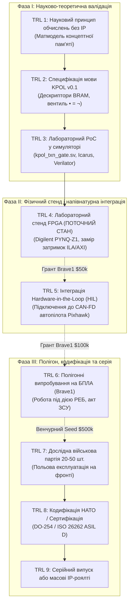
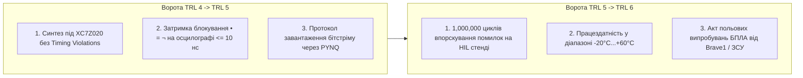

# Мемо: Оцінка та верифікація рівнів технологічної готовності (TRL) Машини Кузьміна

> **Внутрішня робоча копія, не публікація; міграція не є науковим прийняттям.** Перенесено з `drafts@774d575:KuzminMachine/04-verification-and-qa/KUZMIN_MACHINE_TRL_ASSESSMENT_MEMO_UA_v1.0.md` 2026-11-10, Issue #84. Міграція не підтверджує тверджень, прогнозів чи самоприсвоєних статусів. Незмінний оригінал і SHA-256 — у реєстрі міграції.

**Версія:** 1.0 
**Дата:** 7 листопада 2026 року 
**Статус:** Інженерно-аналітичний меморандум визначення поточної технологічної зрілості та програми випробувань 
**Об'єкт:** Архітектура Машини Кузьміна (МК), мова KPOL v0.1, транзакційний шлюз `kpol_txn_gate.sv`, експериментальний стенд Digilent PYNQ-Z1 (Xilinx Zynq-7020 XC7Z020CLG400-1) 

---

## 1. Короткий висновок (Executive Summary)

1. **Поточний підтверджений статус:** 
   Машина Кузьміна повністю та беззаперечно закрила рівні **TRL 1, TRL 2 та TRL 3** (теоретичне обґрунтування, специфікація мови KPOL v0.1, потактовий лінтинг у Verilator, функціональна симуляція модуля SystemVerilog `kpol_txn_gate.sv` в Icarus Verilog та структурна синтезованість у Yosys).
2. **Активний рубіж (TRL 4, 70% готовності):** 
   Проєкт перебуває на стадії лабораторної валідації на фізичному кремнії. Плата **Digilent PYNQ-Z1** із чипом Xilinx Zynq-7020 розгорнута в лабораторії (`~/vida/tlumach`). Підтверджено роботу середовища Linux Zynq-7000, взаємодію підсистеми процесора (PS) з логікою (PL) через AXI та завантаження базового overlay (`base.bit`). 
   *Критична межа TRL 4:* Для 100% закриття TRL 4 необхідно завершити синтез спеціалізованого бітстріму ядра МК під XC7Z020, провести завантаження через PYNQ і фізично зафіксувати часову затримку відхилення інваріанта `• = ¬` цифровим осцилографом / Vivado ILA.
3. **Застереження проти "TRL Inflation" (штучного завищення зрілості):** 
   У практиці оцінки оборонних та критичних технологій категорично неприпустимо заявляти рівні **TRL 5** (інтеграція в актуатор/автопілот) або **TRL 6** (полігонні випробування у складі БПЛА) на підставі лише програмних тестів чи лабораторної плати. Заявлення TRL 5/6 без підписаних протоколів напівнатурного стенда (HIL) чи актів полігона веде до дискваліфікації грантових заявок у кластері **Brave1**.
4. **Джерела вимірювань і доказів:** 
   Рівень зрілості вимірюється суто апаратно-програмними метриками (затримка в наносекундах, максимальна частота $F_{\max}$, використання BRAM/LUT, відсутність збоїв пам'яті під дією завад). Усі артефакти структуровано в каталогах [`02-engineering-hardware/`](../../archive/drafts-774d575-kuzminmachine.tar.gz) (член архіву: `02-engineering-hardware`), [`04-verification-and-qa/`](../../archive/drafts-774d575-kuzminmachine.tar.gz) (член архіву: `04-verification-and-qa`) та [`06-economic-model/`](../../archive/drafts-774d575-kuzminmachine.tar.gz) (член архіву: `06-economic-model`).

---

## 2. Анатомія шкали TRL для апаратно-програмних рішень

Оцінка зрілості відповідає міжнародному стандарту **ISO 16290:2013** та регламенту військово-технічної експертизи **Brave1**:

---

## 3. Детальна інвентаризація поточної зрілості Машини Кузьміна

Нижче наведено статус кожного рівня зрілості з переліком підтверджених артефактів та залишкових робіт:

### TRL 1: Базові наукові принципи досліджено та описано (Завершено — 100%)
* **Вимога стандарту:** Публікація або формалізація фундаментальних законів функціонування системи.
* **Доказ у МК:** Математичне формулювання концептної пам'яті, де переходи відбуваються без лічильника команд (Instruction Pointer) за рахунок комбінаційної фільтрації фазовим вентилем `• = ¬`.
* **Артефакт:** Документ [`01-concepts-and-theory/Kuzmin-Machine-ASN-Specification-UA.md`](../../theory/asn.md).

### TRL 2: Концепція технології та сфера застосування сформульовані (Завершено — 100%)
* **Вимога стандарту:** Специфікація системних компонентів, сценарії використання, вибір базових елементів.
* **Доказ у МК:** Повна специфікація високорівневої мови KPOL v0.1, двійкове кодування 32-бітних слів команд, структура 128-бітного дескриптора концепту в BRAM.
* **Артефакт:** Документ [`03-engineering-software/Kuzmin-Machine-High-Level-Language-Specification-UA.md`](../software/Kuzmin-Machine-High-Level-Language-Specification-UA.md).

### TRL 3: Аналітичне та експериментальне підтвердження критичних функцій (Завершено — 100%)
* **Вимога стандарту:** Програмні моделі компонентів, верифікація в емуляторах, успішні тестбенчі.
* **Доказ у МК:**
  1. Рекурсивний grammar-парсер та AST-валідатор на Python (`kpol_reference.py`, 18 модульних тестів пройдено).
  2. RTL-модуль транзакційного шлюзу `kpol_txn_gate.sv` мовою SystemVerilog: пройдено симуляцію в Icarus Verilog (`kpol_txn_gate_tb.sv`), статичний лінтинг Verilator (без помилок і комбінаційних петель), успішний структурний аналіз Yosys.
* **Артефакти:** [`rtl/kpol_txn_gate.sv`](../../../hw/rtl/core/kpol_txn_gate.sv), [`tb/kpol_txn_gate_tb.sv`](../../../hw/tb/kpol_txn_gate_tb.sv).

### TRL 4: Валідація компонентів у лабораторному середовищі (У процесі — 70%)
* **Вимога стандарту:** Працездатність ключових компонентів на фізичному апаратному забезпеченні в лабораторних умовах.
* **Поточний стан у МК:**
  - Лабораторний стенд на базі SoC Xilinx Zynq-7020 (плата Digilent PYNQ-Z1) розгорнуто та перевірено.
  - Середовище Linux Zynq-7000 та пакет PYNQ 3.1.1 функціонують; базовий бітстрім `base.bit` завантажується, зв'язок PS-PL через шину AXI підтверджено.
* **Залишкові задачі для 100% закриття TRL 4:**
  1. Синтез цільового RTL-модуля МК під кристалічну ревізію `xc7z020clg400-1` у Vivado.
  2. Завантаження бітстріму через драйвер PYNQ Overlay.
  3. Фізичний вимір затримки відхилення некоректної транзакції апаратним лічильником AXI та осцилографом на пінах Pmod (вимога: $t_{\mathrm{react}} \le 10\text{ нс}$).
* **Артефакти:** [`02-engineering-hardware/Kuzmin-Machine-FPGA-PYNQ-Z1-Architecture-UA.md`](../hardware/Kuzmin-Machine-FPGA-PYNQ-Z1-Architecture-UA.md), лабораторний ранбук стенда `~/vida/tlumach`.

### TRL 5: Інтеграція компонентів у напівнатурному релевантному середовищі (Заплановано — 0%)
* **Вимога стандарту:** Робота зразка в контурі реальних сенсорів і приводів (Hardware-in-the-Loop, HIL).
* **План реалізації для МК:**
  - Розробка мезонінної плати інтерлоку з трансивером CAN-FD / SPI.
  - Підключення до польотного контролера Pixhawk / Cube Orange на стенді HIL.
  - Стрес-тестування: 1,000,000 модельних циклів впорскування некоректних кутів атаки та відмов датчиків без зависань.
* **Фінансування:** Грант Brave1 першого етапу ($50,000).

### TRL 6: Демонстрація прототипу системи в операційному середовищі (Заплановано — 0%)
* **Вимога стандарту:** Випробування повнофункціонального зразка в умовах, максимально наближених до реальних (полігон, мороз/спека, завади).
* **План реалізації для МК:**
  - Встановлення плати інтерлоку на базі радіаційно-стійкої ПЛІС Microchip PolarFire на борт експериментального ударного або розвідувального дрона.
  - Льотні випробування на полігоні ЗСУ за умов активного радіоелектронного придушення (РЕБ).
  - Підтвердження блокування перехоплення керування та штатного автопідриву/занулення ключів за 5 нс при збитті.
* **Артефакт:** Офіційний акт полігонних випробувань комісії Генерального штабу ЗСУ та кластера Brave1.

---

## 4. Методологія та вимірювальні прилади: де і чим міряємо

Для захисту звітності перед аудиторами та експертами встановлено такий вимірювальний протокол:

| Рівень зрілості | Фізична локація вимірювання | Вимірювальні прилади та інструменти | Фізичні параметри, що вимірюються |
| :--- | :--- | :--- | :--- |
| **TRL 3** | Робоча станція розробника | `verilator`, `iverilog`, `gtkwave`, SMT-розв'язувач `z3` | Цикли симуляції, відсутність Deadlock у комутаторі, еквівалентність AST |
| **TRL 4** | Лабораторія стендів (`~/vida/tlumach`) | Цифровий осцилограф (100+ МГц), Vivado ILA, AXI Performance Counter | Час затримки фронту сигналу блокування ($< 10\text{ нс}$), статичні таймінги (WNS $\ge 0$), потужність (Power report $< 1.5\text{ Вт}$) |
| **TRL 5** | Інтеграційний стенд (HIL Bench) | Анализатор шини CAN-FD (Peak-System), генератор завад, кліматична термокамера | Відсоток відхилених атак ($100\%$), відсутність False Positives, робота при $-20^\circ\text{C}\dots+60^\circ\text{C}$ |
| **TRL 6** | Полігон кластера Brave1 / ЗСУ | Комплекси РЕБ, станції радіоперехоплення, логери телеметрії польоту | Надійність каналу занулення за 5 нс, успішність виконання місії за умов завад |

---

## 5. Карта документування TRL у репозиторії

Будь-який зовнішній інвестор, аудитор або військовий експерт може перевірити зрілість проєкту за чіткою структурою посилань:

1. **Офіційний паспорт TRL (повні критерії 1–9):** 
   [`04-verification-and-qa/Kuzmin-Machine-TRL-Assessment-Matrix-UA.md`](Kuzmin-Machine-TRL-Assessment-Matrix-UA.md)
2. **Інженерна методика вимірювань і бенчмаркінгу на PYNQ-Z1:** 
   [`04-verification-and-qa/Kuzmin-Machine-Verification-and-Benchmark-Suite-UA.md`](Kuzmin-Machine-Verification-and-Benchmark-Suite-UA.md)
3. **Бізнес-оцінка поточної зрілості (As-Is Status: TRL 3/4) для інвесторів:** 
   [`06-economic-model/Business_Feasibility_Study.md`](../../business/Business_Feasibility_Study.md) (Розділ 2)
4. **Дорожня карта переходу TRL 4 $\to$ TRL 6 з бюджетом та етапами:** 
   [`06-economic-model/Business_Development_Plan.md`](../../business/Business_Development_Plan.md) (Розділ 5)
5. **Вимоги кластера Brave1 до рівнів TRL при виділенні грантів:** 
   [`06-economic-model/ukrainian-grants-funding-and-reporting-guide.md`](../../business/ukrainian-grants-funding-and-reporting-guide.md) (Розділ 2.1)

---

## 6. Критерії виходу (Gate Exit Criteria) для досягнення TRL 5 та TRL 6

Перехід між рівнями TRL здійснюється виключно за умови підтвердження суворих критеріїв виходу (Gate Exit Criteria):

---

## 7. Підсумкові висновки та рекомендації команді

1. **Чесна наукова позиція:** Машина Кузьміна знаходиться на межі **TRL 3 $\to$ TRL 4**. Це солідний, здоровий інженерний фундамент для залучення стартового капіталу в Україні.
2. **Найближчий пріоритет (до кінця Q2 2026):** Закрити останні 30% робіт етапу TRL 4: зібрати фізичний протокол вимірювань затримки за допомогою осцилографа на платі PYNQ-Z1 і оформити його як додаток до патентної заявки в Укрпатент.
3. **Захист від претензій грантодавців:** У заявці до **Brave1** чітко декларувати: «Поточний статус — TRL 4 (лабораторний стенд PYNQ-Z1), ціль гранту — досягнення TRL 5 (HIL стенд інтерлоку БПЛА)». Таке формулювання відповідає реальності на 100% і гарантує безперешкодне проходження військової експертизи.
