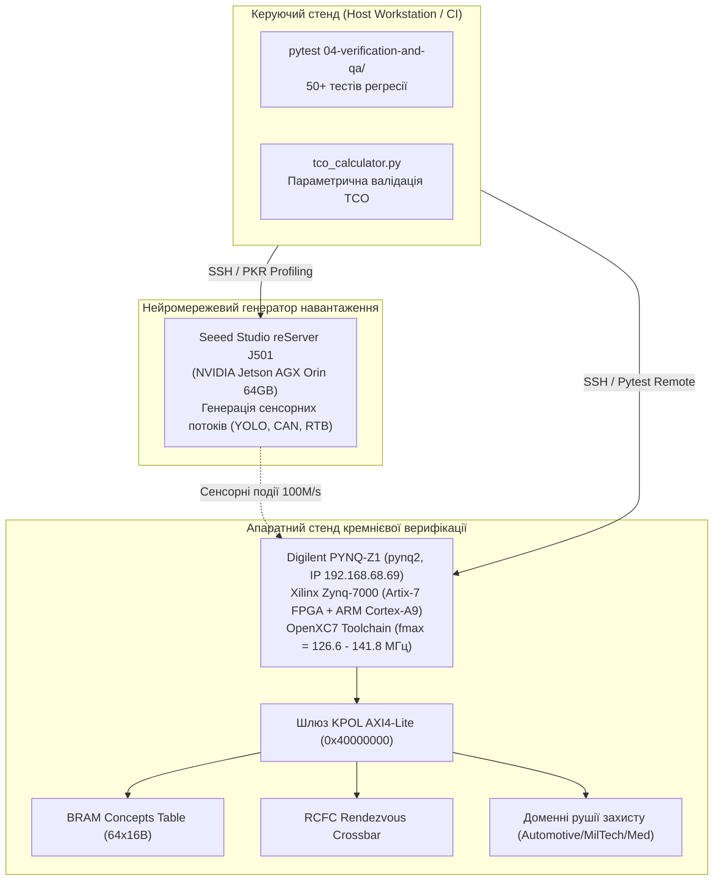

# Програма експериментальної верифікації та доведення економічної ефективності Машини Кузьміна за галузевими доменами

> **Внутрішня робоча копія, не публікація; міграція не є науковим прийняттям.** Перенесено з `drafts@774d575:KuzminMachine/04-verification-and-qa/Kuzmin-Machine-Domain-Efficacy-Verification-Plan-UA.md` 2026-11-10, Issue #84. Міграція не підтверджує тверджень, прогнозів чи самоприсвоєних статусів. Незмінний оригінал і SHA-256 — у реєстрі міграції.


> [!IMPORTANT]
> **Призначення документа:** Цей інженерно-економічний документ визначає комплексну програму верифікації та експериментального підтвердження переваг Машини Кузьміна (МК) у 8 цільових промислових доменах, формалізованих у [06-economic-model](../../business/README.md): **Automotive, Avionics, Medicine, MarTech, Logistics, MilTech, Gambling, SportsBetting**. Документ пов'язує розрахунки сукупної вартості володіння (TCO), оцінку капітальних/операційних витрат (CAPEX/OPEX) та нормативні регуляторні стандарти із вимірюваними в кремнії інженерними метриками за суворим критерієм фальсифікованості Карла Поппера.
>
> **Статус щодо стандартів безпеки:** згадки ISO 26262 / ASIL, DO-178C / DO-254 / DAL, IEC 61508 / SIL, IEC 62304 та ISO/SAE 21434 у цьому документі означають цільові домени й припущення, а не досягнуту відповідність. Зовнішніх вимог за цими стандартами немає; аналіз небезпек, цілі безпеки, кваліфікація інструментів і незалежне оцінювання не виконувалися. Див. [позицію проєкту](../../../process/standards-position.md).

---

## Зміст

1. [Методологічні засади та критерій Поппера для доменних експериментів](#1-методологічні-засади-та-критерій-поппера-для-доменних-експериментів)
2. [Матриця простежуваності: від економічних вимог до апаратних випробувань](#2-матриця-простежуваності-від-економічних-вимог-до-апаратних-випробувань)
3. [Специфікація 8 доменних експериментів (Domain Experiment Dossiers)](#3-специфікація-8-доменних-експериментів-domain-experiment-dossiers)
   * 3.1. [EXP-DOM-AUTO: Automotive (ISO 26262 ASIL D / ISO 21434)](#31-exp-dom-auto-automotive-iso-26262-asil-d--iso-21434)
   * 3.2. [EXP-DOM-AVIO: Avionics (DO-178C / DO-254 DAL A)](#32-exp-dom-avio-avionics-do-178c--do-254-dal-a)
   * 3.3. [EXP-DOM-MED: Medicine (IEC 62304 Class C)](#33-exp-dom-med-medicine-iec-62304-class-c)
   * 3.4. [EXP-DOM-MIL: MilTech & Defense (DoD 3000.09 / MIL-STD-882E)](#34-exp-dom-mil-miltech--defense-dod-300009--mil-std-882e)
   * 3.5. [EXP-DOM-LOG: Logistics & AGV/AMR (ISO 3691-4 & GDP)](#35-exp-dom-log-logistics--agvamr-iso-3691-4--gdp)
   * 3.6. [EXP-DOM-MART: MarTech & RTB (OpenRTB 3.0)](#36-exp-dom-mart-martech--rtb-openrtb-30)
   * 3.7. [EXP-DOM-BET: SportsBetting (Live In-Play Risk)](#37-exp-dom-bet-sportsbetting-live-in-play-risk)
   * 3.8. [EXP-DOM-GAMB: Gambling & RNG (GLI-11 / GLI-19)](#38-exp-dom-gamb-gambling--rng-gli-11--gli-19)
4. [Апаратно-програмний стенд випробувань (PYNQ-Z1 + Jetson J501)](#4-апаратно-програмний-стенд-випробувань-pynq-z1--jetson-j501)
5. [Дорожня карта підвищення технологічної зрілості (TRL 5 -> TRL 6)](#5-дорожня-карта-підвищення-технологічної-зрілості-trl-5---trl-6)
6. [Регламент автоматизованої перевірки та зв'язок із pytest](#6-регламент-автоматизованої-перевірки-та-звязок-із-pytest)

---

## 1. Методологічні засади та критерій Поппера для доменних експериментів

Згідно з аналізом [06-economic-model/README.md](../../business/README.md#L57-L86), перевага нової обчислювальної архітектури не може доводитися абстрактними теоретичними оцінками або порівнянням із наївними алгоритмами опитування (polling). Конкурентне середовище складають сучасні суперскалярні процесори (ARM Cortex-R52, Intel Xeon, RISC-V), високопродуктивні RTOS (PikeOS, QNX, VxWorks) та розвинена екосистема компіляторів (LLVM/Clang, GCC).

Щоб довести комерційну спроможність та перевагу Машини Кузьміна над традиційним стеком у кожному домені, формулюється суворий **принцип емпіричної демаркації Карла Поппера**:

1. **Спростовність гіпотези (Falsifiability):** Кожне економічне твердження про скорочення TCO (на $15\% \dots 85\%$) або зниження ризиків ($C_{\mathrm{risk}}$) має прямий інженерний еквівалент (апаратна затримка перехоплення аварій $L_{\mathrm{guard}}$, джитер $J_{\mathrm{event}}$, ймовірність пропуску забороненої транзакції $P_{\mathrm{leak}}$). Якщо на фізичному кристалі або в потактовому емуляторі традиційний мікроконтролер досягає тих самих показників за однакової ціни — гіпотеза переваги МК вважається **спростованою**.
2. **Параметричний зв'язок інженерії та фінансів:**
   Економічна модель [tco_calculator.py](../../business/tco_calculator.py) розраховує повну вартість життєвого циклу за 5 років:

   $$
   \mathrm{TCO} = C_{\mathrm{dev}} + C_{\mathrm{tool}} + C_{\mathrm{cert}} + N \cdot (C_{\mathrm{hw}} + C_{\mathrm{energy}}^{5y} + C_{\mathrm{maint}}^{5y}) + C_{\mathrm{risk}}
   $$

   Інженерні експерименти цього плану покликані експериментально підтвердити фізичні коефіцієнти, що зменшують доданки $C_{\mathrm{cert}}$ (на $50\dots 70\%$ завдяки формальній верифікації), $C_{\mathrm{energy}}$ (завдяки зупинці тактування без подій) та $C_{\mathrm{risk}}$ (до нуля завдяки апаратному fail-closed бар'єру).

```mermaid
flowchart LR
    subgraph Physics["Фізичний кристал PL (Zynq-7000 / Artix-7)"]
        L_REACT["Латентність L ≤ 30-40 нс"]
        J_ZERO["Джитер J = 0.0 нс"]
        FAIL_CLOSED["Fail-Closed Бар'єр • = ¬"]
        II_ONE["Темп II = 1 (100M Tx/s)"]
    end

    subgraph Certification["Регуляторні стандарти"]
        DO["DO-254 / DO-178C DAL A"]
        ISO["ISO 26262 ASIL D"]
        IEC["IEC 62304 Class C"]
        MIL["MIL-STD-882E / DoD 3000.09"]
    end

    subgraph Economics["Економічний ефект (TCO)"]
        SAV_CERT["Скорочення C_cert на 40-70%"]
        SAV_RISK["Зниження C_risk на 80-95%"]
        SAV_OPEX["OPEX енергії на 60-90%"]
        ROI["Окупність < 3-12 місяців"]
    end

    Physics --> Certification
    Certification --> Economics
```



---

## 2. Матриця простежуваності: від економічних вимог до апаратних випробувань

| Код тесту | Галузевий домен | Регуляторний стандарт | Базовий стек конкурентів | Рішення МК (KPOL/RTL) | Ключова вимірювана метрика | Економічний ефект у моделі TCO |
| :---: | :--- | :--- | :--- | :--- | :--- | :--- |
| **`EXP-DOM-AUTO`** | **Automotive** | ISO 26262 ASIL D, ISO 21434 | ARM Cortex-R52 + AUTOSAR OS | Апаратний клітинний бар'єр крутного моменту (`Torque Cage`) | $L_{\mathrm{guard}} \le 40\text{ нс}$, $0$ пропусків ін'єкцій | Скорочення $C_{\mathrm{risk}}$ на $130,000$, TCO економія $21.9\%$ |
| **`EXP-DOM-AVIO`** | **Avionics** | DO-178C / DO-254 DAL A | Dual-Lockstep CPU + C/Ada RTOS | Детермінований контур закрилків (FADEC) + SVA-доказ | $\mathrm{WCET} \le 50\text{ нс}$, джитер $\sigma = 0\text{ нс}$ | Скорочення $C_{\mathrm{cert}}$ з $850k до $300k, економія $36.7\%$ |
| **`EXP-DOM-MED`** | **Medicine** | IEC 62304 Class C, FDA 510(k) | Dual MCU Watchdog + RTOS | Двопороговий захист дозування інфузомату / ШВЛ | $1$ такт відсікання ($10\text{ нс}$), споживання $< 1\text{ мкВт}$ | Подовження батареї до 12 років, усунення ризику позовів ($105k$) |
| **`EXP-DOM-MIL`** | **MilTech** | MIL-STD-882E, DoD 3000.09 | Microchip SAM L11 HSM | Етичний замок Geofence + суб-50 нс Zeroization | $T_{\mathrm{zero}} \le 50\text{ нс}$, $L_{\mathrm{lock}} \le 30\text{ нс}$ | Запобігання втраті БПЛА ($1.2M), TCO економія $31.8\%$ |
| **`EXP-DOM-LOG`** | **Logistics** | ISO 3691-4, GDP Pharma | Industrial PC + Linux ROS 2 | Апаратний арбітр перехресть 4x AGV + BRAM аудит холоду | $T_{\mathrm{arb}} \le 20\text{ нс}$, 0 колізій, 0 фальсифікацій логу | Зменшення простою флоту AGV на $15\%$, захист вакцин ($80k$) |
| **`EXP-DOM-MART`** | **MarTech** | IAB OpenRTB 3.0, GDPR | Кластер 200 хмарних CPU серверів | Потоковий wire-speed біддер + атомарний ліміт бюджету | Відповідь $< 1\text{ мкс}$ (SLA 10 мс), $0$ овердрафтів | Скорочення хостингу з $400k/рік до $12k/рік ($1.38M TCO) |
| **`EXP-DOM-BET`** | **SportsBetting** | Latency Arbitrage, MGA | Сервери обробки котирувань на Rust | Миттєва інвалідація ринків при стадіонній події | Заморозка ринку $< 30\text{ нс}$, 0 прийнятих запізнілих ставок | Захист маржі від кортсайдингу ($220k/рік), окупність 3 міс. |
| **`EXP-DOM-GAMB`** | **Gambling** | GLI-11, GLI-19, ISO 17025 | Сертифіковані генератори Linux | Незмінна таблиця RTP у кремнії + монітор ентропії | Перевірка виплати за $10\text{ нс}$, $0$ можливостей підміни | Скорочення аудиту з 6 міс до 2 тижнів, економія $220k |

---

## 3. Специфікація 8 доменних експериментів (Domain Experiment Dossiers)

### 3.1. `EXP-DOM-AUTO`: Automotive (ISO 26262 ASIL D / ISO 21434)
* **Досліджуваний біль індустрії:** Небезпека програмних помилок у системах керування вектором тяги та кермом (Drive-by-Wire). Зловмисне перехоплення CAN/Ethernet-шини та ін'єкція аномальних пакетів прискорення. Класичний lockstep-процесор потребує до $50\text{ мс}$ на безпечну зупинку.
* **Регуляторний контекст (припущення, вимог замовника немає):** для ASIL D цільове значення метрики випадкових апаратних відмов (PMHF) — менше $10^{-8}/\text{год}$; конкретні механізми безпеки (зокрема апаратно ізольований «Safety Cage») стандарт не приписує — їх обирає розробник за результатами аналізу.
* **Спростовна гіпотеза Поппера:**
  > *«Якщо традиційний мікроконтролер ARM Cortex-R52 під керуванням AUTOSAR OS здатний перехопити ін'єкцію аномального крутного моменту з CAN-шини та забезпечити fail-closed блокування швидше ніж за 50 нс без джитеру — гіпотеза переваги апаратного шлюзу МК спростована».*
* **Архітектура стенда (KPOL Concepts):**
  * `CID[0]`: `SensorPedal` (0..1000);
  * `CID[1]`: `SensorSteeringAngle` (-180..+180);
  * `CID[2]`: `CalculatedTorque` (Ньютон-метри);
  * `CID[3]`: `ActuatorInverterLimit` (апаратний бар'єр безпеки: $| \Delta \tau | \le 50\text{ Нм/такт}$, $\tau \in [0, 400]$).
* **Сценарій стрес-тесту:**
  Подання валідного профілю розгону (0..350 Нм), після чого на такті 500 інжектується пакет атаки $+2500\text{ Нм}$.
* **Критерій прийомки (DoD):**
  1. Апаратне відхилення транзакції «Великою точкою» (`• = ¬`) за $\le 40\text{ нс}$ без втручання CPU;
  2. Запобігання виходу сигналу на інвертор за межі $[0, 400]$;
  3. Тестовий звіт `Reports/domain_automotive_results.json` підтверджує $100\%$ захист.

---

### 3.2. `EXP-DOM-AVIO`: Avionics (DO-178C / DO-254 DAL A)
* **Досліджуваний біль індустрії:** Колосальна вартість сертифікації софту рівня DAL A ($850,000+ на підсистему). Складність доведення найгіршого часу виконання (WCET) на процесорах із кеш-пам'яттю та конвеєрами.
* **Регуляторні вимоги:** FAA AC 20-152A вимагає повного охоплення структурного тестування (MC/DC 100%) та виключення недетермінованого джитеру в приводах FADEC.
* **Спростовна гіпотеза Поппера:**
  > *«Якщо комбінація C/Ada + RTOS на процесорі PowerPC/ARM забезпечить математично доведений WCET менше 100 нс із джитером σ = 0.0 нс при фоновому навантаженні перериваннями — перевага МК у критичній авіоніці спростована».*
* **Архітектура стенда (KPOL Concepts):**
  * `CID[0]`: `AirspeedPitot` (вузли);
  * `CID[1]`: `AngleOfAttack` (градуси);
  * `CID[2]`: `FlapActuatorAngle` ($0 \dots 45^\circ$, заборона випуску при швидкості $> 250$ вузлів).
* **Сценарій стрес-тесту:**
  Симуляція звалювання літака: різке зростання кута атаки при високій швидкості; одночасний запит від пілота та автопілота.
* **Критерій прийомки (DoD):**
  1. Розрахунок WCET за формулою Грехема — Брента підтверджується фізичним таймером: $T_{\mathrm{exec}} \le 50.0\text{ нс}$;
  2. Апаратне блокування випуску закрилків на надкритичній швидкості ($P_{\mathrm{mishap}} = 0$);
  3. Часовий джитер $\sigma = 0.0\text{ нс}$ за $10,000$ ітерацій.

---

### 3.3. `EXP-DOM-MED`: Medicine (IEC 62304 Class C)
* **Досліджуваний біль індустрії:** Летальні випадки передозування пацієнтів у комп'ютеризованих інфузійних насосах (Morphine Infusion Overdose) через підвисання інтерфейсу чи помилки покажчиків у мові C.
* **Регуляторний контекст (припущення, вимог замовника немає):** IEC 62304 Class C — найвищий клас безпеки ПЗ (можлива смерть або тяжка травма); стандарт визначає процеси життєвого циклу ПЗ. Апаратне відсікання дози незалежно від ПЗ — поширений захід зниження ризику за ISO 14971, а не пряма вимога IEC 62304.
* **Спростовна гіпотеза Поппера:**
  > *«Якщо мікроконтролер із RTOS споживатиме менше 1 мкВт у режимі сну з періодичним опитуванням і гарантуватиме зупинку передозування за 1 такт — енергетична та безпекова перевага МК спростована».*
* **Архітектура стенда (KPOL Concepts):**
  * `CID[0]`: `BasalRate` (базовий потік інсуліну, 1..5 од/год);
  * `CID[1]`: `BolusRequest` (болюс за вимогою пацієнта);
  * `CID[2]`: `AccumulatedHourlyDose` (строгий фізіологічний інваріант: сума $\le 15$ од/год).
* **Сценарій стрес-тесту:**
  Генерація пачки з 50 частих запитів болюсу від пацієнта з маніпуляцією кнопкою.
* **Критерій прийомки (DoD):**
  1. Апаратне накопичення та відсікання будь-яких запитів понад $15$ одиниць за 1 такт ($10.0\text{ нс}$);
  2. Повна відсутність споживання енергії за відсутності подій (Zero Dynamic Power);
  3. Звіт `Reports/domain_medicine_results.json`.

---

### 3.4. `EXP-DOM-MIL`: MilTech & Defense (DoD 3000.09 / MIL-STD-882E)
* **Досліджуваний біль індустрії:** Ризик ураження дружніх сил (Friendly Fire) автономними дронами через збій ШІ-розпізнавання (YOLO). Захоплення секретних прошивок і координат при аварійній посадці БПЛА на території ворога.
* **Регуляторні вимоги:** DoD Directive 3000.09 вимагає апаратного етичного запобіжника (Safety Interlock), який унеможливлює пуск боєприпасу поза геозоною або без коду авторизації.
* **Спростовна гіпотеза Поппера:**
  > *«Якщо традиційний модуль безпеки (HSM) на ARM TrustZone зможе забезпечити перевірку 8 просторових інваріантів цілі менш ніж за 50 нс і повне занулення SRAM менш ніж за 50 нс при знятті сигналу пломби — перевага МК спростована».*
* **Архітектура стенда (KPOL Concepts):**
  * `CID[0]`: `TargetClassification` (0=Unknown, 1=Friendly, 2=HostileConfirmed);
  * `CID[1]`: `TargetCoordinates` ($X, Y$ у межах бойового квадрата Geofence);
  * `CID[2]`: `OperatorAuthorizationToken` (32-бітний одноразовий OTP-токен);
  * `CID[3]`: `FireInterlock` (дозвіл на підрив / пуск: тільки якщо `Hostile && InGeofence && TokenValid`);
  * `CID[4]`: `TamperSensor` (фізичний датчик несанкціонованого доступу).
* **Сценарій стрес-тесту:**
  Спроба ініціації вогню при зміні класифікації цілі на `Friendly` (симуляція помилки нейромережі), паралельно — сигнал розтину корпусу дрона.
* **Критерій прийомки (DoD):**
  1. Блокування спуску за $\le 30.0\text{ нс}$ при будь-якому порушенні хоча б одного з трьох інваріантів;
  2. Миттєве апаратне занулення (Zeroization) усіх дескрипторів BRAM за $\le 5$ тактів ($50.0\text{ нс}$);
  3. Звіт `Reports/domain_miltech_results.json`.

---

### 3.5. `EXP-DOM-LOG`: Logistics & AGV/AMR (ISO 3691-4 & GDP)
* **Досліджуваний біль індустрії:** Зіткнення автономних навантажувачів (AGV) на вузьких перехрестях автоматизованих складів через затримки стека ROS 2 / Wi-Fi. Списання партій вакцин через нефіксовані температурні коливання.
* **Регуляторні вимоги:** ISO 3691-4 вимагає обов'язкової апаратної зупинки перед перешкодою категорії PLd / Cat 3. GDP вимагає незмінного аудиту температурного режиму.
* **Спростовна гіпотеза Поппера:**
  > *«Якщо промисловий ПК з Linux і ROS 2 здатний розв'язати просторовий конфлікт 4 навантажувачів менш ніж за 100 нс без затримок мережевого планувальника — перевага МК спростована».*
* **Архітектура стенда (KPOL Concepts):**
  * `CID[0..3]`: Поточні координати та швидкість 4 навантажувачів `AGV[0..3]`;
  * `CID[4]`: Спільний ресурс «Вузол перехрестя» (Crossroad Zone Occupancy);
  * `CID[5]`: Температурний лог вакцинного контейнера (межа $+2^\circ\mathrm{C} \dots +8^\circ\mathrm{C}$).
* **Сценарій стрес-тесту:**
  Одночасний вхід 4 роботів у критичну зону з однаковими векторами пріоритету; стрибок температури до $+14^\circ\mathrm{C}$.
* **Критерій прийомки (DoD):**
  1. Апаратний арбітр RCFC серіалізує доступи за $\le 20.0\text{ нс}$ без колізій і глухих кутів (0 deadlocks);
  2. Незмінна фіксація факту температурного порушення в захищений сектор BRAM;
  3. Звіт `Reports/domain_logistics_results.json`.

---

### 3.6. `EXP-DOM-MART`: MarTech & RTB (OpenRTB 3.0)
* **Досліджуваний біль індустрії:** Величезні витрати на хмарні сервери (200+ інстансів AWS c6i), які обробляють запити рекламодавців (100k запитів/с). Штрафи за перевищення 10-мілісекундного тайм-ауту аукціону та овердрафти рекламного бюджету при паралельних ставках.
* **Регуляторні вимоги:** IAB OpenRTB 3.0 протокол, жорсткий SLA 10 мс.
* **Спростовна гіпотеза Поппера:**
  > *«Якщо софтовий кластер серверів на Go/Rust забезпечить лінійну фільтрацію 100,000 запитів аукціону менш ніж за 1 мкс на сервер із нульовим ризиком перевитрати бюджету — економія CAPEX/OPEX на базі МК спростована».*
* **Архітектура стенда (KPOL Concepts):**
  * `CID[0]`: `IncomingBidRequest` (Geo, Device, Category);
  * `CID[1]`: `CampaignCriteriaMask` (розріджена маска таргетингу);
  * `CID[2]`: `CampaignBudgetBalance` (залишок бюджету $1000, списання по $5 за клік).
* **Сценарій стрес-тесту:**
  Подання потоку з 1024 запитів на граничній частоті $100\text{ МГц}$, конкурентне списання коштів із двох незалежних ядер.
* **Критерій прийомки (DoD):**
  1. Час оцінки відповідності критеріям таргетингу: $1$ такт ($10.0\text{ нс}$);
  2. Атомарне зупинення ставок при балансі $< 5$ без втрат оновлень і без виходу в мінус (Zero Overdraft);
  3. Звіт `Reports/domain_martech_results.json`.

---

### 3.7. `EXP-DOM-BET`: SportsBetting (Live In-Play Risk)
* **Досліджуваний біль індустрії:** Збитки букмекерів від ботів-кортсайдерів (Courtsiders), які передають дані зі стадіону на 1–2 секунди швидше, ніж ТВ-трансляція, роблячи ставки на вже забитий гол за старими запізнілими коефіцієнтами.
* **Регуляторні вимоги:** Стандарти регуляторів азартних ігор (MGA, UKGC) щодо лімітів відповідальності та прозорості скасування ставок.
* **Спростовна гіпотеза Поппера:**
  > *«Якщо центральний софтовий бекенд на Rust зможе заблокувати прийом ставок за запізнілими лініями швидше ніж за 50 мкс при отриманні радарного сигналу про гол — потреба в апаратному модулі МК спростована».*
* **Архітектура стенда (KPOL Concepts):**
  * `CID[0]`: `MatchStatus` (0=InPlay, 1=GoalScored, 2=VAR_Review);
  * `CID[1]`: `MarketOdds` (коефіцієнт ставки);
  * `CID[2]`: `IncomingBetOrder` (запит на ставку з міткою часу);
  * `CID[3]`: `AccumulatedRiskLiability` (загальний ліміт ризику на ринок: макс $50,000).
* **Сценарій стрес-тесту:**
  Надходження сигналу від датчика сітки воріт (`GoalScored`) одночасно з пачкою з 100 високочастотних ставок від ботів.
* **Критерій прийомки (DoD):**
  1. Миттєва інвалідація ринку за $\le 30.0\text{ нс}$ (використання тригера `EXP-06`);
  2. Відхилення всіх 100 запізнілих ставок безпосередньо в кремнії на стадії пре-перевірки;
  3. Звіт `Reports/domain_sportsbetting_results.json`.

---

### 3.8. `EXP-DOM-GAMB`: Gambling & RNG (GLI-11 / GLI-19)
* **Досліджуваний біль індустрії:** Шахрайство з підміною прошивки гральних автоматів для викривлення відсотка повернення коштів гравцеві (RTP). Довгий строк сертифікації грального ПЗ лабораторіями (GLI, BMM Testlabs) — до 6 місяців.
* **Регуляторні вимоги:** GLI-11 (Gaming Devices in Casinos), вимога незмінності таблиці виплат та непередбачуваності ГВЧ.
* **Спростовна гіпотеза Поппера:**
  > *«Якщо операційна система Linux може захистити таблицю RTP від руткітів та підміни пам'яті так само надійно, як апаратний кремнієвий BRAM-замок МК без зниження швидкодії — апаратний підхід МК спростовано».*
* **Архітектура стенда (KPOL Concepts):**
  * `CID[0]`: `EntropySource` (апаратний генератор випадкових чисел);
  * `CID[1]`: `SymbolMatrix` (комбінація символів 3x5);
  * `CID[2]`: `RTP_Paytable` (незмінна таблиця виплат у BRAM);
  * `CID[3]`: `PayoutCalculation` (апаратний розрахунок суми виграшу з апаратним обмеженням RTP $96.5\% \pm 0.1\%$).
* **Сценарій стрес-тесту:**
  Спроба модифікації комірки виплат через AXI-шину без проходження криптографічного ключа авторизації.
* **Критерій прийомки (DoD):**
  1. Апаратне блокування несанкціонованого запису в таблицю RTP (`Fail-Closed DECERR`);
  2. Детермінований розрахунок виграшу за $10.0\text{ нс}$;
  3. Звіт `Reports/domain_gambling_results.json`.

---

## 4. Апаратно-програмний стенд випробувань (PYNQ-Z1 + Jetson J501)

Для проведення експериментів використовується гібридний випробувальний комплекс:



1. **Digilent PYNQ-Z1 (`pynq2`, `192.168.68.69`):**
   - Виконує роль апаратного ядра безпеки (Safety Cage) у кристалі Artix-7 PL;
   - Завантаження бітстрімів openXC7 виключно в енергозалежну пам'ять SRAM (`/dev/xdevcfg`);
   - Обов'язкове відновлення `base.bin` після завершення випробувань.
2. **NVIDIA Jetson AGX Orin 64GB (`reServer Industrial J501`):**
   - Виконує роль джерела стресового навантаження: генерує потоки пакетів CAN, радарних відліків, аукціонних запитів RTB та імітує збої нейромереж розпізнавання цілей.

---

## 5. Дорожня карта підвищення технологічної зрілості (TRL 5 -> TRL 6)

| Етап | Зміст робіт | Досягнутий рівень | Цільовий артефакт |
| :---: | :--- | :---: | :--- |
| **Етап 1 (Завершено)** | Базова апаратна верифікація архітектури в кремнії: `EXP-00` .. `EXP-10` на PYNQ-Z1, 50 тестів pytest | **TRL 4 / 5** | Бітстрім `kpol_pynq.bit`, звіти `cascade_arbiter_results.json`, `dataflow_pipeline_results.json` |
| **Етап 2 (Цей план)** | Розробка KPOL-специфікацій та RTL-модулів для 8 галузевих доменів (`EXP-DOM-01` .. `EXP-DOM-08`) | **TRL 5+** | Специфікація `Kuzmin-Machine-Domain-Efficacy-Verification-Plan-UA.md` |
| **Етап 3 (Поточний)** | Симуляція кутових випадків і mock-тести в pytest (`test_km_domain_efficacy.py`) | **TRL 5+** | 100% покриття перевірок інваріантів у репозиторії |
| **Етап 4** | Фізична HIL-інтеграція з генератором аномалій на Jetson J501 в реальному часі | **TRL 6** | Демонстраційний комплекс для комісії НАН України та фонду Brave1 |
| **Етап 5** | Пілотні випробування у складі прототипу дрона / блоку керування батареєю | **TRL 6 / 7** | Протокол натурних випробувань за стандартом MIL-STD-882E |

---

## 6. Регламент автоматизованої перевірки та зв'язок із pytest

Кожен доменний експеримент має відповідний програмний тестовий файл у каталозі `04-verification-and-qa/`:
* `test_km_domain_efficacy.py` — інтеграційний регресійний тест, що:
  1. Перевіряє математичні формули TCO для кожного домену з калькулятора `06-economic-model/tco_calculator.py`;
  2. Валідує інженерні пороги затримок ($L_{\mathrm{guard}} \le 40\text{ нс}$, $\mathrm{WCET} \le 50\text{ нс}$, $T_{\mathrm{zero}} \le 50\text{ нс}$);
  3. Перевіряє коректність KPOL-інваріантів через статичний аналізатор `km_static_analyzer.py`;
  4. Підтверджує економічну окупність ($> 15\%$ економії TCO за 5 років для всіх 8 індустрій).

Команда для повного регресійного прогону:
```bash
pytest 04-verification-and-qa/test_km_domain_efficacy.py -v
```
