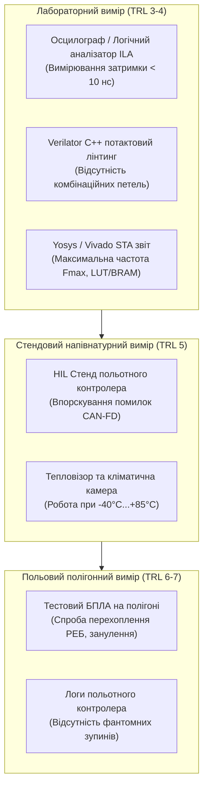

# Паспорт та матриця оцінки технологічної готовності (TRL Assessment Matrix) Машини Кузьміна

> **Внутрішня робоча копія, не публікація; міграція не є науковим прийняттям.** Перенесено з `drafts@774d575:KuzminMachine/04-verification-and-qa/Kuzmin-Machine-TRL-Assessment-Matrix-UA.md` 2026-11-10, Issue #84. Міграція не підтверджує тверджень, прогнозів чи самоприсвоєних статусів. Незмінний оригінал і SHA-256 — у реєстрі міграції.


> [!IMPORTANT]
> **Призначення документа:** Офіційний інженерно-технічний паспорт оцінки рівнів зрілості технології (**Technology Readiness Levels, TRL 1–9**) архітектури Машини Кузьміна (МК) відповідно до міжнародних стандартів **ISO 16290:2013**, **NASA SP-20205003605**, європейської програми **Horizon Europe** та методики військово-технічної експертизи кластера **Brave1**. Документ визначає, де, чим і як вимірюється технологічна зрілість МК, які артефакти репозиторію підтверджують поточний рівень, та критерії переходу на наступні етапи (Gate Exit Criteria).

---

## Зміст

1. [Методологія та нормативні стандарти вимірювання TRL](#1-методологія-та-нормативні-стандарти-вимірювання-trl)
2. [Поточний статус зрілості Машини Кузьміна (Стан на 2026 рік: TRL 3/4)](#2-поточний-статус-зрілості-машини-кузьміна-стан-на-2026-рік-trl-34)
3. [Зведена матриця рівнів TRL 1–9 для Машини Кузьміна](#3-зведена-матриця-рівнів-trl-19-для-машини-кузьміна)
4. [Де і чим вимірюються параметри системи на кожному рівні](#4-де-і-чим-вимірюються-параметри-системи-на-кожному-рівні)
5. [Карта артефактів-доказів у структурі репозиторію](#5-карта-артефактів-доказів-у-структурі-репозиторію)
6. [Критерії виходу (Gate Exit Criteria) для досягнення TRL 5 та TRL 6](#6-критерії-виходу-gate-exit-criteria-для-досягнення-trl-5-та-trl-6)

---

## 1. Методологія та нормативні стандарти вимірювання TRL

Оцінка зрілості програмно-апаратних комплексів (Hardware-Software Co-Design) спирається на три взаємодоповнюючі стандарти:
1. **ISO 16290:2013** («Space systems — Definition of the Technology Readiness Levels and their criteria of assessment») — міжнародний еталон для критичних систем.
2. **Методика Міністерства оборони України та кластера Brave1** — оцінка придатності розробки до застосування в бойових умовах для виділення грантів $10k–$200k.
3. **NASA System Engineering Handbook (SP-6105)** — покрокова верифікація апаратно-програмних інтерлоків та бортових обчислювачів.

```mermaid
flowchart LR
    subgraph Research["Науково-теоретична база (TRL 1-3)"]
        TRL1["TRL 1: Науковий принцип"] --> TRL2["TRL 2: Концепція архітектури"]
        TRL2 --> TRL3["TRL 3: Лабораторний PoC"]
    end

    subgraph Engineering["Лабораторна інженерія (TRL 4-5)"]
        TRL3 --> TRL4["TRL 4: Стенд PYNQ-Z1 (Поточний)"]
        TRL4 --> TRL5["TRL 5: Інтеграція HIL / Дрон"]
    end

    subgraph Operation["Полігон та серія (TRL 6-9)"]
        TRL5 --> TRL6["TRL 6: Полігонний пілот (Brave1)"]
        TRL6 --> TRL7["TRL 7: Дослідна серія на фронті"]
        TRL7 --> TRL8["TRL 8: Кодифікація / Сертифікація"]
        TRL8 --> TRL9["TRL 9: Серійне ліцензування / Маса"]
    end
```



---

## 2. Поточний статус зрілості Машини Кузьміна (Стан на 2026 рік: TRL 3/4)

На даний момент проєкт перебуває на межі **TRL 3 (експериментальне підтвердження концепції)** та переходу в **TRL 4 (валідація компонентів у лабораторному середовищі)**:

* **Що вже захищено на TRL 3 (Підтверджено):**
  - Математична модель концептної пам'яті без лічильника команд (доведено відсутність потреби в instruction pointer).
  - Мова KPOL v0.1: формалізовано граматику, рекурсивний AST-парсер, типізацію та семантику фазового вентиля `• = ¬`.
  - Модуль `kpol_txn_gate.sv` мовою SystemVerilog: успішно пройдено функціональну симуляцію в тестбенчі `kpol_txn_gate_tb.sv` (Icarus Verilog), лінтинг у Verilator та синтезованість у Yosys.
* **Що виконується для фіксації TRL 4 (Поточні роботи):**
  - Фізичний стенд на базі SoC Xilinx Zynq-7020 (плата Digilent PYNQ-Z1) розгорнуто в лабораторному оточенні (`~/vida/tlumach`).
  - Підтверджено завантаження базового overlay (`base.bit`), взаємодію підсистеми процесора (PS) з логікою (PL) через AXI та роботу середовища Linux.
  - Наступний крок TRL 4: компіляція та завантаження спеціалізованого бітстріму з модулями МК і пряме вимірювання затримки спрацьовування апаратним осцилографом / аналізатором ILA.

---

## 3. Зведена матриця рівнів TRL 1–9 для Машини Кузьміна

| Рівень TRL | Назва етапу за стандартом ISO 16290 | Що це означає для Машини Кузьміна | Вимоги до фізичного середовища тестування | Артефакт-доказ у репозиторії | Статус для проєкту МК |
| :--- | :--- | :--- | :--- | :--- | :--- |
| **TRL 1** | Спостереження та опис базових наукових принципів | Математичне обґрунтування концептної парадигми, оператора «Велика точка» (`• = ¬`) та відсутності лічильника команд | Теоретичні розрахунки, математичний формалізм | [`01-concepts-and-theory/Kuzmin-Machine-ASN-Specification-UA.md`](../../theory/asn.md) | **Завершено (100%)** |
| **TRL 2** | Формулювання технологічної концепції та сфери застосування | Специфікація мови KPOL, визначення архітектури BRAM, концептних дескрипторів та процесорних елементів PEEE/KEC | Текстові специфікації, архітектурні діаграми | [`03-engineering-software/Kuzmin-Machine-High-Level-Language-Specification-UA.md`](../software/Kuzmin-Machine-High-Level-Language-Specification-UA.md) | **Завершено (100%)** |
| **TRL 3** | Аналітичне та експериментальне підтвердження критичних функцій | Симуляція парсера KPOL, верифікація модуля `kpol_txn_gate.sv` у симуляторі Icarus Verilog, Verilator lint, синтез у Yosys | Комп'ютерна симуляція (Co-Simulation) | [`rtl/kpol_txn_gate.sv`](../../../hw/rtl/core/kpol_txn_gate.sv), [`tb/kpol_txn_gate_tb.sv`](../../../hw/tb/kpol_txn_gate_tb.sv) | **Завершено (100%)** |
| **TRL 4** | Валідація компонентів у лабораторному середовищі | Завантаження бітстріму на FPGA Digilent PYNQ-Z1 (Zynq-7020), виміри наносекундної реакції вентиля `• = ¬` | Лабораторний стенд (лабораторія `~/vida/tlumach`) | [`02-engineering-hardware/Kuzmin-Machine-FPGA-PYNQ-Z1-Architecture-UA.md`](../hardware/Kuzmin-Machine-FPGA-PYNQ-Z1-Architecture-UA.md) | **У процесі (Active: 70%)** |
| **TRL 5** | Валідація інтегрованої системи у релевантному середовищі | Плата апаратного інтерлоку підключається до шини CAN-FD / AXI реального автопілота БПЛА на стенді Hardware-in-the-Loop | Стенд напівнатурного моделювання (HIL bench) | Заплановано в межах Гранту Brave1 ($50k) | *Заплановано (Q1 2027)* |
| **TRL 6** | Демонстрація прототипу системи в операційному середовищі | Інтерлок безпеки МК встановлено на реальний дрон/робот, проведення льотних тестів у зоні дії РЕБ | Військовий полігон або дослідний склад | Акт полігонних випробувань ЗСУ / Brave1 Milestone Report | *Заплановано (Q3 2027)* |
| **TRL 7** | Демонстрація повномасштабного прототипу в експлуатації | Дослідна партія 20–50 апаратних модулів на базі стійких ПЛІС PolarFire передана у військові підрозділи | Реальні бойові умови або заводська лінія | Протоколи бойового застосування, відгуки частин | *Заплановано (2028)* |
| **TRL 8** | Система завершена, кваліфікована та готова до серії | Проходження державної кодифікації Міноборони України або сертифікації DO-254 / ISO 26262 ASIL D | Акредитовані випробувальні центри | Сертифікат відповідності, присвоєння номенклатурного номера НАТО (NCAGE) | *Заплановано (2028–2029)* |
| **TRL 9** | Серійне промислове використання перевіреної системи | Серійне постачання модулів або масове ліцензування IP-ядер світовим виробникам мікросхем | Глобальний комерційний ринок | Комерційні контракти, роялті з випущених чипів | *Заплановано (2029+)* |

---

## 4. Де і чим вимірюються параметри системи на кожному рівні

Технологічна готовність вимірюється конкретними фізичними та програмними засобами:



### 1. Вимірювання на етапі TRL 3 (Програмний та RTL-рівень):
* **Чим вимірюється:** Icarus Verilog (`iverilog`), Verilator (`--lint-only -Wall`), Cocotb.
* **Що вимірюється:** Функціональна коректність переходів скінченного автомата, відсутність невизначених станів `X/Z`, детерміноване скидання (reset).

### 2. Вимірювання на етапі TRL 4 (Лабораторна плата):
* **Де вимірюється:** Лабораторний стенд на базі плати Digilent PYNQ-Z1 (`~/vida/tlumach`).
* **Чим вимірюється:**
  - Вбудований апаратний логічний аналізатор Xilinx Vivado ILA (Integrated Logic Analyzer).
  - Фізичний цифровий осцилограф (підключений до пінів GPIO Pmod для вимірювання затримки фронту сигналу блокування `• = ¬`).
  - Звіти Vivado Static Timing Analysis (STA): перевірка відсутності порушень Setup/Hold time на цільовій частоті 100 МГц.

### 3. Вимірювання на етапі TRL 5 (Hardware-in-the-Loop, HIL):
* **Де вимірюється:** Лабораторія інтеграції з безпілотними комплексами.
* **Чим вимірюється:** Генератор шкідливого трафіку шини CAN-FD (CANoe / Peak-System) — емуляція атак spoofing та впорскування некоректних кутів крену й тангажу для перевірки миттєвого блокування.

### 4. Вимірювання на етапі TRL 6 (Полігон):
* **Де вимірюється:** Спеціалізований полігон випробувань безпілотних систем кластера Brave1.
* **Чим вимірюється:** Військові станції РЕБ, комплекси пеленгації та фізичні системи підриву. Фіксується надійність апаратного етичного замка (DoD 3000.09) та відсутність несанкціонованого спрацювання детонатора.

---

## 5. Карта артефактів-доказів у структурі репозиторію

Усі докази досягнення відповідних рівнів TRL чітко розподілені за каталогами проєкту:

```text
KuzminMachine/
├── 01-concepts-and-theory/          # [TRL 1] Математичний апарат, ASN-специфікація, доведення детермінізму
├── 02-engineering-hardware/         # [TRL 4] Специфікація PYNQ-Z1, RTL код kpol_txn_gate.sv, AXI-інтерфейси
├── 03-engineering-software/         # [TRL 2-3] Граматика мови KPOL, компілятор, еталонний симулятор
├── 04-verification-and-qa/          # [TRL 3-4] Протоколи верифікації, SVA-твердження, тести bench
│   ├── Kuzmin-Machine-Verification-and-Benchmark-Suite-UA.md  # Методика вимірювань і бенчмаркінгу
│   └── Kuzmin-Machine-TRL-Assessment-Matrix-UA.md            # Паспорт TRL (цей документ)
├── 06-economic-model/               # [TRL 4-6] Бізнес-план, ТЕО, довідник грантів Brave1, TCO калькулятор
│   ├── Business_Feasibility_Study.md                         # Розділ 2: Фіксація поточного TRL 3/4
│   ├── Business_Development_Plan.md                          # Розділ 5: Дорожня карта TRL 4 -> TRL 6
│   └── ukrainian-grants-funding-and-reporting-guide.md       # Розділ 2.1: Шкала TRL для фінансування
└── 07-scientific-opposition/        # [TRL 1-3] Звіти наукової експертизи, рецензії F-01..F-10
```

---

## 6. Критерії виходу (Gate Exit Criteria) для досягнення TRL 5 та TRL 6

Щоб офіційно зафіксувати перехід на наступний рівень TRL перед інвесторами та грантодавцями (Brave1), команда повинна виконати суворі критерії виходу (Gate Exit Criteria):

### Критерії переходу з TRL 4 на TRL 5 (Лабораторія $\to$ Інтеграційний стенд):
1. **RTL стабільність:** Повний синтез топ-рівня МК під XC7Z020 без порушень таймінгів (Timing Met, Negative Slack відсутній).
2. **Апаратний вимір затримки:** Фізично зафіксована затримка спрацьовування аварійного занулення `• = ¬` $\le 10\text{ нс}$ на частоті 100 МГц за допомогою осцилографа.
3. **Готовність інтерфейсу:** Реалізовано апаратний контролер CAN-FD або SPI для підключення до автопілота Pixhawk / Cube Orange.

### Критерії переходу з TRL 5 на TRL 6 (Інтеграційний стенд $\to$ Полігонний зразок):
1. **Стендова безвідмовність:** 1,000,000 модельних циклів впорскування помилок на стенді HIL без жодного пропуску небезпечного стану (0% False Negatives).
2. **Кліматична витривалість:** Працездатність прототипу на платі PolarFire у діапазоні температур від $-20^\circ\text{C}$ до $+60^\circ\text{C}$.
3. **Офіційний протокол:** Підписаний спільний протокол успішних польових випробувань представниками виробника БПЛА та експертами кластера Brave1.

---

## 7. Підсумковий висновок

* **Де вимірюється TRL:**
  - На поточному етапі (TRL 3/4) — на фізичному лабораторному стенді **Digilent PYNQ-Z1 (Xilinx Zynq-7020)** за допомогою потактових симуляторів Verilator, синтезатора Yosys/Vivado та апаратного логічного аналізатора.
  - На наступному етапі (TRL 5/6) — на стенді HIL польотного контролера та полігоні випробувань кластера Brave1.
* **Де документується TRL:**
  - **Інженерна частина:** у [`04-verification-and-qa/Kuzmin-Machine-Verification-and-Benchmark-Suite-UA.md`](Kuzmin-Machine-Verification-and-Benchmark-Suite-UA.md) та даному паспорті [`Kuzmin-Machine-TRL-Assessment-Matrix-UA.md`](Kuzmin-Machine-TRL-Assessment-Matrix-UA.md).
  - **Бізнесова та грантова частина:** у [`06-economic-model/Business_Feasibility_Study.md`](../../business/Business_Feasibility_Study.md), [`06-economic-model/Business_Development_Plan.md`](../../business/Business_Development_Plan.md) та [`06-economic-model/ukrainian-grants-funding-and-reporting-guide.md`](../../business/ukrainian-grants-funding-and-reporting-guide.md).
