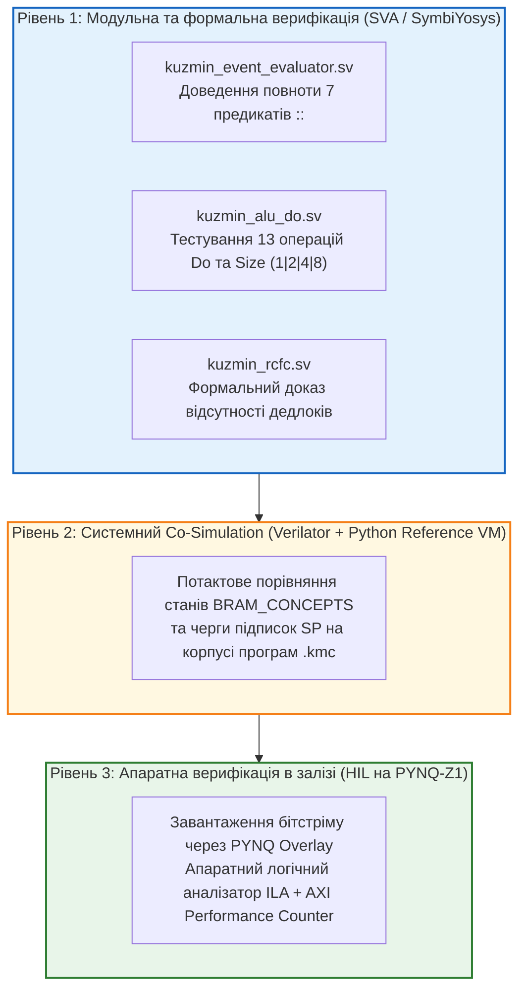
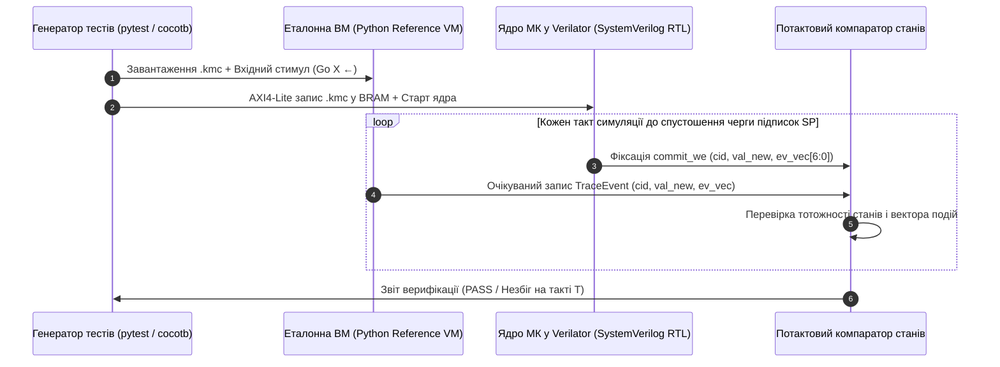

# План апаратно-програмної верифікації (SVA / Verilator Testbench), стрес-тести рандеву та методика бенчмаркінгу Машини Кузьміна

> **Внутрішня робоча копія, не публікація; міграція не є науковим прийняттям.** Перенесено з `drafts@774d575:KuzminMachine/04-verification-and-qa/Kuzmin-Machine-Verification-and-Benchmark-Suite-UA.md` 2026-11-10, Issue #84. Міграція не підтверджує тверджень, прогнозів чи самоприсвоєних статусів. Незмінний оригінал і SHA-256 — у реєстрі міграції.


> [!IMPORTANT]
> **Призначення документа:** Цей інженерний документ визначає повну програму і методику формальної та імітаційної верифікації (**Verification & Benchmark Plan**) для [апаратного прискорювача Машини Кузьміна на FPGA PYNQ-Z1](../hardware/Kuzmin-Machine-FPGA-PYNQ-Z1-Architecture-UA.md) та [еталонної програмної віртуальної машини](../software/Kuzmin-Machine-Reference-VM-and-Cycle-Accurate-Simulator-UA.md). Документ містить формальні твердження **SVA (SystemVerilog Assertions)** для доведення відсутності взаємних блокувань (*Deadlock-Freedom*) у комутаторі рандеву **RCFC**, матрицю кутових стрес-тестів та методику вимірювання детермінізму латентності реакції на події порівняно з класичною процесорною архітектурою ARM Cortex-A9.

---

## Зміст

1. [Стратегія багаторівневої верифікації Машини Кузьміна](#1-стратегія-багаторівневої-верифікації-машини-кузьміна)
2. [Формальні властивості SystemVerilog Assertions (SVA) для ядра МК та комутатора RCFC](#2-формальні-властивості-systemverilog-assertions-sva-для-ядра-мк-та-комутатора-rcfc)
3. [Архітектура потактового стенда Co-Simulation (Verilator + Golden Reference VM)](#3-архітектура-потактового-стенда-co-simulation-verilator--golden-reference-vm)
4. [Матриця стрес-тестів кутових випадків (Corner Cases & Event Avalanches)](#4-матриця-стрес-тестів-кутових-випадків-corner-cases--event-avalanches)
5. [Методика інженерного бенчмаркінгу на платі Digilent PYNQ-Z1 (Zynq-7020)](#5-методика-інженерного-бенчмаркінгу-на-платі-digilent-pynq-z1-zynq-7020)

---

## 1. Стратегія багаторівневої верифікації Машини Кузьміна

Оскільки Машина Кузьміна є асинхронно-подієвою багатопроцесорною системою без глобального лічильника команд, класичне модульне тестування окремих інструкцій АЛП є недостатнім. Головні ризики апаратної реалізації зосереджені на стиках між підсистемами:
* одночасне спрацювання кількох предикатів `ev_vec[6:0]` під час модифікації одного концепту;
* конкуренція за слоти рандеву $`s \in \lbrace 0 \dots 63 \rbrace`$ між основними стеками `SR1` та допоміжними стеками `SR2`;
* перехід у режим **Fallback** при вичерпанні вільних процесорних елементів `PE`;
* дотримання інваріанта придушення рефлексивної рекурсії (*Self-Addressing Suppression*).



---

## 2. Формальні властивості SystemVerilog Assertions (SVA) для ядра МК та комутатора RCFC

Наведені нижче формальні властивості SVA підключаються безпосередньо до RTL-модулів (`bind`) під час симуляції у Verilator / Vivado XSIM або формальної перевірки у SymbiYosys.

### 2.1. Математичні інваріанти безпеки (Safety) та живості (Liveness)

1. **Інваріант прогресу слота рандеву (Liveness / Deadlock-Freedom):**
   Будь-який слот рандеву $`s \in \lbrace 0 \dots 63 \rbrace`$, переведений у стан `DISPATCHED` або `WAITING`, гарантовано повертається у стан `IDLE` за скінченне число тактів $`T_{\max}`$ (завдяки паралельному виконанню на вільному ядрі або перехопленню за процедурою Fallback):

$$
\forall s \in \lbrace 0 \dots 63 \rbrace : \quad \mathsf{G}\Big( \mathrm{SlotState}[s] \neq \mathrm{IDLE} \quad\longrightarrow\quad \mathsf{F}_{\le T_{\max}}\big(\mathrm{SlotState}[s] = \mathrm{IDLE}\big) \Big)
$$

2. **Інваріант придушення рефлексивної рекурсії (Self-Suppression Safety):**
   Якщо процесорний елемент виконує інструкцію запису `Go X ←` у межах підписної лінії, власником якої є той самий концепт `X` (`instr_self_suppress == 1'b1`), апаратний диспетчер оновлює комірку `BRAM_CONCEPTS[X]`, але лінія запиту постановки в чергу підписок `sub_enqueue_valid` залишається неактивною (`1'b0`):

$$
\mathsf{G}\Big( \big(\mathrm{commitWe} \land (\mathrm{targetCid} = \mathrm{ownerCid})\big) \quad\longrightarrow\quad \neg\mathrm{subEnqueueSelf} \Big)
$$

3. **Інваріант атомарності Великої крапки (`•` Transaction Gate):**
   Якщо під час виконання пре-фази запису ($`w_1 \enspace\bullet`$) прапорець Великої крапки концепту скинуто в хибність (`dot_flag == 1'b1`, що відповідає токену `¬`), пост-фаза ($`\bullet\enspace w_2`$) ніколи не ставиться в чергу виконання.

### 2.2. Модуль формальних тверджень `kuzmin_sva_checker.sv`

```systemverilog
// ============================================================================
// Формальний верифікаційний монітор Машини Кузьміна (kuzmin_sva_checker.sv)
// Стандарт: IEEE 1800 SystemVerilog Assertions (SVA)
// ============================================================================
`timescale 1ns / 1ps

module kuzmin_sva_checker #(
    parameter int NUM_PE       = 8,
    parameter int NUM_SLOTS    = 64,
    parameter int MAX_WAIT_CYC = 256
)(
    input  logic                    clk,
    input  logic                    rst_n,

    // Сигнали блоку оцінки подій (kuzmin_event_evaluator)
    input  logic                    ev_eval_valid,
    input  logic                    is_undef_in,
    input  logic signed [63:0]      val_new,
    input  logic signed [63:0]      val_old,
    input  logic [6:0]              ev_vec,

    // Сигнали фіксації запису та захисту від саморекурсії
    input  logic                    commit_we,
    input  logic [11:0]             commit_target_cid,
    input  logic [11:0]             active_owner_cid,
    input  logic                    flag_self_suppress,
    input  logic                    flag_silent_reset,
    input  logic                    dot_flag_false,      // 1'b1 відповідає '¬' (False)
    input  logic                    post_phase_enqueued,

    // Сигнали станів слотів рандеву RCFC (0=IDLE, 1=DISPATCHED, 2=DONE, 3=WAITING)
    input  logic [1:0]              slot_state [NUM_SLOTS]
);

    default clocking cb @(posedge clk);
    endclocking
    default disable iff (!rst_n);

    // ------------------------------------------------------------------------
    // ВЛАСТИВІСТЬ 1: Взаємна виключність полярних подій властивостей даних '::'
    // ------------------------------------------------------------------------
    // Події Null (біт 1), Positive (біт 2) та Negative (біт 3) ніколи не активні одночасно
    property p_trichotomy_exclusivity;
        ev_eval_valid |-> $onehot0(ev_vec[3:1]);
    endproperty
    a_trichotomy: assert property (p_trichotomy_exclusivity)
        else $error("[SVA FAIL] Порушено трихотомію знака в ev_vec[3:1]!");

    // Якщо концепт у стані '_' (is_undef_in == 1), активний лише біт 0 (:: _),
    // а числові властивості Null/Positive/Negative/Even/Uneven заблоковані
    property p_undefined_isolation;
        (ev_eval_valid && is_undef_in) |-> (ev_vec[0] == 1'b1) && (ev_vec[5:1] == 5'b00000);
    endproperty
    a_undef_iso: assert property (p_undefined_isolation)
        else $error("[SVA FAIL] Числові події спрацювали для невизначеного стану '_'!");

    // ------------------------------------------------------------------------
    // ВЛАСТИВІСТЬ 2: Придушення рефлексивної саморекурсії та тихого скидання
    // ------------------------------------------------------------------------
    property p_self_write_suppression;
        (commit_we && (flag_self_suppress || flag_silent_reset)) |-> !post_phase_enqueued;
    endproperty
    a_self_suppress: assert property (p_self_write_suppression)
        else $error("[SVA FAIL] Самозапис або тихе скидання (= _) спричинило рекурсивний каскад!");

    // ------------------------------------------------------------------------
    // ВЛАСТИВІСТЬ 3: Блокування пост-фази при скасуванні Великої крапки (• = ¬)
    // ------------------------------------------------------------------------
    property p_big_dot_abort_gate;
        (commit_we && dot_flag_false) |-> !post_phase_enqueued;
    endproperty
    a_dot_gate: assert property (p_big_dot_abort_gate)
        else $error("[SVA FAIL] Пост-фаза запущена попри скасовану Велику крапку (• == ¬)!");

    // ------------------------------------------------------------------------
    // ВЛАСТИВІСТЬ 4: Гарантія відсутності дедлоків у всіх 64 слотах рандеву RCFC
    // ------------------------------------------------------------------------
    genvar s;
    generate
        for (s = 0; s < NUM_SLOTS; s++) begin : gen_slot_liveness
            property p_slot_eventual_completion;
                (slot_state[s] != 2'd0) |-> ##[1:MAX_WAIT_CYC] (slot_state[s] == 2'd0);
            endproperty
            a_slot_live: assert property (p_slot_eventual_completion)
                else $error("[SVA FAIL] Виявлено зависання (Deadlock) у слоті рандеву #%0d!", s);
        end
    endgenerate

endmodule
```

---

## 3. Архітектура потактового стенда Co-Simulation (Verilator + Golden Reference VM)

Для автоматизованої регресійної перевірки RTL-ядра використовується зв'язка **cocotb + Verilator**, у якій кожна транзакція запису в таблицю концептів `BRAM_CONCEPTS` на боці SystemVerilog порівнюється з [еталонною віртуальною машиною `KuzminReferenceVM`](../software/Kuzmin-Machine-Reference-VM-and-Cycle-Accurate-Simulator-UA.md).



---

## 4. Матриця стрес-тестів кутових випадків (Corner Cases & Event Avalanches)

Кожна збірка апаратного ядра та програмного рантайму МК повинна проходити **8 обов'язкових стрес-тестів**:

| Код тесту | Назва тестового сценарію | Що перевіряється в архітектурі МК | Критерій успішного проходження (Pass Criteria) |
| :---: | :--- | :--- | :--- |
| **`TC-01`** | **Лавина одночасних подій (Event Avalanche 64x)** | Один концепт змінює значення і одночасно пробуджує 64 підписні лінії при наявності лише 8 ядер `PE0..PE7`. | Черга підписок не втрачає жодного дескриптора; усі 64 лінії виконуються за 8 хвиль без переповнення FIFO. |
| **`TC-02`** | **Повне виснаження ядер під час рандеву (All-Core Fallback Stress)** | Усі 8 ядер одночасно виконують основні лінії `O_1` і породжують 8 допоміжних ліній `O_2` (`SR2`), коли вільних ядер `0`. | Блок RCFC переводить усі 8 ядер у режим локального **Fallback**; жоден слот не зависає в `WAITING`. |
| **`TC-03`** | **Випереджальне рандеву (Producer-Before-Consumer)** | Допоміжне ядро `PE1` обчислює просту праву гілку і виконує `Go SR1 ←` за 10 тактів **до** того, як `PE0` дійде до `Go SR2 →`. | Слот переходить у стан `DONE`, звільняє `PE1` для інших задач і миттєво віддає дані `PE0` у момент запиту. |
| **`TC-04`** | **Запізніле рандеву (Consumer-Before-Producer)** | Основне ядро `PE0` доходить до `Go SR2 →`, коли `PE1` ще виконує важке ділення у правій гілці (`RUNNING`). | `PE0` коректно призупиняється на слоті до сигналу готовності від `PE1` і відновлює роботу на наступному такті. |
| **`TC-05`** | **Граничні переходи знака та розрядності `Size (1|2|4|8)`** | Перевірка знакових переповнень `Int8` (`+127 + 1 -> -128`), `U8` (`255 + 1 -> 0`) та коректності подій `:: Positive` / `:: Negative`. | Модуль розширення знака та лінії `we_byte[7:0]` модифікують лише цільові байти без псування сусідніх розрядів. |
| **`TC-06`** | **Потрійний ланцюжок самоадресації (`Distance -> Speed -> Accel`)** | Підписка `Distance` пише сама в себе (`Distance += x`) і після `•` будить `Speed`, яка теж пише сама в себе. | Самозаписи виконуються рівно по 1 разу, а каскад між різними концептами проходить на всі 3 рівні. |
| **`TC-07`** | **Скасування транзакції через Велику крапку (`• = ¬`)** | Пре-фаза `[• : < 0  • = ¬]` відхиляє від'ємне вхідне значення. | Попереднє значення концепту в BRAM залишається незмінним, пост-фаза не викликається. |
| **`TC-08`** | **Конфлікт одночасного запису з двох ядер в один концепт-акумулятор** | Два ядра одночасно завершують лінії й виконують `Go Voltage ←` (де `Voltage` — інтегратор `+= x`). | Арбітр таблиці концептів серіалізує доступи за 2 послідовні такти; сума `Voltage` дорівнює точній сумі обох вкладів. |

---

## 5. Методика інженерного бенчмаркінгу на платі Digilent PYNQ-Z1 (Zynq-7020)

Для кількісної оцінки переваг архітектури Машини Кузьміна на FPGA вимірюються чотири об'єктивні апаратні метрики за допомогою вбудованого 64-бітного лічильника тактів ПЛІС (`REG_PERF_CYCLES` за зміщенням `0x20` у просторі AXI4-Lite):

### 5.1. Ключові метрики продуктивності

1. **Латентність реакції на подію ($`L_{\mathrm{event}}`$):** час у тактах (та наносекундах при $`f_{\mathrm{clk}} = 100\text{ МГц}`$) від моменту зміни концепту або вхідного порту `"0p0"` до початку виконання першої інструкції підписної лінії на ядрі `PE`.
2. **Часовий джитер реакції ($`J_{\mathrm{event}} = L_{\max} - L_{\min}`$):** розкид часу реакції при фоновому навантаженні системи.
3. **Коефіцієнт прискорення міжстекового рандеву ($`S_{\mathrm{split}}`$):**

$$
S_{\mathrm{split}} = \frac{T_{\mathrm{seq}}(\text{1 ядро, послідовний стек } SR_1)}{T_{\mathrm{par}}(\text{2 ядра, розщеплення } SR_1 \leftrightarrow SR_2)}
$$

4. **Пропускна здатність каскадів подій ($`\Theta_{\mathrm{events/sec}}`$):** кількість повністю опрацьованих реактивних переходів за секунду.

### 5.2. Зведена таблиця цільових показників бенчмаркінгу (ARM Cortex-A9 проти Ядра МК на FPGA PYNQ-Z1)

| Тестове навантаження (Benchmark) | Програмна реалізація на ARM Cortex-A9 (Linux Python / C Event Loop, 650 МГц) | Апаратне ядро МК на FPGA Artix-7 PL (8 ядер PE, 100 МГц) | Інженерний виграш архітектури МК на FPGA |
| :--- | :---: | :---: | :--- |
| **Оцінка 7 предикатів даних `::` після запису** | $`18 \dots 45`$ тактів CPU (гілки `if/else`) | **$`1`$ такт** ($`10\text{ нс}`$, комбінаційно) | **У $`18\text{–}45`$ разів менше тактів**, нульовий штраф розгалужень |
| **Латентність реакції на імпульс порту `"0p0"` (`Class Example`)** | $`2.5 \dots 15\text{ мкс}`$ (переривання ОС / опитування) | **$`3`$ такти ($`30\text{ нс}`$)** (прямий тригер підписки в PL) | **Жорсткий реальний час**, зменшення латентності більш ніж у $`80`$ разів |
| **Джитер часу реакції ($`J_{\mathrm{event}}`$) при 8 активних потоках** | $`1.2 \dots 40\text{ мкс}`$ (планувальник потоків) | **$`0`$ тактів ($`0\text{ нс}`$)** при наявності вільного PE | **Абсолютний апаратний детермінізм** |
| **Алгоритм Евкліда `Nod(120, 6)` (19 реактивних ітерацій)** | $`~420`$ тактів (виклики колбеків черги подій) | **$`58`$ тактів ($`0.58\text{ мкс}`$)** | Пряма комутація підписок без програмного стека викликів |
| **Паралельна перевірка меж `Value ~ [Up Down]` (`Class Control`)** | Послідовна перевірка обох меж в одному потоці | **Одночасна перевірка** на `PE0` та `PE1` за $`4`$ такти | **Двократне скорочення латентності** аварійного захисту |
