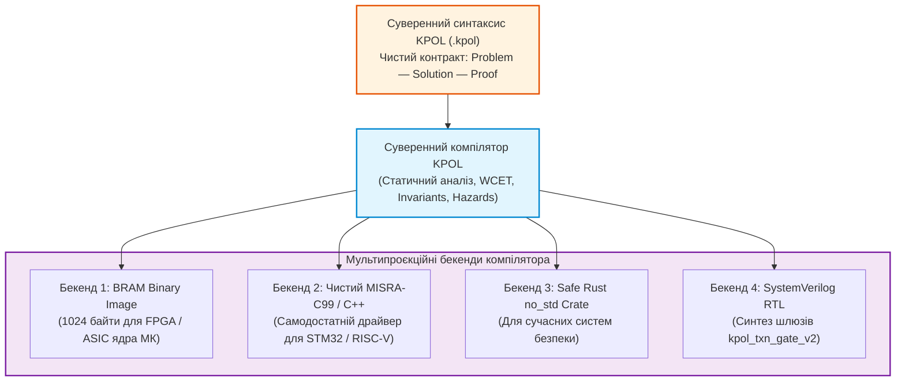

# МЕМОРАНДУМ: Стратегія суверенності мови KPOL та розширена дорожня карта версій v0.6–v1.0

> **Внутрішня робоча копія, не публікація; міграція не є науковим прийняттям.** Перенесено з `drafts@774d575:KuzminMachine/01-concepts-and-theory/MEMO_KPOL_SOVEREIGN_STRATEGY_AND_EXTENDED_ROADMAP_UA.md` 2026-11-10, Issue #84. Міграція не підтверджує тверджень, прогнозів чи самоприсвоєних статусів. Незмінний оригінал і SHA-256 — у реєстрі міграції.

* **Дата затвердження:** 2026-11-08 
* **Статус документа:** Нормативне стратегічне та архітектурне рішення 
* **Автори:** Федчик М. М. (Lead Researcher), Antigravity AI Assistant 
* **Предмет рішення:** 
  1. Вибір парадигми суверенності: Автономна мова (External DSL) проти фреймворку/макросів поверх C чи Rust. 
  2. Запровадження обов'язкових проміжних версій v0.6, v0.7, v0.8, v0.9 перед релізом стандарту v1.0.

> **Статус щодо стандартів безпеки:** згадки ISO 26262 / ASIL, DO-178C / DO-254 / DAL, IEC 61508 / SIL, IEC 62304 та ISO/SAE 21434 у цьому документі означають цільові домени й припущення, а не досягнуту відповідність. Зовнішніх вимог за цими стандартами немає; аналіз небезпек, цілі безпеки, кваліфікація інструментів і незалежне оцінювання не виконувалися. Див. [позицію проєкту](../../process/standards-position.md).

---

## 1. Стратегічне роздоріжжя та прийняте рішення про суверенність

### 1.1. Аналіз варіантів реалізації
Розглядалося два крайні підходи та один гібридний:
1. **Повна ізольована суверенність (Pure Standalone DSL):** власна мова, власний компілятор, закрита віртуальна машина. 
   * *Вердикт:* Занадто високий бар'єр входу для інженерів, прірва інструментів (*Tooling Gap*), високий ризик відторгнення індустрією.
2. **Вбудований фреймворк поверх C або Rust (Pure Embedded DSL / Macro library):** 
   * *Вердикт:* Неможливість гарантувати кремнієвий WCET-детермінізм ($10\text{ нс}$), макросове візуальне перевантаження, відсутність природного маппінгу на BRAM дескриптори та фазовий вентиль `•`.
3. **Канонічний світовий гібрид (Шлях SCADE, SPARK Ada та CUDA):** 
   * *Прийняте рішення:* **«Суверенний фронтенд — Мультипроєкційні відкриті бекенди»**.

### 1.2. Формула суверенності KPOL
* **Синтаксис є суверенним:** Тріада «Проблема (вимоги) — Вирішення (код) — Доказ (тести)» оформлюється у строгому файлі `.kpol` без компромісів із синтаксичним шумом універсальних мов.
* **Виконання є відкритим і нативним:** Компілятор генерує чистий C99, Safe Rust, двійковий образ BRAM та Verilog. Розробник під STM32 просто підключає згенерований `kpol_<module>.h` до свого Keil/GCC/IAR проекту без жодних сторонніх рантаймів або операційних систем.

---

## 2. Обґрунтування нової розширеної дорожньої карти

Прямий стрибок із версії v0.5 одразу у v1.0 відхилено як методологічно хибний. 
Перед стандартизацією v1.0 у розробку вводиться **чотири обов'язкові проміжні підверсії**:

### Порівняльна таблиця нової дорожньої карти KPOL

| Версія | Статус | Головний фокус | Ключовий результат |
| :--- | :--- | :--- | :--- |
| **v0.2** | *Готово* | **Синхронізація ядра** | Розділення `Hazard` (Fail-Closed) vs `Alert` (телеметрія); Тріада `Problem-Solution-Proof` (Docs-as-Code) |
| **v0.3** | *Готово* | **Час і надійність** | Фізичний час (`every`/`within`/`timeout`), піни `Pin`, Дерева нагляду (*Supervision*), Профілі ядра |
| **v0.4** | *Готово* | **Конкурентність і залізо** | CSP-рандеву, монопольна власність пам'яті BRAM, зворотний тиск (*Backpressure* / DoS-захист), Deadlock-Free |
| **v0.5** | *Готово* | **Перший компілятор** | 1024-байтний BRAM бінарник, C99 заголовки для STM32, Verilog обв'язка, RTM-матриця трасування вимог (формат розраховано на можливий майбутній аудит; відповідність ISO 26262 не заявляється) |
| **v0.6** | *У роботі* | **CyberSecurity & Secure Boot** | Криптографічний підпис BRAM образу (HMAC/Ed25519), Hardware ACL маски, Zero-Trust валідація MMIO |
| **v0.7** | *Заплановано* | **Попперівська фальсифікація** | Вбудований авто-мутаційний фаззер, Z3 SMT контрприклади, офіційний ступінь підкріплення $C(h, e)$ |
| **v0.8** | *Заплановано* | **Фіксований кремній & STM32** | Готовий Bare-Metal рантайм `libkpol`, Vivado AXI4-Lite IP-ядро, Hardware-in-the-Loop стенд вимірювання затримок |
| **v0.9** | *Заплановано* | **Файли-заголовки & Лінкер** | Роздільні файли `.kproblem` / `.ksolution` / `.kproof`, простори імен (`namespaces`), розділення ролей за зразком вимог незалежності DO-178C |
| **v1.0** | *Фінал* | **Стандартизація та CTS** | Формальна операційна семантика (SOS), заморожений ABI v1.0, Conformance Test Suite ($\ge 200$ тестів) |

---

## 3. Деталізація проміжних версій

### 3.1. KPOL v0.6: CyberSecurity, Апаратна ізоляція та Secure Boot
* **Мета:** Унеможливити підміну правил безпеки, ін'єкцію несанкціонованих подій та перехоплення керування вихідними пінами.
* **Вимоги:**
  1. Блок криптографічного підпису конфігурації (Signed BRAM Payload: 1024 байти даних + 64 байти блоку безпеки з HMAC-SHA256 або Ed25519);
  2. Апаратні списки контролю доступу (Hardware Capabilities ACL): бітова маска дозволених операцій запису у фізичні піни `Pin<Out>` для кожного концепту;
  3. Zero-Trust вхідний фільтр подій на межі MMIO-мосту (перевірка допустимості діапазонів до надходження в транзакційний шлюз).

### 3.2. KPOL v0.7: Попперівська фальсифікація та автоматичний мутаційний відбір
* **Мета:** Ліквідувати упередженість підтвердження (*confirmation bias*) людини під час написання тестів.
* **Вимоги:**
  1. Вбудований мутаційний фаззер: компілятор автоматично генерує мутантів коду і блокує збірку релізу, якщо мутаційний бал $M < 1.0$;
  2. Інтеграція з SMT-солвером (Z3): математичний пошук найгірших контрприкладів, здатних порушити інваріанти;
  3. Розрахунок метрики підкріплення Поппера $C(h, e)$ для сертифікаційного аудиту.

### 3.3. KPOL v0.8: Екосистема розгортання на фіксованому кремнії (STM32 & FPGA)
* **Мета:** Повний перехід від лабораторного емулятора до готової до використання промислової платформи.
* **Вимоги:**
  1. Бібліотека `libkpol` для STM32 / RISC-V: детерміністичний C-рантайм без динамічної пам'яті (MISRA C:2012 сумісний);
  2. Параметризоване AXI4-Lite IP-ядро для середовища Xilinx Vivado / openXC7;
  3. Hardware-in-the-Loop стенд вимірювання реальних фізичних затримок обробки подій між STM32 і FPGA.

### 3.4. KPOL v0.9: Модульна декомпозиція та дотримання незалежності верифікації
* **Мета:** Технічно підтримати розділення коду й тестів, якого вимагають правила незалежності верифікації у DO-178C (DAL A) та ISO 26262 (ASIL D). Відповідність цим стандартам не оцінювалася і самим форматом файлів не забезпечується.
* **Вимоги:**
  1. Синтаксична підтримка роздільних файлів: `.kproblem` (Safety-інженер), `.ksolution` (Розробник алгоритму), `.kproof` (Red-Team верифікатор);
  2. Простори імен (`namespaces`) та правила імпорту сигналів;
  3. Лінкер модулів KPOL із контролем несуперечливості контрактів.

---

## 4. Висновок

Прийняте рішення забезпечує **ідеальну рівновагу між інженерною чистотою та ринковою життєздатністю**:
KPOL зберігає власну суверенну філософію на рівні мислення та специфікації, але інтегрується у звичний для світової індустрії софтверний ландшафт C, Rust і FPGA без створення штучних бар'єрів.
