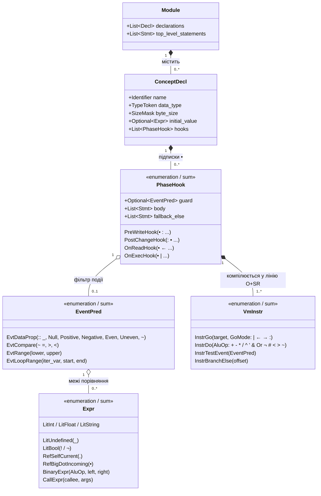
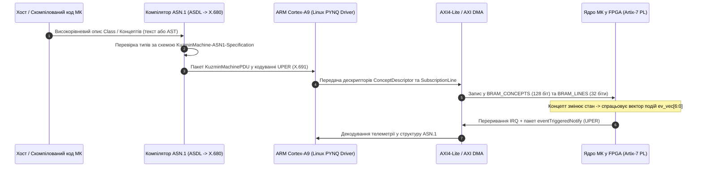

# Формальна специфікація мови та протоколу Машини Кузьміна в нотації абстрактного синтаксису (ASN / ASDL та ITU-T X.680 ASN.1)

* **Версія:** 0.1.1
* **Перенесено з:** `drafts/KuzminMachine/01-concepts-and-theory/Kuzmin-Machine-ASN-Specification-UA.md` @ `a4738bc` (2026-11-09)

> [!IMPORTANT]
> **Призначення документа:** Цей документ доповнює [Специфікацію високорівневої мови МК](https://github.com/nick-fedchik/drafts/blob/a4738bc/KuzminMachine/03-engineering-software/Kuzmin-Machine-High-Level-Language-Specification-UA.md) та [Архітектуру апаратного прискорювача на FPGA PYNQ-Z1](https://github.com/nick-fedchik/drafts/blob/a4738bc/KuzminMachine/02-engineering-hardware/Kuzmin-Machine-FPGA-PYNQ-Z1-Architecture-UA.md), переводячи опис мови Машини Кузьміна (МК) із рівня поверхневої текстової граматики (**EBNF**) на рівень класичної **Нотації абстрактного синтаксису (Abstract Syntax Notation — ASN)**. Документ охоплює обидві фундаментальні інженерні парадигми ASN:
> 1. **Алгебраїчну абстрактну синтаксичну нотацію компілятора (McCarthy ASN / Zephyr ASDL)** — для формалізації дерева абстрактного синтаксису (AST), вільного від дужок, роздільників і синтаксичного цукру.
> 2. **Міжнародний стандарт ITU-T X.680 / ISO/IEC 8824 (ASN.1)** — для строгої типізації концептів, подій, фазових перехоплень Великої крапки (`•`), підписних ліній $`O + SR`$ та компактного бінарного кодування (**UPER / DER**) під час віддаленого створення концептів і динамічного обміну між хостом та апаратним ядром МК.

---

## Зміст

1. [Чому вихідний опис спирався на EBNF і навіщо Машині Кузьміна потрібна класична нотація ASN](#1-чому-вихідний-опис-спирався-на-ebnf-і-навіщо-машині-кузьміна-потрібна-класична-нотація-asn)
2. [Абстрактний синтаксис компілятора: алгебраїчна нотація McCarthy ASN та Zephyr ASDL](#2-абстрактний-синтаксис-компілятора-алгебраїчна-нотація-mccarthy-asn-та-zephyr-asdl)
3. [Повний формальний модуль мови та протоколу МК у стандарті ITU-T X.680 (ASN.1)](#3-повний-формальний-модуль-мови-та-протоколу-мк-у-стандарті-itu-t-x680-asn1)
4. [Бінарне кодування ASN.1 (DER та UPER) і його відображення на апаратну пам'ять FPGA PYNQ-Z1](#4-бінарне-кодування-asn1-der-та-uper-і-його-відображення-на-апаратну-пам'ять-fpga-pynq-z1)
5. [Наскрізний корпус програм МК у канонічній нотації значень ASN.1 (Value Notation)](#5-наскрізний-корпус-програм-мк-у-канонічній-нотації-значень-asn1-value-notation)

---

## 1. Чому вихідний опис спирався на EBNF і навіщо Машині Кузьміна потрібна класична нотація ASN

У попередньому документі ([Специфікація високорівневої мови МК](https://github.com/nick-fedchik/drafts/blob/a4738bc/KuzminMachine/03-engineering-software/Kuzmin-Machine-High-Level-Language-Specification-UA.md)) граматику було подано в розширеній нотації Бекуса — Наура (**EBNF**). Такий вибір на першому етапі був зумовлений трьома причинами:

1. **Авторська текстова нотація словників:** Оригінальні таблиці `Type { ... }` та `Operation { ... }` у першоджерелах М. Кузьміна записані як ієрархічні символьні дерева з фігурними `{}` і круглими `()` дужками, позиційними індексами та вбудованими коментарями `# '...»`. Для лексичного аналізатора (токенайзера) та парсера тексту першим кроком завжди є формалізація **конкретного синтаксису** (Concrete Syntax) через EBNF.
2. **Неоднозначність поверхневих токенів:** У текстовому записі МК один і той самий символ виконує різні синтаксичні ролі залежно від оточення (наприклад, `~` — це і бінарне порівняння, і подія зміни значення `:: ~`, і побітова інверсія `Do ~`; символи `<` та `>` позначають і відношення порядку, і зсуви бітів `Do <` / `Do >`, і межі локального циклу `<i ... >`). EBNF дозволяє явно зафіксувати правила розмежування цих контекстів під час читання вихідного тексту.
3. **Синтаксичний цукор інфіксних виразів:** Високорівневий запис на кшталт `Res = V1 - V2` або `• { . = • * • }` містить неявні пріоритети операторів та дужки, які існують лише в тексті програми, але повністю зникають у внутрішній моделі Машини Кузьміна.

Проте **EBNF принципово недостатня** для повного опису Машини Кузьміна як обчислювальної платформи з таких фундаментальних інженерних причин:

* **МК оперує в часі виконання не текстом, а живими концептами в середовищі:** Згідно з архітектурою МК, програма не є монолітним текстовим файлом, який компілюється раз і назавжди. Середовище МК дозволяє **віддалено у реальному часі створювати нові концепти** (`Define`), модифікувати їхні типи (`Convert`) та динамічно приєднувати зовнішні підписки (`E.Subscribe(Value)`) між різними вузлами або ядрами без зупинки обчислень.
* **Двоїстість високорівневого дерева (AST) і низькорівневого потоку (`Go`/`Do`):** Внутрішнє представлення концепту в пам'яті не містить круглих чи квадратних дужок або ключових слів `else` — воно складається зі строго типізованого дескриптора концепту, дерева абстрактних виразів та скомпільованих підписних ліній $`O + SR`$.
* **Потреба у кросплатформній бінарній серіалізації (Host $\leftrightarrow$ MCU / FPGA):** Під час передачі концептів і підписок від інструментального середовища розробки (хост-комп'ютера або процесорної системи ARM Cortex-A9 у PYNQ-Z1) до апаратного рушія у програмованій логіці FPGA чи мікроконтролера STM32 необхідний канонічний бінарний протокол без накладних витрат на текстовий парсинг.

Саме цю прогалину закриває класична **Нотація абстрактного синтаксису (ASN)** у двох її канонічних вимірах:

| Вимір специфікації | Формальний апарат | Що саме формалізує в Машині Кузьміна | Де застосовується в інженерному стеку МК |
| :--- | :--- | :--- | :--- |
| **Конкретний синтаксис** (Concrete Syntax) | **ISO/IEC 14977 EBNF** | Поверхневий текстовий запис, пріоритети інфіксних операторів, дужки `()`, `[]`, `{}`, коментарі `# '...»`. | Лексер та синтаксичний парсер текстових вихідних файлів `.km`. |
| **Абстрактний синтаксис компілятора** (Compiler ASN) | **McCarthy ASN / Zephyr ASDL** (Алгебраїчні типи даних) | Чиста ієрархія вузлів дерева абстрактного синтаксису (**AST**): конструктори концептів, предикати подій, фазові гілки `•`, інструкції `Go`/`Do`. | Фронтенд і міделенд компілятора МК, верифікатор типів, генератор підписних ліній $`O + SR`$. |
| **Стандартна нотація абстрактного синтаксису та кодування** | **ITU-T X.680 ASN.1** + **X.690 DER / X.691 UPER** | Незалежна від мови та платформи схема структур даних МК і мережевих/шинних пакетів (**PDU**) разом із правилами побітового пакування. | Протокол віддаленого створення концептів і підписок, DMA-обмін ARM PS $\leftrightarrow$ FPGA PL (PYNQ-Z1), збереження образу середовища МК. |

```mermaid
flowchart LR
    subgraph TextLayer["1. Поверхневий рівень (EBNF)"]
        SRC["Текстовий код МК<br/>Class, [• : ...], ::, Go/Do"]
    end

    subgraph CompilerASN["2. Абстрактний синтаксис компілятора (ASDL / AST)"]
        AST["Алгебраїчне дерево AST<br/>ConceptDecl, PhaseSub, EventPred, Expr"]
        IR["Граф підписних ліній<br/>Дескриптори SP та масиви O + SR"]
    end

    subgraph StandardASN1["3. Стандартизований рівень ITU-T X.680 (ASN.1)"]
        ASN1["Модуль KuzminMachine-ASN1<br/>Типи даних та повідомлення PDU"]
        UPER["Бінарний потік UPER / DER<br/>(X.691 Unaligned PER / X.690 DER)"]
    end

    subgraph HardwareTarget["4. Виконавче середовище МК"]
        FPGA["Апаратне ядро FPGA PYNQ-Z1<br/>BRAM Concept Table + RCFC + PE"]
        MCU["Вбудована ВМ (STM32 / SoC)<br/>Середовище виконання концептів"]
    end

    SRC -->|"Парсинг (EBNF)"| AST
    AST -->|"Трансляція фаз •"| IR
    AST <-->|"Ізоморфне відображення"| ASN1
    IR <-->|"Серіалізація структур"| ASN1
    ASN1 -->|"Кодування X.691 / X.690"| UPER
    UPER -->|"AXI4-Lite / DMA / UART"| FPGA
    UPER -->|"Віддалена підписка"| MCU

    style TextLayer fill:#eceff1,stroke:#455a64,stroke-width:2px
    style CompilerASN fill:#e3f2fd,stroke:#1565c0,stroke-width:2px
    style StandardASN1 fill:#fff8e1,stroke:#f57f17,stroke-width:2px
    style HardwareTarget fill:#e8f5e9,stroke:#2e7d32,stroke-width:2px
```



---

## 2. Абстрактний синтаксис компілятора: алгебраїчна нотація McCarthy ASN та Zephyr ASDL

У класичній теорії мов програмування (Дж. Маккарті, 1962; система **Zephyr ASDL** — *Abstract Syntax Description Language*, Вагнер та ін., 1997) абстрактний синтаксис визначається як система взаємно рекурсивних алгебраїчних типів даних: **типів-сум** (конструкторів варіантів, розділених вертикальною рискою `|`) та **типів-добутків** (іменованих полів кожного конструктора).

На відміну від EBNF, в абстрактному синтаксисі (ASDL):
* відсутні роздільники (`,`, `;`, `:`, дужки `[]`, `{}`, `()`);
* знято синтаксичну неоднозначність між поверхневими операторами (`~` як порівняння стає конструктором `CmpOp`, `~` як подія зміни значення — конструктором `EvtChanged`, а `~` як побітова інверсія — конструктором `AluBitNot`);
* високо- та низькорівневі конструкції об'єднані в єдину строго типізовану ієрархію, яку компілятор МК безпосередньо транслює у низькорівневі таблиці.

### 2.1. Математична сигнатура абстрактних доменів МК

Нехай $`\mathcal{I}`$ — зліченна множина ідентифікаторів концептів ($`\mathrm{Identifier}`$), $`\mathbb{Z}`$ — множина цілих констант, $`\mathbb{Q}`$ — множина констант із рухомою комою, $`\Sigma^*`$ — множина рядкових літералів (включно з дескрипторами апаратних виводів `"0p0"`). Тоді абстрактний синтаксис програми Машини Кузьміна задається кортежем взаємно рекурсивних синтаксичних доменів:

$$
\mathcal{A}_{\mathrm{KM}} = \langle \mathbf{Module}, \mathbf{Decl}, \mathbf{TypeSpec}, \mathbf{PhaseHook}, \mathbf{EventPred}, \mathbf{Expr}, \mathbf{Stmt}, \mathbf{VmInstr} \rangle
$$

Кожен концепт у абстрактному синтаксисі є елементом домену-добутку:

$$
\mathbf{ConceptDecl} \cong \mathcal{I} \times \mathbf{TypeSpec} \times \mathbf{SizeSpec} \times \mathbf{InitVal}^? \times \mathbf{PhaseHook}^*
$$

де фазове перехоплення Великої крапки (`•`) розкладається на чотири ортогональні алгебраїчні конструктори за моментом життєвого циклу концепту:

$$
\mathbf{PhaseHook} ::= \mathsf{PreWrite}(\mathbf{EventPred}^?, \mathbf{Stmt}^+) \quad\mid\quad \mathsf{PostChange}(\mathbf{EventPred}^?, \mathbf{Stmt}^+) \quad\mid\quad \mathsf{OnRead}(\mathbf{EventPred}^?, \mathbf{Stmt}^+) \quad\mid\quad \mathsf{OnExec}(\mathbf{EventPred}^?, \mathbf{Stmt}^+)
$$

### 2.2. Повна специфікація абстрактного синтаксису МК у нотації Zephyr ASDL

Нижче наведено повну формальну специфікацію абстрактного синтаксису мови Машини Кузьміна у стандартній нотації **ASDL** (де суфікс `?` означає опціональне поле $`0..1`$, а `*` — послідовність із $`0..N`$ елементів):

```asdl
-- ============================================================================
-- Абстрактний синтаксис мови Машини Кузьміна (Zephyr ASDL Specification)
-- ============================================================================
module KuzminMachineAST {

    -- Корінь абстрактного дерева: модуль або живий пакет середовища МК
    module = Module(
        decl* declarations,
        stmt* top_level_statements
    )

    -- 1. Оголошення сутностей (класи, параметри, концепти, зовнішні підписки)
    decl = ClassDecl(
               identifier name,
               param_decl* params,
               decl* members,
               phase_hook* class_hooks
           )
         | ConceptDecl(
               identifier name,
               type_token data_type,
               size_mask byte_size,
               expr? initial_value,
               phase_hook* hooks
           )
         | AliasDecl(
               identifier alias_name,
               target_ref target
           )
         | RemoteSubDecl(
               identifier subscriber,
               identifier target_concept,
               phase_hook* attached_hooks
           )

    param_decl = ParamDecl(
        identifier name,
        type_token data_type,
        size_mask byte_size,
        expr? default_value,
        phase_hook* param_hooks
    )

    -- 2. Система типів (відповідає словнику Type 0..15) та розмірів (Size 1|2|4|8)
    type_token = TypeTokenId       -- 0: Token (Перелічуваний токен)
               | TypeUnsigned      -- 1: + (Беззнакове ціле)
               | TypeSigned        -- 2: +- (Знакове ціле)
               | TypeFloat         -- 3: . (Дійсне число з рухомою комою)
               | TypeChar          -- 4: ' (Символ)
               | TypeString        -- 5: " (Рядок)
               | TypeConceptRef    -- 6: : (Посилання на концепт)
               | TypePointer       -- 7: ↑ (Вказівник у пам'яті)
               | TypeRow           -- 8: ← (Рядок матриці / вектор)
               | TypeColumn        -- 9: ↓ (Стовпець матриці)
               | TypeTable         -- 10: # (Таблиця / матриця)
               | TypeGroup         -- 11: [] (Група концептів)
               | TypePin           -- 12: └─ (Апаратний вивід контролера)
               | TypeChannel       -- 13: ⇄ (Канал вводу-виводу)
               | TypeFrame         -- 14: ▭ (Кадр даних)
               | TypeClass         -- 15: Class (Користувацький клас)

    size_mask = Size1B             -- 1 байт (8 біт)
              | Size2B             -- 2 байти (16 біт)
              | Size4B             -- 4 байти (32 біти)
              | Size8B             -- 8 байтів (64 біти)
              | SizeDynamic        -- Динамічний розмір (для рядків, таблиць і груп)

    -- 3. Фазова модель Великої крапки (•) та реактивних підписок
    phase_hook = PreWriteHook(     -- [• : ...] До привласнення (фільтрація входу •)
                     event_pred? guard,
                     stmt* body,
                     stmt* fallback_else
                 )
               | PostChangeHook(   -- [: • ...] Після зміни стану концепту
                     event_pred? guard,
                     stmt* body,
                     stmt* fallback_else
                 )
               | OnReadHook(       -- [• ← ...] Перед зчитуванням значення
                     event_pred? guard,
                     stmt* body
                 )
               | OnExecHook(       -- [• | ...] Під час безумовного виконання
                     event_pred? guard,
                     stmt* body,
                     stmt* fallback_else
                 )

    -- 4. Алгебра предикатів подій (:: та ~)
    event_pred = EvtDataProp(data_prop_kind prop)
               | EvtCompare(cmp_op op, expr rhs)
               | EvtRange(cmp_op lower_op, expr lower_bound, cmp_op upper_op, expr upper_bound)
               | EvtLoopRange(identifier iter_var, expr start_bound, cmp_op limit_op, expr end_bound)
               | EvtLogicalAnd(event_pred left, event_pred right)
               | EvtLogicalOr(event_pred left, event_pred right)
               | EvtLogicalNot(event_pred inner)

    data_prop_kind = PropUndefined -- 0: :: _ (Відсутнє значення)
                   | PropNull      -- 1: :: Null (Нуль)
                   | PropPositive  -- 2: :: Positive (Додатне > 0)
                   | PropNegative  -- 3: :: Negative (Від'ємне < 0)
                   | PropEven      -- 4: :: Even (Парне)
                   | PropUneven    -- 5: :: Uneven (Непарне)
                   | PropChanged   -- 6: :: ~ (Зміна значення: val_new != val_old)

    cmp_op = CmpEq                 -- 0: = (Дорівнює)
           | CmpGt                 -- 1: > (Більше)
           | CmpLt                 -- 2: < (Менше)
           | CmpGe                 -- >= (Більше або дорівнює: синтез ~ > Or ~ =)
           | CmpLe                 -- <= (Менше або дорівнює: синтез ~ < Or ~ =)
           | CmpNe                 -- != (Не дорівнює: синтез ¬ ~ =)

    -- 5. Оператори дії (високорівневі оператори та низькорівневі блоки Go/Do)
    stmt = AssignSelfStmt(expr value)                        -- . = expr (запис у поточний концепт)
         | AssignTargetStmt(target_ref target, expr value)   -- Target = expr (запис у цільовий концепт)
         | MutateUpdateStmt(target_ref target, alu_op op, expr rhs) -- Target += expr, ++Target
         | CallStmt(target_ref callee, expr* args)           -- Виклик концепту/класу з аргументами
         | GuardedBlockStmt(event_pred condition, stmt* then_branch, stmt* else_branch)
         | LocalLoopStmt(identifier iter_var, expr init_val, event_pred loop_cond, stmt* loop_body)
         | LowLevelSeqStmt(vm_instr* instructions)           -- Прямий блок інструкцій Go / Do
         | ControlOpStmt(ctrl_op_kind ctrl_kind, target_ref? arg)

    ctrl_op_kind = OpDefine        -- Define (Динамічне визначення поняття)
                 | OpConvert       -- Convert (Конвертація типу концепту)
                 | OpExit          -- Exit (Вихід із групи виконання)
                 | OpProcessor     -- Processor (Додати процесор / обчислювальне ядро)

    -- 6. Високорівневі вирази (вільні від синтаксичних дужок)
    expr = LitUndefined            -- _ (Невизначений стан)
         | LitBool(bool val)       -- ! (True, 0) або ¬ (False, 1)
         | LitInt(int val)         -- Ціла константа
         | LitFloat(float val)     -- Дійсна константа
         | LitString(string val)   -- Рядкова константа або дескриптор порту "0p0"
         | RefSelfCurrent          -- . (Поточне збережене значення концепту)
         | RefBigDotIncoming       -- • (Вхідне значення, що записується у концепт)
         | RefConcept(target_ref ref)
         | UnaryExpr(alu_op op, expr operand)
         | BinaryExpr(alu_op op, expr left, expr right)
         | CallExpr(target_ref callee, expr* args)

    target_ref = SimpleRef(identifier name)
               | MemberRef(target_ref object, identifier field)
               | IndexedRef(target_ref array, expr index)

    -- 7. Низькорівневі інструкції віртуальної / апаратної стекової машини (Go та Do)
    vm_instr = InstrGo(target_ref concept_target, go_mode mode)
             | InstrDo(alu_op operation)
             | InstrTestEvent(event_pred predicate)
             | InstrBranchElse(int offset_instructions)

    go_mode = GoExec               -- 0: Go X |  (Виконати підписки концепту X)
            | GoWrite              -- 1: Go X ←  (Витягти зі стека й записати у концепт X)
            | GoRead               -- 2: Go X →  (Зчитати значення концепту X на вершину стека)
            | GoAddress            -- 3: Go X :  (Покласти на стек ідентифікатор/адресу концепту X)

    alu_op = AluAdd                -- 0:  Do +  (Додавання)
           | AluSub                -- 1:  Do -  (Віднімання)
           | AluMul                -- 2:  Do *  (Множення)
           | AluDiv                -- 3:  Do /  (Ділення)
           | AluPow                -- 4:  Do ^  (Піднесення до степеня)
           | AluMod                -- 5:  Do '  (Остача від ділення)
           | AluBitAnd             -- 6:  Do &  (Побітове І)
           | AluBitOr              -- 7:  Do Or (Побітове АБО)
           | AluLogNot             -- 8:  Do ¬  (Логічне заперечення)
           | AluBitXor             -- 9:  Do #  (Виключне АБО — XOR)
           | AluShiftLeft          -- 10: Do <  (Зсув бітів ліворуч)
           | AluShiftRight         -- 11: Do >  (Зсув бітів праворуч)
           | AluBitNot             -- 12: Do ~  (Побітова інверсія)
}
```

### 2.3. Метамодель абстрактного синтаксису МК (Mermaid Class Diagram)



---

## 3. Повний формальний модуль мови та протоколу МК у стандарті ITU-T X.680 (ASN.1)

Якщо нотація ASDL описує внутрішні структури компілятора, то міжнародний стандарт **ITU-T X.680 / ISO/IEC 8824 (Abstract Syntax Notation One — ASN.1)** забезпечує канонічну контрактну специфікацію, яка одночасно визначає:
1. **Високорівневе представлення концептів і класів** (для обміну між IDE, компілятором і сховищем концептів);
2. **Низькорівневі таблиці виконання** — дескриптори концептів, дескриптори підписок $`SP`$ та лінії команд $`O + SR`$;
3. **Мережевий та шинний протокол PDU (Protocol Data Units)** — для віддаленого створення концептів (`Define`), приєднання підписок (`Subscribe`) на льоту та телеметрії подій між хостом і вузлами виконання (STM32 або FPGA PYNQ-Z1).

Усі числові коди у наведеному нижче модулі `KuzminMachine-ASN1-Specification` **точно збігаються з канонічними індексами токенів** у словниках `Type` та `Operation` Машини Кузьміна.

```asn1
-- ============================================================================
-- Формальна специфікація мови, таблиць виконання та протоколу Машини Кузьміна
-- Стандарт: ITU-T Rec. X.680 (ASN.1) | Кодування: ITU-T X.690 (DER), X.691 (UPER)
-- ============================================================================

KuzminMachine-ASN1-Specification {
    iso(1) identified-organization(3) dod(6) internet(1)
    private(4) enterprise(1) kuzminMachine(99999) specification(1) version1(1)
}
DEFINITIONS AUTOMATIC TAGS EXTENSIBILITY IMPLIED ::= BEGIN

EXPORTS
    KuzminMachineModule,
    ConceptDescriptor,
    SubscriptionDescriptor,
    SubscriptionLine,
    VmInstruction,
    KuzminMachinePDU;

-- ============================================================================
-- 1. БАЗОВІ ІДЕНТИФІКАТОРИ ТА СИСТЕМА ТИПІВ (Словник Type 0..15)
-- ============================================================================

-- Числовий ідентифікатор концепту в апаратній таблиці (до 65536 концептів на вузол,
-- у конфігурації PYNQ-Z1 використовується піддіапазон 0..4095)
ConceptId ::= INTEGER (0..65535)

-- Символьне ім'я концепту, класу або параметра у високорівневій мові
ConceptName ::= UTF8String (SIZE (1..128))

-- Універсальне посилання на концепт (за символьним ім'ям під час компіляції
-- або за числовим індексом у скомпільованому бінарному образі)
ConceptRef ::= CHOICE {
    byId        ConceptId,
    byName      ConceptName,
    memberPath  SEQUENCE (SIZE (2..8)) OF ConceptName,
    selfCurrent NULL,   -- Токен '.' (поточне значення концепту)
    bigDotIn    NULL    -- Токен '•' (Велика крапка: вхідний аргумент / подія)
}

-- Канонічний перелік типів концептів (точно відповідає індексам Type 0..15)
TypeToken ::= ENUMERATED {
    token       (0),    -- Token : Перелічуваний токен
    unsignedInt (1),    -- "+"   : Ціле число без знака
    signedInt   (2),    -- "+-"  : Ціле число зі знаком
    floatPoint  (3),    -- "."   : Число з рухомою комою
    character   (4),    -- "'"   : Одиночний символ
    textString  (5),    -- """   : Текстовий рядок
    conceptRef  (6),    -- ":"   : Посилання на інший концепт
    pointer     (7),    -- "↑"   : Вказівник у пам'яті
    matrixRow   (8),    -- "←"   : Рядок таблиці / вектор
    matrixCol   (9),    -- "↓"   : Стовпець таблиці
    tableMatrix (10),   -- "#"   : Таблиця / матриця
    conceptGrp  (11),   -- "[]"  : Група концептів
    hwPin       (12),   -- "└─"  : Апаратний вивід контролера (порт GPIO)
    ioChannel   (13),   -- "⇄"   : Канал обміну даними
    dataFrame   (14),   -- "▭"   : Кадр даних
    userClass   (15)    -- Class : Користувацький клас
}

-- Квантування розміру даних у байтах: Size ( 1 | 2 | 4 | 8 )
SizeCode ::= ENUMERATED {
    size1Byte   (0),    -- 1 байт  (8 біт)
    size2Bytes  (1),    -- 2 байти (16 біт)
    size4Bytes  (2),    -- 4 байти (32 біти)
    size8Bytes  (3)     -- 8 байтів (64 біти)
}

-- Логічний токен Машини Кузьміна: "?" Token ( "!" 0 , "¬" 1 )
-- Увага: за специфікацією МК код 0 відповідає Істині ('!'), а код 1 — Хибності ('¬')
KmBoolean ::= ENUMERATED {
    kmTrue      (0),    -- "!" : Істина (True)
    kmFalse     (1)     -- "¬" : Хибність (False)
}

-- Типізоване значення концепту (включно з особливим станом '_' — Відсутнє значення)
ConceptValue ::= CHOICE {
    undefinedVal    NULL,                           -- "_" : Відсутнє значення (is_undef = 1)
    boolVal         KmBoolean,                      -- "?" : "!" (0) або "¬" (1)
    unsignedVal     INTEGER (0..18446744073709551615),
    signedVal       INTEGER (-9223372036854775808..9223372036854775807),
    floatVal        REAL,
    charVal         UTF8String (SIZE (1)),
    stringVal       UTF8String (SIZE (0..4096)),
    pinConfigStr    VisibleString (SIZE (3..8)),    -- Наприклад, "0p0", "0p1"
    refVal          ConceptId,
    groupElements   SEQUENCE OF ConceptId
}

-- ============================================================================
-- 2. СИСТЕМА ПОДІЙ ТА КОМПАРАТОРІВ (Словник Operation: "::" та "~")
-- ============================================================================

-- Внутрішні події властивостей даних "::" (індекси 0..6 за авторською таблицею)
DataPropertyEvent ::= ENUMERATED {
    absentValue (0),    -- "_"        : Відсутнє значення (не ініціалізовано)
    isNull      (1),    -- Null       : Дорівнює нулю (val == 0)
    isPositive  (2),    -- Positive   : Додатне значення (val > 0)
    isNegative  (3),    -- Negative   : Від'ємне значення (val < 0)
    isEven      (4),    -- Even       : Парне число (val mod 2 == 0)
    isUneven    (5),    -- Uneven     : Непарне число (val mod 2 != 0)
    valChanged  (6)     -- "~"        : Зміна значення (val_new != val_old)
}

-- Оператори відношення порівняння "~" (індекси 0..2 за авторською таблицею + похідні)
ComparisonOperator ::= ENUMERATED {
    equal           (0),    -- "="  : Дорівнює
    greaterThan     (1),    -- ">"  : Більше
    lessThan        (2),    -- "<"  : Менше
    greaterOrEqual  (3),    -- ">=" : Синтезоване (greaterThan OR equal)
    lessOrEqual     (4),    -- "<=" : Синтезоване (lessThan OR equal)
    notEqual        (5)     -- "!=" : Синтезоване (NOT equal)
}

-- Одиночна умова порівняння (наприклад, ":: < Max" або "= 10")
ComparisonGuard ::= SEQUENCE {
    operator    ComparisonOperator,
    threshold   HllExpression
}

-- Діапазонна умова (наприклад, ":: > Min < Max" у класі Control)
RangeGuard ::= SEQUENCE {
    lowerBound  ComparisonGuard,
    upperBound  ComparisonGuard
}

-- Локальний генератор циклу на подіях (наприклад, "<i = 0 < 5 ... >")
LoopEventGuard ::= SEQUENCE {
    iteratorConcept ConceptRef,
    initialExpr     HllExpression,
    terminationCond ComparisonGuard
}

-- Узагальнений предикат події, що запускає підписну лінію
EventPredicate ::= CHOICE {
    unconditional   NULL,                           -- Безумовна активація фази
    dataProperty    DataPropertyEvent,              -- "::" (0..6)
    singleCompare   ComparisonGuard,                -- "~" (=, >, <)
    rangeCompare    RangeGuard,                     -- Подвійне обмеження діапазону
    loopGenerator   LoopEventGuard,                 -- Циклічна подія <i ... >
    logicalNot      EventPredicate,                 -- "¬" Заперечення події
    logicalAnd      SEQUENCE SIZE (2..8) OF EventPredicate,
    logicalOr       SEQUENCE SIZE (2..8) OF EventPredicate
}

-- ============================================================================
-- 3. НИЗЬКОРІВНЕВІ ОПЕРАЦІЇ СТЕКОВОЇ МАШИНИ (Go, Do, Системні директиви)
-- ============================================================================

-- Коди адресації операції Go (індекси 0..3 за авторською таблицею)
GoModeCode ::= ENUMERATED {
    execSub     (0),    -- "|" : Активувати виконання підписок концепту
    writePop    (1),    -- "←" : Витягти значення зі стека та записати в концепт
    readPush    (2),    -- "→" : Зчитати значення концепту та покласти на стек
    pushAddress (3)     -- ":" : Покласти ідентифікатор (адресу) концепту на стек
}

-- Коди арифметико-логічного пристрою Do (індекси 0..12 за авторською таблицею)
DoOpcode ::= ENUMERATED {
    add         (0),    -- "+"  : Додавання
    subtract    (1),    -- "-"  : Віднімання
    multiply    (2),    -- "*"  : Множення
    divide      (3),    -- "/"  : Ділення
    power       (4),    -- "^"  : Піднесення до степеня
    modulo      (5),    -- "'"  : Остача від ділення
    bitAnd      (6),    -- "&"  : Побітове І
    bitOr       (7),    -- "Or" : Побітове АБО
    logicalNot  (8),    -- "¬"  : Логічне заперечення
    bitXor      (9),    -- "#"  : Побітове виключне АБО (XOR)
    shiftLeft   (10),   -- "<"  : Побітовий зсув ліворуч
    shiftRight  (11),   -- ">"  : Побітовий зсув праворуч
    bitInvert   (12)    -- "~"  : Побітова інверсія (доповнення)
}

-- Системні директиви керування середовищем МК
SystemDirectiveCode ::= ENUMERATED {
    defineConcept   (0),    -- Define    : Визначення нових понять (концептів)
    convertType     (1),    -- Convert   : Конвертація типів концептів
    exitGroup       (2),    -- Exit      : Вихід із групи виконання
    addProcessor    (3)     -- Processor : Додати процесор (обчислювальний вузол)
}

-- Низькорівнева інструкція віртуальної або апаратної машини МК (слово лінії O)
VmInstruction ::= CHOICE {
    goInstr         SEQUENCE {
        target      ConceptRef,
        mode        GoModeCode DEFAULT execSub
    },
    doInstr         DoOpcode,
    checkDataEvent  SEQUENCE {
        target      ConceptRef,
        propEvent   DataPropertyEvent
    },
    checkCompare    SEQUENCE {
        op          ComparisonOperator,
        invert      BOOLEAN DEFAULT FALSE
    },
    pushImmediate   ConceptValue,
    branchOnFalse   INTEGER (-32768..32767),        -- Перехід на гілку 'else'
    systemDirective SEQUENCE {
        directive   SystemDirectiveCode,
        operand     ConceptRef OPTIONAL
    }
}

-- ============================================================================
-- 4. ФАЗОВА МОДЕЛЬ ВЕЛИКОЇ КРАПКИ (•) ТА ДЕСКРИПТОРИ ПІДПИСОК (SP та O + SR)
-- ============================================================================

-- Фаза життєвого циклу концепту, яку перехоплює Велика крапка (•)
BigDotPhase ::= ENUMERATED {
    preWriteFilter  (0),    -- [• : ...] До привласнення (перевірка та трансформація входу •)
    postChangeReact (1),    -- [: • ...] Після зміни стану концепту (реактивна розсилка)
    onReadSupply    (2),    -- [• ← ...] Перед зчитуванням (ліниве обчислення значення)
    onExecInvoke    (3)     -- [• | ...] Безумовне виконання дій концепту
}

-- Скомпільована підписна лінія (O + SR) для виконання на процесорі P або PE в FPGA
SubscriptionLine ::= SEQUENCE {
    lineId          INTEGER (0..65535),
    ownerConcept    ConceptId,
    phase           BigDotPhase,
    triggerMask     BIT STRING {
        evtAbsent   (0),
        evtNull     (1),
        evtPositive (2),
        evtNegative (3),
        evtEven     (4),
        evtUneven   (5),
        evtChanged  (6),
        evtCompare  (7)
    } (SIZE (8)),
    operationsO     SEQUENCE (SIZE (1..256)) OF VmInstruction,
    nestedSubsSR    SEQUENCE (SIZE (0..64)) OF SubscriptionId,
    elseFallbackLine SubscriptionId OPTIONAL
}

SubscriptionId ::= INTEGER (0..65535)

-- Апаратний дескриптор підписки SP (Subscription Pointer у глобальній пам'яті МК)
SubscriptionDescriptor ::= SEQUENCE {
    subId           SubscriptionId,
    sourceConcept   ConceptId,                      -- Концепт-джерело події
    subscriber      ConceptId,                      -- Концепт-підписник
    phase           BigDotPhase,
    priority        INTEGER (0..255) DEFAULT 0,
    activeLine      SubscriptionLine
}

-- ============================================================================
-- 5. ВИСОКОРІВНЕВЕ ДЕРЕВО АБСТРАКТНОГО СИНТАКСИСУ (HLL AST у ASN.1)
-- ============================================================================

HllExpression ::= CHOICE {
    literal         ConceptValue,
    conceptRef      ConceptRef,
    unaryAlu        SEQUENCE {
        op          DoOpcode,
        operand     HllExpression
    },
    binaryAlu       SEQUENCE {
        op          DoOpcode,
        left        HllExpression,
        right       HllExpression
    },
    conceptCall     SEQUENCE {
        callee      ConceptRef,
        arguments   SEQUENCE OF HllExpression
    }
}

HllStatement ::= CHOICE {
    assignSelf      HllExpression,                  -- . = expr
    assignTarget    SEQUENCE {                      -- Target = expr
        target      ConceptRef,
        valueExpr   HllExpression
    },
    compoundUpdate  SEQUENCE {                      -- ++Target, Target += expr
        target      ConceptRef,
        aluOp       DoOpcode,
        deltaExpr   HllExpression
    },
    invokeConcept   SEQUENCE {                      -- Виклик концепту/класу
        callee      ConceptRef,
        arguments   SEQUENCE OF HllExpression
    },
    guardedAction   SEQUENCE {                      -- Умовний блок з 'else'
        guard       EventPredicate,
        thenStmts   SEQUENCE OF HllStatement,
        elseStmts   SEQUENCE OF HllStatement OPTIONAL
    },
    lowLevelBlock   SEQUENCE OF VmInstruction       -- Вбудований ланцюжок Go / Do
}

-- Високорівневий опис підписки у блоці Великої крапки [...]
HllPhaseHook ::= SEQUENCE {
    phase           BigDotPhase,
    eventGuard      EventPredicate,
    actions         SEQUENCE OF HllStatement,
    elseActions     SEQUENCE OF HllStatement OPTIONAL
}

-- Повний дескриптор концепту (об'єднує метадані, поточний стан, HLL AST та лінії O+SR)
ConceptDescriptor ::= SEQUENCE {
    id              ConceptId,
    name            ConceptName,
    typeToken       TypeToken,
    sizeCode        SizeCode DEFAULT size4Bytes,
    isUndefined     BOOLEAN DEFAULT TRUE,           -- Чи перебуває у стані '_'
    currentValue    ConceptValue,
    previousValue   ConceptValue OPTIONAL,          -- Для обчислення події ':: ~'
    highLevelHooks  SEQUENCE OF HllPhaseHook OPTIONAL,
    compiledSubs    SEQUENCE OF SubscriptionId OPTIONAL
}

-- Опис класу високорівневої мови (наприклад, Class Example, Class Control, Nod)
ClassDeclaration ::= SEQUENCE {
    classId         ConceptId,
    className       ConceptName,
    parameters      SEQUENCE OF ConceptDescriptor,
    localConcepts   SEQUENCE OF ConceptDescriptor,
    classHooks      SEQUENCE OF HllPhaseHook
}

-- Корінь модуля високорівневої програми або образу пам'яті МК
KuzminMachineModule ::= SEQUENCE {
    moduleName      UTF8String (SIZE (1..128)),
    specVersion     INTEGER DEFAULT 1,
    classes         SEQUENCE OF ClassDeclaration,
    concepts        SEQUENCE OF ConceptDescriptor,
    subscriptions   SEQUENCE OF SubscriptionDescriptor,
    entryStatements SEQUENCE OF HllStatement OPTIONAL
}

-- ============================================================================
-- 6. МЕРЕЖЕВИЙ ТА ШИННИЙ ПРОТОКОЛ ВІДДАЛЕНОГО КЕРУВАННЯ СЕРЕДОВИЩЕМ МК (PDU)
-- ============================================================================

KuzminMachinePDU ::= CHOICE {
    -- 1. Віддалене створення нового концепту або класу в живому середовищі (Define)
    defineConceptReq        SEQUENCE {
        requestId           INTEGER (0..4294967295),
        conceptSpec         ConceptDescriptor
    },
    -- 2. Віддалене динамічне приєднання підписки (наприклад, E.Subscribe(Value))
    attachSubscriptionReq   SEQUENCE {
        requestId           INTEGER (0..4294967295),
        targetConcept       ConceptRef,
        subscriberConcept   ConceptRef,
        hookSpec            HllPhaseHook,
        compiledLine        SubscriptionLine OPTIONAL
    },
    -- 3. Зовнішній запис або активація концепту (віддалене Go X ← або Go X |)
    remoteGoCommand         SEQUENCE {
        requestId           INTEGER (0..4294967295),
        targetConcept       ConceptRef,
        mode                GoModeCode,
        payloadValue        ConceptValue OPTIONAL
    },
    -- 4. Асинхронне повідомлення про спрацювання події від ядра МК (телеметрія)
    eventTriggeredNotify    SEQUENCE {
        timestampCycles     INTEGER (0..18446744073709551615),
        sourceConcept       ConceptId,
        triggeredPhase      BigDotPhase,
        newValue            ConceptValue,
        executedLineId      SubscriptionId
    },
    -- 5. Відповідь-підтвердження від виконавчого ядра МК (FPGA / MCU)
    executionAck            SEQUENCE {
        requestId           INTEGER (0..4294967295),
        status              ENUMERATED {
            ok                  (0),
            fallbackElseTaken   (1),
            conceptNotFound     (2),
            typeMismatch        (3),
            rendezvousTimeout   (4)
        },
        resultValue         ConceptValue OPTIONAL
    }
}

END
```

---

## 4. Бінарне кодування ASN.1 (DER та UPER) і його відображення на апаратну пам'ять FPGA PYNQ-Z1

Ключова перевага запису мови МК у стандарті **ITU-T X.680 ASN.1** полягає в тому, що одна й та сама формальна специфікація автоматично отримує строгі математичні правила побітової серіалізації без написання ручних парсерів:

1. **DER (Distinguished Encoding Rules, ITU-T X.690)** — канонічне самоописове кодування `Tag-Length-Value (TLV)`, ідеальне для збереження скомпільованих модулів `.kmc` на диску та обміну між інструментальними засобами на ARM Cortex-A9 (Linux PYNQ).
2. **UPER (Unaligned Packed Encoding Rules, ITU-T X.691)** — надкомпактне побітове кодування без вирівнювання на межі октетів, яке використовує мінімальну теоретико-інформаційну кількість бітів для кожного обмеженого типу даних.

### 4.1. Математичний розрахунок бітової ємності полів МК у кодуванні ASN.1 UPER

Згідно зі стандартом ITU-T X.691, для будь-якого перелічуваного типу `ENUMERATED` або обмеженого цілого типу `INTEGER (L..U)` із потужністю множини значень $`N = U - L + 1`$ кількість бітів у потоці UPER становить рівно:

$$
B_{\mathrm{UPER}}(N) = \lceil \log_2(N) \rceil \text{ бітів}
$$

Підставивши потужності словників Машини Кузьміна з нашого ASN.1-модуля, отримуємо **точний ізоморфізм між кодуванням ASN.1 UPER та апаратними регістрами FPGA PYNQ-Z1** (описаними у [дослідницькому документі з FPGA-архітектури](https://github.com/nick-fedchik/drafts/blob/a4738bc/KuzminMachine/02-engineering-hardware/Kuzmin-Machine-FPGA-PYNQ-Z1-Architecture-UA.md)):

| Тип у модулі ASN.1 | Діапазон / Потужність $`N`$ | Розмір у JSON / Тексті | Розмір у ASN.1 UPER ($`\lceil \log_2 N \rceil`$) | Пряме відображення в апаратній логіці PYNQ-Z1 (SystemVerilog) |
| :--- | :---: | :---: | :---: | :--- |
| `TypeToken` | $`N = 16`$ (`0..15`) | $`80 \dots 120`$ біт | **$`4`$ біти** | Поле `type_tok[3:0]` у 128-бітному слові `Concept Table BRAM` |
| `SizeCode` | $`N = 4`$ (`1, 2, 4, 8`) | $`48 \dots 64`$ біти | **$`2`$ біти** | Поле `size_code[1:0]` (керує мультиплексором знака та `we_byte[7:0]`) |
| `KmBoolean` (`!`/`¬`) | $`N = 2`$ (`0..1`) | $`40 \dots 48`$ біт | **$`1`$ біт** | Апаратний біт істинності (інверсна конвенція МК: `0` = `!`, `1` = `¬`) |
| `DataPropertyEvent` (`::`) | $`N = 7`$ (`0..6`) | $`72 \dots 128`$ біт | **$`3`$ біти** | Селектор лінії у модулі `kuzmin_event_evaluator.sv` (`ev_vec[6:0]`) |
| `ComparisonOperator` (`~`) | $`N = 6`$ (`0..5`) | $`48 \dots 96`$ біт | **$`3`$ біти** | Код компаратора відношень (`=`, `>`, `<`, `>=`, `<=`, `!=`) |
| `GoModeCode` (`\|`, `←`, `→`, `:`) | $`N = 4`$ (`0..3`) | $`56 \dots 80`$ біт | **$`2`$ біти** | Поле `sub_op[1:0]` в інструкції `Go` (Біти `[27:26]` слова лінії $`O`$) |
| `DoOpcode` (`+`..`~`) | $`N = 13`$ (`0..12`) | $`56 \dots 96`$ біт | **$`4`$ біти** | Поле `alu_op[3:0]` модуля `kuzmin_alu_do.sv` (Біти `[27:24]` слова $`O`$) |
| `BigDotPhase` (`•`) | $`N = 4`$ (`0..3`) | $`80 \dots 128`$ біт | **$`2`$ біти** | Індекс фазової таблиці підписок концепту |
| `ConceptId` (в межах ядра) | $`N = 4096`$ (`0..4095`) | $`64 \dots 96`$ біт | **$`12`$ бітів** | Адреса рядка у двопортовій блочній пам'яті `BRAM_CONCEPTS` |

> [!TIP]
> **Інженерний висновок:** Завдяки тому, що авторські таблиці `Type` ($`16`$ значень) та `Operation` (`Go` — $`4`$ значення, `Do` — $`13`$ значень, `::` — $`7`$ значень) спроєктовані як щільні позиційні індекси степенів двійки, стандартне кодування **ASN.1 UPER (ITU-T X.691)** без жодного додаткового стиснення генерує бітовий потік, який **біт-у-біт лягає в апаратні шини дешифраторів FPGA**.

### 4.2. Конвеєр трансляції та серіалізації ASN.1 для гібридної системи ARM + FPGA (PYNQ-Z1)



---

## 5. Наскрізний корпус програм МК у канонічній нотації значень ASN.1 (Value Notation)

Стандарт ITU-T X.680 визначає не лише мову опису схем (Type Notation), а й строгу **нотацію значень (ASN.1 Value Notation)**. Будь-яка програма високорівневої мови Машини Кузьміна може бути однозначно записана як константне значення типу `KuzminMachineModule` або послідовність пакетів `KuzminMachinePDU`.

Нижче наведено канонічні приклади програм МК, переведені з поверхневого синтаксису у формальну нотацію значень ASN.1.

### 5.1. Приклад 1: Алгоритм Евкліда `Nod(120, 6)` у нотації ASN.1

**Вихідний запис у поверхневому синтаксисі МК:**
```text
Nod ( +- A , +- B )
[• : :: ~
    [ A > B  A = A - B ]
    else [ B > A  B = B - A ]
]
Nod(120, 6)
```

**Еквівалентне формальне представлення у стандартній нотації значень ASN.1 (ITU-T X.680):**

```asn1
euclidModule KuzminMachineModule ::= {
    moduleName "Euclid-GCD-Module",
    specVersion 1,
    classes {
        {
            classId 10,
            className "Nod",
            parameters {
                {
                    id 11,
                    name "A",
                    typeToken signedInt,        -- "+-" (код 2)
                    sizeCode size4Bytes,
                    isUndefined TRUE,
                    currentValue undefinedVal : NULL
                },
                {
                    id 12,
                    name "B",
                    typeToken signedInt,        -- "+-" (код 2)
                    sizeCode size4Bytes,
                    isUndefined TRUE,
                    currentValue undefinedVal : NULL
                }
            },
            localConcepts {},
            classHooks {
                {
                    phase preWriteFilter,       -- [• : ...]
                    eventGuard dataProperty : valChanged, -- ":: ~" (код 6: зміна значення)
                    actions {
                        guardedAction : {
                            guard singleCompare : {
                                operator greaterThan,     -- ">" (код 1)
                                threshold conceptRef : byName : "B"
                            },
                            thenStmts {
                                -- A = A - B
                                assignTarget : {
                                    target byName : "A",
                                    valueExpr binaryAlu : {
                                        op subtract,      -- Do "-" (код 1)
                                        left conceptRef : byName : "A",
                                        right conceptRef : byName : "B"
                                    }
                                }
                            },
                            elseStmts {
                                -- else [ B > A  B = B - A ]
                                guardedAction : {
                                    guard singleCompare : {
                                        operator greaterThan,
                                        threshold conceptRef : byName : "A"
                                    },
                                    thenStmts {
                                        assignTarget : {
                                            target byName : "B",
                                            valueExpr binaryAlu : {
                                                op subtract,
                                                left conceptRef : byName : "B",
                                                right conceptRef : byName : "A"
                                            }
                                        }
                                    }
                                }
                            }
                        }
                    }
                }
            }
        }
    },
    concepts {},
    subscriptions {
        -- Скомпільована низькорівнева підписна лінія O + SR для Nod (ConceptId = 10)
        {
            subId 100,
            sourceConcept 10,
            subscriber 10,
            phase preWriteFilter,
            priority 0,
            activeLine {
                lineId 500,
                ownerConcept 10,
                phase preWriteFilter,
                triggerMask { evtChanged },     -- Біт 6 (:: ~)
                operationsO {
                    -- Перевірка A > B: Go A → ; Go B → ; ~ >
                    goInstr : { target byId : 11, mode readPush },
                    goInstr : { target byId : 12, mode readPush },
                    checkCompare : { op greaterThan, invert FALSE },
                    branchOnFalse : 5,          -- Перехід на гілку else, якщо ¬(A > B)
                    -- Тіло: A = A - B (Go A → ; Go B → ; Do - ; Go A ←)
                    goInstr : { target byId : 11, mode readPush },
                    goInstr : { target byId : 12, mode readPush },
                    doInstr : subtract,
                    goInstr : { target byId : 11, mode writePop }
                },
                nestedSubsSR { 100 },           -- Рекурсивна реактивація при зміні A або B
                elseFallbackLine 501            -- Лінія гілки else [ B > A  B = B - A ]
            }
        }
    },
    entryStatements {
        -- Виклик Nod(120, 6)
        invokeConcept : {
            callee byName : "Nod",
            arguments {
                literal : signedVal : 120,
                literal : signedVal : 6
            }
        }
    }
}
```

### 5.2. Приклад 2: Цифровий електролічильник (`Class Example`) із апаратними виводами `"0p0"` та `"0p1"`

**Вихідний запис у поверхневому синтаксисі МК:**
```text
Class Example {
    └─ In = "0p0" [• : ++Counter ]
    └─ Out = "0p1"
    + 1 Counter [• : = 10  . = 0  ++Out ]
}
```

**Еквівалентне формальне представлення у нотації значень ASN.1:**

```asn1
powerMeterClass ClassDeclaration ::= {
    classId 20,
    className "Example",
    parameters {},
    localConcepts {
        -- 1. Вхідний імпульсний порт: └─ In = "0p0" [• : ++Counter ]
        {
            id 21,
            name "In",
            typeToken hwPin,                    -- "└─" (код 12)
            sizeCode size1Byte,
            isUndefined FALSE,
            currentValue pinConfigStr : "0p0",
            highLevelHooks {
                {
                    phase preWriteFilter,       -- [• : ++Counter ]
                    eventGuard unconditional : NULL,
                    actions {
                        compoundUpdate : {
                            target byName : "Counter",
                            aluOp add,          -- Do "+" (код 0)
                            deltaExpr literal : unsignedVal : 1
                        }
                    }
                }
            }
        },
        -- 2. Вихідний порт керування кроковим двигуном: └─ Out = "0p1"
        {
            id 22,
            name "Out",
            typeToken hwPin,                    -- "└─" (код 12)
            sizeCode size1Byte,
            isUndefined FALSE,
            currentValue pinConfigStr : "0p1"
        },
        -- 3. Однобайтовий лічильник імпульсів: + 1 Counter [• : = 10  . = 0  ++Out ]
        {
            id 23,
            name "Counter",
            typeToken unsignedInt,              -- "+" (код 1)
            sizeCode size1Byte,                 -- Size 1 (1 байт)
            isUndefined FALSE,
            currentValue unsignedVal : 0,
            highLevelHooks {
                {
                    phase preWriteFilter,
                    eventGuard singleCompare : {
                        operator equal,         -- "=" (код 0)
                        threshold literal : unsignedVal : 10
                    },
                    actions {
                        -- . = 0 (Скидання власного значення концепту Counter)
                        assignSelf : literal : unsignedVal : 0,
                        -- ++Out (Імпульс на вихідний порт Out)
                        compoundUpdate : {
                            target byName : "Out",
                            aluOp add,
                            deltaExpr literal : unsignedVal : 1
                        }
                    }
                }
            }
        }
    },
    classHooks {}
}
```

### 5.3. Приклад 3: Віддалене створення концепту та динамічна підписка `E.Subscribe(Value)` через протокол `KuzminMachinePDU`

У живому середовищі МК користувач або зовнішній сервіс може підписати існуючий концепт-лічильник `E` на зміну зовнішнього концепту `Value` у діапазоні `> Min < Max` без зупинки та перекомпіляції системи. У стандарті ASN.1 ця операція передається одним атомарним пакетом `attachSubscriptionReq`:

```asn1
remoteDynamicSubscriptionPacket KuzminMachinePDU ::= attachSubscriptionReq : {
    requestId 1042,
    targetConcept byName : "Value",
    subscriberConcept byName : "E",
    hookSpec {
        phase postChangeReact,                  -- Реакція на оновлення концепту Value
        eventGuard rangeCompare : {             -- ":: > Min < Max"
            lowerBound {
                operator greaterThan,           -- ">" (код 1)
                threshold conceptRef : byName : "Min"
            },
            upperBound {
                operator lessThan,              -- "<" (код 2)
                threshold conceptRef : byName : "Max"
            }
        },
        actions {
            -- Коли Value виходить у заданий діапазон, концепт E виконує свої дії
            invokeConcept : {
                callee byName : "E",
                arguments {
                    conceptRef : bigDotIn : NULL -- Передача поточного значення •
                }
            }
        }
    }
}
```

---

## 6. Підсумкове порівняння трьох рівнів формалізації мови МК

Завдяки поєднанню трьох документів інженерний опис Машини Кузьміна тепер має повну класичну тріаду формальних специфікацій:

1. **Конкретний синтаксис (EBNF)** у [Специфікації високорівневої мови МК](https://github.com/nick-fedchik/drafts/blob/a4738bc/KuzminMachine/03-engineering-software/Kuzmin-Machine-High-Level-Language-Specification-UA.md) — визначає, як людина пише код у текстовому редакторі та як парсер розбирає дужки й операторні вирази.
2. **Абстрактний синтаксис компілятора (Zephyr ASDL)** у Розділі 2 цього документа — визначає чисту алгебраїчну структуру дерева AST, над якою працюють аналізатор семантики Великої крапки (`•`) та генератор підписних ліній.
3. **Стандартна нотація абстрактного синтаксису ITU-T X.680 (ASN.1 + UPER/DER)** у Розділах 3–5 цього документа — визначає строгий бінарний контракт даних і команд, який безпосередньо зв'язує компілятор із апаратними таблицями BRAM та конвеєром подій у [FPGA-архітектурі на PYNQ-Z1](https://github.com/nick-fedchik/drafts/blob/a4738bc/KuzminMachine/02-engineering-hardware/Kuzmin-Machine-FPGA-PYNQ-Z1-Architecture-UA.md).

---

## Історія версій

| Версія | Дата | Зміни |
| :--- | :--- | :--- |
| 0.1.0 | 2026-11-09 | Перенесено з `drafts/KuzminMachine/01-concepts-and-theory/Kuzmin-Machine-ASN-Specification-UA.md` @ `a4738bc` |
| 0.1.1 | 2026-11-09 | Виправлено шляхи в посиланнях на `drafts@a4738bc`: `Kuzmin-Machine-High-Level-Language-Specification-UA.md` → `03-engineering-software/`, `Kuzmin-Machine-FPGA-PYNQ-Z1-Architecture-UA.md` → `02-engineering-hardware/` (#51) |
