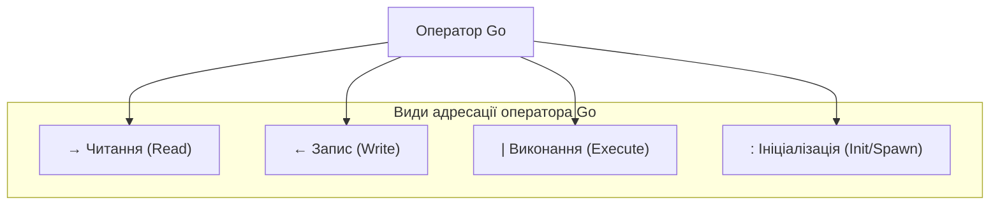
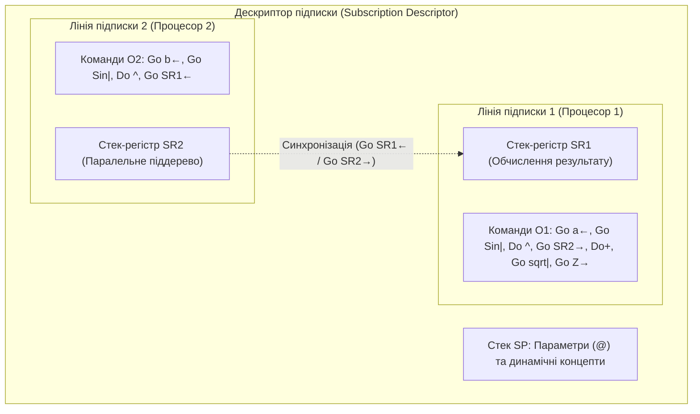
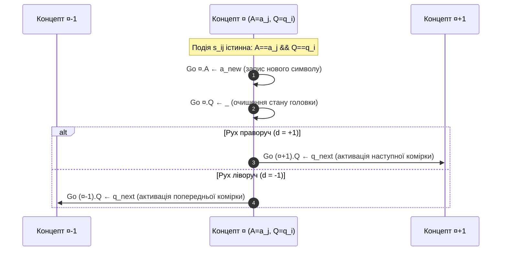
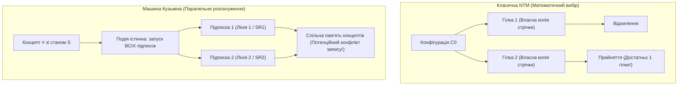
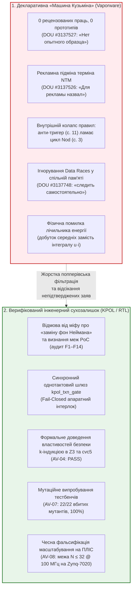

# Машина Кузьміна під формальним розбором: події, підписки, архітектура виконання й критична верифікація

* **Версія:** 0.2.0 (робоча редакція, не незалежне прийняття).
* **Дата:** 2026-11-10.

> **Внутрішня робоча копія, не публікація; міграція не є науковим прийняттям.** Перенесено з `drafts@774d575:KuzminMachine/01-concepts-and-theory/Kuzmin-Machine-Formal-Analysis-UA.md` 2026-11-10, Issue #84. Міграція не підтверджує тверджень, прогнозів чи самоприсвоєних статусів. Незмінний оригінал і SHA-256 — у реєстрі міграції.

> **Автор аналізу та реконструкції:** Микола Федчик (Mykola Fedchyk)<br/>
> **Предмет дослідження:** публічний опис Машини Кузьміна у збережених топіках автора на DOU (2021–2023), авторські уточнення в обговоренні листопада 2026 року, презентація «Пример для АН» (16 слайдів) та похідна інженерна реконструкція М. Федчика (2026).<br/>
> **Мета:** реконструювати формальну та апаратно-програмну модель Машини Кузьміна, дослідити систему команд і стеків, оцінити конструктивний ескіз симуляції машини Тюрінга та семантику синхронізації, провести критичну наукову верифікацію заявлених властивостей і чітко розмежувати непідтверджену авторську декларацію та реальні верифіковані інженерні артефакти проєкту.

---

## Анотація

У публікаціях Михайла Кузьміна (2020–2026) декларується обчислювальна модель, у якій обчислення подаються не як послідовний потік інструкцій фон-нейманівського типу, а як граф концептів зі станами, події-предикати над цими станами та підписки, що генерують адресовані дії. Автор позиціонує цю модель — **Машину Кузьміна (МК)** — як нову багатопроцесорну подієву архітектуру, що долає конвеєрні обмеження послідовних процесорів, усуває недетермінізм у класичному розумінні та максимізує швидкість реакції на події в реальному часі.

Реконструкція технічної специфікації (М. Федчик, 2026) разом із корпусом публікацій на DOU та авторською презентацією систематизує низькорівневий базис моделі: систему типів і команд (`Go`, `Do`), стеково-регістрову модель ліній виконання ($SR$, $SP$, $O$), протокол міжстекової синхронізації виразів на кількох процесорах із відкатом на одне ядро, оператор послідовності `•` (Big Dot) для пре- та пост-активацій при читанні/записі, правило запобігання рекурсивним циклам, а також конструктивний ескіз симуляції класичної машини Тюрінга (МТ) шляхом передачі стану $Q$ між сусідніми концептами стрічки $\text{¤}-1, \text{¤}, \text{¤}+1$.

Порівняльний та критичний аналіз показує, що концептуально Машина Кузьміна є комбінацією давно відомих патернів **стекової потокової машини (Dataflow / Reduction Architecture)**, **акторної моделі** з адресованими активаціями та **подієво-продукційної системи (ECA)** 1970–1980-х років. Водночас як самостійна теоретична «нова парадигма обчислень» авторська модель не має математичного доведення повноти за Тюрінгом, містить внутрішні логічні суперечності між правилом анти-зациклення та ітеративними циклами, не розв'язує проблему конфліктів запису в спільну пам'ять (*data races*) і не підкріплена жодним експериментальним зразком автора. Реальна науково-технічна цінність у межах цього репозиторію виникає лише після відмови від непідтвердженої філософії МК і звуження задачі до формально верифікованого солверами Z3/cvc5 генератора синхронних предикатних шлюзів безпеки (`Fail-Closed` апаратних інтерлоків, §9).

---

## 1. Джерельна база та межі дослідження

Аналіз спирається на зіставлення збережених первинних матеріалів автора концепції та явно відділеної від них реконструкції:

1. **Корпус публікацій на DOU (2021–2023):** збережені топіки Михайла Кузьміна (35914, 36556, 38994, 43177), присвячені подієвому опису, концептам, паралельному розгалуженню («А-ритм») та прикладній автоматиці.
2. **Дискусія листопада 2026 року:** відповіді автора на прямі питання щодо недетермінізму, повноти за Тюрінгом, природи пам'яті, відсутності дослідного зразка та конфліктів запису в топіку [«Машина Кузьміна» (35914)](https://dou.ua/forums/topic/35914/).
3. **Авторська презентація «Пример для АН» (2024/2026):** 16 слайдів (`.pptx` / `.pdf`), що містять таблицю типів і операцій (с. 4), приклади `Nod` (с. 3) та лічильника (с. 6–8), опис стеків $O, SR, SP$ (с. 9–10), оператора `•` та правила анти-зациклення (с. 11), ескіз симуляції МТ (с. 14) та міркування щодо NTM (с. 15).
4. **Похідна реконструкція М. Федчика (2026):** формалізація синтаксису, діаграм і граничних умов у цьому документі. Окремої авторської текстової специфікації 2026 року від М. Ю. Кузьміна не існує.

Розрізняємо чотири рівні наукової верифікації фактів:
- **Опис / Декларація:** авторське твердження або мотиваційний виклад задуму без формального чи експериментального підтвердження;
- **Формальна специфікація:** математично та операційно несуперечливе правило виконання переходів;
- **Конструктивний доказ:** повний алгоритм трансляції або машинний доказ збереження обчислювальної еквівалентності чи інваріантів безпеки;
- **Фізичний експеримент:** відтворюваний протокол вимірювань затримок, конфліктів і ресурсів на цільовому залізі.

---

## 2. Систематизація еволюції концепції (2020–2026)

| Джерело / Дата | Пам'ять і структура | Визначення події | Модель паралелізму й виконання |
|---|---|---|---|
| **DOU топік 35914** (28.12.2021) | «Стрічка скінченна»; комірки замінено концептами. | Зміна стану концепту; окремі події адресацій. | Кілька головок; паралельний запуск кількох підписок. Заявлено «недетермінізм». |
| **Коментар у 38994** (09.07.2022) | «Зліченна множина комірок»; множина станів $S$ «можливо нескінченна». | Скінченна підмножина станів; перевірка належності стану підмножині. | Активація запускає одночасний аналіз усіх подій концепту та паралельний запуск усіх підписок. |
| **DOU топік 43177** (24.04.2023) | Множина поточних значень змінних концепту. | «Логічна функція від змінних». | Зміна значення змінної запускає перевірку формули. Згадано макет із 20 плат на STM32 (без опублікованих даних). |
| **Дискусія на DOU** (04–05.11.2026) | Зліченна множина концептів; нескінченність стрічки названо філософським питанням. | Для симуляції МТ: пара $`(a_i, q_j)`$ «символ стрічки — стан». | «Недетермінізм — це рекламне слово, у мене паралелізм». «Дослідного зразка немає». Конфлікти записів покладаються на програміста. |
| **Презентація «Пример для АН» та реконструкція** (2024–2026) | Зліченний простір типізованих концептів (`_`, `Token`, `Byte`, `Int32`, `Float`...). Адреси концептів. | Множина станів $U$, події $`s_i \subseteq U`$, функція-висловлювання $`w_i(U) \in \{0, 1\}`$. Нульовий порядок логіки. | Стекова VM: лінії підписки ($O + SR$), стек параметрів $SP$, команди рандеву між стеками (`Go SR2 →`, `Go SR ←`), оператор фаз `•`, придушення авто-тригерів. |

---

## 3. Технічна та формальна архітектура Машини Кузьміна

### 3.1. Базові сутності та система адресацій

Машина Кузьміна складається зі зліченної множини концептів та множини незалежних керуючих пристроїв (головок адресації).
Поточний концепт позначається символом **$\text{¤}$**.

Адресація здійснюється оператором **`Go`** за шаблоном:

$$\text{Go } \langle\text{Адреса / Ідентифікатор концепту}\rangle \enspace \langle\text{Вид адресації}\rangle$$

Визначено чотири фундаментальні види адресації, кожен з яких сам по собі породжує однойменну подію активації:
1. **`→` (Читання):** запит значення з концепту. При наявності підписок виконує асоційовану дію перед або після зчитування.
2. **`←` (Запис):** внесення нового значення в концепт.
3. **`|` (Виконання):** активація обчислювального методу/підписки концепту (еквівалент виклику підпрограми / переходу).
4. **`:` (Ініціалізація):** інстанціювання нового екземпляра концепту з використанням цільового концепту як класу/прототипу.



### 3.2. Система типів та інструкцій (ISA)

Авторська технічна специфікація містить чітку таблицю вбудованих типів пам'яті та примітивних операцій:

#### Типи даних (`Type`):
- `_` : Відсутність значення або будь-яке значення (Size 0);
- `Token` : 4-бітний дискретний токен значень від 0 до 15 (Size 0);
- `Byte` / `Int8` : 8-бітні беззнакові (0..255) та знакові (-128..127) значення (Size 1);
- `U16` / `Int16` : 16-бітні цілі (Size 3 у внутрішньому кодуванні розмірів автора);
- `U32` / `Int32` / `Float` : 32-бітні цілі та числа з рухомою комою IEEE-754 (Size 7);
- `U64` / `Int64` / `Double` : 64-бітні цілі та дійсні числа подвійної точності (Size 15);
- `Chr` : 1-байтний ASCII символ;
- `Uni` : 4-байтний Unicode символ.

#### Система операцій (`Operation`):
1. **Булеві стани (`?`):** `!` (True / Істина, код 0), `¬` (False / Хиба, код 1).
2. **Класи подій даних (`::`):**
   - `_` (Відсутнє значення / 0)
   - `Null` (Нульове значення / 1)
   - `Positive` (Додатне, $> 0$ / 2)
   - `Negative` (Від'ємне, $< 0$ / 3)
   - `Even` (Парне / 4)
   - `Uneven` (Непарне / 5)
   - `~` (Факт зміни значення / 6)
3. **Події порівняння (`~`):** `=` (код 0), `>` (код 1), `<` (код 2).
4. **Арифметично-логічні оператори (`Do`):**
   - `+`, `-`, `*`, `/`, `^` (піднесення до степеня);
   - `'` (інкремент $+1$);
   - `&` (побітове AND), `Or` (побітове OR);
   - `¬` (логічна інверсія), `#` (арифметична зміна знака / унарний мінус);
   - `<`, `>` (побітові зсуви вліво та вправо);
   - `~` (оператор порівняння).
5. **Службові мета-інструкції:** `Define` (оголошення типів), `Convert` (приведення типів), `Exit` (вихід із групи виконання), `Processor` (запит на виділення додаткового фізичного/віртуального ядра).

---

### 3.3. Низькорівнева модель стеків і виконання ліній підписок

Специфікація 2026 року детально описує трансляцію та виконання підписок на багатопроцесорному рівні. Кожна складна підписка або паралельний вираз декомпонується на **дескриптор підписки**, що складається з однієї або кількох **ліній підписки**.

```text
Лінія підписки = (Послідовність команд O) + (Стек-регістр SR)
Дескриптор підписки = { Лінії підписки } ∪ (Стек параметрів та динамічних концептів SP)
```



#### Алгоритм життєвого циклу активації на виконання:
1. **Виділення процесора:** із пулу вільних ядер призначається вільний процесор.
2. **Передача коду:** завантажується послідовність команд $O$ (розмір якої та необхідна пам'ять відомі на етапі трансляції).
3. **Виділення пам'яті стек-регістра $SR$:** саме тут зберігаються проміжні операнди арифметичних інструкцій `Do`.
4. **Виділення стек-регістра $SP$:** стек призначається для параметрів виклику концепту (`@`) та динамічних змінних, породжених операцією `:`.
5. **Виконання:** команди $O$ виконуються за внутрішнім лічильником команд.
6. **Звільнення процесора:** ядро звільняється після останньої команди (яка може бути командою синхронізації).
7. **Очищення пам'яті:** стек знищується після вичитування кінцевого результату.

#### Механізм міжстекової синхронізації та детермінований відкат (Fallback)
При паралельному обчисленні виразу на кшталт $Z = \sqrt{\sin^2(a) + \sin^2(b)}$ компілятор розбиває дерево виразу на два стеки:
- **Процесор 1 (Лінія 1):** `Go a ←; Go Sin |; 2; Do ^;` $\to$ точка очікування $\to$ `Do +; Go sqrt |; Go Z →`
- **Процесор 2 (Лінія 2):** `Go b ←; Go Sin |; 2; Do ^;` $\to$ передача результату.

Для зв'язування ліній використовуються симетричні команди рандеву:
- У лінії 1 генерується читання зі стека 2: `Go SR2 →`
- У лінії 2 генерується запис у стек 1: `Go SR1 ←`

> **Критичне правило планування Кузьміна:**
> Якщо в момент запуску **немає вільного другого процесора**, затримки або блокування черги не виникає. Процесор 1 послідовно виконує свою гілку до команди `Go SR2 →`, після чого **перемикається і самостійно виконує інструкції лінії 2**, гарантуючи завершення обчислення на єдиному ядрі! Це забезпечує природну адаптацію коду під довільну кількість фізичних ядер (від 1 до $N$).

---

### 3.4. Оператор послідовності `•` (Big Dot) та усунення автоколізій

У дописі на ДОУ залишалося відкритим питання: що відбувається при зверненні на читання чи запис до концепту, який сам має підписки на читання/запис? В авторській технічній специфікації Кузьмін пропонує розв'язання двох класичних проблем подієвих моделей:

#### 1. Впорядкування дій через властивість-булевий прапорець `•` (Велика точка)
Кожен концепт має вбудовану булеву властивість успішності `•` (за замовчуванням `!` — True).<br/>
Синтаксис складеної підписки записується як:

$$w_1 \bullet w_2$$

- **При читанні (`→`):** спочатку виконується підписка $`w_1`$ (яка обчислює або готує актуальне значення), потім відбувається фізичне читання (що активує подію `•`), і після нього виконується $`w_2`$ (пост-обробка, наприклад, скидання буфера).
  ```text
  → • Revolutions = Tick * 600; Tick = 0
  ```
- **При записі (`←`):** спочатку запускається пре-підписка $`w_1`$ (валідація, розрахунок похідних величин). Якщо вона успішна, фіксується запис `•`, після чого виконується пост-дія $`w_2`$. Якщо валідація не пройшла, підписка явно виставляє `• = ¬` (False), блокуючи наступні каскади.

#### 2. Інваріант анти-зациклення (Cycle Prevention Invariant)
> *«Адресація до атрибута в підписці до події цього ж атрибута не генерує подію для уникнення зациклювання.»*

Це правило є прямим апаратним/семантичним захистом від нескінченної рефлексивної рекурсії: якщо підписка на зміну змінної `Distance` сама записує в `Distance`, повторна активація події `~ Distance` для цього потоку пригнічується.

---

## 4. Конструктивний аналіз симуляції Машини Тюрінга

У ранніх матеріалах 2021–2026 рр. твердження про те, що Машина Кузьміна моделює будь-яку класичну МТ, спиралося лише на кодування таблиці станів. Технічна специфікація МК розкриває авторську конструкцію симуляції стрічки й головки.

### 4.1. Авторська конструкція трансляції МТ $\to$ МК

Класична детермінована машина Тюрінга задається як $`M = \langle A, Q, q_0, q_{halt}, \delta \rangle`$, де правила переходу мають вигляд:

$$q_i, a_j \to q_{next}, a_{new}, d_k \quad (d_k \in \lbrace L(-1), N(0), R(+1) \rbrace)$$

Кузьмін будує відображення наступним чином:
1. **Стрічка:** подається як ланцюжок пронумерованих концептів. Поточна комірка стрічки позначається як $\text{¤}$. Сусідні комірки адресовані як $\text{¤} - 1$ та $\text{¤} + 1$.
2. **Вміст комірки:** кожен концепт має атрибут `A` (символ алфавіту) та атрибут `Q` (стан головки, або `_` якщо головка відсутня над цією коміркою).
3. **Ліва частина правила (Подія):**

$$s_{ij} \equiv (A = a_j \land Q = q_i)$$

   Це кон'юнкція поточного значення комірки та стану головки, що знаходиться в ній.
4. **Права частина правила (Підписка):**
   При істинності події $`s_{ij}`$ активується підписка $`w_{ij}`$:

$$w_{ij} = s_{ij} \left( \text{Go } \text{¤}.A \leftarrow a_{new} \quad \text{Do } \text{¤} + d.Q \leftarrow q_{next} \right)$$

   де:
   - $`\text{Go } \text{¤}.A \leftarrow a_{new}`$ — запис нового символу в поточний концепт;
   - $`\text{Do } \text{¤} + d.Q \leftarrow q_{next}`$ — перенесення маркера стану головки у сусідній концепт ($\text{¤} - 1$ при русі вліво або $\text{¤} + 1$ при русі вправо).



### 4.2. Формальна оцінка повноти за Тюрінгом

Запропонована схема розв'язує задачу передачі керування вздовж стрічки за допомогою відносної адресації $\text{¤} + d$.
- **Зупинка:** досягається відсутністю підписок для стану $`q_{halt}`$ або записом термінального стану `_`.
- **Необмеженість пам'яті:** оскільки адресація концепту здійснюється за цілочисловим індексом (зліченна множина концептів), а оператор `:` дозволяє динамічно створювати нові концепти при виході за поточні межі індексу, простір пам'яті задовольняє вимогу потенційної нескінченності.

**Межа висновку:** Наведена схема є лише концептуальним ескізом можливого кодування, а **не завершеним доведенням повноти за Тюрінгом**. В оригінальній формулі автора (с. 14 презентації) відсутнє очищення попереднього стану головки `Go ¤.Q ← _` (цей крок дописано виключно в похідній реконструкції на діаграмі вище), а також не визначено атомарність переходу, випадок $d = 0$ та сумісність із правилом пригнічення повторної події (див. §9.1).

---

## 5. Співвідношення з Недетермінованою Машиною Тюрінга (NTM)

Автор аналізує власне бачення кризи поняття NTM:
> *«Якщо існує 2 і більше команд для пари (символ стрічки — стан)... якщо перша команда змінює стан або комірку, решта команд уже не відповідають цьому стану. Як вони мають виконуватися? Одночасно? Не змінюючи стану і залишаючись над тією ж коміркою? А сенс? Тому я запропонував кілька незалежних головок, розділивши правила на події та підписки.»*

Тут виникає фундаментальне розходження між **математичною теорією обчислень** та **інженерно-фізичною інтуїцією автора**:

1. **У класичній теорії складності (Sipser, Rabin-Scott):**
   Недетермінізм — це теоретико-множинне відношення переходу $`\delta \subseteq (Q \times \Gamma) \times (Q \times \Gamma \times \{L, R\})`$. NTM не «виконує всі гілки фізично в одному процесорі»; дерево конфігурацій є абстракцією, де слово приймається, якщо **існує хоча б одна успішна гілка**.
2. **У Машині Кузьміна:**
   Якщо на подію підписано кілька дій, машина фізично генерує окремі лінії виконання (головки) для **всіх** підписок, і всі вони намагаються виконатися над **спільною пам'яттю концептів**.



Отже, твердження автора 2026 року: *«Недетермінована МТ — це міф. Я у себе бачу паралельні обчислення. Для реклами назвав недетермінізмом»* — є математично строгим визнанням. Машина Кузьміна належить до класу **паралельних асинхронних/синхронних систем зі спільною пам'яттю (PRAM / Concurrent Rewriting Systems)**, а не до NTM.

---

## 6. Порівняльний аналіз із відомими паралельними парадигмами

| Модель / Архітектура | Спільні риси з Машиною Кузьміна | Ключові відмінності |
|---|---|---|
| **Dataflow-архітектури (Dennis, Arvind)** | Обчислення активується готовністю даних/подій, а не лічильником команд програми. | У Dataflow токени рухаються графом зв'язків. У МК концепти статично адресовані (`Go`), а підписки самі читають/пишуть операнди. |
| **Стекові машини (Forth, Transputer, Java VM)** | Використання стека ($SR$) для арифметичних операцій `Do` та передачі параметрів. | Стекові операції в МК динамічно створюються лініями підписок і мають примітиви міжстекової синхронізації (`Go SR2 →`). |
| **Акторна модель (Hewitt, Agha, Erlang)** | Концепт є автономною сутністю, адресація подібна до надсилання повідомлення. | Актори мають приватний ізольований стан і чергу вхідних повідомлень (mailbox). У МК концепти мають відкриту спільну пам'ять атрибутів. |
| **ECA-системи та Active DB** | Парадигма Event-Condition-Action (Подія — Перевірка умови — Дія). | МК вводить поняття пре/пост-фаз (`•`), лінії синхронізації та апаратно орієнтований набір операцій `Do`. |
| **Синхронні мови (Esterel, Lustre)** | Реакція системи на події зовнішнього середовища в логічному часі. | Esterel має сувору детерміновану семантику логічного такту (Synchronous Hypothesis). У МК паралельні лінії можуть виконуватися з довільною тривалістю, якщо не застосовано бар'єр рандеву. |

---

## 7. Практичні приклади реалізації мовою Машини Кузьміна

### 7.1. Алгоритм Евкліда (НСД) в один рядок
```text
U64 Nod | @ U64 ( a_ > b -=b , b_ > a -=a ) =a
Z = Nod(120, 6)
```
**Семантика виконання:**
Два параметри `a` і `b` оголошені з взаємними подіями-підписками:
- Якщо $a > b$, спрацьовує дія зменшення $a \leftarrow a - b$;
- Якщо $b > a$, спрацьовує дія $b \leftarrow b - a$;
- Коли жодна з умов не виконується ($a = b$), спрацьовує повернення `= a`.
Обчислення є чисто подієвим циклом над спільними змінними.

### 7.2. Електронний лічильник електроенергії з інтегруванням
```text
Class Example
| @ Byte Interval 1 Timer(Interval, Tick |)
: {
    Float {
        Voltage ← @ Float x +=x
        → Voltage =0
        Electricity ← @ Float x +=x
        → Electricity =0
        Value 0
        ← @ Float x +=x
        ~ Change |
    }
    Byte Tick 0
    = 10 Value = Voltage * Electricity / Tick^2
    ← Tick +=1
    → Tick = 0
    Void Tick | [Tick = 0 Voltage = "0p1" Electricity = "0p0"] Go Tick → 0 Go Tick ← ;
    ? Change
}
```
**Семантика виконання:**
Концепт поєднує реакцію на переривання таймера, накопичення інтегральних сум струму й напруги при подіях запису (`←`), обнулення накопичувачів при зчитуванні (`→`) та перерахунок потужності за настанням дискретного інтервалу (подія `= 10`).

---

## 8. Підсумкова оцінка реконструйованої моделі

**Дата оцінки:** 2026-11-10. **База інженерних артефактів:** `nick-fedchik/kuzmin-machine@7dd215a5573f72476a61e8c9eb99a030e87a6ae9`. Розглянуто збережені звіти, рецензії, сирі CSV/JSON та актуальні постановки задач. Це оцінка вже наявних доказів, а не новий експеримент чи незалежний аудит TRL. Посилання на інженерний репозиторій можуть вимагати прав доступу.

### 8.1. Об’єкт оцінки та теоретичний статус

Потрібно розрізняти **авторський опис МК**, **його формальну реконструкцію** та **конкретні реалізації KPOL/RTL**. Результати для одного з цих об’єктів не переносяться на інші без обґрунтування відповідності.

Наявні первинні матеріали дозволяють описувати задум МК як подієво-правилову модель зі спільним простором концептів і запропонованим стеково-регістровим виконавцем. Лінії підписок `O + SR + SP`, парна синхронізація, пре-/пост-фази `•` та перехід до послідовного виконання за нестачі ресурсів становлять предмет реконструкції. Проте їхня наявність у технічному описі ще не задає повної операційної семантики, не доводить новизни та не визначає однозначного класу допустимих конкурентних трас.

**Повноту за Тюрінгом не доведено.** Ескіз §4 потребує явних правил очищення попереднього Q, атомарності переходу, нерухомого кроку та необмеженого ресурсу абстрактної моделі. Успішне виконання скінченного набору прикладів на FPGA не може замінити такого доведення. Водночас відсутність доведення не є доведенням неповноти. Так само паралельне виконання саме по собі не встановлює еквівалентності недетермінованій МТ або переваги для NP-задач.

Можлива суперечність між придушенням само-тригерів і циклом `Nod` потребує перевірки на явно зафіксованій семантиці та повних трасах. Необхідно відокремити контрприклад конкретному тлумаченню від твердження про неможливість будь-якої несуперечливої реконструкції. Додані реконструктором правила мають бути позначені як доповнення, а не приписані авторові.

### 8.2. Що вже встановлено та з якими обмеженнями

Слово «встановлено» нижче стосується конкретних властивостей і зафіксованих артефактів. Воно не означає повної верифікації системи, прийняття всіх висновків історичних звітів чи досягнення TRL.

| Об’єкт і вид доказу | Підтримуваний результат | Межі висновку та джерела |
|---|---|---|
| **Шлюз v1, AV-04 — формальна перевірка** | Для `kpol_txn_gate` за W = 8 і 32 збережено PASS BMC, k-індукції P1–P5 та cover-цілей у Z3 і cvc5. Мутанти M_a–M_h дають очікувані контрприклади. | Це доказ заданих властивостей двозначної моделі із перетвореним скиданням, не фізичний вимір; невідомість кодується через `*_known`, а не X/Z. Властивість `PX_hazard_blocks` має **FAIL**: активний Hazard у v1 не блокує commit. Доказ не охоплює v2, AXI, top, метастабільність чи еквівалентність RTL і синтезованого нетліста. [Звіт][s8-av04], [Z3 CSV][s8-z3], [cvc5 CSV][s8-cvc5], [рецензія][s8-av04-review]. |
| **AV-07 v2.0 — RTL-симуляція з мутаціями** | Сирий JSON містить 22/22 виявлених мутантів у семи наборах: 20 через перевірки симуляції та 2 через таймаут. Це кількісний результат для визначеного набору навмисних дефектів. | Не фізичне випробування і не доказ відсутності інших дефектів. Немає покриття всіх модулів поточного ядра; наявна рецензія стосується v1.0, не v2.0. Відкриті #14/#15. [Звіт][s8-av07], [сирі дані][s8-av07-raw]. |
| **AV-08 — синтез, розміщення, трасування та STA** | Для серії незалежних ліній `предикатор → шлюз`, W = 32, на `xc7z020clg400-1` перевірено по три seed із цільовою частотою 100 МГц. При N = 32 медіана оцінки f_max — 118,53 МГц, діапазон 114,12–121,85; при N = 64 — 88,04 МГц, діапазон 76,74–96,54. Критерій виконано в усіх трьох випадках N = 32 і порушено в усіх трьох N = 64. | N = 32 — найбільша **перевірена** точка, що задовольнила критерій; точного порога між 32 і 64 не визначено. Це не універсальна фізична межа, не мережа взаємодіючих концептів і не вимір на платі. STA nextpnr не є sign-off. [Звіт][s8-av08], [CSV][s8-av08-raw], [зведення][s8-av08-summary]. |
| **Інтерпретатор і генератори KPOL — наявність реалізації та локальних перевірок** | У коді є інтерпретатор, генератори C/Verilog, звичайного BRAM-дескриптора та окремого мікрокоду для CME. Тому твердження про повну відсутність програмної реалізації вже некоректне. | Наявність функцій не доводить їх повноти чи відповідності всій МК. Звичайний дескриптор і виконуваний мікрокод — різні шляхи. Звіт KPOL-FIX містить заяви про виправлення, але власної рецензії не має (#17); узгодження специфікацій, семантики й наскрізного виконання залишається відкритим. [Код][s8-reference], [KPOL-FIX][s8-kpol-fix]. |
| **AV-03 — програмне порівняння функції рішення** | Є збережені вимірювання, попередні пакетні оцінки та тест узгодженості C з допоміжною Python-моделлю. | Рецензія не приймає трактування одиночних вимірів як латентності самої функції: не віднято витрати таймера, є квантування, оракул не той незалежний еталон, що вимагав план, у metadata SHA позначено `unknown`. Це не доказ переваги PL, «нульового джитера» чи затримки пін→пін. [Звіт][s8-av03], [рецензія][s8-av03-review], [приклад metadata][s8-av03-meta]. |
| **Історичні HIL-демонстрації та виправлення F12** | QA v1.3 описує завантаження бітстріму та конкретні перевірки commit/reject через MMIO на PYNQ. Окремо F12 усунуто в PR #44 із симуляційними негативними контролями (§10.3). | Історичні HIL-описи не слід заперечувати, але їх самопозначення `Hardware Verified / TRL 4` не є незалежним прийняттям (#16). MMIO-перевірка не вимірює автономний шлях пін→пін. Виправлення RTL не перевіряє автоматично старі чи нові бітстріми. [Історичний QA-звіт][s8-qa], [#16](https://github.com/nick-fedchik/kuzmin-machine/issues/16), §10.3. |

**Контрприклад щодо Hazard має контрактне значення:** у перевіреній моделі v1 Hazard є діагностичною ознакою, а не умовою заборони commit. Тому PASS P1–P5 і FAIL додаткової `PX_hazard_blocks` не суперечать один одному. Але цей результат не задовольняє сильнішої вимоги безумовного блокування небезпеки; її потрібно узгодити нормативно (#19/#60) та перевірити для відповідної реалізації (#18/#62).

[Реєстр міграції, §0.3][s8-migration] уже фіксує повтор AV-04 із Z3, повтор AV-07 зі збігом результатів та побайтний збіг зведення AV-08, перерахованого з перенесених даних. Тому твердження «нічого не відтворювалося» також було б неточним. Водночас у тому самому записі зазначено, що новий синтез/PNR AV-08 і нові вимірювання AV-03 не виконувалися. Аналіз старого CSV, повтор симуляції та повтор фізичного експерименту — різні рівні відтворення; цим записом не закривається весь критерій #75.

Наявність рецензії враховується разом із її об’єктом, версією та зауваженнями. Зокрема, формулювання рецензії AV-08 про «точну фізичну межу» й гарантований ефект запропонованої конвеєризації не підкріплюються проведеним набором прогонів і до цієї оцінки не переносяться. Два SMT-розв’язувачі перевіряють ту саму формалізацію; їхня згода не є незалежним доказом правильності перекладу вимог у властивості.

### 8.3. Що ще потрібно перевірити і де це задекларовано

**Теоретичні передумови — не емпіричні вимірювання:** #76/#78 мають визначити модель і допустимі траси; #77 — обґрунтувати або відкликати заяву про повноту; #82 — встановити відношення до prior art. #79/#81 потрібні для виконуваного еталона та перевірок відповідності. Відкритий компілятор сам по собі не є необхідною умовою математичної коректності моделі: для її виконуваної перевірки може бути достатньо інтерпретатора. Проте заяву про конкретний шлях `KPOL → BRAM → незмінне ядро` потрібно доводити саме цим шляхом (#66/#69).

**Окрема формальна передумова апаратних гарантій:** [#18](https://github.com/nick-fedchik/kuzmin-machine/issues/18) і #62 стосуються формальних перевірок v2 та залежних реалізацій, які не охоплені доказом v1; #19/#60 — нормативного контракту. Симуляція, BMC скінченної глибини, індуктивний доказ і фізичне випробування не є взаємозамінними.

У таблиці **«пряме» означає наявність явного критерію в задачі, а не його виконання**. «Часткове» означає, що загальна мета пов’язана з перевіркою, але потрібний протокол чи обсяг не зафіксовано в її критеріях. Усі перелічені задачі відкриті; це не означає, що кожна описана в них функція відсутня чи кожен критерій уже перевірено і провалено. Статус Open сам по собі не встановлює результату: окремі критерії можуть мати позитивні, негативні або ще не отримані результати, які потрібно підтверджувати артефактами.

| Залишкова перевірка | Задачі проєкту | Що саме задекларовано | Покриття та поточне обмеження |
|---|---|---|---|
| Походження чисел і відтворення бази | [#59](https://github.com/nick-fedchik/kuzmin-machine/issues/59), [#75](https://github.com/nick-fedchik/kuzmin-machine/issues/75) | Автоматична перевірка команд/SHA/дати/raw та повтор AV-04/07/08 на тому самому SHA зі збігом результатів | **Пряме**, обидві `ready`; #75 не охоплює нові вимірювання AV-03 чи всі HIL-повтори |
| Узгодженість специфікації, еталона й реалізацій | [#19](https://github.com/nick-fedchik/kuzmin-machine/issues/19), [#60](https://github.com/nick-fedchik/kuzmin-machine/issues/60), [#61](https://github.com/nick-fedchik/kuzmin-machine/issues/61), [#63](https://github.com/nick-fedchik/kuzmin-machine/issues/63), [#81](https://github.com/nick-fedchik/kuzmin-machine/issues/81) | Консолідація, тести нормативних тверджень, трасування без сиріт, паритет Python/C/RTL на N ≥ 10 000 із межовими випадками, семантично обґрунтовані траси | **Пряме**; #60 `ready`. Старі дефекти не можна вважати досі відкритими лише за текстом старого аудиту |
| Чутливість тестів поточного апаратного ядра | [#14](https://github.com/nick-fedchik/kuzmin-machine/issues/14), [#15](https://github.com/nick-fedchik/kuzmin-machine/issues/15), [#65](https://github.com/nick-fedchik/kuzmin-machine/issues/65) | Розширення охоплення модулів, незалежна рецензія AV-07 v2.0, бал ≥ 95 % і виявлення обов’язкових мутантів | **Пряме**; 22/22 зі старого набору цього не замінюють |
| Протокол AXI4-Lite та нормативний регістровий інтерфейс | [#48](https://github.com/nick-fedchik/kuzmin-machine/issues/48), [#64](https://github.com/nick-fedchik/kuzmin-machine/issues/64) | Карта регістрів/скидання з трасуванням та assertion-based протокольна перевірка | **Пряме**, але #64 `blocked`: потрібне погоджене виправлення помилкового критерію BREADY; F12 не закриває весь протокол |
| Зміна програми без пересинтезу | [#66](https://github.com/nick-fedchik/kuzmin-machine/issues/66), [#69](https://github.com/nick-fedchik/kuzmin-machine/issues/69) | Дві програми на одному бітстрімі, перевірка 20 правил без тихого відкидання, 10 еталонних програм без ручного RTL | **Пряме**; потрібен наскрізний результат, а не лише наявність генератора CME |
| Автономність і фізична затримка | [#72](https://github.com/nick-fedchik/kuzmin-machine/issues/72), [#73](https://github.com/nick-fedchik/kuzmin-machine/issues/73) | Відсутність каузальної участі PS у шляху події; p99 за N ≥ 1000, поріг власника, логічний аналізатор і raw | **Пряме**; #73 `blocked`. Узгодження з REQ-SYS-002 та повним протоколом AV-10 ще потрібне (§8.4) |
| Захист образу, тріади та реального релізного шляху | [#67](https://github.com/nick-fedchik/kuzmin-machine/issues/67), [#68](https://github.com/nick-fedchik/kuzmin-machine/issues/68), [#70](https://github.com/nick-fedchik/kuzmin-machine/issues/70), [#71](https://github.com/nick-fedchik/kuzmin-machine/issues/71) | Відхилення відкату; повний однобітовий перебір образу; виявлення зміни вимоги й порожнього proof; блокування релізу слабкими тестами або порожнім набором мутантів | **Пряме** для цих програмних/інтеграційних критеріїв; не є фізичним внесенням збоїв у сигнали |
| Незалежна перевірка HIL та прикладний випадок | [#16](https://github.com/nick-fedchik/kuzmin-machine/issues/16), [#80](https://github.com/nick-fedchik/kuzmin-machine/issues/80) | Рецензія історичних QA/HIL-звітів або відмова спиратися на них; відтворюване застосування з вимогами, відмовами та вимірюваннями | **Пряме** для рецензії/застосування, **часткове** для повного AV-05 з обома платами та повторами |
| Порівняння продуктивності та масштабування | [#83](https://github.com/nick-fedchik/kuzmin-machine/issues/83), [#80](https://github.com/nick-fedchik/kuzmin-machine/issues/80) | Рівноцінні baseline, латентність/пропускна здатність, ресурси, навантаження, конфлікти, відмови та сирі результати | **Пряме** як загальна програма; виправлення конкретної методики AV-03 і масштабування взаємодіючої мережі покриті лише **частково** |
| Перевірка звітів та остаточне прийняття | [#17](https://github.com/nick-fedchik/kuzmin-machine/issues/17), [#74](https://github.com/nick-fedchik/kuzmin-machine/issues/74) | Власна рецензія KPOL-FIX; незалежний аудит MVP без відкритих Critical | **Пряме**, але аудит не замінює відсутніх експериментів і не є сертифікацією безпеки |

### 8.4. Прогалини та неточності трасування вимог

1. **Поріг затримки не можна описувати як повну відсутність будь-якого числа.** У [реєстрі вимог][s8-requirements] `REQ-SYS-002` уже містить реакцію `< 500 нс` для автономної диспетчеризації. Проте не визначено, чи це внутрішній інтервал секвенсера або фізичний шлях пін→пін, за яких умов і для якої статистики діє межа. Позначка `PASS` у цій матриці не є виміром. Власник має явно погодити застосування чи перегляд цього числа для #73 та прив’язати його до протоколу. Крім того, #73 задає мінімум N ≥ 1000, а [AV-10 у плані][s8-plan] — N = 10⁵ для PL і N = 10⁴ для Linux, з режимами навантаження та калібруванням. Мінімум у задачі не замінює повного протоколу; p99 також не доводить жорсткої верхньої межі. За планом виміри іншою PYNQ залишаються попередніми до перехресної перевірки незалежним приладом; потрібно зафіксувати його роздільність та похибку.
2. **Виправлення AV-03 не виділено в явний набір критеріїв окремої задачі.** #59/#63/#83 пов’язані з походженням, паритетом і benchmark, але не перелічують усіх зауважень рецензії AV-03: порожній часовий інтервал, достатня роздільність/пакетне вимірювання, незалежний еталон, змішані вхідні вектори, зафіксований SHA, повтори та контроль режиму CPU. До нового порівняння потрібна явна трасованість цих зауважень, а не оголошення старого розподілу придатним.
3. **Повний AV-05 не тотожний #75.** План вимагає функціональних повторів на обох PYNQ, щонайменше по три запуски, з походженням і перевіркою результатів. #75 обмежено AV-04/07/08; #16 вимагає рецензії історичних звітів, а не обов’язково нового HIL-прогону. #72/#73/#80 охоплюють частини апаратної перевірки, але їхні тіла не відтворюють повний критерій AV-05. Вимога вже задекларована в плані, проте її закриття окремою задачею або явними критеріями ще потрібно простежити.
4. **Фізичне внесення збоїв AV-11 не покривається формальним fail-closed чи пошкодженням файла.** План окремо передбачає перевірку реакції на некоректні фізичні вхідні сигнали та відсутності хибних commit. У #80 є загальні вимоги до відмов, але немає окремого критерію цього протоколу; #62 — формальна перевірка, #68 — інверсії бітів образу. Для твердження про апаратну безпеку потрібна явна прив’язка випробувань фізичного входу, скидання та перетину тактових доменів до вимог і даних. Формальна двозначна модель не доводить відсутності метастабільності, а тест сам по собі не доводить її неможливості.

Окремий, **не емпіричний**, пробіл стосується перенесення формального доказу RTL на реалізований образ: AV-04 не містить перевірки еквівалентності RTL і синтезованого нетліста, а #18/#62 не задають її явним критерієм. Якщо заявляється збереження доведених властивостей у реалізації, потрібно обґрунтувати цей перехід і зафіксувати відповідну перевірку; кілька успішних MMIO-тестів не доводять еквівалентності для всіх трас.

Окремо потребують актуалізації **описові статуси**, але не мовчазної зміни критеріїв: #60 посилається на старий fail-open дефолт, тоді як у коді досліджуваної бази `Interpreter` уже має `fail_closed_hazards=True`; #66/#69 слід перевіряти з розрізненням старого BRAM-дескриптора та нового шляху CME. Матриця вимог також існує, але наявність рядків `PASS` не встановлює її коректності чи повноти (#61). Аудит `drafts@62219ef`, пізніші заяви KPOL-FIX про виправлення та нова перевірка на актуальному SHA — різні докази.

Зазначення цих прогалин не додає заднім числом нових критеріїв у відкриті задачі. У межах цього перегляду їхні тіла, статуси та мітки не змінено; нових Issues не створено. Перед виконанням відповідного етапу потрібне окреме явне рішення щодо неповністю простежених перевірок. Розкладка першої черги та блокування #64/#73 наведені в §10.1.

### 8.5. Академічний висновок

Наявна доказова база підтримує **доведені властивості спеціалізованого шлюзу v1 у межах формалізованого контракту**, який не передбачає безумовного блокування Hazard, чутливість визначених симуляційних тестів до конкретних дефектів і характеристики певних конфігурацій синтезу/трасування. Є програмні реалізації та описані локальні апаратні демонстрації; зводити весь результат до відсутності будь-яких артефактів неправильно.

Водночас **ще не встановлено** повної операційної визначеності та несуперечливості реконструкції МК, її повноти за Тюрінгом, теоретичної новизни, наскрізної відповідності всього програмно-апаратного шляху чи інженерної переваги над рівноцінними альтернативами. Не всі ці питання емпіричні: повнота потребує доказу, новизна — аналізу літератури, а продуктивність і фізична реакція — належного експерименту.

Отже, коректний поточний статус — **досліджувана обчислювальна концепція з частково формалізованими й перевіреними інженерними компонентами**, а не доведена нова парадигма і не доведено неможлива модель. Подальші висновки залежать від результатів зафіксованих перевірок. Ця оцінка сама по собі не закриває жодного гейта й не підвищує TRL.

[s8-av04]: https://github.com/nick-fedchik/kuzmin-machine/blob/7dd215a5573f72476a61e8c9eb99a030e87a6ae9/experiments/AV-04/report.md
[s8-z3]: https://github.com/nick-fedchik/kuzmin-machine/blob/7dd215a5573f72476a61e8c9eb99a030e87a6ae9/experiments/AV-04/raw/av04_formal/av04_results.csv
[s8-cvc5]: https://github.com/nick-fedchik/kuzmin-machine/blob/7dd215a5573f72476a61e8c9eb99a030e87a6ae9/experiments/AV-04/raw/av04_formal_cvc5/av04_results.csv
[s8-av04-review]: https://github.com/nick-fedchik/kuzmin-machine/blob/7dd215a5573f72476a61e8c9eb99a030e87a6ae9/experiments/AV-04/review.md
[s8-av07]: https://github.com/nick-fedchik/kuzmin-machine/blob/7dd215a5573f72476a61e8c9eb99a030e87a6ae9/experiments/AV-07/report.md
[s8-av07-raw]: https://github.com/nick-fedchik/kuzmin-machine/blob/7dd215a5573f72476a61e8c9eb99a030e87a6ae9/experiments/AV-07/raw/av07_mutation_results.json
[s8-av08]: https://github.com/nick-fedchik/kuzmin-machine/blob/7dd215a5573f72476a61e8c9eb99a030e87a6ae9/experiments/AV-08/report.md
[s8-av08-raw]: https://github.com/nick-fedchik/kuzmin-machine/blob/7dd215a5573f72476a61e8c9eb99a030e87a6ae9/experiments/AV-08/raw/av08_scaling/av08_results.csv
[s8-av08-summary]: https://github.com/nick-fedchik/kuzmin-machine/blob/7dd215a5573f72476a61e8c9eb99a030e87a6ae9/experiments/AV-08/raw/av08_scaling/av08_summary.json
[s8-reference]: https://github.com/nick-fedchik/kuzmin-machine/blob/7dd215a5573f72476a61e8c9eb99a030e87a6ae9/sw/kpol-ref/kpol_reference.py
[s8-kpol-fix]: https://github.com/nick-fedchik/kuzmin-machine/blob/7dd215a5573f72476a61e8c9eb99a030e87a6ae9/experiments/KPOL-FIX/report.md
[s8-av03]: https://github.com/nick-fedchik/kuzmin-machine/blob/7dd215a5573f72476a61e8c9eb99a030e87a6ae9/experiments/AV-03/report.md
[s8-av03-review]: https://github.com/nick-fedchik/kuzmin-machine/blob/7dd215a5573f72476a61e8c9eb99a030e87a6ae9/experiments/AV-03/review.md
[s8-av03-meta]: https://github.com/nick-fedchik/kuzmin-machine/blob/7dd215a5573f72476a61e8c9eb99a030e87a6ae9/experiments/AV-03/raw/av03_jetson_orin_summary.json
[s8-qa]: ../research/verification/Reports/KUZMIN_MACHINE_QA_AND_VERIFICATION_TEST_REPORT_UA_v1.3.md
[s8-migration]: https://github.com/nick-fedchik/kuzmin-machine/blob/7dd215a5573f72476a61e8c9eb99a030e87a6ae9/process/MIGRATION-REGISTER.md
[s8-requirements]: https://github.com/nick-fedchik/kuzmin-machine/blob/7dd215a5573f72476a61e8c9eb99a030e87a6ae9/requirements/requirements.md
[s8-plan]: https://github.com/nick-fedchik/kuzmin-machine/blob/7dd215a5573f72476a61e8c9eb99a030e87a6ae9/experiments/PLAN.md

---

## 9. Критична наукова верифікація та демаркація: між непідтвердженою декларацією (Vaporware) та верифікованим інженерним артефактом

> **Уточнення від 2026-11-10:** доказові відповіді, межі висновків і актуальні статуси перевірок наведено в [§10](#10-науковий-та-інженерний-захист). Це стосується також сили формулювань про суперечливість моделі, формальну верифікацію, 22/22 мутантів і «фізичну межу» N ≤ 32: їх не слід узагальнювати понад наведені докази та обмеження §10.4. Історична знахідка не означає, що дефект досі відкритий; прийняття задачі до виконання не означає його виправлення.

Незалежний перехресний аналіз першоджерел ([SCIENTIFIC_OPPOSITION_REPORT_UA.md](../trl-evidence/scientific-opposition-report.md)) та ретроспективний аудит інженерних артефактів проєкту вимагають проведення чіткої методологічної межі (демаркації за К. Поппером) між:
1. **Теоретичними претензіями М. Ю. Кузьміна на створення «нової фундаментальної обчислювальної машини»**;
2. **Реальними інженерними вузлами, створеними й верифікованими М. М. Федчиком у процесі апаратно-програмної реконструкції**.



### 9.1. Доказове обґрунтування: чому авторська «нова парадигма обчислень» є науково непідтвердженою декларацією

Перевірка первинних матеріалів М. Ю. Кузьміна (2020–2026 рр.) за критеріями теоретичної інформатики та комп'ютерної інженерії встановлює шість фундаментальних неспроможностей:

1. **Повна відсутність наукової та експериментальної бази:**
   - За шість років публічного обговорення (2020–2026) автором ідеї не опубліковано жодної рецензованої наукової статті, препринта, формальної граматики, операційної семантики чи відкритого вихідного коду транслятора/віртуальної машини.
   - Увесь первинний корпус вичерпується публіцистичними дописами на форумі DOU та 16-сторінковою презентацією `Пример для АН.pptx` (створена 2024-05-21, модифікована 2026-11-06).
   - У прямому обговоренні на DOU від 04.11.2026 ([коментар #3137527](https://dou.ua/forums/topic/35914/#3137527)) автор особисто засвідчив відсутність будь-якої експериментальної верифікації:
     > *«Экспериментальных данных нет. По понятным причинам. Нет опытного образца.»*
   - Документ, який у ранніх чернетках згадувався як «авторська технічна специфікація 2026 року», насправді ніколи не існував як авторський текст М. Ю. Кузьміна — це похідна систематизація та реконструкція М. Федчика, укладена на основі презентації й форумних дописів.

2. **Свідома підміна базового поняття теорії обчислень («Недетермінована МТ»):**
   - Протягом 2021–2023 рр. модель подавалася під заголовком *«Управляемая недетерминированная машина Тьюринга»* (топік 35914), що створювало хибну алюзію на фізичне розв'язання задач недетермінованого класу $\text{NP}$.
   - Під час фахової дискусії 04.11.2026 ([коментар #3137526](https://dou.ua/forums/topic/35914/#3137526)) автор прямо визнав, що використав строгий математичний термін суто з маркетинговою метою:
     > *«Недетерминированная МТ это миф... Я у себя вижу (и предлагаю) параллельные вычисления. Для рекламы назвал недетерминизмом.»*

3. **Внутрішня суперечливість аксіоматики автора (колапс ітерацій та симуляції МТ):**
   - **Конфлікт між правилом анти-зациклення та циклами:** На с. 11 презентації сформульовано базовий інваріант: *«Адресація до атрибута в підписці до події цього ж атрибута не генерує подію для уникнення зациклювання»*. Проте на с. 3 тієї ж презентації наведено ключовий приклад автора — алгоритм Евкліда (`Nod`), у якому підписка на подію порівняння $a > b$ модифікує атрибут $a$ ($a \leftarrow a - b$). Згідно з правилом с. 11, цей запис не породжує нової події для $a$, через що обчислення НСД гарантовано зупиняється після першої ж ітерації.
   - **Некоректність формули переходу МТ:** На с. 14 презентації автор записує підписку переходу машини Тюрінга як $w_i = s_i (\text{Go } \text{¤}.A \to (v_i) \text{ Do } \text{¤}+d.Q \to (f_i))$. Оскільки в цій формулі відсутня операція очищення стану головки $Q$ у поточному концепті $\text{¤}$, після першого ж переходу активний стан головки залишається у старій комірці й водночас з'являється у новій $\text{¤}+d$, що призводить до неконтрольованого розмноження головок по стрічці.
   - **Неузгодженість позначень читання/запису:** Між слайдами презентації (с. 3, 9, 11, 14) напрямки стрілок `Go ←` та `Go →` для операцій читання в стек та запису в пам'ять інвертуються без пояснень.

4. **Відсутність моделі консистентності пам'яті та арбітражу конфліктів (Data Races):**
   - У будь-якій паралельній моделі зі спільною пам'яттю ключовою науковою проблемою є детерміноване розв'язання конкурентних записів (*write-write* та *read-write hazards*).
   - В авторській концепції МК всі підписки на подію запускаються паралельно над спільним простором концептів без жодного транзакційного протоколу чи формального арбітра. У [коментарі #3137748](https://dou.ua/forums/topic/35914/#3137748) від 05.11.2026 автор перекладає цю проблему на користувача:
     > *«За конфликтами следить надо самостоятельно, но с этим проблем нет, так как ветвление этого класса на одном логическом шаге.»*
   - Твердження, що на одному логічному кроці конфліктів немає, є хибним за визначенням: саме одночасний запис двох паралельних гілок в один концепт на одному кроці і є класичним станом гонитви (*race condition*).

5. **Фізична помилковість прикладного прикладу електролічильника:**
   - На с. 6–8 презентації (відтворено у §7.2 вище) активна електроенергія обчислюється за формулою `Value = Voltage * Electricity / Tick^2`, де `Voltage` та `Electricity` — окремо накопичені суми відліків напруги та струму.
   - З точки зору фізики та електротехніки змінного струму добуток середніх значень $\bar{U} \cdot \bar{I}$ не дорівнює середній миттєвій потужності $\frac{1}{T}\int_0^T u(t)i(t)\,dt$, оскільки повністю ігнорує фазовий зсув $\cos\varphi$ та гармонійні спотворення.

6. **Перевинахід відомих архітектурних патернів без урахування їхніх обмежень:**
   - Як детально показано в огляді [Similar_Machines_to_KM.md](../research/theory/Similar_Machines_to_KM.md), базові ідеї МК (відмова від глобального PC, активація за подією зміни даних, парні стеки, канальне рандеву) відтворюють класичні рішення **Dataflow-машин Джека Денніса (1974)**, **ECA-систем та активних СУБД (HiPAC, POSTGRES, 1987–1988)**, **алгоритму Rete (1982)**, **двостекових процесорів Forth (Novix, 1985)** та **CSP Тоні Гоара (1978)** — але без того строгого математичного апарату, яким попередники забезпечували детермінізм і відсутність блокувань.

### 9.2. Інженерна демаркація: усунення бутафорії PoC та реальна цінність верифікованого артефакту

Чесний науковий аудит вимагає такої ж безкомпромісної оцінки ранніх інженерних напрацювань самого репозиторію проєкту. Під час внутрішньої верифікації та міграції (знахідки аудиту **F1–F14**) було виявлено й усунено прояви методологічної інфляції, коли звичайним інженерним рішенням приписувалися властивості «універсальної Машини Кузьміна»:

* **Демістифікація демонстраційних RTL-ядер:** Модулі раннього PoC (зокрема `km_euclid_core.sv` та суміжні демо-блоки) не є універсальною подієвою машиною без лічильника команд. Це класичні синхронні **жорстко закодовані скінченні автомати (hardcoded Verilog FSMs)**, де логіка конкретної задачі незмінно зашита в комбінаційних мультиплексорах і не може бути змінена без повного пересинтезу бітстріму ПЛІС.
* **Демістифікація ранніх вимірювань затримки (F10):** Заявлена в ранніх звітах затримка $84\text{ мкс}$ на платі PYNQ-Z1 вимірювала не швидкодію «нової архітектури МК», а накладні витрати інтерпретатора Python та викликів `pynq.MMIO` поверх ядра Linux на процесорі ARM Cortex-A9.
* **Виявлення та фіксація дефектів (F-05, F12):** Було зафіксовано й відкинено помилкову аналітичну формулу оцінки LUT-ресурсів, дефектний RTL-оператор піднесення до степеня `Do ^` (що помилявся на степенях $>3$) та непрацездатний початковий тестбенч шини AXI4-Lite (`kpol_txn_gate_axi_lite_tb.sv`).

Коли проєкт відсікає цю бутафорію та відмовляється від претензій на «нову філософію обчислень, що замінює фон Неймана», у сухому залишку постає **реальний, скромний за масштабом, але строго перевірений інженерний результат**:

1. **Формально верифікований транзакційний шлюз передумов (`kpol_txn_gate` v1, експеримент AV-04):**
   - Чітко спеціалізований синхронний цифровий вузол (апаратний `Fail-Closed` інтерлок), для якого методом математичної $k$-індукції у солверах **Z3** та **cvc5** формально доведено інваріанти безпеки: взаємовиключність сигналів `commit` та `reject`, неможливість зміни стану концепту при порушенні будь-якої передумови та перехід у безпечний стан за 1 такт.
2. **Стійкість верифікації під мутаційним тиском (експеримент AV-07 v2.0):**
   - Після усунення тавтологічних перевірок тестовий контур шлюзу знищує **22 з 22 синтетичних мутантів RTL-коду ($100\%$ mutation score)**, що є об'єктивним кількісним доказом якості тестбенчів.
3. **Чесна фальсифікація фізичних меж масштабування на кремнії (експеримент AV-08):**
   - Замість рекламних обіцянок «необмеженого паралелізму» синтез у відкритому маршруті **Yosys + nextpnr-xilinx (openXC7)** під кристал Zynq-7020 (`xc7z020clg400-1`) експериментально **спростував** гіпотезу про роботу 64 паралельних правил на частоті $100\text{ МГц}$ (критичний шлях склав $15.72\text{ нс} > 10.0\text{ нс}$) і встановив реальну фізичну межу однотактової архітектури: **$N \le 32$ правила**.

### 9.3. Підсумкова формула демаркації

> 1. **Як теоретична «нова парадигма обчислень» (М. Ю. Кузьміна):** «Машина Кузьміна» є **науково непідтвердженою декларацією (*vaporware*)**, що складається з внутрішньо суперечливих форумних ескізів, визнаного автором рекламного вживання терміна «недетермінована машина Тюрінга» та фрагментарного перевинаходу давно відомих патернів ECA / Dataflow 1970–1980-х років без жодного математичного доведення і без розв'язання фундаментальної проблеми конфліктів спільної пам'яті.
> 2. **Як інженерний артефакт у репозиторії:** дійсна науково-технічна цінність проєкту виникає рівно в тій точці, де він **припиняє видавати себе за філософську «Машину Кузьміна»**, відкидає непідтверджені декларації про «подолання архітектури фон Неймана» і чесно працює як скромний, формально верифікований солверами Z3/cvc5 генератор табличних предикатних шлюзів (**`Fail-Closed` апаратних інтерлоків**) із жорсткою попперівською фіксацією власних фізичних обмежень та негативних результатів.

---

## 10. Науковий та інженерний захист

**Стан доказового реєстру: 2026-11-10.** Захист тут означає перевірку конкретних заперечень, а не обов’язок отримати позитивний висновок про МК. Допустимі результати — підтвердження обмеженої властивості, контрприклад, відмова від надмірного твердження або висновок «не перевірено». Працездатність окремого шлюзу не доводить коректності всієї обчислювальної моделі, а дефект окремої реалізації не доводить неможливості всіх її реалізацій.

Нові задачі [#59–#83](https://github.com/nick-fedchik/kuzmin-machine/issues?q=is%3Aissue%20label%3Atopic%3Ademarcation) прийнято до програми робіт. **На цю дату жодну з цих 25 задач не завершено.** Наведена нижче матриця визначає, якими доказами можна відповідати на §9, але сама не є такими доказами. Уже виконане локальне виправлення F12 розглянуто окремо в §10.3. У межах цього оновлення нових формальних, симуляційних чи апаратних прогонів не проводилося.

### 10.1. Прийняті задачі та порядок виконання

Рішення власника й розкладку зафіксовано в [координаційному записі до #4](https://github.com/nick-fedchik/kuzmin-machine/issues/4#issuecomment-6761362076). Це запис керування роботами, не незалежна рецензія та не підтвердження TRL.

Усі 25 задач мають спільні мітки `accepted` і `topic:demarcation`, а попередні мітки типу, напряму, пріоритету та ASPICE збережено. `accepted` означає прийняття роботи до програми, а не прийняття результату чи погодження висновків §9. Першу чергу з міткою `ready` становлять:

- **#59, #75:** походження чисел і відтворення AV-04/07/08; це різні перевірки.
- **#60:** узгодження нормативних тверджень KPOL з еталоном до залежних перевірок ядра.
- **#76, #78:** узгоджене дослідження семантики МК та конкурентного виконання; первинні правила не змішуються з доповненнями реконструкції.
- **#82:** аналіз найближчих попередників і конкретного змісту заяв про новизну.

Решта задач очікують визначених у координаційному записі залежностей. Дві задачі додатково мають мітку `blocked` і **не** мають `ready`:

- **#64:** формулювання «відповідь без bready» потребує погодженої власником корекції до перевірки. Стан `BVALID=1, BREADY=0` сам по собі дозволений AXI; перевіряти треба, зокрема, утримання відповіді під зворотним тиском та облік прийнятих AW/W. [Причину записано окремо](https://github.com/nick-fedchik/kuzmin-machine/issues/64#issuecomment-6751459712); тіло критерію не переписано.
- **#73:** власник має встановити поріг затримки пін→пін до підтверджувального вимірювання. Період такту ядра 10 нс не є таким порогом. [Попередній запис про обмеження](https://github.com/nick-fedchik/kuzmin-machine/issues/73#issuecomment-6751462078) залишається чинним; критерій p99 не є гарантією жорсткої верхньої межі.

Фактичне поле Status у Project має значення `Todo / In progress / Done`; його схему не змінено. Усі ці картки поки залишаються `Todo`, а допуск першої черги позначає мітка `ready`. Статус `In progress` ставиться після фактичного взяття задачі виконавцем, а не для всієї прийнятої програми одночасно. Діє обмеження одного відкритого PR на виконавця. Критерії, віхи й цільові TRL цим рішенням не змінюються.

### 10.2. Матриця претензій та необхідних доказів

Номери задач у таблиці належать репозиторію `nick-fedchik/kuzmin-machine`. Їхні тіла містять критерії приймання; таблиця їх не замінює та не змінює. Усі результати цього підрозділу **ще належить отримати**.

| Предмет заперечення | Задачі | Який результат потрібен | Межа можливого висновку |
|---|---|---|---|
| §9.1(1): неформальність опису та відсутність відтворюваного виконавця | [#76](https://github.com/nick-fedchik/kuzmin-machine/issues/76), [#79](https://github.com/nick-fedchik/kuzmin-machine/issues/79), [#81](https://github.com/nick-fedchik/kuzmin-machine/issues/81) | Версійована семантика, мінімальна реалізація та автоматичні перевірки, очікування яких виведено із семантики | Підтверджує виконуваність конкретної реконструкції, не наявність раніше не опублікованого авторського прототипу |
| §9.1(2): змішування паралелізму та недетермінованої МТ | [#78](https://github.com/nick-fedchik/kuzmin-machine/issues/78), [#77](https://github.com/nick-fedchik/kuzmin-machine/issues/77) | Точні означення допустимих трас і конструктивна перевірка обчислювальної виразності | Не виправдовує маркетинговий термін і не означає ефективного розв’язання NP-задач |
| §9.1(3): анти-тригер, цикл `Nod`, стан головки Q та напрямки адресації | [#76](https://github.com/nick-fedchik/kuzmin-machine/issues/76), [#78](https://github.com/nick-fedchik/kuzmin-machine/issues/78), [#77](https://github.com/nick-fedchik/kuzmin-machine/issues/77), [#81](https://github.com/nick-fedchik/kuzmin-machine/issues/81) | Повні траси, правила повторної активації та доказ симуляції або контрприклад для визначеної семантики | Додані правила позначаються як реконструкція; завершений приклад не підміняє загального доказу |
| §9.1(4): конкурентні записи та консистентність пам’яті | [#78](https://github.com/nick-fedchik/kuzmin-machine/issues/78), [#76](https://github.com/nick-fedchik/kuzmin-machine/issues/76), [#81](https://github.com/nick-fedchik/kuzmin-machine/issues/81) | Явна модель атомарності, арбітражу, порядку й допустимих результатів на конфліктних сценаріях | Правильність локального `commit/reject` не доводить коректності глобального планувальника |
| §9.1(5): фізична помилка електролічильника | [#80](https://github.com/nick-fedchik/kuzmin-machine/issues/80), [#81](https://github.com/nick-fedchik/kuzmin-machine/issues/81), якщо перевіряється саме цей приклад | Виправлений алгоритм із незалежним фізичним еталоном і негативними випадками, які ловлять добуток середніх | Інший приклад застосування не усуває помилки авторського лічильника; потужність і енергія розрізняються |
| §9.1(6): відомі механізми та заявлена новизна | [#82](https://github.com/nick-fedchik/kuzmin-machine/issues/82), [#83](https://github.com/nick-fedchik/kuzmin-machine/issues/83) | Порівняння з первинними джерелами та рівноцінними реалізаціями | Комбінація механізмів може бути інженерно корисною без нової теорії обчислень; відсутність новизни допустима |
| §9.2: задачні FSM замість програмованої логіки | [#66](https://github.com/nick-fedchik/kuzmin-machine/issues/66), [#69](https://github.com/nick-fedchik/kuzmin-machine/issues/69) | Різні програми через BRAM на незмінному бітстрімі та трансляція без ручного RTL | Стосується нової реалізації, не перетворює ранні жорстко закодовані FSM на універсальну машину |
| §9.2: невизначений контракт і недостатня перевірка ядра | [#60](https://github.com/nick-fedchik/kuzmin-machine/issues/60), [#61](https://github.com/nick-fedchik/kuzmin-machine/issues/61), [#62](https://github.com/nick-fedchik/kuzmin-machine/issues/62), [#63](https://github.com/nick-fedchik/kuzmin-machine/issues/63), [#64](https://github.com/nick-fedchik/kuzmin-machine/issues/64) (**blocked**), [#65](https://github.com/nick-fedchik/kuzmin-machine/issues/65) | Трасування, визначений контракт, формальні властивості, паритет реалізацій, протокольні та мутаційні перевірки | Доказ шлюзу v1 не переноситься автоматично на v2, інтерконект або C-рантайм |
| §9.2: походження AV-04/07/08 і узагальнення чисел | [#59](https://github.com/nick-fedchik/kuzmin-machine/issues/59), [#75](https://github.com/nick-fedchik/kuzmin-machine/issues/75) | Перевірювана зв’язка команд, SHA, середовища й сирих даних; повтор на зафіксованій базі | Відтворення конкретного результату не робить його універсальною межею |
| §9.2: затримка Python/MMIO проти автономного апаратного шляху | [#72](https://github.com/nick-fedchik/kuzmin-machine/issues/72), [#73](https://github.com/nick-fedchik/kuzmin-machine/issues/73) (**blocked**), [#83](https://github.com/nick-fedchik/kuzmin-machine/issues/83) | Вимір пін→пін, перевірка участі PS і зіставний baseline за попереднім протоколом | Не прирівнює такт ядра, програмний виклик і наскрізну фізичну реакцію |
| Цілісність інженерного доказового контуру та прийняття MVP | [#67](https://github.com/nick-fedchik/kuzmin-machine/issues/67), [#68](https://github.com/nick-fedchik/kuzmin-machine/issues/68), [#70](https://github.com/nick-fedchik/kuzmin-machine/issues/70), [#71](https://github.com/nick-fedchik/kuzmin-machine/issues/71), [#74](https://github.com/nick-fedchik/kuzmin-machine/issues/74) | Перевірки відкату й пошкоджень образу, прив’язки вимоги до доказу, реального релізного гейта та незалежний аудит | Не доводить повноти чи новизни МК і не означає сертифікації промислової безпеки |

Ідентифікатори знахідок потрібно читати разом із назвою аудиту та SHA. Наприклад, помилка електролічильника в науковій опозиції та `F-08` у ретроспективному аудиті KPOL — не одна й та сама знахідка лише через схожий номер.

### 10.3. Локальне виправлення F12: симуляційна перевірка

Твердження про ранній несправний AXI-тестбенч у §9.2 має історичну підставу, але його не слід переносити на пізніший код як досі відкритий дефект. Йдеться про F12 [реєстру міграції](https://github.com/nick-fedchik/kuzmin-machine/blob/d7c42aecbaf30fb20cb046a9c1ccf8307d4ffa17/process/MIGRATION-REGISTER.md), який документує перенесення зі знімка `drafts@a4738bc`.

**Завершені задачі:** [#11](https://github.com/nick-fedchik/kuzmin-machine/issues/11), [#38](https://github.com/nick-fedchik/kuzmin-machine/issues/38), [#42](https://github.com/nick-fedchik/kuzmin-machine/issues/42). **Виправлення:** злитий [PR #44](https://github.com/nick-fedchik/kuzmin-machine/pull/44), коміт `d7c42aecbaf30fb20cb046a9c1ccf8307d4ffa17`.

У цій ревізії:

1. Відновлено скидання `upper_bound_q` у `0x7FFFFFFF` замість регресійного нуля; значення узгоджено з тодішніми споживачами й тестами.
2. Усунуто застаріле очікування `DECERR` для адреси `0x2C`, де вже реалізовано `REG_CYCLE_CNT_LO`; додано перевірки справді незайнятих адрес.
3. Розширено адреси в задачах тестбенча до 13 біт і знято очікуваний провал `xfail`. При цьому первинний провал читання `0x1C` спричинявся не 6-бітною адресою, а регресією значення після скидання.

| Доказ | Джерело та зміст |
|---|---|
| Конкретний RTL і тестбенч | [AXI-обгортка](https://github.com/nick-fedchik/kuzmin-machine/blob/d7c42aecbaf30fb20cb046a9c1ccf8307d4ffa17/hw/rtl/bus/kpol_txn_gate_axi_lite.sv), [тестбенч](https://github.com/nick-fedchik/kuzmin-machine/blob/d7c42aecbaf30fb20cb046a9c1ccf8307d4ffa17/hw/tb/kpol_txn_gate_axi_lite_tb.sv), [pytest-обгортка без xfail](https://github.com/nick-fedchik/kuzmin-machine/blob/d7c42aecbaf30fb20cb046a9c1ccf8307d4ffa17/hw/tests/test_testbenches.py) |
| Функціональна перевірка | Report у [PR #44](https://github.com/nick-fedchik/kuzmin-machine/pull/44): симуляція Icarus Verilog завершується PASS; наведено команди перевірки |
| Негативний контроль | Report і [рецензія agy](https://github.com/nick-fedchik/kuzmin-machine/pull/44#issuecomment-6742678911): повернення нульового скидання та 6-бітних адрес викликає провали відповідних перевірок |
| Записана рецензія | У тому самому [Review Report](https://github.com/nick-fedchik/kuzmin-machine/pull/44#issuecomment-6742678911) наведено повторні перевірки й вердикт «Прийнято із зауваженнями»; це наявна рецензія, не новий аудит у межах §10 |
| CI | [Перевірка PR #44](https://github.com/nick-fedchik/kuzmin-machine/actions/runs/42637062235/job/129227915848) має статус pass; цей статус не додає гарантій поза обсягом виконаних перевірок |
| Залишкове обмеження | [#48](https://github.com/nick-fedchik/kuzmin-machine/issues/48) щодо нормативної карти регістрів і значень після скидання залишається відкритою |

Межу актуальності зафіксовано: на момент цього оновлення `main` інженерного репозиторію — `7dd215a5573f72476a61e8c9eb99a030e87a6ae9`; у різниці з комітом виправлення немає змін файлів `hw/`. Це перевірка збереження виправлення в коді, **не новий прогін тестів**.

**Дозволене уточнення до §9.2:** «У ранньому знімку AXI-тестбенч мав дефекти та падав; конкретні причини F12 усунуто в PR #44 і перевірено симуляцією та негативними контролями з відновленням дефектів». Ці локальні контролі не ототожнюються з набором мутантів AV-07.

**Що цим не доведено:** коректність усього протоколу AXI4-Lite, проходження #64 або #65, робота виправленого бітстріму на платі, відповідність усіх реалізацій KPOL чи коректність МК. У звіті PR #44 прямо зазначено, що HIL і перезбирання бітстріму не виконувалися. Історичні вимірювання старого бітстріму не стають перевірками нового RTL.

### 10.4. Межі наукового та інженерного захисту

Ці обмеження визначають силу висновків §9 і §10. Вони не є позитивними результатами відкритих задач.

Статуси AV-04/07/08 у §9 наведено за історичними звітами. У межах цього оновлення їх не відтворювали; перевірка походження та повторний прогін залишаються предметом #59/#75 для всіх трьох експериментів.

- **Непідтвердженість не дорівнює доведеній неможливості.** Збережений корпус джерел дозволяє оцінювати опубліковані твердження, але не доводить відсутності будь-яких невідомих матеріалів. Слова «vaporware», «колапс» або «бутафорія» не замінюють формального контрприкладу. Для твердження про гарантовану зупинку `Nod` необхідно явно задати тлумачення анти-тригера та показати повну трасу; без семантики не можна поширювати такий висновок на всі можливі реконструкції.
- **Доведення стосується формалізованого контракту.** AV-04 для шлюзу v1 не є доказом блокування будь-якого Hazard у будь-якому варіанті системи. До #60/#62 мають бути визначені версія ядра, властивості й припущення. Відсутність контрприкладу в обмеженому BMC не є необмеженим доведенням; k-індукція також доводить лише задані властивості за заданих припущень.
- **22/22 — результат конкретного набору мутантів.** Наведені в §9 дані AV-07 не означають виявлення всіх можливих дефектів або «100 % правильності». Відтворення набору, його чутливість і поширення на нове ядро перевіряються окремо.
- **STA окремої конфігурації не встановлює універсальної фізичної межі.** Формулювання §9 про `N ≤ 32` не слід читати як доведену межу для всіх реалізацій, обмежень і розміщень на Zynq-7020. Висновок потрібно прив’язати до конкретного RTL, кристала, частоти, тулчейну, seed та результатів AV-08; до #59/#75 його походження й відтворення тут повторно не засвідчено.
- **Реконструкція не змінює заднім числом першоджерело.** Якщо #76/#77 потребуватимуть додаткового правила очищення Q, атомарності чи повторної активації, це буде явно позначеним розширенням моделі. Воно може зробити реконструкцію узгодженою, але не означатиме, що відсутнє правило вже містилося в авторському записі.
- **Локальне виправлення не є універсальною реабілітацією.** Коректний електролічильник не доводить новизни моделі; коректний інтерлок не доводить її повноти за Тюрінгом; незалежний аудит вузького артефакту не є сертифікацією всієї системи.

### 10.5. Правило внесення наступних доказових відповідей

Після виконання кожної задачі до цього розділу додається не декларація «претензію знято», а конкретний запис: **пункт §9 → задача → реалізація або формальна модель та SHA → команда й умови перевірки → незмінні сирі дані → негативний контроль → рецензія → точне дозволене уточнення та залишкові обмеження**. Для теоретичного результату наводяться припущення й доказ або контрприклад; для апаратного — конфігурація стенда та межі вимірювання.

Якщо зміна критерію необхідна, її погоджують і записують із причиною до підтверджувального прогону, а не підганяють під отримані дані. Негативний результат зберігається так само, як позитивний. Закриття задачі чи зелений CI без відповідного доказового пакета саме по собі не є підставою переписувати науковий висновок.

Отже, **наразі §10 засвідчує локальне виправлення F12 та прийняття програми перевірок, але не спростування решти претензій §9**. Наступні уточнення залежать від фактично отриманих і перевірених результатів, а не від бажаного «захисту» МК.

---

## Історія версій робочої копії

| Версія | Дата | Зміни |
|---|---|---|
| 0.2.0 | 2026-11-10 | #84: перенесено редакцію drafts@774d575, зокрема §§8–10; нормалізовано навігацію та оформлення. Попередню приватну редакцію збережено в реєстрі міграції |

## Словник термінів

- **А-ритм:** авторська назва порядку обчислень, що виникає внаслідок каскадного спрацьовування зв'язків «подія-підписка» замість імперативної блок-схеми.
- **А-схема:** динамічний граф взаємодії концептів, у якому зв'язки активуються контекстно.
- **Велика точка (`•`):** булевий прапорець концепту та синтаксичний роздільник перед-дії ($`w_1`$) і після-дії ($`w_2`$) при операціях читання/запису.
- **Дескриптор підписки:** сукупність структурних ресурсів виконання (стек параметрів $SP$ і множина ліній підписок).
- **Лінія підписки:** потік інструкцій $O$, що виконується на одному фізичному чи віртуальному процесорі за допомогою власного стек-регістра $SR$.
- **Поточний концепт ($\text{¤}$):** базовий елемент пам'яті, що адресується в даний момент оператором `Go`.
- **Fail-Closed інтерлок:** апаратний або програмний шлюз безпеки, який за будь-якої невизначеності, помилки або порушення передумов гарантовано блокує транзакцію й переводить вихід у безпечний стан.

---

## Джерела

1. М. Федчик. *Реконструкція технічної специфікації архітектури, системи команд та стекової моделі Машини Кузьміна* (на основі публікацій М. Ю. Кузьміна на DOU та презентації «Пример для АН»), 2026. Похідний аналітичний документ; окремої авторської специфікації 2026 року не існує.
2. Публікації М. Ю. Кузьміна на порталі DOU (2020–2023):
   - [«Машина Кузьміна. (Керована недетермінована машина Тюрінга.)»](https://dou.ua/forums/topic/35914/) (28.12.2021);
   - [«Виконання груп у недетермінованій машині»](https://dou.ua/forums/topic/36556/) (17.02.2022);
   - [«Автоматика та пристрої»](https://dou.ua/forums/topic/38994/) (07.07.2022);
   - [«Опис недетермінованої машини Кузьміна на пальцях»](https://dou.ua/forums/topic/43177/) (24.04.2023).
3. Обговорення та відповіді М. Ю. Кузьміна у темі топіка 35914 від 04–05 листопада 2026 року (зокрема коментарі [#3137526](https://dou.ua/forums/topic/35914/#3137526), [#3137527](https://dou.ua/forums/topic/35914/#3137527), [#3137565](https://dou.ua/forums/topic/35914/#3137565), [#3137748](https://dou.ua/forums/topic/35914/#3137748)).
4. М. Ю. Кузьмін. Презентація *«Пример для АН»* (`Пример для АН.pptx` / `.pdf`, 16 слайдів; створено 2024-05-21, змінено 2026-11-06).
5. [Наукова опозиція концепції «Машина Кузьміна» (`SCIENTIFIC_OPPOSITION_REPORT_UA.md`)](../trl-evidence/scientific-opposition-report.md), 2026-11-06.
6. [Огляд споріднених концептуальних обчислювальних машин та архітектурних попередників МК (`Similar_Machines_to_KM.md`)](../research/theory/Similar_Machines_to_KM.md), 2026-11-09.
7. Alan M. Turing. *“On Computable Numbers, with an Application to the Entscheidungsproblem.”* Proc. London Math. Soc., 1936.
8. Michael Sipser. *Introduction to the Theory of Computation*. 3rd ed., Cengage Learning, 2013.
9. Charles L. Forgy. *“Rete: A Fast Algorithm for the Many Pattern/Many Object Pattern Match Problem.”* Artificial Intelligence, 1982.
10. Gérard Berry, Georges Gonthier. *“The Esterel Synchronous Programming Language: Design, Semantics, Implementation.”* Science of Computer Programming, 1992.
