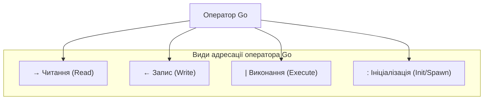
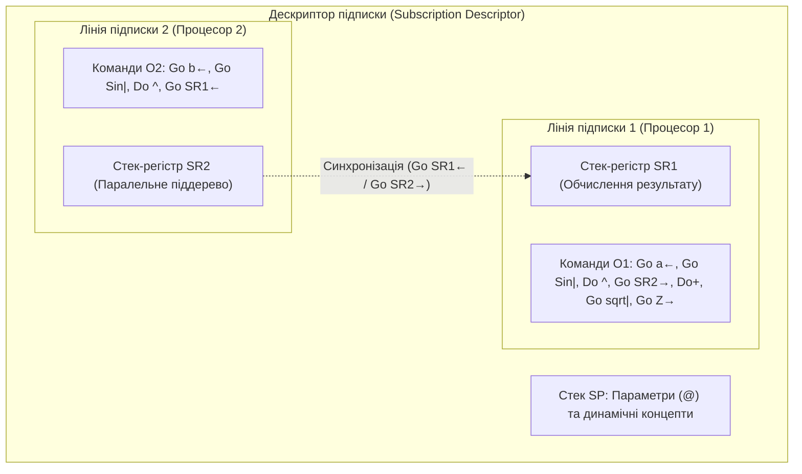
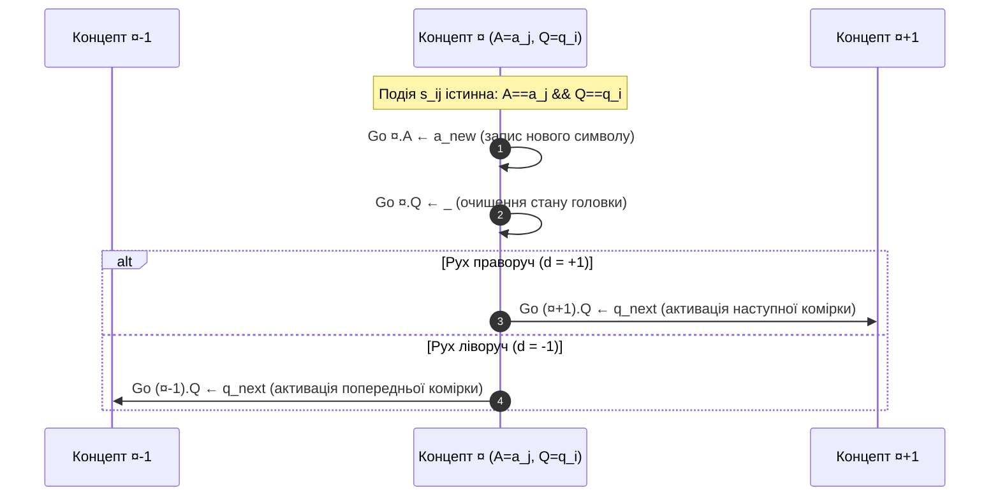
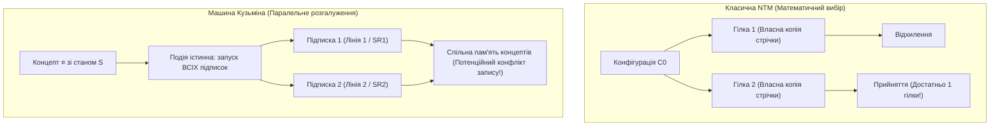

# Машина Кузьміна під формальним розбором: події, підписки, архітектура виконання й конструктивні докази

* **Версія:** 0.2.0
* **Виправлення F11 (MIGRATION-REGISTER):** джерело «авторська специфікація 2026» перейменовано на реконструкцію М. Федчика.
* **Перенесено з:** `drafts/KuzminMachine/01-concepts-and-theory/Kuzmin-Machine-Formal-Analysis-UA.md` @ `a4738bc` (2026-11-09)

> **Автор аналізу:** Микола Федчик (Mykola Fedchyk)  
> **Предмет дослідження:** збережені публікації М. Ю. Кузьміна на DOU, авторські уточнення в обговоренні листопада 2026 року та презентація «Пример для АН». Нижче — похідний аналіз М. Федчика, не авторська специфікація. Незадокументовані усні твердження не використовуються.
> **Мета:** реконструювати повну формальну та апаратно-програмну модель Машини Кузьміна, дослідити систему команд і стеків, оцінити конструктивний ескіз симуляції машини Тюрінга, семантику синхронізації та визначити дійсне місце моделі в теорії обчислень і практичній паралельній архітектурі.

---

## Анотація

У доробку Михайла Кузьміна (2020–2026) розвивається обчислювальна модель, у якій обчислення подаються не як послідовний потік інструкцій фоннейманівського типу, а як граф концептів зі станами, події-предикати над цими станами та підписки, що генерують адресовані дії. Автор позиціонує цю модель — **Машину Кузьміна (МК)** — як нову багатопроцесорну подієву архітектуру, що долає конвеєрні обмеження послідовних процесорів, усуває недетермінізм у класичному розумінні та максимізує швидкість реакції на події в реальному часі.

Реконструкція технічної специфікації (М. Федчик, 2026) разом із корпусом публікацій на DOU описує конкретний низькорівневий базис моделі: систему типів і команд (`Go`, `Do`), стеково-регістрову модель ліній виконання ($SR$, $SP$, $O$), протокол міжстекової синхронізації виразів на кількох процесорах із детермінованим відкатом на одне ядро, оператор послідовності `•` (Big Dot) для пре- та пост-активацій при читанні/записі, правило запобігання рекурсивним циклам, а також конструктивний ескіз симуляції класичної машини Тюрінга (МТ) шляхом передачі стану $Q$ між сусідніми концептами стрічки $\text{¤}-1, \text{¤}, \text{¤}+1$.

Опис має риси **стекової потокової машини (Dataflow / Reduction Architecture)**, **акторної моделі** з адресованими активаціями та **подієво-продукційної системи (ECA)**. Ця аналогія не встановлює новизни. Ескіз симуляції МТ не є завершеним доведенням повноти за Тюрінгом; паралельний запуск підписок над спільним станом також не слід ототожнювати з екзистенційним вибором гілки класичної недетермінованої МТ.

---

## 1. Джерельна база та межі дослідження

Аналіз спирається на такі збережені джерела та явно відділену від них реконструкцію:

1. **Корпус DOU:** збережено [чотири топіки](../sources/README.md) (35914, 36556, 38994, 43177), а не всі 11, згадані в ранній редакції аналізу. Твердження про повноту ширшого корпусу не використовуються.
2. **Дискусія листопада 2026 року:** відповіді автора на питання щодо недетермінізму, повноти за Тюрінгом, природи пам'яті та конфліктів у [копії топіка 35914](../sources/author/dou/dou-35914.md).
3. **Авторська презентація «Пример для АН»:** [PDF](../sources/author/kuzmin-2024-example-for-AN.pdf) / [PPTX](../sources/author/kuzmin-2024-example-for-AN.pptx) — два формати одного матеріалу. Локатори далі — номери сторінок PDF (1–16), не дата першого оприлюднення окремих тверджень.
4. **Реконструкція М. Федчика:** математичні позначення, схеми й інтерпретації в цьому документі є похідними. Окремої авторської специфікації 2026 року немає. Попередні посилання на незадокументоване спілкування вилучено; наведені нижче механізми зіставлено зі збереженою презентацією, а не з переказом розмов.

| Частина аналізу | Збережене первинне джерело | Межа висновку |
| :--- | :--- | :--- |
| Концепти, стан, події, підписки (§3.1) | DOU 35914, «Устройство машины Кузьмина»; DOU 43177, «Стартовий допис» | Є опис моделі, не доказ її реалізації |
| Таблиці `Type` / `Operation` (§3.2) | Презентація, с. 4 | Похідний виклад таблиці; виправлення позначень не є новим авторським твердженням |
| Життєвий цикл, $O$, $SR$, $SP$ (§3.3) | Презентація, с. 9 | Описана організація виконання, не перевірений runtime |
| Міжстекова синхронізація й перехід до другого стека (§3.3) | Презентація, с. 10 | Пропозиція автора; гарантію завершення за всіх розкладів не доведено |
| `•` та пригнічення повторної події (§3.4) | Презентація, с. 11 | Заявлені правила; їхня сумісність із прикладами потребує перевірки |
| Ескіз симуляції МТ (§4) | Презентація, с. 14; DOU 35914, коментар автора #3137565 | Не завершений доказ; формули та діаграма нижче є реконструкцією |
| Інтуїція автора щодо NTM (§5) | Презентація, с. 15; DOU 35914, коментар автора #3137526 | Авторський погляд, не спростування математичної моделі NTM |
| Приклади (§7) | Презентація, с. 3 (НСД), с. 6–8 (лічильник) | Приклади запису, не відтворені експериментальні результати |

Відомі суперечності цих матеріалів розглянуто в [науковій опозиції](../trl-evidence/scientific-opposition-report.md). Цей аналіз не скасовує її обмеженого негативного вердикту.

Розрізняємо чотири рівні наукової верифікації фактів:
- **Опис / Декларація:** авторське твердження або мотиваційний виклад задуму;
- **Формальна специфікація:** математично та операційно несуперечливе правило виконання переходів;
- **Конструктивний доказ:** алгоритм трансляції або доказ збереження обчислювальної еквівалентності;
- **Фізичний експеримент:** відтворюваний протокол вимірювань затримок, конфліктів і пропускної здатності на цільовому залізі.

---

## 2. Систематизація еволюції концепції (2020–2026)

| Джерело / Дата | Пам'ять і структура | Визначення події | Модель паралелізму й виконання |
|---|---|---|---|
| **DOU топік 35914** (28.12.2021) | «Стрічка скінченна»; комірки замінено концептами. | Зміна стану концепту; окремі події адресацій. | Кілька головок; паралельний запуск кількох підписок. Заявлено «недетермінізм». |
| **Коментар у 38994** (09.07.2022) | «Зліченна множина комірок»; множина станів $S$ «можливо нескінченна». | Скінченна підмножина станів; перевірка належності стану підмножині. | Активація запускає одночасний аналіз усіх подій концепту та паралельний запуск усіх підписок. |
| **DOU топік 43177** (24.04.2023) | Множина поточних значень змінних концепту. | «Логічна функція від змінних». | Зміна значення змінної запускає перевірку формули. 20 дослідних плат на STM32. |
| **Дискусія на DOU** (04–05.11.2026) | Зліченна множина концептів; нескінченність стрічки названо філософським питанням. | Для симуляції МТ: пара $`(a_i, q_j)`$ «символ стрічки — стан». | «Недетермінізм — це рекламне слово, у мене паралелізм». Конфлікти записів на одному логічному кроці покладаються на програміста. |
| **Реконструкція специфікації МК** (М. Федчик, 2026) | Зліченний простір типізованих концептів (`_`, `Token`, `Byte`, `Int32`, `Float`...). Адреси концептів. | Множина станів $U$, події $`s_i \subseteq U`$, функція-висловлювання $`w_i(U) \in \{0, 1\}`$. Нульовий порядок логіки. | Стекова VM: лінії підписки ($O + SR$), стек параметрів $SP$, команди рандеву між стеками (`Go SR2 →`, `Go SR ←`), оператор фаз `•`, придушення авто-тригерів. |

---

## 3. Технічна та формальна архітектура Машини Кузьміна

### 3.1. Базові сутності та система адресацій

Машина Кузьміна складається зі зліченної множини концептів та множини незалежних керуючих пристроїв (головок адресації).
Поточний концепт позначається символом **$\text{¤}$**.

Адресація здійснюється оператором **`Go`** за шаблоном:

$$\text{Go } \langle\text{Адреса / Ідентифікатор концепту}\rangle \enspace \langle\text{Вид адресації}\rangle$$

Визначено чотири фундаментальні види адресації, кожен з яких сам по собі породжує однойменну подію активації:
1. **`→` (Читання):** запит значення з концепту. При наявності підписок виконує асоційовану дію перед або після зчитування.
2. **`←` (Запис):** внесення нового значення в концепт.
3. **`|` (Виконання):** активація обчислювального методу/підписки концепту (еквівалент виклику підпрограми / переходу).
4. **`:` (Ініціалізація):** інстанціювання нового екземпляра концепту з використанням цільового концепту як класу/прототипу.



### 3.2. Система типів та інструкцій (ISA)

Реконструкція специфікації містить таблицю вбудованих типів пам'яті та примітивних операцій:

#### Типи даних (`Type`):
- `_` : Відсутність значення або будь-яке значення (Size 0);
- `Token` : 4-бітний дискретний токен значень від 0 до 15 (Size 0);
- `Byte` / `Int8` : 8-бітні беззнакові (0..255) та знакові (-128..127) значення (Size 1);
- `U16` / `Int16` : 16-бітні цілі (Size 3 у внутрішньому кодуванні розмірів автора);
- `U32` / `Int32` / `Float` : 32-бітні цілі та числа з рухомою комою IEEE-754 (Size 7);
- `U64` / `Int64` / `Double` : 64-бітні цілі та дійсні числа подвійної точності (Size 15);
- `Chr` : 1-байтний ASCII символ;
- `Uni` : 4-байтний Unicode символ.

#### Система операцій (`Operation`):
1. **Булеві стани (`?`):** `!` (True / Істина, код 0), `¬` (False / Хиба, код 1).
2. **Класи подій даних (`::`):**
   - `_` (Відсутнє значення / 0)
   - `Null` (Нульове значення / 1)
   - `Positive` (Додатне, $> 0$ / 2)
   - `Negative` (Від'ємне, $< 0$ / 3)
   - `Even` (Парне / 4)
   - `Uneven` (Непарне / 5)
   - `~` (Факт зміни значення / 6)
3. **Події порівняння (`~`):** `=` (код 0), `>` (код 1), `<` (код 2).
4. **Арифметично-логічні оператори (`Do`):**
   - `+`, `-`, `*`, `/`, `^` (піднесення до степеня);
   - `'` (інкремент $+1$);
   - `&` (побітове AND), `Or` (побітове OR);
   - `¬` (логічна інверсія), `#` (арифметична зміна знака / унарний мінус);
   - `<`, `>` (побітові зсуви вліво та вправо);
   - `~` (оператор порівняння).
5. **Службові мета-інструкції:** `Define` (оголошення типів), `Convert` (приведення типів), `Exit` (вихід із групи виконання), `Processor` (запит на виділення додаткового фізичного/віртуального ядра).

---

### 3.3. Низькорівнева модель стеків і виконання ліній підписок

На с. 9–10 презентації описано трансляцію та виконання підписок на багатопроцесорному рівні. Нижче відтворено запропонований **дескриптор підписки**, що складається з однієї або кількох **ліній підписки**; це не результат перевірки реалізованого компілятора.

```text
Лінія підписки = (Послідовність команд O) + (Стек-регістр SR)
Дескриптор підписки = { Лінії підписки } ∪ (Стек параметрів та динамічних концептів SP)
```



#### Алгоритм життєвого циклу активації на виконання:
1. **Виділення процесора:** із пулу вільних ядер призначається вільний процесор.
2. **Передача коду:** завантажується послідовність команд $O$ (розмір якої та необхідна пам'ять відомі на етапі трансляції).
3. **Виділення пам'яті стек-регістра $SR$:** саме тут зберігаються проміжні операнди арифметичних інструкцій `Do`.
4. **Виділення стек-регістра $SP$:** стек призначається для параметрів виклику концепту (`@`) та динамічних змінних, породжених операцією `:`.
5. **Виконання:** команди $O$ виконуються за внутрішнім лічильником команд.
6. **Звільнення процесора:** ядро звільняється після останньої команди (яка може бути командою синхронізації).
7. **Очищення пам'яті:** стек знищується після вичитування кінцевого результату.

#### Механізм міжстекової синхронізації та детермінований відкат (Fallback)
При паралельному обчисленні виразу на кшталт $Z = \sqrt{\sin^2(a) + \sin^2(b)}$ компілятор розбиває дерево виразу на два стеки:
- **Процесор 1 (Лінія 1):** `Go a ←; Go Sin |; 2; Do ^;` $\to$ точка очікування $\to$ `Do +; Go sqrt |; Go Z →`
- **Процесор 2 (Лінія 2):** `Go b ←; Go Sin |; 2; Do ^;` $\to$ передача результату.

Для зв'язування ліній використовуються симетричні команди рандеву:
- У лінії 1 генерується читання зі стека 2: `Go SR2 →`
- У лінії 2 генерується запис у стек 1: `Go SR1 ←`

На с. 10 презентації автор пропонує за відсутності другого вільного процесора продовжувати виконання другого стека першим процесором після досягнення точки синхронізації. Це джерело опису механізму, а не доведення відсутності блокувань або гарантованого завершення для довільних виразів і розкладів.

---

### 3.4. Оператор послідовності `•` (Big Dot) та усунення автоколізій

На с. 11 збереженої презентації автор описує порядок читання/запису за наявності підписок і правило пригнічення повторної події. Нижче наведено їхню інтерпретацію, а не посилання на окрему «авторську технічну специфікацію»:

#### 1. Впорядкування дій через властивість-булевий прапорець `•` (Велика точка)
Кожен концепт має вбудовану булеву властивість успішності `•` (за замовчуванням `!` — True).  
Синтаксис складеної підписки записується як:

$$w_1 \bullet w_2$$

- **При читанні (`→`):** спочатку виконується підписка $`w_1`$ (яка обчислює або готує актуальне значення), потім відбувається фізичне читання (що активує подію `•`), і після нього виконується $`w_2`$ (пост-обробка, наприклад, скидання буфера).
  ```text
  → • Revolutions = Tick * 600; Tick = 0
  ```
- **При записі (`←`):** спочатку запускається пре-підписка $`w_1`$ (валідація, розрахунок похідних величин). Якщо вона успішна, фіксується запис `•`, після чого виконується пост-дія $`w_2`$. Якщо валідація не пройшла, підписка явно виставляє `• = ¬` (False), блокуючи наступні каскади.

#### 2. Інваріант анти-зациклення (Cycle Prevention Invariant)
> *«Адресація до атрибута в підписці до події цього ж атрибута не генерує подію для уникнення зациклювання.»*

За цим описом, якщо підписка на зміну змінної `Distance` сама записує в `Distance`, повторна активація події `~ Distance` пригнічується. Правило не доводить відсутності всіх циклів; у науковій опозиції вказано конфлікт із наведеними прикладами ітерацій.

---

## 4. Конструктивний аналіз симуляції Машини Тюрінга

На с. 14 презентації є ескіз кодування переходу МТ через подію та підписку; у DOU 35914 коментар #3137565 також пов'язує події з парою «символ — стан». Нижче — реконструкція цього ескізу, не завершене авторське доведення.

### 4.1. Авторська конструкція трансляції МТ $\to$ МК

Класична детермінована машина Тюрінга задається як $`M = \langle A, Q, q_0, q_{halt}, \delta \rangle`$, де правила переходу мають вигляд:

$$q_i, a_j \to q_{next}, a_{new}, d_k \quad (d_k \in \lbrace L(-1), N(0), R(+1) \rbrace)$$

У похідній реконструкції відображення записано наступним чином:
1. **Стрічка:** подається як ланцюжок пронумерованих концептів. Поточна комірка стрічки позначається як $\text{¤}$. Сусідні комірки адресовані як $\text{¤} - 1$ та $\text{¤} + 1$.
2. **Вміст комірки:** кожен концепт має атрибут `A` (символ алфавіту) та атрибут `Q` (стан головки, або `_` якщо головка відсутня над цією коміркою).
3. **Ліва частина правила (Подія):**

$$s_{ij} \equiv (A = a_j \land Q = q_i)$$

   Це кон'юнкція поточного значення комірки та стану головки, що знаходиться в ній.
4. **Права частина правила (Підписка):**
   При істинності події $`s_{ij}`$ активується підписка $`w_{ij}`$:

$$w_{ij} = s_{ij} \left( \text{Go } \text{¤}.A \leftarrow a_{new} \quad \text{Do } \text{¤} + d.Q \leftarrow q_{next} \right)$$

   де:
   - $`\text{Go } \text{¤}.A \leftarrow a_{new}`$ — запис нового символу в поточний концепт;
   - $`\text{Do } \text{¤} + d.Q \leftarrow q_{next}`$ — перенесення маркера стану головки у сусідній концепт ($\text{¤} - 1$ при русі вліво або $\text{¤} + 1$ при русі вправо).



### 4.2. Формальна оцінка повноти за Тюрінгом

Запропонована схема розв'язує задачу передачі керування вздовж стрічки за допомогою відносної адресації $\text{¤} + d$.
- **Зупинка:** досягається відсутністю підписок для стану $`q_{halt}`$ або записом термінального стану `_`.
- **Необмеженість пам'яті:** оскільки адресація концепту здійснюється за цілочисловим індексом (зліченна множина концептів), а оператор `:` дозволяє динамічно створювати нові концепти при виході за поточні межі індексу, простір пам'яті задовольняє вимогу потенційної нескінченності.

**Межа висновку:** наведено ескіз можливого кодування, а не доведення повноти за Тюрінгом. Потрібно визначити атомарність переходу, видалення попереднього маркера головки, випадок $d=0$, породження пам'яті та сумісність із правилом пригнічення повторної події. Очищення `Q` у діаграмі вище — доповнення реконструкції, не явно виписаний крок джерела.

---

## 5. Співвідношення з Недетермінованою Машиною Тюрінга (NTM)

На с. 15 презентації автор ставить питання про порядок виконання кількох команд для однієї пари «символ — стан» і мотивує незалежні головки та поділ на події й підписки. Це переказ датованого матеріалу, а не цитата з особистої розмови.

Тут виникає фундаментальне розходження між **математичною теорією обчислень** та **інженерно-фізичною інтуїцією автора**:

1. **У класичній теорії складності (Sipser, Rabin-Scott):**
   Недетермінізм — це теоретико-множинне відношення переходу $`\delta \subseteq (Q \times \Gamma) \times (Q \times \Gamma \times \{L, R\})`$. NTM не «виконує всі гілки фізично в одному процесорі»; дерево конфігурацій є абстракцією, де слово приймається, якщо **існує хоча б одна успішна гілка**.
2. **У Машині Кузьміна:**
   Якщо на подію підписано кілька дій, машина фізично генерує окремі лінії виконання (головки) для **всіх** підписок, і всі вони намагаються виконатися над **спільною пам'яттю концептів**.



У збереженому коментарі DOU 35914 #3137526 автор пояснює вживання слова «недетермінізм» паралельним виконанням. Це не спростування класичної NTM і не формальна класифікація МК. Аналогії з PRAM та конкурентним переписуванням у цьому аналізі залишаються похідними інтерпретаціями до визначення повної операційної семантики.

---

## 6. Порівняльний аналіз із відомими паралельними парадигмами

| Модель / Архітектура | Спільні риси з Машиною Кузьміна | Ключові відмінності |
|---|---|---|
| **Dataflow-архітектури (Dennis, Arvind)** | Обчислення активується готовністю даних/подій, а не лічильником команд програми. | У Dataflow токени рухаються графом зв'язків. У МК концепти статично адресовані (`Go`), а підписки самі читають/пишуть операнди. |
| **Стекові машини (Forth, Transputer, Java VM)** | Використання стека ($SR$) для арифметичних операцій `Do` та передачі параметрів. | Стекові операції в МК динамічно створюються лініями підписок і мають примітиви міжстекової синхронізації (`Go SR2 →`). |
| **Акторна модель (Hewitt, Agha, Erlang)** | Концепт є автономною сутністю, адресація подібна до надсилання повідомлення. | Актори мають приватний ізольований стан і чергу вхідних повідомлень (mailbox). У МК концепти мають відкриту спільну пам'ять атрибутів. |
| **ECA-системи та Active DB** | Парадигма Event-Condition-Action (Подія — Перевірка умови — Дія). | МК вводить поняття пре/пост-фаз (`•`), лінії синхронізації та апаратно орієнтований набір операцій `Do`. |
| **Синхронні мови (Esterel, Lustre)** | Реакція системи на події зовнішнього середовища в логічному часі. | Esterel має сувору детерміновану семантику логічного такту (Synchronous Hypothesis). У МК паралельні лінії можуть виконуватися з довільною тривалістю, якщо не застосовано бар'єр рандеву. |

---

## 7. Практичні приклади реалізації мовою Машини Кузьміна

### 7.1. Алгоритм Евкліда (НСД) в один рядок
```text
U64 Nod | @ U64 ( a_ > b -=b , b_ > a -=a ) =a
Z = Nod(120, 6)
```
**Семантика виконання:**
Два параметри `a` і `b` оголошені з взаємними подіями-підписками:
- Якщо $a > b$, спрацьовує дія зменшення $a \leftarrow a - b$;
- Якщо $b > a$, спрацьовує дія $b \leftarrow b - a$;
- Коли жодна з умов не виконується ($a = b$), спрацьовує повернення `= a`.
Обчислення є чисто подієвим циклом над спільними змінними.

### 7.2. Електронний лічильник електроенергії з інтегруванням
```text
Class Example
| @ Byte Interval 1 Timer(Interval, Tick |)
: { 
    Float { 
        Voltage ← @ Float x +=x 
        → Voltage =0
        Electricity ← @ Float x +=x 
        → Electricity =0
        Value 0
        ← @ Float x +=x
        ~ Change | 
    }
    Byte Tick 0
    = 10 Value = Voltage * Electricity / Tick^2
    ← Tick +=1
    → Tick = 0
    Void Tick | [Tick = 0 Voltage = "0p1" Electricity = "0p0"] Go Tick → 0 Go Tick ← ;
    ? Change
}
```
**Семантика виконання:**
Концепт поєднує реакцію на переривання таймера, накопичення інтегральних сум струму й напруги при подіях запису (`←`), обнулення накопичувачів при зчитуванні (`→`) та перерахунок потужності за настанням дискретного інтервалу (подія `= 10`).

---

## 8. Підсумкова оцінка наукової та інженерної цінності

1. **Повнота за Тюрінгом не доведена цим документом:** ескіз перенесення стану $Q$ між концептами потребує уточнень, перелічених у §4.2.
2. **Природа моделі:** Машина Кузьміна не є недетермінованою машиною Тюрінга. Вона є **асинхронною/синхронною мультипроцесорною подієвою моделлю зі стеково-регістровим виконавцем** та спільною пам'яттю концептів.
3. **Описані інженерні пропозиції (новизну й коректність не встановлено):**
   - Модель ліній підписок ($O + SR + SP$) з автоматичним перемиканням на послідовне виконання при вичерпанні фізичних ядер;
   - Механізм парної рандеву-синхронізації стеків (`Go SR2 →` / `Go SR ←`);
   - Оператор `•` для розмежування перевірок валідності та побічних ефектів читання/запису;
   - Правило пригнічення авто-тригерів для усунення зациклень.
4. **Вимоги до практичного впровадження:**
   Для повноцінної верифікації заявленої переваги — високої швидкості реакції в автоматиці порівняно з RTOS або ISR на мікроконтролерах — необхідна публікація вихідного коду емулятора або прошивки для STM32 з відкритим бенчмарком джитера та затримок реакції на зовнішні переривання.

---

## Словник термінів

- **А-ритм:** порядок обчислень, що виникає внаслідок каскадного спрацьовування зв'язків «подія-підписка» замість імперативної блок-схеми.
- **А-схема:** динамічний граф взаємодії концептів, у якому зв'язки активуються контекстно (наприклад, при наведенні або активації концепту).
- **Велика точка (`•`):** булевий прапорець концепту та синтаксичний роздільник перед-дії ($`w_1`$) і після-дії ($`w_2`$) при операціях читання/запису.
- **Дескриптор підписки:** сукупність структурних ресурсів виконання (стек параметрів $SP$ і множина ліній підписок).
- **Лінія підписки:** атомарний потік інструкцій $O$, що виконується на одному фізичному чи віртуальному процесорі за допомогою власного стек-регістра $SR$.
- **Поточний концепт ($\text{¤}$):** базовий елемент пам'яті, що адресується в даний момент оператором `Go`.

---

## Джерела

1. М. Федчик. *Реконструкція технічної специфікації архітектури, системи команд та стекової моделі Машини Кузьміна*, 2026. Похідний аналіз, не авторський текст М. Ю. Кузьміна; первинні підстави наведено в карті §1.
2. Публікації М. Ю. Кузьміна на порталі DOU (2020–2023):
   - [«Машина Кузьміна. (Керована недетермінована машина Тюрінга.)»](https://dou.ua/forums/topic/35914/) (28.12.2021);
   - [«Виконання груп у недетермінованій машині»](https://dou.ua/forums/topic/36556/) (2022);
   - [«Автоматика та пристрої»](https://dou.ua/forums/topic/38994/) (07.07.2022; коментарі також датовано наступними днями);
   - [«Опис недетермінованої машини Кузьміна на пальцях»](https://dou.ua/forums/topic/43177/) (24.04.2023).
3. Обговорення та відповіді автора у темі топіка 35914 від 04–05 листопада 2026 року.
4. Alan M. Turing. *“On Computable Numbers, with an Application to the Entscheidungsproblem.”* Proc. London Math. Soc., 1936.
5. Michael Sipser. *Introduction to the Theory of Computation*. 3rd ed., Cengage Learning, 2013.
6. Charles L. Forgy. *“Rete: A Fast Algorithm for the Many Pattern/Many Object Pattern Match Problem.”* Artificial Intelligence, 1982.
7. Gérard Berry, Georges Gonthier. *“The Esterel Synchronous Programming Language: Design, Semantics, Implementation.”* Science of Computer Programming, 1992.
8. М. Ю. Кузьмін. *«Пример для АН»*, [PDF](../sources/author/kuzmin-2024-example-for-AN.pdf) / [PPTX](../sources/author/kuzmin-2024-example-for-AN.pptx). PPTX створено 2024-05-21, змінено 2026-11-06; PDF експортовано 2026-11-06.

## Історія версій

| Версія | Дата | Зміни |
| :--- | :--- | :--- |
| 0.2.0 | 2026-11-09 | #2, З2 рецензії PR #57: вилучено недокументоване усне джерело; механізми прив'язано до збережених DOU і презентації; авторські твердження відділено від реконструкцій, незавершеного доказу та неперевірених гарантій |
