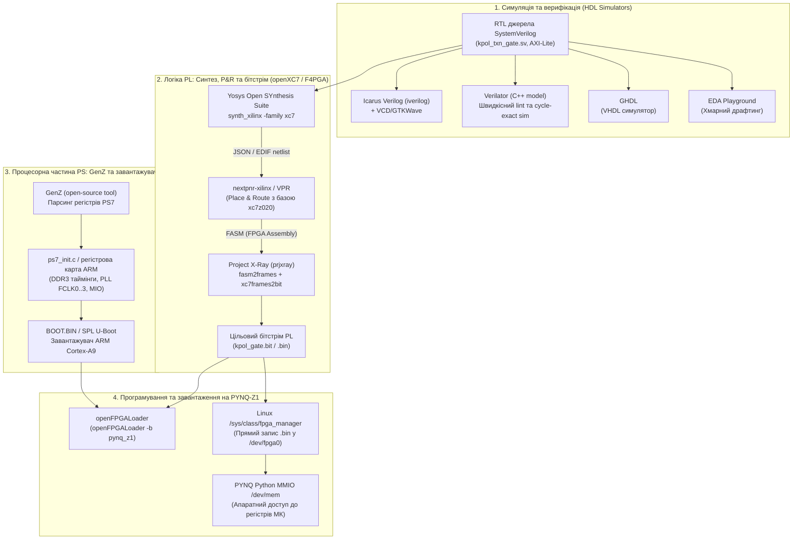
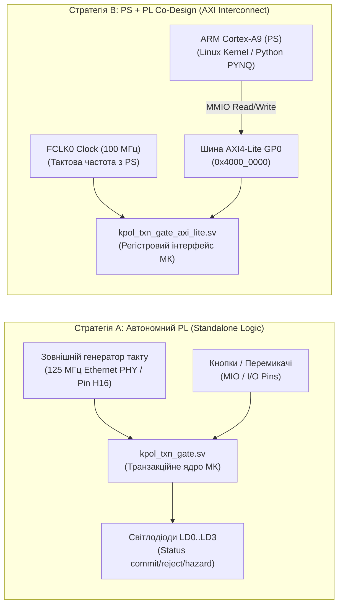
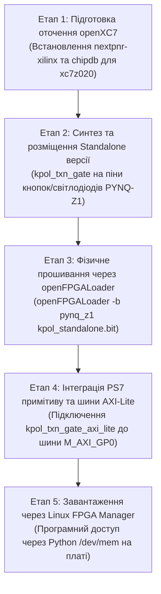

# Архітектура відкритого інструментального стека для XC7Z020 (PYNQ-Z1) без Vivado/Vitis

* **Версія:** 0.1.0
* **Перенесено з:** `drafts/KuzminMachine/02-engineering-hardware/Kuzmin-Machine-Open-Source-XC7-Toolchain-Architecture-UA.md` @ `a4738bc` (2026-11-09)

> [!IMPORTANT]
> **Мета документа:** Фіксація повної технічної архітектури, робочих процесів (pipelines) та інструментального забезпечення для синтезу, трасування, конфігурації PS-ядра (ARM Cortex-A9), генерації бітстріму та програмування кристала **Xilinx Zynq-7000 (XC7Z020-1CLG400C)** на платі **PYNQ-Z1** виключно за допомогою вільного та відкритого програмного забезпечення (Open-Source EDA Toolchain).
>
> Цей підхід усуває залежність від важкого пропрієтарного пакета AMD/Xilinx Vivado/Vitis, забезпечуючи 100% автономність, прозорість та відтворюваність у CI/CD середовищах.

---

## 1. Загальна концепція та порівняльний огляд

Кристал **Xilinx Zynq-7000 (XC7Z020)** є гетерогенною системою на кристалі (SoC), що поєднує:
1. **PS (Processing System):** Двоядерний процесор ARM Cortex-A9 MPCore з вбудованим контролером пам'яті DDR3, периферійними контролерами (UART, SPI, I2C, USB, Ethernet, SDIO) та блоком фазового автопідстроювання частоти (PLL).
2. **PL (Programmable Logic):** Матрицю програмованої логіки 7-ї серії Xilinx (Artix-7 клас: 85,000 логічних комірок, 53,200 LUT6, 106,400 тригерів, 140 блоків Block RAM 36Kb, 220 блоків DSP48E1).

Традиційний пропрієтарний підхід AMD/Xilinx вимагає встановлення інсталяційного пакета Vivado/Vitis обсягом 50-100+ ГБ, графічного середовища IP Integrator (Block Design) та ліцензійних обмежень.

Відкритий стек (FOSS) розділяє завдання на модульні, легковажні та стандартизовані компоненти:



---

## 2. Відкритий ланцюжок інструментів для логіки (PL): openXC7

### 2.1. Походження та архітектура openXC7
Проєкт **openXC7** (розвиток напрацювань SymbiFlow та F4PGA 7-Series) реалізує наскрізний потік компіляції Verilog/SystemVerilog у бітовий потік для чіпів Xilinx 7-ї серії (Artix-7, Kintex-7, Zynq-7000).

Ланцюжок складається з чотирьох послідовних кроків:
1. **Синтез логіки (Frontend Synthesis):**
   - Утиліта: [Yosys](https://github.com/YosysHQ/yosys) (версії $\ge 0.30$).
   - Команда: `synth_xilinx -family xc7 -top kpol_txn_gate_axi_lite`.
   - Результат: Проміжне логічне представлення (JSON або EDIF netlist), де логіка відображена на елементи `LUT6`, `FDRE`/`FDCE`, `CARRY4`, `RAM32M` тощо.
2. **Розміщення та трасування (Place & Route):**
   - Утиліта: [nextpnr-xilinx](https://github.com/gatecat/nextpnr-xilinx) (альтернативно VPR із проєкту F4PGA).
   - База даних кристала (ChipDB): Заздалегідь згенерований двійковий файл топології для чіпа `xc7z020clg400-1`.
   - Вхідні дані: JSON-нетліст від Yosys + файл фізичних обмежень (PCF або XDC).
   - Результат: Трасований граф зв'язків та розміщення комірок.
3. **Генерація FASM (FPGA Assembly):**
   - `nextpnr-xilinx` експортує розміщення у формат FASM (текстовий опис увімкнених бітів конфігурації логічних блоків, комутаторів трасування та мультиплексорів).
4. **Формування двійкового бітстріму (Bitstream Generation):**
   - Інструменти: **Project X-Ray** (`prjxray-tools`).
   - `fasm2frames`: Перетворює текстовий FASM у фрейми пам'яті конфігурації.
   - `xc7frames2bit`: Формує стандартний бінарний файл бітстріму `.bit` (та `.bin` для Linux FPGA Manager) з відповідними заголовками Xilinx.

### 2.2. Порівняння параметрів компіляції

| Параметр | Пропрієтарний Vivado | Відкритий openXC7 |
| :--- | :--- | :--- |
| **Обсяг дистрибутива** | $50 - 110\text{ ГБ}$ | $\approx 2 - 4\text{ ГБ}$ (разом із ChipDB) |
| **Час холодного запуску** | $45 - 90\text{ с}$ (GUI/JVM) | $< 1\text{ с}$ (чистий C++/POSIX) |
| **Час компіляції для gate** | $3 - 5\text{ хв}$ | $10 - 25\text{ с}$ |
| **Автоматизація в CI/CD** | Складна (Tcl batch скрипти, ліцензії) | Проста (UNIX pipeline, Make, Docker) |
| **Підтримка Zynq PS-ядра** | Автоматична через Block Design | Напівавтоматична (потребує GenZ або ручного зв'язування) |

---

## 3. Конфігурація процесорного ядра (PS): GenZ

### 3.1. Проблема Zynq-7000 PS у відкритому середовищі
У чипах Zynq процесорна система (PS) є фізичним кремнієвим блоком (Hard IP). При старті системи внутрішній BootROM ARM Cortex-A9 повинен:
1. Налаштувати внутрішні дільники PLL для отримання тактових частот CPU ($667\text{ МГц}$), DDR ($533\text{ МГц}$) та шин AXI/FCLK ($50 - 100\text{ МГц}$).
2. Ініціалізувати контролер динамічної пам'яті DDR3 (таймінги, калібрування ZQ, біти затримки).
3. Налаштувати мультиплексовані виводи (MIO) для UART, SD-карти та Ethernet.

У середовищі Vivado це генерується у вигляді файлів `ps7_init.c` та `ps7_init.h`.

### 3.2. Роль проєкту GenZ
**GenZ** — це відкрита утиліта, призначена для автономної конфігурації регістрів Zynq-7000:
- Дозволяє декларувати налаштування PS через текстовий файл конфігурації (YAML або TOML) замість пропрієтарного XML/Tcl.
- Генерує:
  - C-код ініціалізації (`ps7_init`) для використання з відкритим завантажувачем (U-Boot SPL або Baremetal FSBL).
  - Конфігураційні заголовки для завантажувального образу `BOOT.BIN`.
  - Правильні константи адресації контролера AXI GP0/GP1.

> [!NOTE]
> **Практичний обхідний шлях для PYNQ-Z1:**
> Оскільки на платах PYNQ-Z1 уже працює повноцінний Linux (образ PYNQ 3.1.1 на базі Ubuntu), контролер пам'яті DDR3, процесор ARM та тактова частота `FCLK0` ($100\text{ МГц}$) уже повністю ініціалізовані ядром Linux та штатною службою завантаження!
> Це означає, що для розгортання транзакційного шлюзу Машини Кузьміна **не обов'язково перезбирати BOOT.BIN**. Достатньо скомпілювати відкритим стеком openXC7 лише бітстрім PL-частини, передати його через AXI-шину і завантажити в активну матрицю без перезавантаження процесора.

---

## 4. Завантаження та прошивання: openFPGALoader та Linux FPGA Manager

### 4.1. Утиліта openFPGALoader
`openFPGALoader` — це універсальна відкрита консольна утиліта для програмування FPGA через JTAG інтерфейси (FTDI FT2232, Raspberry Pi GPIO, JTAG-HS2 тощо).

- **Нативна підтримка PYNQ-Z1:**
  Плата PYNQ-Z1 містить на борту мікросхему FTDI FT2232H, яка нативно підтримується `openFPGALoader`:
  ```bash
  # Виявлення підключеної плати PYNQ через USB-JTAG
  openFPGALoader --detect

  # Пряме завантаження бітстріму у SRAM кристала XC7Z020
  openFPGALoader -b pynq_z1 kpol_txn_gate.bit

  # Запис бітстріму у енергонезалежну SPI Flash пам'ять
  openFPGALoader -b pynq_z1 -f kpol_txn_gate.bit
  ```

### 4.2. Механізм Linux FPGA Manager (In-System Reconfiguration)
У випадку, коли плата доступна по мережі Ethernet через SSH (`pynq1` / `pynq2`), бітстрім завантажується безпосередньо операційною системою Linux без фізичного JTAG-підключення:
1. Бінарний бітстрім перетворюється у формат `.bin` (очищений від заголовків Xilinx).
2. Записується у системний шлюз ядра:
   ```bash
   # Копіювання образу на плату
   scp kpol_txn_gate.bin xilinx@pynq2:/lib/firmware/kpol.bin

   # Завантаження в апаратну матрицю через sysfs драйвер ядра Linux
   ssh xilinx@pynq2 "echo kpol.bin > /sys/class/fpga_manager/fpga0/firmware"

   # Перевірка статусу конфігурації
   ssh xilinx@pynq2 "cat /sys/class/fpga_manager/fpga0/state"
   # Повертає: operating
   ```

### 4.3. Робота з PYNQ взагалі без .hwh (Альтернативний прямий MMIO шлях)

Файл `.hwh` (Hardware Handoff XML) потрібен бібліотеці PYNQ виключно для високорівневого автоматичного парсингу адресної простори IP-блоків у середовищі Python (для автогенерації об'єктів на кшталт `overlay.dma_block` чи `overlay.axi_gpio`).

Якщо бітстрім скомпільовано у відкритому стеку (`openXC7` / `nextpnr-xilinx` / `prjxray`), і у наявності є лише файл `.bit` або `.bin`:

#### 1. Передумови (Що необхідно знати заздалегідь)
Оскільки без `.hwh` файлу бібліотека PYNQ не знає внутрішньої топології прошивки, параметри шини задаються безпосередньо з RTL-специфікації:
1. **Базова адреса (Base Address):** Фізична адреса підключення IP-блоку на шині `M_AXI_GP0` кристала Zynq-7000 (за замовчуванням `0x4000_0000`).
2. **Адресний простір (Address Range):** Розмір вікна пам'яті (за замовчуванням `0x1000` = 4096 байт).
3. **Байтові зміщення регістрів (Byte Offsets):** Зсув у байтах для кожного 32-бітного регістра (крок 4 байти):
   - `0x00`: `REG_CANDIDATE_VALUE` (R/W) — кандидатне значення стану.
   - `0x04`: `REG_CONDITIONS` (R/W) — вектори передумов, інваріантів та завад.
   - `0x08`: `REG_COMMAND` (W) — командний регістр (біт 0 = пуск транзакції).
   - `0x0C`: `REG_STATUS` (R) — біти done, committed, rejected, hazard, busy.
   - `0x10`: `REG_STATE` (R) — поточний зафіксований стан ядра.
   - `0x14`: `REG_IDENTIFICATION` (R) — сигнатура ядра `0x4B504F4C` (ASCII `'KPOL'`).

> [!CAUTION]
> **Критичні апаратні нюанси:**
> 1. **Байтова адресація:** Зміщення обов'язково вказуються в байтах (`0x00`, `0x04`, `0x08`, `0x0C`, `0x10`, `0x14`), а не в номерах слів!
> 2. **Захист від Bus Error:** Якщо в коді звернутися до фізичної адреси, яка не була активована в дизайні FPGA (не підключена до шини AXI SmartConnect / Interconnect), ядро Linux на платі перехопить апаратне виключення AXI DECERR/SLVERR і згенерує фатальний сигнал `SIGBUS` (`Bus error`) або спричинить повне апаратне зависання ядра ARM.

#### 2. Покроковий скрипт завантаження та доступу
Завантаження та керування без `.hwh` виконується через модулі `pynq.PL` та `pynq.MMIO`:

```python
import time
from pynq import PL, MMIO, Bitstream

# 1. Завантаження сирого бітстріму у FPGA
bitstream_path = "kpol_gate.bit"
print("[*] Скидання FPGA та завантаження сирого бітстріму...")
PL.reset()  # Скидання поточного стану матриці PL
bit = Bitstream(bitstream_path)
bit.download()
print("[+] Бітстрім успішно прошито в PL!")

# 2. Ініціалізація прямого MMIO для доступу до регістрів
IP_BASE_ADDRESS = 0x40000000  # Базова адреса на шині M_AXI_GP0
IP_ADDRESS_RANGE = 0x1000     # Апертура 4 КБ

kpol_ip = MMIO(IP_BASE_ADDRESS, IP_ADDRESS_RANGE)

# 3. Перевірка ідентифікатора ядра (offset 0x14)
ident = kpol_ip.read(0x14)
print(f"[*] Сигнатура ядра: {hex(ident)} (очікується 0x4b504f4c)")
assert ident == 0x4B504F4C, "Невірний ID ядра!"

# 4. Запис вхідних параметрів та умов
kpol_ip.write(0x00, 0x12345678)  # Кандидат
kpol_ip.write(0x04, 0x1F)        # Валідні умови (cand + assump + inv)

# 5. Пуск транзакції
kpol_ip.write(0x08, 0x01)
time.sleep(0.001)

# 6. Зчитування результату
status = kpol_ip.read(0x0C)
new_state = kpol_ip.read(0x10)
print(f"[+] Транзакція: статус={hex(status)}, новий стан={hex(new_state)}")
```

#### 3. Використання локального репозиторію PYNQ (`~/PYNQ`)
На робочій станції у каталозі `~/PYNQ` (`/home/mfedchyk/PYNQ`) розгорнуто повний вихідний код бібліотеки PYNQ:
- [`~/PYNQ/pynq/pl.py`](file:///home/mfedchyk/PYNQ/pynq/pl.py): еталонна реалізація класу `PL` (керування станом, скидання `PL.reset()`, відстеження стану через sysfs).
- [`~/PYNQ/pynq/mmio.py`](file:///home/mfedchyk/PYNQ/pynq/mmio.py): еталонна реалізація прямого відображення пам'яті через C-розширення `/dev/mem` (`mmap`).
- [`~/PYNQ/pynq/bitstream.py`](file:///home/mfedchyk/PYNQ/pynq/bitstream.py): механізм завантаження безпосередньо в ядра Linux `/sys/class/fpga_manager`.

Готовий інженерний драйвер із валідацією логіки контракту в режимі емуляції (`MockMMIO`) знаходиться у файлі:  
👉 [`02-engineering-hardware/deploy/kpol_direct_mmio_driver.py`](../../sw/runtime/pynq/kpol_direct_mmio_driver.py).

#### 4. Епістемічна демаркація: Чому оминання `.hwh` не розв'язує апаратну частину AXI
Відмова від `.hwh` розв'язує виключно питання програмного API у середовищі Python (знімає потребу у парсингу вендорних XML-метаданих).

Проте це **жодним чином не усуває апаратної вимоги до синтезованого бітстріму**:
1. Сигнали шини процесора `M_AXI_GP0` мають бути фізично з'єднані з ніжками апаратного блоку `PS7` (Hard IP ARM Cortex-A9).
2. У матриці PL обов'язково має бути реалізований апаратний AXI Interconnect (або безпосередній bridge) для тактування від `FCLK0`, скидання від `FCLKRESETN0` та коректної обробки квитування сигналів адреси і даних (`AWREADY`, `WREADY`, `ARREADY`, `RVALID`).
3. Якщо скомпілювати у відкритому стеку `openXC7` лише модуль `kpol_txn_gate_axi_lite.sv` без прив'язки до примітива `PS7` та без шинного інтерконекту, то при першому зверненні через `pynq.MMIO(0x40000000)` процесор отримає апаратну помилку невідповідності адреси (AXI DECERR/SLVERR), що в Linux призведе до негайного аварійного завершення програми з `SIGBUS (Bus error)` або повного зависання ядра операційної системи.

Отже, оминання `.hwh` спрощує софтверний шар, але **не скасовує необхідності повноцінного апаратного проєктування зв'язки PS-PL** у бітстрімі.

---

## 5. Екосистема відкритих HDL-симуляторів

Для перевірки логіки перед компіляцією відпадає потреба у громіздкому Vivado Simulator (xsim). Використовується стек відкритих симуляторів:

| Симулятор | Призначення | Переваги | Роль у проєкті Машини Кузьміна |
| :--- | :--- | :--- | :--- |
| **Icarus Verilog (`iverilog`)** | IEEE-1364 Verilog та базовий SystemVerilog | Швидкий старт, генерація VCD-діаграм, простота синтаксису | Основний симулятор функціональних тестбенчів ([`kpol_txn_gate_tb.sv`](../../hw/tb/kpol_txn_gate_tb.sv)) |
| **Verilator** | SystemVerilog компілятор у багатопотоковий C++ | Найвища швидкість у світі ($10\times - 100\times$ швидше за інтерпретовані симулятори), суворий статичний lint | Статичний аудит якості RTL, формальна перевірка SVA та cycle-accurate симуляція |
| **GHDL** | Повний симулятор VHDL (IEEE 1076) | Єдиний відкритий промисловий стандарт для VHDL | Використовується у разі підключення сторонніх VHDL IP-блоків або перевірки сумісності |
| **GTKWave** | Графічний візуалізатор часових діаграм | Інтерактивний перегляд шин AXI, валідація стробів, станів FSM | Аналіз VCD-трас переходів стану транзакційного шлюзу |
| **EDA Playground** | Хмарне веб-середовище симуляції | Нульове встановлення на клієнті, спільна робота над RTL-кодом | Швидкий обмін та прототипування експериментальних комірок логіки |

---

## 6. Порівняння архітектурних стратегій: Standalone PL vs PS+PL Co-Design

При роботі з відкритим стеком розрізняють два підходи до розміщення логіки:



### 6.1. Стратегія A: Автономний PL (Pure PL)
- **Принцип:** Логіка не залежить від процесора ARM. Тактовий сигнал береться безпосередньо з вхідного піна плати PYNQ-Z1 (наприклад, пін `H16` — тактовий генератор $125\text{ МГц}$).
- **Вхід/Вихід:** Керування транзакціями здійснюється через кнопки `BTN0..BTN3`, перемикачі `SW0..SW1`, а статус `commit`, `reject`, `hazard` виводиться на світлодіоди `LD0..LD3`.
- **Перевага у відкритому стеку:** **Максимальна простота.** Для збірки потрібні лише `yosys` + `nextpnr-xilinx` + `openFPGALoader`. Не потрібно узгоджувати складні протоколи AXI з шинами процесора.

### 6.2. Стратегія B: PS + PL Co-Design (Повноцінний SoC з AXI)
- **Принцип:** Транзакційний шлюз підключається до шини процесора `M_AXI_GP0`. Програма на Python через mmap/MMIO надсилає умови та зчитує статус.
- **Вимоги до відкритого стеку:**
  1. Необхідно описати модуль прив'язки до портів PS7 (примітив `PS7` у бібліотеці Xilinx).
  2. Використати тактовий сигнал `FCLKCLK[0]` та сигнал скидання `FCLKRESETN[0]`.
  3. Здійснити трасування AXI-каналів адрес і даних.

---

## 7. Покрокова дорожня карта практичної реалізації на PYNQ-Z1

Для переходу від моделювання до фізичного завантаження без Vivado визначено такі конкретні етапи:



### Деталі етапів:
1. **Підготовка середовища openXC7:**
   - Отримання ChipDB для `xc7z020` (пакет розміром $\approx 600\text{ МБ}$).
   - Використання контейнеризованого збирача `openxc7` (Docker або автономний бінарний пакет Nix).
2. **Збірка Standalone бітстріму:**
   - Створення файлу обмежень `pynq_z1_pins.xdc` або `.pcf` з прив'язкою портів:
     - `clk_i` $\to$ пін `H16` ($125\text{ МГц}$).
     - `rst_ni` $\to$ пін `D19` (`BTN0`).
     - `cand_valid_i` $\to$ пін `D20` (`BTN1`).
     - `done_o` $\to$ пін `R14` (`LD0`).
     - `committed_o` $\to$ пін `P14` (`LD1`).
     - `rejected_o` $\to$ пін `N16` (`LD2`).
     - `hazard_o` $\to$ пін `M14` (`LD3`).
3. **Фізична валідація:**
   - Прошивання за допомогою встановленого `/usr/bin/openFPGALoader -b pynq_z1`.
   - Фіксація апаратного спрацьовування та реакції на натискання кнопок.
4. **SoC AXI-Lite інтеграція:**
   - Створення відкритого wrapper-модуля з інстанціацією примітиву `PS7` (без графічного Vivado Block Design).
   - Генерація бітстріму та тестування через системну бібліотеку Python на PYNQ.

---

## 8. Висновки

1. Запропонований відкритий стек (**Yosys + nextpnr-xilinx + Project X-Ray + openFPGALoader + Icarus Verilog + Verilator**) є життєздатною та технічно обґрунтованою альтернативою пропрієтарному пакету AMD/Xilinx Vivado.
2. Для плати PYNQ-Z1 наявність уже розгорнутого дистрибутива Linux на SD-карті значно полегшує завдання, дозволяючи використовувати готову ініціалізацію PS (ARM Cortex-A9 та DDR3) і зосередитися на відкритій збірці та динамічному завантаженні PL-матриці Машини Кузьміна.
3. Документована архітектура усуває «чорні скриньки» та гарантує наукову відтворюваність експериментів відповідно до принципів відкритої науки та відкритого апаратного забезпечення (Open Source Hardware).
