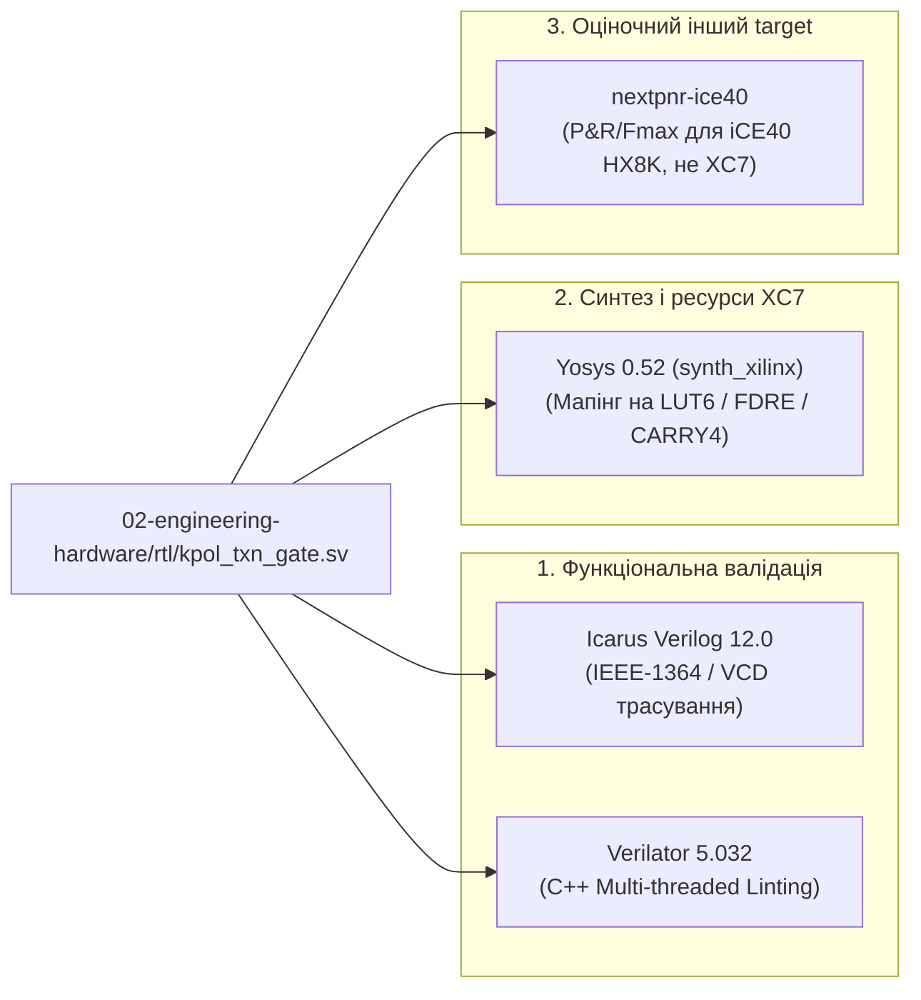

# Відкрита верифікація, XC7-мапінг та iCE40 proxy timing для Машини Кузьміна

* **Версія:** 0.1.0
* **Перенесено з:** `drafts/KuzminMachine/02-engineering-hardware/Kuzmin-Machine-Open-Source-Verification-and-Synthesis-Runbook-UA.md` @ `a4738bc` (2026-11-09)

> [!IMPORTANT]
> **Межі регламенту:** Icarus Verilog та Verilator перевіряють RTL; Yosys виконує логічне відображення на примітиви XC7; окремий крок Yosys `synth_ice40` + `nextpnr-ice40` оцінює розміщення й частоту для Lattice iCE40 HX8K. Останній результат **не є STA для XC7Z020 або вимірюванням на PYNQ-Z1**. Цей цикл не створює XC7 `.bit`/`.hwh` і не замінює target-specific P&R та HIL.

---

## Зміст

1. [Архітектура відкритого інструментального стека](#1-архітектура-відкритого-інструментального-стека)
2. [Покроковий регламент виконання відкритого циклу](#2-покроковий-регламент-виконання-відкритого-циклу)
   * 2.1. [Крок 1: Потактова симуляція Verilog (Icarus Verilog)](#21-крок-1-потактова-симуляція-verilog-icarus-verilog)
   * 2.2. [Крок 2: Статичний лінтинг SystemVerilog (Verilator)](#22-крок-2-статичний-лінтинг-systemverilog-verilator)
   * 2.3. [Крок 3: Верифікація AXI4-Lite прототипу для PYNQ](#23-крок-3-верифікація-axi4-lite-прототипу-для-pynq)
   * 2.4. [Крок 4: Логічний синтез під Xilinx 7-Series (Yosys synth_xilinx)](#24-крок-4-логічний-синтез-під-xilinx-7-series-yosys-synth_xilinx)
   * 2.5. [Крок 5: Оціночний P&R/Fmax для iCE40, не XC7](#25-крок-5-оціночний-prfmax-для-ice40-не-xc7)
3. [Автоматизований запуск (One-Liner та bash-скрипт)](#3-автоматизований-запуск-one-liner-та-bash-скрипт)
4. [Фактичні результати вимірювань для Машини Кузьміна](#4-фактичні-результати-вимірювань-для-машини-кузьміна)
5. [Взаємодія з фізичною платою PYNQ-Z1 через Linux та SSH](#5-взаємодія-з-фізичною-платою-pynq-z1-через-linux-та-ssh)
6. [Чіткі межі відкритого циклу (Що доведено, а що очікує бітстріму)](#6-чіткі-межі-відкритого-циклу-що-доведено-а-що-очікує-бітстріму)

---

## 1. Архітектура відкритого інструментального стека

Цей регламент поєднує ранню RTL-перевірку, XC7 technology mapping та окрему експериментальну оцінку на iCE40. Повна цільова архітектура відкритого стека для Xilinx Zynq-7000 (XC7Z020) без пропрієтарного Vivado деталізована у спеціальному документі: [Kuzmin-Machine-Open-Source-XC7-Toolchain-Architecture-UA.md](../docs/toolchain/xc7.md) (поєднання `openXC7`, `GenZ` та `openFPGALoader`).

Поточний локальний стенд швидкої перевірки використовує відкриті інструменти, але ще не реалізує повний target-specific flow для PYNQ-Z1:



* **Icarus Verilog (`iverilog`)**: потактова симуляція поведінки шин та формування часових діаграм VCD.
* **Verilator**: статична перевірка RTL; результат lint не є функціональним чи фізичним тестом.
* **Yosys (`synth_xilinx`)**: логічний синтез і technology mapping на примітиви Xilinx 7-ї серії; це не place-and-route і не генерація `.bit`.
* **nextpnr-ice40**: P&R та оцінка частоти для іншої мікросхеми — Lattice iCE40 HX8K. Результати не переносяться на XC7Z020.

---

## 2. Покроковий регламент виконання відкритого циклу

Команди нижче виконуються з каталогу `KuzminMachine/`. Скрипт із розділу 3 сам переходить до свого каталогу й може бути запущений з іншого місця.

### 2.1. Крок 1: Потактова симуляція Verilog (Icarus Verilog)
Перевіряє поведінку однословного транзакційного шлюзу при валідних інваріантах, некоректних даних та зовнішніх завадах (`Hazard`):

```bash
iverilog -g2012 -Wall -s kpol_txn_gate_tb -o /tmp/kpol_txn_gate_tb.vvp \
  02-engineering-hardware/rtl/kpol_txn_gate.sv \
  02-engineering-hardware/tb/kpol_txn_gate_tb.sv
vvp /tmp/kpol_txn_gate_tb.vvp
```
* **Результат:** визначені у цьому тестбенчі випадки завершилися з `PASS: KPOL single-event transaction gate`.

---

### 2.2. Крок 2: Статичний лінтинг SystemVerilog (Verilator)
Перевіряє якість коду за стандартом SystemVerilog:

```bash
verilator --lint-only -Wall --top-module kpol_txn_gate \
  02-engineering-hardware/rtl/kpol_txn_gate.sv
```
* **Очікуваний результат:** Відсутність будь-яких помилок компіляції (`0 errors, 0 warnings`).

---

### 2.3. Крок 3: Верифікація AXI4-Lite прототипу для PYNQ
Перевіряє сумісність транзакційного шлюзу з шиною пам'яті процесора ARM Cortex-A9:

```bash
iverilog -g2012 -Wall -s kpol_txn_gate_axi_lite_tb -o /tmp/kpol_axi_tb.vvp \
  02-engineering-hardware/rtl/kpol_txn_gate.sv \
  02-engineering-hardware/rtl/kpol_txn_gate_axi_lite.sv \
  02-engineering-hardware/tb/kpol_txn_gate_axi_lite_tb.sv
vvp /tmp/kpol_axi_tb.vvp
verilator --lint-only -Wall --top-module kpol_txn_gate_axi_lite \
  02-engineering-hardware/rtl/kpol_txn_gate.sv \
  02-engineering-hardware/rtl/kpol_txn_gate_axi_lite.sv
```
* **Очікуваний результат:** `PASS: KPOL AXI4-Lite register interface and transaction gate`.

---

### 2.4. Крок 4: Логічний синтез під Xilinx 7-Series (Yosys `synth_xilinx`)
*Окремий XC7 mapping RTL МК. Це відрізняється від `MEMO-068` у `~/vida`, де EVM scripts використовують `synth_ice40`.*
Команда виконує розбір Verilog-коду, перетворення скінченного автомата та технологічний мапінг на апаратні блоки чіпа Xilinx Zynq-7000 (XC7Z020):

```bash
yosys -q -p "read_verilog -sv 02-engineering-hardware/rtl/kpol_txn_gate.sv; hierarchy -top kpol_txn_gate; synth_xilinx -top kpol_txn_gate; stat"
```

* **Фактичний звіт ресурсів:**
  - `BUFG`: 1 (тактовий буфер)
  - `FDCE`: 39 (тригери D-типу з асинхронним скиданням)
  - `LUT6`: 10 (6-входові таблиці пошуку Xilinx)
  - `LUT2..LUT4`: 21 (допоміжні логічні вентилі)
  - `MUXF7 / MUXF8`: 3 (мультиплексори шин)
  - **Оцінка площі:** Лише **21 логічна комірка (Estimated LCs: 21)**.
  - **Контроль цілісності:** `Check module kpol_txn_gate: Found and reported 0 problems`.

---

### 2.5. Крок 5: Оціночний P&R/Fmax для iCE40, не XC7
*Це окремий запуск для Lattice iCE40, а не STA Машини Кузьміна на PYNQ-Z1.*
Команда синтезує RTL під iCE40 HX8K і запускає nextpnr для цієї цілі. `--freq 100` задає target frequency цього запуску, а не підтверджує вимогу для PYNQ-Z1:

```bash
yosys -q -p "read_verilog -sv 02-engineering-hardware/rtl/kpol_txn_gate.sv; hierarchy -top kpol_txn_gate; synth_ice40 -top kpol_txn_gate -json /tmp/gate_ice40.json"
nextpnr-ice40 --hx8k --package ct256 --json /tmp/gate_ice40.json --freq 100 --log /tmp/nextpnr_sta.log -q
grep "Max frequency" /tmp/nextpnr_sta.log | tail -2
```

* **Результат цього запуску для iCE40:**
  ```text
  Info: Max frequency for clock 'clk_i$SB_IO_IN_$glb_clk': 182.55 MHz (PASS at 100.00 MHz)
  Info: Max frequency for clock 'clk_i$SB_IO_IN_$glb_clk': 202.92 MHz (PASS at 100.00 MHz)
  ```
  Лог цього запуску містить два рядки `Max frequency`; обидва стосуються iCE40 HX8K. PCF-файл не задано, тож nextpnr попереджає про автоматичне розміщення I/O.

Ці числа не є Fmax для XC7Z020. Обернена частота — це період модельованого такту, а не затримка поширення оператора `•` чи виміряний час реакції МК. Для таймінг-висновків щодо PYNQ потрібні target-specific XC7 P&R, обмеження такту й інтерфейсів та відповідний timing report.

---

## 3. Автоматизований запуск (One-Liner та bash-скрипт)

У репозиторії створено скрипт автоматизації: [`run_open_flow.sh`](scripts/run_open_flow.sh).

Для запуску п'яти перевірок та оцінок, описаних вище, однією командою:

```bash
./02-engineering-hardware/run_open_flow.sh
```

Або через єдиний One-Liner у терміналі. Його завершальний `nextpnr-ice40` крок також стосується лише iCE40, а не XC7Z020:

```bash
iverilog -g2012 -Wall -s kpol_txn_gate_tb -o /tmp/gate_sim 02-engineering-hardware/rtl/kpol_txn_gate.sv 02-engineering-hardware/tb/kpol_txn_gate_tb.sv && vvp /tmp/gate_sim && verilator --lint-only -Wall --top-module kpol_txn_gate 02-engineering-hardware/rtl/kpol_txn_gate.sv && yosys -q -p "read_verilog -sv 02-engineering-hardware/rtl/kpol_txn_gate.sv; hierarchy -top kpol_txn_gate; synth_xilinx -top kpol_txn_gate; stat" && yosys -q -p "read_verilog -sv 02-engineering-hardware/rtl/kpol_txn_gate.sv; synth_ice40 -top kpol_txn_gate -json /tmp/gate.json" && nextpnr-ice40 --hx8k --json /tmp/gate.json --freq 100 -q --log /tmp/nextpnr.log && grep "Max frequency" /tmp/nextpnr.log
```

---

## 4. Результати інструментів для RTL-зрізу

| Перевірка | Результат | Межі висновку |
| :--- | :--- | :--- |
| Icarus Verilog testbenches | Обидва визначені testbench завершилися з `PASS` | Симуляція RTL, не фізичний тест |
| Verilator lint | 0 помилок і попереджень у прогнаних командах | Статичний lint лише для вказаних top-level |
| Yosys `synth_xilinx` mapping | Оцінка 21 LC; `check` знайшов 0 проблем | XC7 primitive mapping, не фінальний utilization/P&R report |
| Yosys `synth_ice40` + `nextpnr-ice40` | 182.55 та 202.92 MHz у звіті запуску | Оцінки для iCE40 HX8K, не для Zynq/XC7 |
| PYNQ-Z1 bitstream, STA та вимірювання реакції | Не виконувалися | Немає custom `.bit`/`.hwh` і HIL-доказу |

---

## 5. Взаємодія з фізичною платою PYNQ-Z1 через Linux та SSH

Фізична плата **PYNQ-Z1 (`pynq2`)** доступна по локальній мережі (`192.168.2.99` або через шлюз Jetson J501).

Для перевірки статусу плати без Vivado:

```bash
# 1. Перевірка ядра Linux на платі PYNQ
ssh xilinx@pynq2 "uname -a; cat /sys/class/fpga_manager/fpga0/state"

# 2. Зчитування температури кристала та напруги ядра через системні датчики XADC:
ssh xilinx@pynq2 "cat /sys/bus/iio/devices/iio:device0/in_temp0_raw"
```

---

## 6. Чіткі межі відкритого циклу (Що доведено, а що очікує бітстріму)

* **Що підтверджено на рівні RTL та інструментів:**
  - Пройшли зазначені RTL testbenches і Verilator lint.
  - Yosys успішно виконав логічне відображення RTL на XC7-примітиви; це не доводить розміщення на конкретному FPGA.
  - nextpnr побудував timing estimate для окремої цілі iCE40 HX8K.
* **Що не доведено:**
  - XC7Z020 P&R/STA, відповідність частотним вимогам PYNQ-Z1, затримка фізичної реакції, custom `.bit`/`.hwh` або запуск на платі.
* **Наступний target-specific етап:**
  - Зібрати цільовий бітстрім через відкритий потік `openXC7` (`nextpnr-xilinx` із chipdb `xc7z020`) або Vivado, як описано в [Kuzmin-Machine-Open-Source-XC7-Toolchain-Architecture-UA.md](../docs/toolchain/xc7.md).
  - Завантажити згенерований образ у фізичну матрицю PYNQ-Z1 за допомогою `openFPGALoader -b pynq_z1` або через Linux FPGA Manager (`/sys/class/fpga_manager/fpga0/firmware`), і провести повноцінний HIL бенчмарк безпосередньо в кремнії.
