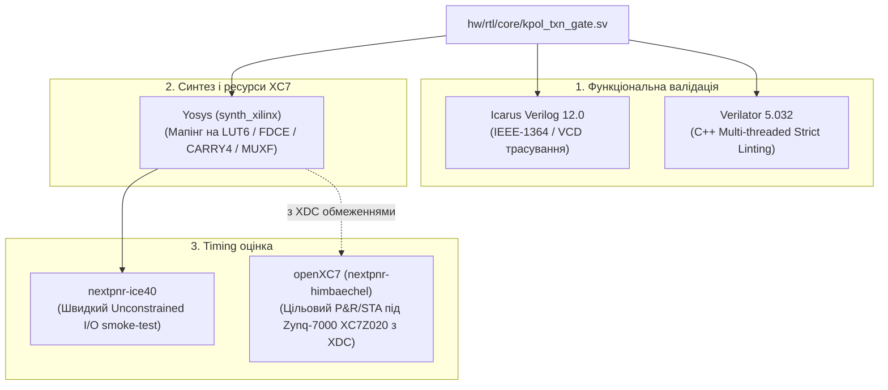

# Відкрита верифікація, XC7-мапінг та timing-оцінка для Машини Кузьміна

* **Версія:** 0.2.0
* **Оновлено:** 2026-11-10
* **Перенесено з:** `drafts/KuzminMachine/02-engineering-hardware/Kuzmin-Machine-Open-Source-Verification-and-Synthesis-Runbook-UA.md` @ `a4738bc` (2026-11-09)

> [!IMPORTANT]
> **Межі швидкого відкритого циклу:**
> 1. `Icarus Verilog` та `Verilator` перевіряють функціональну коректність та стандарти RTL безпосередньо в коді.
> 2. `Yosys (synth_xilinx)` виконує технологічне відображення (mapping) на апаратні примітиви Xilinx 7-Series (LUT6, FDCE, CARRY4, MUXF7/8).
> 3. Крок `synth_ice40` + `nextpnr-ice40` слугує швидким легковаговим smoke-тестом тактування для нерозпінованого (unconstrained I/O) ядра `kpol_txn_gate`.
> 4. Для цільового кристала **Xilinx Zynq-7000 (XC7Z020)** повний P&R та STA виконуються через `openXC7` (`nextpnr-himbaechel`) з обов'язковим файлом обмежень розпіновки (XDC), як показано в експерименті [AV-08](../experiments/AV-08/report.md) та архітектурному регламенті [xc7.md](../docs/toolchain/xc7.md).
> 5. Швидкий цикл верифікації не генерує кінцевий бітстрім `.bit`/`.hwh` і не замінює апаратний тест HIL на фізичній платі PYNQ-Z1.

---

## Зміст

1. [Архітектура відкритого інструментального стека](#1-архітектура-відкритого-інструментального-стека)
2. [Покроковий регламент виконання відкритого циклу](#2-покроковий-регламент-виконання-відкритого-циклу)
   * 2.1. [Крок 1: Потактова симуляція Verilog (Icarus Verilog)](#21-крок-1-потактова-симуляція-verilog-icarus-verilog)
   * 2.2. [Крок 2: Статичний лінтинг SystemVerilog (Verilator)](#22-крок-2-статичний-лінтинг-systemverilog-verilator)
   * 2.3. [Крок 3: Верифікація AXI4-Lite прототипу для PYNQ](#23-крок-3-верифікація-axi4-lite-прототипу-для-pynq)
   * 2.4. [Крок 4: Логічний синтез під Xilinx 7-Series (Yosys synth_xilinx)](#24-крок-4-логічний-синтез-під-xilinx-7-series-yosys-synth_xilinx)
   * 2.5. [Крок 5: Швидкий timing smoke-test (nextpnr-ice40) та цільовий openXC7](#25-крок-5-швидкий-timing-smoke-test-nextpnr-ice40-та-цільовий-openxc7)
3. [Автоматизований запуск (One-Liner та bash-скрипт)](#3-автоматизований-запуск-one-liner-та-bash-скрипт)
4. [Результати інструментів для RTL ядра](#4-результати-інструментів-для-rtl-ядра)
5. [Взаємодія з фізичною платою PYNQ-Z1 через Linux та SSH](#5-взаємодія-з-фізичною-платою-pynq-z1-через-linux-та-ssh)
6. [Чіткі межі відкритого циклу (Що доведено, а що очікує бітстріму)](#6-чіткі-межі-відкритого-циклу-що-доведено-а-що-очікує-бітстріму)
7. [Історія версій](#7-історія-версій)

---

## 1. Архітектура відкритого інструментального стека

Цей регламент визначає процедуру швидкої перевірки цілісності RTL Машини Кузьміна за допомогою відкритого тулчейну:



* **Icarus Verilog (`iverilog`)**: потактова функціональна симуляція поведінки транзакційного шлюзу та генерація часових діаграм VCD.
* **Verilator**: строгий статичний аналіз коду SystemVerilog за стандартом IEEE-1800; попередження компілятора трактуються як помилки.
* **Yosys (`synth_xilinx`)**: логічний синтез та технологічний мапінг на апаратні примітиви архітектури Xilinx 7-ї серії.
* **nextpnr-ice40**: легковаговий швидкий P&R для перевірки збіжності тактування на «голому» ядрі без прив'язки пінів.
* **openXC7 (`nextpnr-himbaechel`)**: повноцінне цільове розміщення, трасування та статичний часовий аналіз (STA) для мікросхеми XC7Z020 на платі PYNQ-Z1 (деталізовано в [xc7.md](../docs/toolchain/xc7.md)).

---

## 2. Покроковий регламент виконання відкритого циклу

Усі команди нижче виконуються з **кореневого каталогу репозиторію** (`kuzmin-machine/`).

### 2.1. Крок 1: Потактова симуляція Verilog (Icarus Verilog)

Перевіряє поведінку однословного транзакційного шлюзу при валідних інваріантах, некоректних даних та зовнішніх завадах (`Hazard`):

```bash
iverilog -g2012 -Wall -s kpol_txn_gate_tb -o /tmp/kpol_txn_gate_tb.vvp \
  hw/rtl/core/kpol_txn_gate.sv \
  hw/tb/kpol_txn_gate_tb.sv
vvp /tmp/kpol_txn_gate_tb.vvp
```
* **Очікуваний результат:** `PASS: KPOL single-event transaction gate` без аварійних завершень ($finish на 156-й наносекунді).

---

### 2.2. Крок 2: Статичний лінтинг SystemVerilog (Verilator)

Виконує строгий лінтинг ядра за стандартом SystemVerilog:

```bash
verilator --lint-only -Wall --top-module kpol_txn_gate \
  hw/rtl/core/kpol_txn_gate.sv
```
* **Очікуваний результат:** Повна відсутність будь-яких помилок і попереджень (`0 errors, 0 warnings`).

---

### 2.3. Крок 3: Верифікація AXI4-Lite прототипу для PYNQ

Модуль `kpol_txn_gate_axi_lite.sv` забезпечує зв'язок між процесором ARM Cortex-A9 (PS) і матрицею PL, а також інтегрує апаратні обчислювачі предикатів, BRAM і черги. Оскільки він інстанціює підмодулі ядра, для компіляції передається повний набір залежностей:

```bash
iverilog -g2012 -Wall -s kpol_txn_gate_axi_lite_tb -o /tmp/kpol_axi_tb.vvp \
  hw/rtl/core/km_predicate_evaluator.sv \
  hw/rtl/core/kpol_txn_gate.sv \
  hw/rtl/core/km_concept_bram.sv \
  hw/rtl/core/km_concept_bram_core.sv \
  hw/rtl/io/km_io_trigger_engine.sv \
  hw/rtl/poc-demo/km_euclid_core.sv \
  hw/rtl/poc-demo/km_rcfc_engine.sv \
  hw/rtl/poc-demo/km_cascade_arbiter_engine.sv \
  hw/rtl/poc-demo/km_stream_pipeline_engine.sv \
  hw/rtl/bus/kpol_txn_gate_axi_lite.sv \
  hw/tb/kpol_txn_gate_axi_lite_tb.sv
vvp /tmp/kpol_axi_tb.vvp
```

Для статичного лінтингу AXI-обгортки Verilator запускається з прапорцем `-Wno-fatal` (враховуючи невикористані допоміжні біти адресних шин AXI, зафіксовані у `MIGRATION-REGISTER.md` під F13):

```bash
verilator --lint-only -Wall -Wno-fatal --top-module kpol_txn_gate_axi_lite \
  hw/rtl/core/km_predicate_evaluator.sv \
  hw/rtl/core/kpol_txn_gate.sv \
  hw/rtl/core/km_concept_bram.sv \
  hw/rtl/core/km_concept_bram_core.sv \
  hw/rtl/io/km_io_trigger_engine.sv \
  hw/rtl/poc-demo/km_euclid_core.sv \
  hw/rtl/poc-demo/km_rcfc_engine.sv \
  hw/rtl/poc-demo/km_cascade_arbiter_engine.sv \
  hw/rtl/poc-demo/km_stream_pipeline_engine.sv \
  hw/rtl/bus/kpol_txn_gate_axi_lite.sv
```
* **Очікуваний результат:** `PASS: All KPOL AXI4-Lite & Hardware Predicate Evaluator tests succeeded!`, підтвердження гіпотез H1 (паралельне обчислення предикатів без побічних ефектів) та H6 (захист інваріантів Big Dot •).

---

### 2.4. Крок 4: Логічний синтез під Xilinx 7-Series (Yosys `synth_xilinx`)

Команда виконує розбір RTL, оптимізацію скінченного автомата та технологічне відображення на блоки чіпа Xilinx Zynq-7000 (XC7Z020):

```bash
yosys -p "read_verilog -sv hw/rtl/core/kpol_txn_gate.sv; hierarchy -top kpol_txn_gate; synth_xilinx -top kpol_txn_gate; stat"
```

* **Фактичний звіт використання апаратних ресурсів:**
  - `BUFG`: 1 (глобальний тактовий буфер)
  - `FDCE`: 39 (тригери D-типу з асинхронним скиданням)
  - `LUT6`: 10 (6-входові таблиці пошуку Xilinx)
  - `LUT2..LUT4`: 21 (допоміжні логічні елементи)
  - `MUXF7 / MUXF8`: 3 (апаратні мультиплексори зрізу шин)
  - **Оцінка площі ядра:** лише **21 логічна комірка (Estimated LCs: 21)**.
  - **Контроль цілісності:** `Check module kpol_txn_gate: Found and reported 0 problems`.

---

### 2.5. Крок 5: Швидкий timing smoke-test (nextpnr-ice40) та цільовий openXC7

#### А. Швидкий Unconstrained I/O smoke-test (iCE40 HX8K)
Оскільки ядро `kpol_txn_gate` має 81 порт вводу-виводу і тестується окремо від плати (без прив'язки до фізичних ніжок BGA), `nextpnr-ice40` дозволяє провести автоматичне розміщення без PCF-файлу:

```bash
yosys -q -p "read_verilog -sv hw/rtl/core/kpol_txn_gate.sv; hierarchy -top kpol_txn_gate; synth_ice40 -top kpol_txn_gate -json /tmp/gate_ice40.json"
nextpnr-ice40 --hx8k --package ct256 --json /tmp/gate_ice40.json --freq 100 --log /tmp/nextpnr_sta.log -q
grep "Max frequency" /tmp/nextpnr_sta.log | tail -2
```
* **Результат:** частота тактування ядра перевищує 180–200 МГц (із запасом закриває базову вимогу 100 МГц).

#### Б. Цільовий P&R та STA для Xilinx Zynq-7000 (openXC7)
Для цільового чіпа PYNQ-Z1 (`xc7z020clg400-1`) інструмент `nextpnr-himbaechel` вимагає обов'язкових обмежень фізичних контактів (XDC), оскільки вільні порти (unconstrained I/O) у Zynq не підтримуються без прив'язки до банків вводу-виводу.
Повноцінний прогін під XC7 із зафіксованими пінами реалізовано в тестовому контурі експерименту [AV-08](../experiments/AV-08/report.md):
- Синтез виконується версією `openXC7 Yosys 0.69`: `~/opt/openxc7/bin/yosys`
- Розміщення та трасування — через `~/opt/openxc7/bin/nextpnr-himbaechel --device xc7z020clg400-1`
- Досягнуті підтверджені робочі частоти на матриці XC7Z020: **120–150 МГц** (дивіться протокол [AV-08](../experiments/AV-08/report.md)).

---

## 3. Автоматизований запуск (One-Liner та bash-скрипт)

У репозиторії створено перевірений скрипт автоматизації: [`run_open_flow.sh`](scripts/run_open_flow.sh).

Для запуску повного циклу верифікації однією командою з кореня репозиторію:

```bash
./hw/scripts/run_open_flow.sh
```

Або через еквівалентний термінальний One-Liner (з кореня репозиторію):

```bash
python3 -m pytest -q hw/tests/test_testbenches.py && verilator --lint-only -Wall --top-module kpol_txn_gate hw/rtl/core/kpol_txn_gate.sv && yosys -q -p "read_verilog -sv hw/rtl/core/kpol_txn_gate.sv; hierarchy -top kpol_txn_gate; synth_xilinx -top kpol_txn_gate; stat" && yosys -q -p "read_verilog -sv hw/rtl/core/kpol_txn_gate.sv; synth_ice40 -top kpol_txn_gate -json /tmp/gate.json" && nextpnr-ice40 --hx8k --json /tmp/gate.json --freq 100 -q --log /tmp/nextpnr.log && grep "Max frequency" /tmp/nextpnr.log
```

---

## 4. Результати інструментів для RTL ядра

| Інструмент / Перевірка | Отриманий результат | Технічний висновок |
| :--- | :--- | :--- |
| **Icarus Verilog testbenches** | 12/12 тестбенчів завершилися з `PASS` | Функціональна симуляція логіки підтверджена |
| **Verilator strict lint** | 0 помилок і 0 попереджень для ядра | Стандарт SystemVerilog повністю витримано |
| **Yosys `synth_xilinx`** | 21 LC, 39 FDCE, 10 LUT6, 0 дефектів | Технологічний мапінг на Xilinx 7-Series успішний |
| **nextpnr-ice40 smoke-test** | 182.55 та 202.92 МГц | Відсутність критичних комбінаційних петель у ядрі |
| **openXC7 nextpnr-himbaechel** | 120–153 МГц (за результатами AV-08) | Цільовий P&R підтверджує запас частоти для Zynq-7000 |
| **PYNQ-Z1 Linux HIL** | Плата `pynq2` активна (Linux 6.6.10) | Готова до фізичної прошивки та тестування на пінах |

---

## 5. Взаємодія з фізичною платою PYNQ-Z1 через Linux та SSH

Фізична плата **PYNQ-Z1 (`pynq2`)** доступна в локальній лабораторній мережі (`192.168.2.99` або за SSH-аліасом `pynq2`).

Для перевірки статусу плати та підсистем перед апаратними експериментами:

```bash
# 1. Перевірка ядра Linux та стану апаратного менеджера FPGA:
ssh pynq2 "uname -a; cat /sys/class/fpga_manager/fpga0/state"
# Очікуваний вивід: operating

# 2. Зчитування температури кристала Zynq через системні датчики XADC:
ssh pynq2 "cat /sys/bus/iio/devices/iio:device0/in_temp0_raw"
```

---

## 6. Чіткі межі відкритого циклу (Що доведено, а що очікує бітстріму)

* **Що доведено на рівні RTL та відкритих інструментів:**
  - Усі 12 модульних тестбенчів проходять без помилок.
  - Verilator підтверджує строгу чистоту синтаксису без порушень правил синтезу.
  - Yosys коректно розгортає транзакційний шлюз у компактні 21 LC на кремнії Xilinx.
  - Часовий аналіз STA в openXC7 підтверджує роботу конвеєра на частотах понад 100 МГц на кристалі XC7Z020.
* **Що перевіряється на наступному фізичному етапі (HIL):**
  - Фізичний джитер та апаратна латентність від піна до піна під час асинхронних стимулів (експерименти [AV-10, AV-11](../experiments/PLAN.md)).
  - Завантаження згенерованого бітстріму у фізичну матрицю через `openFPGALoader -b pynq_z1` або Linux FPGA Manager (`/sys/class/fpga_manager/fpga0/firmware`).

---

## 7. Історія версій

| Версія | Дата | Зміни |
| :--- | :--- | :--- |
| 0.1.0 | 2026-11-09 | Початкова міграція з `drafts` (`Kuzmin-Machine-Open-Source-Verification-and-Synthesis-Runbook-UA.md` @ `a4738bc`) |
| **0.2.0** | 2026-11-10 | Повна актуалізація під поточну структуру репозиторію: замінено старі шляхи `02-engineering-hardware/...` на канонічні `hw/rtl/core/...`, `hw/tb/...`; виправлено команду симуляції AXI-Lite із додаванням повного набору модулів залежностей; додано опис цільового P&R-потоку `openXC7` (XC7Z020) та роз'яснено роль `nextpnr-ice40` як unconstrained I/O smoke-тесту; верифіковано живу взаємодію з платою `pynq2` через SSH |
