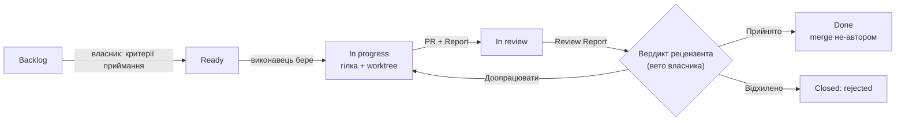
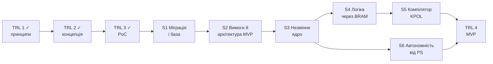

# Машина Кузьміна — Настанова проєкту (Project Manual / Project Plan)

* **Версія:** 0.5.0 (чернетка; затверджує власник)
* **Дата:** 2026-11-09
* **Власник проєкту:** Микола Федчик
* **Репозиторій:** `nick-fedchik/kuzmin-machine` (приватний)
* **Пов'язані документи:** [AGENTS.md](../AGENTS.md) — правила для агентів; [audit/ASPICE-Audit-Method.md](audit/ASPICE-Audit-Method.md) — методика незалежного аудиту; [MIGRATION-REGISTER.md](MIGRATION-REGISTER.md) — що й чому перенесено з PoC; [trl/TRL-passport.md](trl/TRL-passport.md) — докази рівнів TRL.

---

## 1. Мета й межі

**Мета:** розробити й перевірити апаратно-програмні компоненти Машини Кузьміна (МК): RTL-ядро на FPGA, мову KPOL та її еталонну реалізацію, засоби верифікації. Кожне твердження має спиратися на відтворювані докази.

**Входить у проєкт:** вимоги, архітектура, код HW/SW, верифікація, експерименти AV-xx/EXP-xx, звіти й рецензії, оцінювання TRL.

**Не входить:** публікації, статті, бізнес-модель, наукова опозиція — вони в `drafts/KuzminMachine`. Відповідність стандартам безпеки не заявляється (див. [standards-position.md](standards-position.md)).

**Поточний стан:** TRL 3 (PoC) за самооцінкою, див. [паспорт TRL](trl/TRL-passport.md). Незалежним аудитом не підтверджено.

**Мета MVP (TRL 4)** — прийнято власником 2026-11-09: рефакторинг у три кроки та усунення п'яти прогалин PoC ([план](../architecture/refactoring-plan.md)):
1. незмінне апаратне ядро;
2. взаємодія концептів без FSM, жорстко закодованих у RTL;
3. справжній компілятор KPOL.

**Автор концепції** — Михайло Ювеналійович Кузьмін (М. Ю. Кузьмін). Первинні джерела — у [docs/sources/](../docs/sources/README.md). Решта документів — похідні.

## 2. Ролі

| Роль | Хто | Повноваження | Чого не робить |
| :--- | :--- | :--- | :--- |
| **Власник** | Микола Федчик | Ставить задачі, переводить Issue в `Ready`, приймає або відхиляє результати, вирішує зовнішні дії, має право вето на будь-яке злиття і будь-який тег | — |
| **Lead Engineer** | агент, призначений власником (з 2026-11-09 — GitHub Copilot CLI) | Розподіляє Issues між виконавцями й пише для них постановки; ставить теги `vX.Y.Z` за §7.1 | Не зливає PR; не рецензує власну роботу; не змінює дати віх і критерії приймання без власника |
| **Учасник з правом запису** | людина, призначена власником | Зливає PR у `main` за правилом п. 3.4 | Не зливає власних PR |
| **Виконавець** | агент або людина | Виконує одну Issue: гілка, код, звіт (Report), PR | Не рецензує й не зливає власну роботу; не змінює межі задачі |
| **Рецензент** | інший агент (бажано іншої моделі) або людина | Пише Review Report на один Report або PR: вердикт і знахідки | Не виправляє код автора в тому ж PR; не рецензує свою роботу |
| **Аудитор** | незалежний агент у чистій сесії | Періодичний аудит за ASPICE і TRL за [методикою](audit/ASPICE-Audit-Method.md) | Не бере участі в розробці об'єкта аудиту |

Рецензенти-агенти незалежні лише від автора документа. Злиття виконує не-автор (п. 3.4); власник-людина має право вето і остаточне слово у спорах.

### 2.1. Агенти проєкту

| Агент | Файл інструкцій, який читає | Модель |
| :--- | :--- | :--- |
| GitHub Copilot CLI (Lead Engineer) | `AGENTS.md` | змінна (обирає користувач; зараз Claude Opus) |
| Claude Code | `CLAUDE.md` → `AGENTS.md` | Claude |
| Gemini CLI | `GEMINI.md` → `AGENTS.md` | Gemini |
| OpenCode | `AGENTS.md` | змінна (задає конфігурація) |

**Незалежність визначає модель, а не інструмент.** Copilot з моделлю Claude і Claude Code — одна родина моделей. Тож рецензент має бути з **іншої родини моделей**, ніж автор: на роботу Claude — Gemini, на роботу Gemini — Claude. OpenCode та Copilot підходять, якщо в них обрано модель іншої родини. Тому в шапці кожного Report і Review Report вказують і агента, і модель. Аудитор за [методикою](audit/ASPICE-Audit-Method.md) — теж модель іншої родини, ніж автори об'єкта аудиту, і в чистій сесії.

## 3. Робочий процес (workflow)



Правила:

1. **Одна Issue — одна гілка — один PR.** Схема гілок прив'язана до Issue:

   ```mermaid
   gitGraph
       commit id: "main"
       branch feat/14-gate-core
       commit id: "feat: #14 ..."
       commit id: "test: #14 ..."
       checkout main
       branch exp/12-av07-rerun
       commit id: "exp: #12 ..."
       checkout main
       merge feat/14-gate-core id: "PR Closes #14"
       merge exp/12-av07-rerun id: "PR Closes #12"
   ```

   - **Ім'я гілки:** `<тип>/<номер-issue>-<коротко-латиницею>`, наприклад `exp/12-av07-mutation-rework`.
     Типи: `feat` (код), `fix` (виправлення), `exp` (експеримент AV-xx), `spec` (специфікація чи вимоги), `docs`, `review` (Review Report), `audit` (звіт аудиту), `chore` (структура, CI).
     Гілку без номера Issue не створюють.
   - **Створення гілки:** `gh issue develop <N> --name <тип>/<N>-<опис> --base main` (зв'язує гілку з Issue) або `git worktree add … -b <тип>/<N>-<опис> origin/main`.
   - **Коміти** містять `#<N>` у заголовку або тілі.
   - **PR:** заголовок `<тип>: <опис> (#<N>)`, у тілі `Closes #<N>`. Review Report — окремий PR з гілки `review/<N>-…` або комітом рецензента в той самий PR, лише у файлі `review.md`.
   - **Злиття** — squash merge. Гілку видаляють після злиття. Довгоживучих гілок, окрім `main`, немає.
2. **Готовність до виконання (Definition of Ready):** Issue має мету, межі, критерії приймання (кількісні або булеві), посилання на вимоги `REQ-*` або гіпотези `H*`, а також мітку власника `ready`.
3. **Виконано (Definition of Done):**
   - CI зелений;
   - Report має шапку, версію, джерела даних і обмеження;
   - є Review Report з вердиктом «Прийнято»;
   - усі суттєві знахідки закриті або винесені в окремі Issues;
   - трасування оновлено;
   - PR злив учасник, який не є його автором.
4. **У `main` — лише через PR. Зливає будь-хто, крім автора PR**, за таких умов:
   - CI зелений;
   - є Review Report з вердиктом «Прийнято» від рецензента, який не є автором;
   - на PR є approve на GitHub від не-автора;
   - власник не наклав вето (мітка `blocked` або коментар).

   Агент зливає лише за явною командою людини (див. [AGENTS.md](../AGENTS.md) §1). Теги ставить Lead Engineer за §7.1.
   Якщо план GitHub дозволяє, правило закріплюють захистом гілки: обов'язковий PR, 1 approve, заборона approve від останнього автора push, обов'язковий CI. Інакше правило діє через цей документ і AGENTS.md.

   **Конфігурація з одним обліковим записом GitHub** (діє, поки в репозиторії лише @nick-fedchik). Усі агенти працюють під цим обліковим записом, тож формально автор кожного PR — власник, і GitHub не дає йому approve. Тому:
   - **автор PR** — це виконавець (агент і модель), зазначений у Report або в тілі PR, а не обліковий запис GitHub;
   - умову «approve на GitHub від не-автора» замінює **Review Report із вердиктом «Прийнято»** від рецензента іншої родини моделей (§2.1): файл `review.md` за [шаблоном](templates/review.md) у PR або коментар у PR з тими самими полями (агент, модель, версія, вердикт, знахідки);
   - **зливає власник** (squash merge) після перевірки решти умов цього пункту.

   Правило втрачає силу, щойно з'являється другий обліковий запис з правом запису: тоді діє approve на GitHub.
5. **Зовнішні й незворотні дії** виконуються лише за явною командою власника: створення чи видалення репозиторіїв, force-push, зміна видимості, публікація, витрати.
6. **Єдиний виняток з п. 4:** стартовий коміт порожнього репозиторію (`README.md`, `.gitignore`) іде прямо в `main`, бо PR без базової гілки неможливий. Зроблено один раз, 2026-11-09.

## 4. Віхи TRL і маршрут до MVP

Шкала — ISO 16290:2013. Віхи TRL — головні рубежі. Між ними — проміжні кроки S1…S6 з атрибутами ASPICE. Кожен рубіж і крок — GitHub milestone з батьківською Issue; у Project — поле «TRL-рубіж».



✓ — самооцінка за [паспортом TRL](trl/TRL-passport.md). Віхи TRL 1–3 закриваються лише після Review Report на паспорт і аудиту.

| Віха | Процеси ASPICE | Критерій виходу | Прогалина PoC | Ціль (орієнтовно) |
| :--- | :--- | :--- | :--- | :--- |
| **TRL 1** | — | Первинні джерела автора збережено; похідні позначено ([паспорт §1](trl/TRL-passport.md#1-trl-1--базові-принципи-спостережено-й-описано)) | — | ретроспективно |
| **TRL 2** | — | Концепцію й застосування сформульовано; є незалежна критика ([паспорт §2](trl/TRL-passport.md#2-trl-2--сформульовано-концепцію-технології-та-застосування)) | — | ретроспективно |
| **TRL 3** | — | Критичну функцію шлюзу підтверджено: AV-04, AV-07, AV-08 ([паспорт §3](trl/TRL-passport.md#3-trl-3--аналітичне-та-експериментальне-підтвердження-критичної-функції-poc)) | — | ретроспективно |
| S1 Міграція і база | SUP.8, SUP.10, MAN.3 | Реєстр міграції; CI зелений; повторні прогони AV-04/07/08 збігаються з `raw/`; тег `v0.4.0` | — | 2026-11-16 |
| S2 Вимоги й архітектура MVP | SYS.2, SYS.3, HWE.1, SWE.1 | `REQ-*` з критеріями перевірки; архітектура MVP; трасування без «сиріт» | — | 2026-11-30 |
| S3 Незмінне ядро | HWE.2, HWE.3 | Ядро без задачних FSM; формальна верифікація (як AV-04) і мутаційний бал ≥ 95 % | 1 | 2026-12-21 |
| S4 Логіка через BRAM | HWE.2, HWE.4, SWE.3 | Дві різні програми на **одному** бітстрімі; SHA-256 бітстріму незмінний | 2 | 2027-01-18 |
| S5 Компілятор KPOL | SWE.1–SWE.6 | Консолідована специфікація; текст KPOL → образ BRAM без ручного RTL | 4 | 2027-02-15 |
| S6 Автономність від PS | SYS.4, HWE.4 | Подія пін → пін без участі PS; вимір логічним аналізатором | 3 | 2027-02-01 |
| **TRL 4 — MVP** | SYS.5, VAL.1 | Незалежний аудит; паспорт TRL оновлено; тег `v1.0.0` | — | 2027-03-01 |
| TRL 5 | — | Обрій: HIL-стенд у релевантному середовищі | — | поза планом |

Порядок: S1 → S2 → S3 → S4 → S5; S6 можна паралельно після S3. Прогалина 5 (стандарти безпеки) поза маршрутом. Постійні процеси на всіх кроках: SUP.1, SUP.8, SUP.9, SUP.10, MAN.3, MAN.5. Мета кожного кроку — рівень можливостей 1 (PA 1.1 ≥ L) для його процесів.

Дати орієнтовні; змінює їх лише власник.

## 5. Відповідність процесам ASPICE 4.0

ASPICE використовується як перелік добрих практик. Мета — рівень можливостей 1 для процесів нижче. Формального оцінювання не планується.

| Процес | Де виконується |
| :--- | :--- |
| SYS.2 / HWE.1 / SWE.1 — вимоги | [requirements/](../requirements/), ID `REQ-SYS/HW/SW-NNN` |
| SYS.3 / HWE.2 / SWE.2 — архітектура | [architecture/](../architecture/), [specs/](../specs/) |
| HWE.2 — дизайн апаратури | [hw/rtl/](../hw/rtl/) (`core/`, `bus/`, `io/`; `poc-demo/` — застаріле) |
| SWE.3 — реалізація ПЗ | [sw/](../sw/) |
| HWE.3 / SWE.4 — перевірка проти дизайну / unit | [hw/tb/](../hw/tb/), [hw/tests/](../hw/tests/), `sw/*/tests/` |
| SYS.4 / SWE.5 / HWE.4 / SYS.5 — інтеграція й верифікація | [experiments/](../experiments/) (AV-xx: `report.md`, `review.md`, `scripts/`, `raw/`), [hw/boards/](../hw/boards/) (HIL) |
| Трасування | `requirements/requirements.md` (матриця); автоматична перевірка — Issue кроку S2 |
| SUP.1 — забезпечення якості | Review Reports, [review-rules.md](review-rules.md), аудит |
| SUP.8 — керування конфігурацією | git, `VERSION`, теги `vX.Y.Z` (§7.1), CI |
| SUP.9 — вирішення проблем | Issues з міткою `type:finding` |
| SUP.10 — запити на зміни | Issues з міткою `type:change-request` (для вимог і специфікацій) |
| MAN.3 — керування проєктом | цей документ, GitHub Project, milestones |
| MAN.5 — ризики | Issues з міткою `type:risk`, перегляд щотижня |

### 5.1. Структура репозиторію

| Каталог | Вміст |
| :--- | :--- |
| `process/` | Настанова, правила рецензування, позиція щодо стандартів, кроки ASPICE, [реєстр міграції](MIGRATION-REGISTER.md), `trl/`, `audit/`, `migration/` |
| `requirements/` | Вимоги та матриця трасування |
| `architecture/` | Архітектура системи, план рефакторингу, `software/` |
| `specs/kpol/` | Специфікації мови KPOL `kpol-X.Y.Z.md`, `reviews/` |
| `docs/` | `sources/` — первинні джерела автора; `theory/` — похідна теорія; `trl-evidence/`; `toolchain/` |
| `hw/` | `rtl/`, `tb/`, `tests/` (pytest-обгортка тестбенчів), `boards/pynq-z1/` (top, `.xdc`, збірка, `hil/`), `scripts/` |
| `sw/` | `kpol-ref/` (еталонна реалізація KPOL), `runtime/{pynq,mcu}/`, `tools/` |
| `experiments/` | `PLAN.md`; `AV-xx/` — звіт, рецензія, скрипти, сирі дані |
| `tools/` | Допоміжні перевірки репозиторію (`check_links.py`) |

## 6. GitHub: Issues і Project

**Мітки:**
- `type:task`, `type:experiment`, `type:finding`, `type:change-request`, `type:risk`;
- `area:hw`, `area:sw`, `area:sys`, `area:process`;
- `sev:critical`, `sev:major`, `sev:minor`;
- `ready`, `blocked`;
- `aspice:SUP.8`, `aspice:HWE.2` тощо — процеси ASPICE, яких стосується Issue (кілька міток можна).

**Поля Project:**
- Status: Backlog / Ready / In progress / In review / Done;
- TRL-рубіж (один вибір: TRL 1 … TRL 4, S1 … S6);
- Start date / Target date (для Roadmap);
- Milestone;
- Виконавець (агент або модель);
- Рецензент.

**Правило закриття:** `type:finding` закриває рецензент після перевірки виправлення, `type:risk` — власник.

## 7. Керування конфігурацією

- **Елементи конфігурації:** усе під git. Великі сирі дані можна винести в Releases з контрольною сумою — це рішення власника.
- **Версії документів — Semantic Versioning 2.0.0:** `MAJOR.MINOR.PATCH` у шапці (`* **Версія:** X.Y.Z`).
  - `0.y.z` — чернетка; `1.0.0` — перша прийнята редакція (є Review Report «Прийнято»).
  - PATCH — редакційні правки без зміни змісту; MINOR — нові розділи або твердження без зміни прийнятих; MAJOR — зміна прийнятих тверджень, вимог чи висновків.
  - Кожна зміна — рядок в «Історії версій». Review Report вказує версію, яку рецензує.
  - Файли специфікацій мають версію в імені (`kpol-0.9.0.md`); інші документи — ні.
- **Версія репозиторію:** файл [`VERSION`](../VERSION) і анотований тег `vX.Y.Z`, який ставить Lead Engineer за §7.1. `v0.4.0` — міграція PoC (апаратний PoC мав `0.3.0`); `v1.0.0` — MVP / TRL 4. Перед аудитом ставиться тег, і аудит посилається на нього.
- **Сирі дані незмінні:** повторний прогін записується в новий каталог (у скриптах AV — змінні середовища `AV0x_OUT_DIR`).
- **Походження перенесеного:** рядок `* **Перенесено з:**` у шапці та [скрипт міграції](migration/migrate_from_drafts.py).

### 7.1. Тегування

Тегування делеговано Lead Engineer рішенням власника 2026-11-09 ([#29](https://github.com/nick-fedchik/kuzmin-machine/issues/29)).

1. Анотований тег `vX.Y.Z` ставиться лише на коміт у `main` після злиття PR із зеленим CI.
2. На момент тегу файл `VERSION` = `X.Y.Z`. Підвищення версії йде окремим комітом у PR, а не після злиття. PR, що не змінює `VERSION`, тегу не потребує.
3. Повідомлення тегу: `vX.Y.Z: <опис> (#<Issue>, PR #<N>)`.
4. Опублікований тег не переносять і не видаляють. Виняток — тег на хибному коміті, від якого ще ніщо не залежить (аудит, звіт, реліз): його видаляють із записом в Issue.
5. Власник зберігає вето: незгода з тегом — коментар в Issue або PR чи мітка `blocked`.

Інцидент 2026-11-09: `v0.4.0` поставлено на стартовий коміт `5ba7fab` до злиття PR #26. Тег видалено за правилом 4 і поставлено на коміт злиття `c1b9d2f`.

## 8. Середовище

| Ресурс | Призначення | Правило |
| :--- | :--- | :--- |
| ПК | Збірка, симуляція, формальна верифікація, CI локально | — |
| PYNQ-Z1 `pynq1`, `pynq2` | HIL, вимірювання | Лише під `flock /tmp/km-bench.lock`; у звіті вказати плату й бітстрім (SHA-256) |
| Jetson (тимчасово) | Порівняльні вимірювання aarch64 | Те саме |
| openXC7 / Yosys / nextpnr-xilinx | Відкритий маршрут синтезу | Версії інструментів — у звіті |
| CI (GitHub Actions) | `pytest`, тестбенчі, строгий лінт ядра, перевірка посилань | Червоний CI блокує злиття |

Локальна перевірка перед PR: `python3 -m pytest` і `python3 tools/check_links.py`. Повний відкритий маршрут: `bash hw/scripts/run_open_flow.sh`.

## 9. Звітність

- Щотижня: стан Project (Done / In review / Blocked), відкриті `sev:critical`, ризики.
- Перед кожною віхою TRL — незалежний аудит.

## 10. Зміни цієї настанови

Зміни вносяться через Issue `type:change-request` і рішення власника. Номер версії документа зростає з кожною зміною.

## Історія версій

| Версія | Дата | Зміни |
| :--- | :--- | :--- |
| 0.1.0 | 2026-11-09 | Чернетка для обговорення |
| 0.2.0 | 2026-11-09 | Схема гілок з номером Issue (gitGraph, типи, `gh issue develop`, `Closes #N`, squash); злиття в `main` — будь-хто, крім автора PR, з вето власника; роль «Учасник з правом запису» |
| 0.3.0 | 2026-11-09 | Маршрут TRL 1/2/3 → S1–S6 → TRL 4 з датами; SemVer 2 і теги `vX.Y.Z` замість `bl/<дата>`; фактична структура каталогів; мітки `aspice:*`, поле «TRL-рубіж»; виняток для стартового коміту; CI |
| 0.4.0 | 2026-11-09 | §2.1: агенти проєкту (Copilot, Claude Code, Gemini CLI, OpenCode); незалежність рецензента — за родиною моделей |
| 0.5.0 | 2026-11-09 | Роль Lead Engineer (§2); тегування — §7.1 (#29); п. 3.4: злиття в конфігурації з одним обліковим записом GitHub (#27) |

## Абревіатури та глосарій

| Термін | Значення |
| :--- | :--- |
| ASPICE | Automotive SPICE 4.0 — модель оцінювання процесів розроблення |
| BP / PA | Base Practice / Process Attribute в ASPICE |
| TRL | Technology Readiness Level за ISO 16290 |
| PoC / MVP | Proof of Concept / Minimum Viable Product |
| HIL | Hardware-in-the-Loop |
| PS / PL | Processing System (ARM) / Programmable Logic (FPGA) у Zynq-7000 |
| Report / Review Report | Звіт виконавця / рецензія на нього іншим учасником |
| Lead Engineer | Провідний інженер: розподіляє задачі між виконавцями й ставить теги версій (§2, §7.1) |
| Squash merge | Злиття PR одним комітом у `main` |
