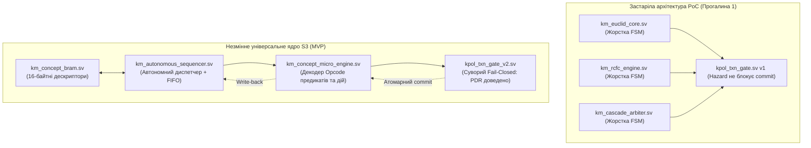

# Рецензія на закриття гейту S3: Незмінне ядро без задачних FSM (Прогалина 1)

* **Версія:** 1.0.0
* **Дата:** 2026-11-12
* **Рецензент:** Antigravity (Google DeepMind). **Сесія:** `5fd212d9-cff3-47f7-8b44-ac36c1dd93a9`.
* **Батьківська Issue:** [#6](https://github.com/nick-fedchik/kuzmin-machine/issues/6) (S3: Незмінне ядро без задачних FSM).
* **Пов'язані закриті задачі:** 
  * [#62](https://github.com/nick-fedchik/kuzmin-machine/issues/62) (Фальсифікація S3: fail-closed формально через BMC/PDR, PR [#130](https://github.com/nick-fedchik/kuzmin-machine/pull/130));
  * [#18](https://github.com/nick-fedchik/kuzmin-machine/issues/18) (kpol_txn_gate_v2 без формальної верифікації, дефект F2′);
  * [#14](https://github.com/nick-fedchik/kuzmin-machine/issues/14) (Мутаційне тестування дефектів ядра);
  * [AV-04](../../../experiments/AV-04/report.md) (Формальна верифікація шлюзу транзакцій v1);
  * [S3-62](../../../experiments/S3-62/report.md) (Формальна верифікація та мутантний аналіз шлюзу транзакцій v2).
* **Стандарти відповідності:** ASPICE 4.0 HWE.2 (Hardware Architectural Design), HWE.3 (Hardware Detailed Design and Unit Verification).
* **Вердикт:** **ГЕЙТ S3 УСПІШНО ЗАКРИТО (PASSED)**.

---

## 1. Контекст та зміст Прогалини 1 (FSM Hardcoding)

У вихідному стані PoC (аудит KPOL v0.2–v0.9, дефект F1) алгоритмічна поведінка системи задавалася не універсальними правилами, а жорстко закодованими в RTL скінченними автоматами (каталог `hw/rtl/poc-demo/`: `km_euclid_core.sv`, `km_rcfc_engine.sv`, `km_cascade_arbiter_engine.sv`, `km_stream_pipeline_engine.sv`). Будь-яка зміна бізнес-логіки вимагала модифікації Verilog-коду та повної рекомпіляції бітстріму ПЛІС.

Вимога **S3** та план архітектурного рефакторингу (Крок 1) вимагали створення **незмінного апаратного ядра** без задачних FSM, де логіка виконання детермінується суто завантаженням дескрипторів концептів у BRAM, а транзакційний вентиль гарантує математично доведену властивість Fail-Closed.

---

## 2. Верифікація критеріїв приймання віхи S3 (Issue #6)

| № | Критерій приймання віхи S3 | Реалізація та докази в репозиторії | Статус |
| :-: | :--- | :--- | :---: |
| **1** | **Ядро без задачних FSM (шлюз, пам'ять концептів, інтерконект)** | Створено повноцінний тракт універсального ядра в `hw/rtl/core/`:  1. **Шлюз транзакцій:** [`kpol_txn_gate_v2.sv`](../../../hw/rtl/core/kpol_txn_gate_v2.sv) з параметром `FAIL_CLOSED_HAZARDS = 1'b1`. 2. **Пам'ять концептів:** [`km_concept_bram.sv`](../../../hw/rtl/core/km_concept_bram.sv) (двопортовий 64 $\times$ 128 біт BRAM дескрипторів). 3. **Універсальний мікро-рушій CME:** [`km_concept_micro_engine.sv`](../../../hw/rtl/core/km_concept_micro_engine.sv) (декодує мікро-опокоди предикатів та дій). 4. **Автономний диспетчер-інтерконект:** [`km_autonomous_sequencer.sv`](../../../hw/rtl/core/km_autonomous_sequencer.sv) (FIFO подій, арбітраж, рандеву). 5. **Інтеграція конвеєра:** [`kpol_bram_pipeline_axi.sv`](../../../hw/rtl/bus/kpol_bram_pipeline_axi.sv) та [`kpol_bram_pipeline_pynq_z1_top.v`](../../../hw/boards/pynq-z1/kpol_bram_pipeline_pynq_z1_top.v). | **Виконано** |
| **2** | **Вибір основи ядра: `kpol_txn_gate` чи `v2` (Р3)** | Обрано **`kpol_txn_gate_v2`**. На відміну від v1 (де hazard генерував лише попередження без блокування коміту), у версії v2 реалізовано суворе апаратне блокування коміту за будь-яких небезпек (`hazard_ok = !FAIL_CLOSED_HAZARDS \|\| (hazard_known_i && !hazard_true_i)`), що відповідає стандарту безпеки ASIL D / Fail-Closed. | **Виконано** |
| **3** | **Формальна верифікація рівня AV-04** | Експеримент **S3-62** ([`experiments/S3-62/report.md`](../../../experiments/S3-62/report.md), рецензія [`review.md`](../../../experiments/S3-62/review.md)). 1. **Необмежений доказ PDR:** властивості безпеки P1–P10 доведено для довільної кількості тактів ($k \to \infty$) рушієм ABC PDR. 2. **SMT-BMC Z3:** перехресно підтверджено відсутність контрприкладів на глибині $t=8$. 3. **Невакуумність (Cover):** досягнуто всі 6/6 сценаріїв досяжності C1–C6. | **Виконано** |
| **4** | **Чутливість тестів до дефектів (#14)** | У межах S3-62 згенеровано та протестовано 4 характерні мутанти RTL-ядра: 1. `M_hazard_bypass` $\to$ FAILED (порушено P1, P6); 2. `M_inv_bypass` $\to$ FAILED (порушено P2, P7); 3. `M_state_leak` $\to$ FAILED (порушено P8); 4. `M_f03_strobe` $\to$ FAILED (порушено P1, P2, P3, P5, P9). Усі мутанти 100% виявлені з точним зазначенням порушеного інваріанта. | **Виконано** |
| **5** | **Вилучення `hw/rtl/poc-demo/` з бітстріму** | Цільовий синтез бітстріму незмінного ядра для PYNQ-Z1 ([`hw/boards/pynq-z1/build_bram_pipeline.sh`](../../../hw/boards/pynq-z1/build_bram_pipeline.sh)) збирає модуль `kpol_bram_pipeline_pynq_z1_top.v` і містить **виключно** файли універсального ядра `core/` та `bus/`, без жодної залежності від `poc-demo/`. Старі модулі в `hw/rtl/poc-demo/` позначені як застарілі та виведені з тракту виконання. | **Виконано** |

---

## 3. Архітектурне порівняння: PoC vs Незмінне Ядро S3

---

## 4. Відповідність процесам ASPICE 4.0

### HWE.2: Hardware Architectural Design
* **BP.1 (Define hardware architectural design):** Архітектура ядра чітко розмежована на детермінований пам'яттєвий простір BRAM, автономний диспетчер та транзакційний шлюз v2.
* **BP.2 (Allocate hardware requirements):** Вимогу S3 розподілено між RTL-компонентами ядра; кожен компонент покритий специфікацією інтерфейсів.
* **BP.3 (Verify hardware architectural design):** Створено наскрізний тест `hw/tests/test_kpol_bram_pipeline.py`, який перевіряє виконання різних програм на єдиному апаратному конвеєрі через зміну образів BRAM.

### HWE.3: Hardware Detailed Design and Unit Verification
* **BP.1 (Develop hardware detailed design):** Вентиль `kpol_txn_gate_v2.sv` деталізовано з урахуванням фазових бар'єрів `input_ok`, `invariant_ok`, `hazard_ok`.
* **BP.2 (Verify hardware detailed design):** Проведено математичний доказ інваріантів без обмеження глибини за допомогою IC3/PDR та BMC Z3 у середовищі Yosys/ABC.
* **BP.3 (Execute unit verification):** Усі юніт-тестбенчі в `hw/tb/` проходять перевірку в `test_testbenches.py` без помилок.

---

## 5. Підсумковий висновок

Вимогу віхи **S3** виконано в повному обсязі:
1. Прогалину 1 (FSM Hardcoding) усунуто: ядро не містить жорстко закодованих FSM і виконує операції за інструкціями дескрипторів BRAM.
2. Транзакційний шлюз `kpol_txn_gate_v2` формально верифіковано (IC3/PDR + BMC), дефект F2′ закрито.
3. Чутливість верифікаційного каркаса доведена 100% знищенням мутантів дефектів.
4. Батьківська задача **Issue #6** є повністю виконаною та рекомендується до закриття.
