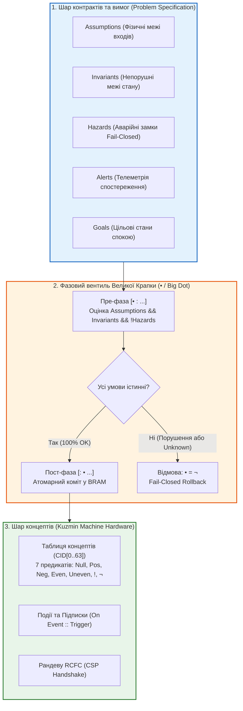
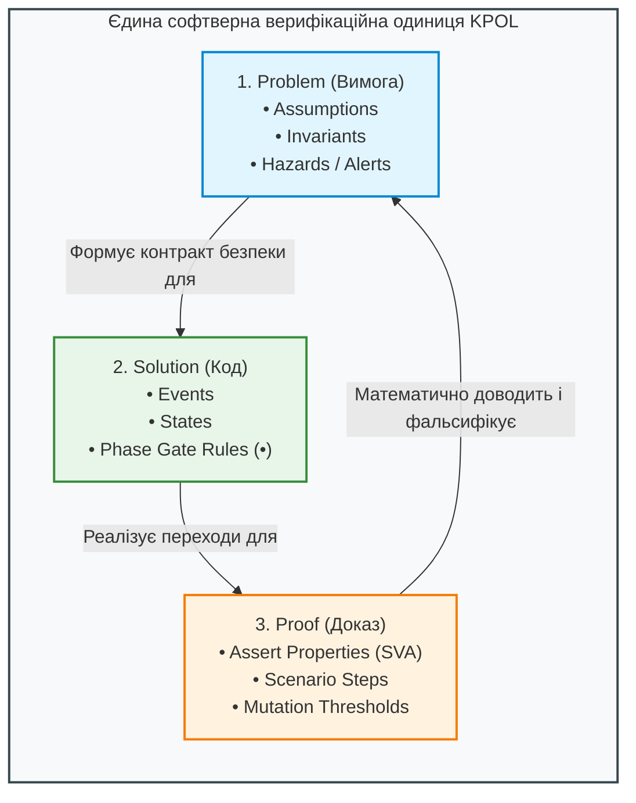

# Специфікація проблемно-орієнтованої мови KPOL v0.2 (Kuzmin Problem-Oriented Language)

* **Версія стандарту:** KPOL v0.2 (Unified Core Specification)  
* **Дата затвердження:** 2026-11-08  
* **Статус:** Офіційна нормативна специфікація ядра  
* **Призначення:** Єдина уніфікована специфікація проблемно-орієнтованої мови для Машини Кузьміна (МК). Усуває розкол між попередніми чернетками v0.1, формалізує апаратний захист від небезпек (`Hazards` vs `Alerts`), вводить концептні блоки з природними предикатами МК та визначає життєвий цикл фазового вентиля Великої Крапки (`•`).
* **Версія:** 0.2.0
* **Перенесено з:** `drafts/KuzminMachine/03-engineering-software/Kuzmin-Machine-KPOL-Language-v0.2-Specification-UA.md` @ `a4738bc` (2026-11-09)

> **Статус щодо стандартів безпеки:** згадки ISO 26262 / ASIL, DO-178C / DO-254 / DAL, IEC 61508 / SIL, IEC 62304 та ISO/SAE 21434 у цьому документі означають цільові домени й припущення, а не досягнуту відповідність. Зовнішніх вимог за цими стандартами немає; аналіз небезпек, цілі безпеки, кваліфікація інструментів і незалежне оцінювання не виконувалися. Див. [позицію проєкту](../../process/standards-position.md).

---

## 1. Архітектурні засади та модель обчислень

KPOL поєднує опис предметної області (вимоги, фізичні допущення, інваріанти безпеки) та алгоритм їх подієвого опрацювання на апаратурі МК.



---

## 2. Типи даних та 3-значна логіка (Unknown)

### 2.1. Базові типи KPOL v0.2
* `Bool`: булеві значення `true` / `false` / `Unknown`.
* `Int32`: 32-бітні знакові цілі числа \([-2^{31}, 2^{31}-1]\).
* `U32`: 32-бітні беззнакові цілі числа \([0, 2^{32}-1]\).
* `Float<Unit>`: числове значення з фізичною розмірністю SI (наприклад, `Float<V>`, `Float<A>`, `Float<W>`, `Float<ms>`). Перевіряється на етапі компіляції (`Float<V> * Float<A> = Float<W>`).
* `ConceptRef`: 16-бітний дескриптор посилання на інший концепт у таблиці BRAM.

### 2.2. Семантика `Unknown` та безпечна демаркація
`Unknown` позначає відсутній сигнал, збій датчика або шум у лінії:
* Логіка Kleene:
  * `false && Unknown = false`
  * `true && Unknown = Unknown`
  * `true || Unknown = true`
  * `false || Unknown = Unknown`
  * `!Unknown = Unknown`
* **Правило безпеки:** Будь-який контракт безпеки (`Assumption`, `Invariant`, `Hazard`), що повертає `Unknown`, розцінюється апаратурою як **критична загроза** та спричиняє відхилення транзакції (`Fail-Closed Abort`).

---

## 3. Чотирирівнева контрактна демаркація

У версії KPOL v0.2 усунуто розбіжність щодо `Hazard` шляхом розмежування на 4 незалежні класи:

| Ключове слово | Призначення | Поведінка при `false` або `Unknown` | Вплив на стан концепту | Апаратний вихід RTL |
| :--- | :--- | :--- | :--- | :--- |
| **`Assumption`** | Передумова вхідних даних події | Відхиляє вхідний сигнал як невалідний | Стан не змінюється | `rejected_o = 1`<br/>`rejected_input_o = 1` |
| **`Invariant`** | Інваріант безпеки стану | Відхиляє запропонований перехід стану | Стан не змінюється | `rejected_o = 1`<br/>`rejected_invariant_o = 1` |
| **`Hazard`** | Апаратний аварійний замок (`Fail-Closed`) | **Блокує коміт**, якщо небезпека активна (`true`) або невідома (`Unknown`) | Стан захищено, фіксації немає | `rejected_o = 1`<br/>`rejected_hazard_o = 1`<br/>`hazard_blocked_o = 1` |
| **`Alert`** | Телеметрія спостереження | Фіксує факт спостереження події | **Не блокує коміт** (інформаційний сигнал) | `alert_observed_o = 1` |

---

## 4. Концептні блоки та синтаксис KPOL v0.2

```kpol
// Приклад визначення модуля системи термозахисту (KPOL v0.2)
module ThermalController;

concept CoolantPump : Int32 {
    initial = 0;
    
    // Інваріант безпеки концепту
    invariant SafeRange = (CoolantPump >= 0 && CoolantPump <= 100);

    // Аварійний замок: якщо сенсор перегрітий або в Unknown -> пуск блокується
    hazard OverheatLockout on StartPump(rpm: Int32) {
        condition = (SensorTemp > 95.0<degC>);
    }

    // Діагностичне спостереження: попередження диспетчера без зупинки
    alert HighVibrationWarning on StartPump(rpm: Int32) {
        condition = (VibrationLevel > 5.0<mm_s>);
    }

    // Правило обробки події
    on StartPump(rpm: Int32) {
        assume ValidRpm = (rpm >= 500 && rpm <= 3000);
        commit = rpm / 30; // перерахунок у відсотки
    }

    on StopPump() {
        commit = 0;
    }
}
```

---

## 5. Апаратний життєвий цикл фазового вентиля (`•`)

Кожна транзакція в ядрі `kpol_txn_gate` виконується за 1 такт ($10.0\text{ нс}$ при $100\text{ МГц}$):

1. **Такт $T$ (Вхідний строб `event_valid_i`):**
   * Паралельно обчислюються:
     $$\text{input\_ok} = \text{candidate\_known} \land \text{assumption\_known} \land \text{assumption\_true}$$
     $$\text{invariant\_ok} = \text{invariant\_known} \land \text{invariant\_true}$$
     $$\text{hazard\_ok} = \text{hazard\_known} \land \neg\text{hazard\_true}$$
   * Виставляються діагностичні сигнали: `alert_observed_o`, `unknown_hazard_o`.

2. **Логіка рішення коміту:**
   $$\text{committed\_o} = \text{input\_ok} \land \text{invariant\_ok} \land \text{hazard\_ok}$$
   $$\text{rejected\_o} = \neg\text{committed\_o}$$

3. **Такт $T+1$ (Фіксація або відкат):**
   * Якщо $\text{committed\_o} = 1$: `state_o <= candidate_value_i`, `changed_o <= (candidate != state)`.
   * Якщо $\text{committed\_o} = 0$: `state_o <= state_o` (незмінний стан), виставляється відповідний строб відхилення.

---

## 6. Зворотна сумісність

Специфікація v0.2 підтримує режим зворотної сумісності з v0.1:
* Якщо параметр `FAIL_CLOSED_HAZARDS = 0`, модуль `kpol_txn_gate` працює в режимі v0.1 (де `hazard` лише виставляє прапорець спостереження).
* У стандартному безпечному режимі `FAIL_CLOSED_HAZARDS = 1` активується суворий захист fail-closed.
* Модулі без задекларованого блоку `Proof` залишаються повністю валідними для компіляції та синтезу в RTL.

---

## 7. Тріада KPOL: Проблема — Вирішення — Доказ (Docs-as-Code & Verifiable Systems)

Концепція мови KPOL базується на неподільній тріаді інженерної верифікації:
$$\text{Тріада} = \langle \text{Проблема (Problem)}, \text{Вирішення (Solution)}, \text{Доказ (Proof)} \rangle$$



### 7.1. Архітектурне призначення та переваги
1. **Docs-as-Code & Ліквідація семантичного дрейфу (Zero Semantic Drift):**
   У класичній практиці (C/Verilog + ALM-системи DOORS/Polarion + окремі фреймворки тестування) вимоги застарівають під час рефакторингу коду. У KPOL неможливо модифікувати логіку `Solution`, якщо вона порушує інваріант `Problem` або ламає хоча б один сценарій/твердження `Proof`. Компілятор зупиняє збірку на етапі статичного аналізу або верифікації.
2. **Автоматизоване трасування вимог (допоміжний артефакт для можливого аудиту за ISO 26262, DO-178C, IEC 62304; відповідність не заявляється):**
   Компілятор KPOL формує матрицю двонапрямленого трасування (Bidirectional Requirements Traceability Matrix, RTM) безпосередньо з AST:
   $$\text{Req ID} \longleftrightarrow \text{Rule / Phase Gate} \longleftrightarrow \text{Proof Scenario / SVA Property}$$
3. **Єдиний синтаксичний простір:**
   Вимоги, переходи станів та сценарії фальсифікації записуються в одній граматиці, що дозволяє компілятору одночасно транслювати модуль у:
   - Синтезований Verilog RTL (`km_module.sv`);
   - Апаратні монітори безпеки SystemVerilog Assertions (`tb_sva_module.sv`);
   - Детерміністичні тестові бенчмарки (`test_module.py` / C runner).

### 7.2. Критичні межі застосування та інженерні застереження
> [!IMPORTANT]
> **Принцип незалежності верифікації (Independence of Verification):**
> Нормативні стандарти функціональної безпеки вимагають, щоб верифікація здійснювалася незалежно від автора імплементації для запобігання упередженості підтвердження (*confirmation bias*).
> Якщо розробник пише код і тести в одному файлі, виникає небезпека «тавтологічного тестування» (тестується те, як код написаний, а не граничні аномалії).
> **Рішення KPOL:** Підтримка як компактної однофайлової форми, так і **модульних роздільних файлів (Headers-as-Code)**:
> - `Pump.kproblem` — створюється системним архітектором / Safety-інженером;
> - `Pump.ksolution` — створюється розробником алгоритмів / RTL-інженером;
> - `Pump.kproof` — створюється Red-Team / Verification-інженером.
> Компілятор збирає їх в єдиний вузол `Module` під час складання.

> [!WARNING]
> **Неможливість заміни System-Level та HIL-тестів:**
> Блок `Proof` верифікує контрактну та функціональну чистоту на рівні Unit-модуля. Він **не замінює** фізичного тестування на залізі (Hardware-in-the-Loop, HIL), де діють джиттер ліній, шуми АЦП, термічні дрейфи кристала та міжмодульні блокування каскадного арбітра.

### 7.3. Приклад повної тріади KPOL v0.2

```kpol
module HydraulicRegulator;

Problem HydraulicRegulator {
    Invariants {
        SafePressure: Pressure <= 250;
    }
    Hazards {
        Overpressure on SensorSample to EmergencyTrip: P > 250;
    }
    Alerts {
        HighTempWarning on SensorSample: T > 85;
    }
}

Solution HydraulicRegulator {
    event SensorSample(P: Int32, T: Int32);
    state Pressure: Int32 = 100;
    state Temperature: Int32 = 40;
    state PumpActive: Bool = true;
    state EmergencyTrip: Bool = false;

    rule NormalSample on SensorSample when P <= 250 {
        set Pressure := P;
        set Temperature := T;
    }

    rule OverpressureCutoff on SensorSample when P > 250 covers Overpressure {
        set EmergencyTrip := true;
        set PumpActive := false;
    }
}

Proof HydraulicRegulator {
    // 1. Формальне твердження (Invariant Property)
    assert TripOnOverpressure on SensorSample {
        when P > 250 expect PumpActive == false;
    }

    // 2. Детерміністичний сценарій номінальної роботи
    scenario NominalFlow {
        step SensorSample(P = 180, T = 65);
        expect Pressure == 180;
        expect PumpActive == true;
        expect EmergencyTrip == false;
    }

    // 3. Сценарій спрацьовування аварійного замка (Fail-Closed)
    scenario EmergencyShutdown {
        step SensorSample(P = 270, T = 90);
        expect PumpActive == false;
        expect EmergencyTrip == true;
    }
}
```
