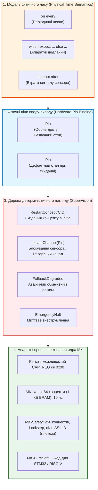

# Специфікація проблемно-орієнтованої мови KPOL v0.3 (Kuzmin Problem-Oriented Language)

* **Версія стандарту:** KPOL v0.3 (Physical Time, Hardware Pins & Deterministic Supervision)  
* **Дата затвердження:** 2026-11-08  
* **Статус:** Офіційна нормативна специфікація ядра  
* **Призначення:** Формалізація темпоральних операторів реального часу (`every`, `within`, `timeout`), фізичних пінів вводу-виводу (`Pin`) з апаратним захистом від обриву дроту та завад, дерев детерміністичного нагляду (*Supervision Trees*), а також профільної моделі апаратного ядра МК (MK-Nano, MK-Safety, MK-PureSoft).
* **Версія:** 0.3.0
* **Перенесено з:** `drafts/KuzminMachine/03-engineering-software/Kuzmin-Machine-KPOL-Language-v0.3-Specification-UA.md` @ `a4738bc` (2026-11-09)

> **Статус щодо стандартів безпеки:** згадки ISO 26262 / ASIL, DO-178C / DO-254 / DAL, IEC 61508 / SIL, IEC 62304 та ISO/SAE 21434 у цьому документі означають цільові домени й припущення, а не досягнуту відповідність. Зовнішніх вимог за цими стандартами немає; аналіз небезпек, цілі безпеки, кваліфікація інструментів і незалежне оцінювання не виконувалися. Див. [позицію проєкту](../../process/standards-position.md).

---

## 1. Архітектурне розширення версії v0.3

Версія KPOL v0.3 розширює ядро v0.2 моделлю фізичного часу та прямою проєкцією на апаратну периферію мікроконтролера або FPGA:



---

## 2. Модель фізичного часу та темпоральні оператори

### 2.1. Фізичні розмірності часу в системі типів
KPOL v0.3 вводить строгі темпоральні типи:
* `Float<ns>` — наносекунди ($10^{-9}\text{ с}$, дискретність такту FPGA при $100\text{ МГц} = 10.0\text{ ns}$);
* `Float<us>` — мікросекунди ($10^{-6}\text{ с}$);
* `Float<ms>` — мілісекунди ($10^{-3}\text{ с}$);
* `Float<s>` — секунди;
* `Float<min>`, `Float<h>` — хвилини та години.

Усі темпоральні константи автоматично приводяться компілятором до внутрішнього 64-бітного лічильника системних тактів (`U64 ticks`) без втрати точності.

### 2.2. Оператор періодичності `on every <Duration>`
Визначає строго періодичну генерацію події в апаратурі:
```kpol
on every 10.0<ms> {
    emit HeartbeatTimer;
}
```
* **Апаратна семантика:** Компілятор виділяє апаратний таймер-лічильник, який скидається кожні $N$ тактів і генерує строб події в арбітр.

### 2.3. Оператор контролю дедлайну `within <Duration>`
Забезпечує гарантію часу реакції керованого об'єкта (*Deadline Constraint*):
```kpol
on CommandOpenValve {
    within 50.0<ms> expect (FlowSensor > 5.0<L_min>)
    else trigger ValveStuckHazard;
}
```
* Якщо умова `FlowSensor > 5.0` виконується до спливу $50.0\text{ ms}$, дедлайн знімається.
* Якщо час вичерпано, а умова хибна — компілятор у такті $T_{\text{deadline}}$ генерує подію відмови `ValveStuckHazard`.

### 2.4. Оператор виявлення втрати зв'язку `timeout after <Duration>`
Контролює регулярність надходження вхідних даних сенсора (*Watchdog / Liveness*):
```kpol
timeout after 100.0<ms> without PressureSample {
    set SensorStatus := Unknown;
    supervise IsolateChannel;
}
```
* Будь-яке прибуття події `PressureSample` скидає внутрішній таймер.
* При зависанні або обриві лінії спрацьовує таймаут, що переводить стан сенсора в `Unknown` і викликає нагляд.

---

## 3. Семантика фізичних пінів (`Pin` Binding)

Пін у KPOL v0.3 є строго типізованим фізичним портом вводу-виводу з вбудованим апаратним захистом.

### 3.1. Синтаксис декларації піна
$$\mathbf{concept}\;\text{Name} : \mathbf{Pin}\langle\text{Direction}, \text{Polarity}, [\text{Filter}, \text{Pull}]\rangle \;\mathbf{@}\;\text{HardwareLocation}$$

* **Direction:** `In` (вхід) або `Out` (вихід).
* **Polarity:** `ActiveHigh` (1 = активно) або `ActiveLow` (0 = активно).
* **GlitchFilter:** `GlitchFilter<Duration>` — апаратний цифровий фільтр придушення бруду та завад (імпульси коротші за заданий час ігноруються).
* **Pull:** `PullUp`, `PullDown`, `Floating`.
* **Default State (Wire-Break Safety):** безпечний дефолтний стан при знеструмленні або обриві лінії.

```kpol
// Приклад вхідного піна кнопки аварійного стопу:
concept EmergencyButton : Pin<In, ActiveLow, GlitchFilter<50.0<ns>>, PullUp> @ Pmod_JA1 {
    default = SafeActive; // обрив кабелю = зупинка
}

// Приклад вихідного піна керування контактором:
concept HighPressurePumpRelay : Pin<Out, ActiveHigh, PushPull> @ Pmod_JB1 {
    default = 0; // при скиданні живлення реле вимкнене
}
```

---

## 4. Дерева детерміністичного нагляду (Supervision Trees)

При виявленні загрози (`Hazard`), невідповідності інваріанту (`InvariantViolation`) або збою датчика (`Unknown`), система не повинна зависати. KPOL v0.3 формалізує **чотири детерміністичні політики нагляду**:

```kpol
supervise ConceptName on FailureCondition {
    policy = RestartConcept | IsolateChannel | FallbackDegraded | EmergencyHalt;
}
```

| Політика нагляду | Дія апаратури | Вплив на стан BRAM | Час реакції |
| :--- | :--- | :--- | :--- |
| **`RestartConcept`** | Скидання внутрішніх регістрів концепту у початкові значення `initial` | Відновлення дефолту | $1\text{ такт}$ ($10\text{ нс}$) |
| **`IsolateChannel`** | Апаратне блокування вхідного піна/тригера, перехід на дублюючий сенсор | `SensorStatus := Unknown` | $1\text{ такт}$ ($10\text{ нс}$) |
| **`FallbackDegraded`** | Перехід у режим обмеженої потужності (Safe Slow Mode) | `Mode := Degraded` | $1\text{ такт}$ ($10\text{ нс}$) |
| **`EmergencyHalt`** | Миттєве знеструмлення всіх виконавчих пінів (`All Outputs := SafeDefault`) | `SystemLock := true` | $1\text{ такт}$ ($10\text{ нс}$) |

---

## 5. Апаратні профілі виконання ядра МК

KPOL v0.3 офіційно підтримує модель **фіксованого кремнію** з трьома стандартизованими профілями:

### 5.1. Регістр можливостей `CAP_REG` (Адреса `0x00`)
Кожне ядро МК на кремнії містить 32-бітний регістр ідентифікації:
$$\text{CAP\_REG} = \{\text{MajorVer}[7:0], \;\text{MinorVer}[7:0], \;\text{CID\_Count}[7:0], \;\text{Flags}[7:0]\}$$
* `Flags[0]` — наявність апаратного FPU;
* `Flags[1]` — наявність апаратних таймерів дедлайнів;
* `Flags[2]` — наявність Lockstep-дублювання.

### 5.2. Специфікація профілів
1. **Профіль MK-Nano (M-64):**
   * 64 концепти BRAM ($1024\text{ байти}$), $10\text{ нс}$ такт;
   * Цілочисельна арифметика $Q16.16$, без динамічної пам'яті;
   * Цільова апаратура: дешеві CPLD/FPGA ($1–$3, Lattice iCE40, Gowin).
2. **Профіль MK-Safety (R-256):**
   * 256 концептів BRAM ($4096\text{ байтів}$);
   * Апаратні таймери `within` та `timeout`;
   * Lockstep дублювання двох ядер із компаратором розбіжностей;
   * Цільові домени (гіпотеза, вимог немає): автомобільний кремній (ISO 26262, ціль ASIL D), авіоніка (DO-254, ціль DAL A).
3. **Профіль MK-PureSoft (MCU Target):**
   * Чистий детерміністичний C-код для STM32, RISC-V, ESP32;
   * Відсутність потреби у FPGA;
   * Час реакції: $50\text{–}150\text{ нс}$ на частотах $168\text{–}480\text{ МГц}$.

---

## 6. Приклад повного модуля системи захисту реактора (KPOL v0.3)

```kpol
module ReactorThermalGuard;

Problem ReactorThermalGuard {
    Invariants {
        SafeTemp: CoreTemp <= 120.0<degC>;
        SafePressure: CorePressure <= 160.0<bar>;
    }

    Hazards {
        OverheatLockout on TempSample to EmergencyTrip: T > 120.0<degC>;
        OverpressureLockout on PressureSample to EmergencyTrip: P > 160.0<bar>;
    }

    Alerts {
        PreWarningTemp on TempSample: T > 100.0<degC>;
    }

    Goals {
        NormalOperation: CoreTemp < 95.0<degC> and EmergencyTrip == false;
    }
}

Solution ReactorThermalGuard {
    // Фізичні піни з апаратною фільтрацією завад
    concept EmergencyStopWire : Pin<In, ActiveLow, GlitchFilter<50.0<ns>>, PullUp> @ Pmod_JA1 {
        default = 1;
    }

    concept CoolantPumpRelay : Pin<Out, ActiveHigh, PushPull> @ Pmod_JB1 {
        default = 0;
    }

    event TempSample(T: Float<degC>);
    event PressureSample(P: Float<bar>);
    event HeartbeatTick();

    state CoreTemp: Float<degC> = 75.0<degC>;
    state CorePressure: Float<bar> = 100.0<bar>;
    state EmergencyTrip: Bool = false;
    state PumpActive: Bool = true;

    // Періодичний сторожовий таймер
    on every 10.0<ms> {
        emit HeartbeatTick();
    }

    // Правило обробки температури
    rule HandleTemp on TempSample when T <= 120.0<degC> {
        set CoreTemp := T;
    }

    // Аварійний замок від перегріву
    rule TripOnOverheat on TempSample when T > 120.0<degC> covers OverheatLockout {
        set EmergencyTrip := true;
        set PumpActive := false;
    }

    // Таймаут датчика температури: якщо сигналу немає 50 мс -> Degraded Mode
    timeout after 50.0<ms> without TempSample {
        set CoreTemp := Unknown;
        supervise FallbackDegraded;
    }
}

Proof ReactorThermalGuard {
    assert FailClosedOnOverheat on TempSample {
        when T > 120.0<degC> expect EmergencyTrip == true;
    }

    scenario NominalTempUpdate {
        step TempSample(T = 85.0<degC>);
        expect CoreTemp == 85.0<degC>;
        expect EmergencyTrip == false;
        expect PumpActive == true;
    }

    scenario OverheatCutoff {
        step TempSample(T = 125.0<degC>);
        expect EmergencyTrip == true;
        expect PumpActive == false;
    }
}
```