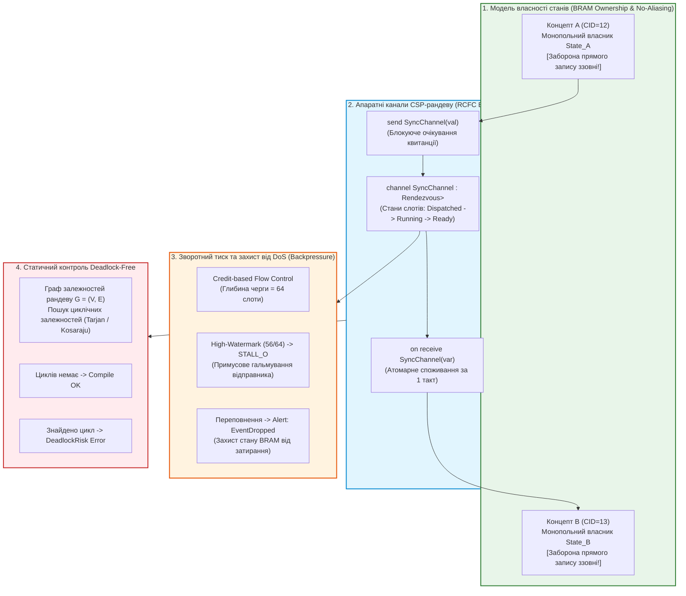
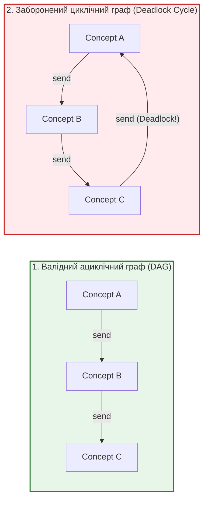

# Специфікація проблемно-орієнтованої мови KPOL v0.4 (Kuzmin Problem-Oriented Language)

* **Версія стандарту:** KPOL v0.4 (Concurrency, CSP Rendezvous, Backpressure & Memory Ownership)  
* **Дата затвердження:** 2026-11-08  
* **Статус:** Офіційна нормативна специфікація ядра  
* **Призначення:** Формалізація моделі конкурентності та ізоляції пам'яті: апаратні канали строгого рандеву Чарльза Гоара (CSP), модель монопольної власності на стан концепту (*No-Aliasing Memory Ownership*), апаратний зворотний тиск (*Credit-based Backpressure*) для захисту від DoS-переповнення черг, та статичний аналіз відсутності взаємних блокувань (*Deadlock-Free Check*).
* **Версія:** 0.4.0
* **Перенесено з:** `drafts/KuzminMachine/03-engineering-software/Kuzmin-Machine-KPOL-Language-v0.4-Specification-UA.md` @ `a4738bc` (2026-11-09)

---

## 1. Архітектурні засади версії v0.4

Версія KPOL v0.4 піднімає мову з рівня одиничного автомата до **системи взаємодіючих паралельних концептів**, що безпосередньо відображається на апаратні рушії `km_rcfc_engine.sv` та `km_cascade_arbiter_engine.sv` Машини Кузьміна:



---

## 2. Модель власності станів та ізоляція пам'яті (Memory Ownership)

У критичних системах вбудованого класу однією з головних загроз є неконтрольоване затирання чужої пам'яті (Memory Aliasing / Data Races).

### 2.1. Інваріант монопольної власності концепту
Кожна змінна стану `state S`, оголошена всередині концепту `concept C (CID = k)`:
$$\mathbf{Owner}(\text{State}\; S) = \text{CID}_k$$

* **Правило безпеки:** Лише правила самого концепту `C` мають право виконувати дію `set S := Expr;`.
* **Заборона трансконцептного запису:** Спроба будь-якого іншого концепту `C'` безпосередньо змінити `S` спричиняє **помилку компіляції**:
  $$\text{Error: Concept } C' \text{ cannot mutate state } S \text{ owned by Concept } C \text{ (Ownership Violation).}$$
* **Механізм взаємодії:** Зміна стану чужого концепту можлива **виключно через надсилання події або передачу даних через типізований канал рандеву**.

---

## 3. Апаратні канали CSP-рандеву (RCFC Synchronization)

KPOL v0.4 вводить канали зв'язку за моделлю *Communicating Sequential Processes (CSP)* Чарльза Гоара, які на кремнії МК обслуговуються комутатором `km_rcfc_engine.sv`.

### 3.1. Декларація каналу
$$\mathbf{channel}\;\text{ChannelName} : \mathbf{Rendezvous}\langle\text{Type}\rangle;$$
$$\mathbf{channel}\;\text{ChannelName} : \mathbf{Stream}\langle\text{Type}, \text{Depth}\rangle;$$

* `Rendezvous<Type>` — строге небуферизоване рандеву (апаратне рукостискання *Handshake* за 1 такт). Передача відбувається лише тоді, коли відправник готовий передати, а одержувач — прийняти.
* `Stream<Type, Depth>` — буферизований потік із фіксованою глибиною черги FIFO (наприклад, 16 або 64 слоти).

### 3.2. Оператори передачі та прийому
* **Відправлення в канал:**
  ```kpol
  send CoolantPressureChannel(MeasuredPressure);
  ```
* **Прийом з каналу (як джерело події):**
  ```kpol
  on receive CoolantPressureChannel(p: Float<bar>) {
      set TargetPressure := p;
  }
  ```

### 3.3. Відображення на апаратні стани слотів `km_rcfc_engine.sv`
Під час виконання транзакції рандеву апаратний слот слота RCFC проходить детерміністичні стани:
$$\text{SLOT\_IDLE} \longrightarrow \text{SLOT\_DISPATCHED} \longrightarrow \text{SLOT\_RUNNING} \longrightarrow \text{SLOT\_READY} \longrightarrow \text{SLOT\_IDLE}$$
Якщо протягом `MAX_WAIT_CYCLES` (за замовчуванням 256 тактів) друга сторона не вийшла на рандеву, слот переходить у стан `SLOT_TIMEOUT` і генерує апаратний строб `timeout_deadlock_error_o`.

---

## 4. Зворотний тиск (Backpressure) та апаратний захист від DoS-переповнення

У критичних системах шторм подій від несправного сенсора або атаки зловмисника не повинен призводити до переповнення пам'яті чи затирання стану.

### 4.1. Кредитне регулювання темпу (Credit-Based Flow Control)
Кожен буферизований канал має лічильник вільних кредитів `CreditsAvailable`.
1. **Звичайний режим ($\text{Occupied} < \text{High-Watermark}$):**
   Транзакції приймаються без затримки.
2. **Режим зворотного тиску ($\text{Occupied} \ge 56 / 64$):**
   Канал виставляє апаратний сигнал зворотного тиску:
   $$\text{stall\_o} = 1$$
   Відправник примусово блокується на апаратному рівні без втрати даних, доки одержувач не звільнить слоти.
3. **Захист від переповнення (Emergency Overflow Protection):**
   Якщо некероване джерело ігнорує сигнал `stall_o`, вхідний шлюз скидає нові пакети без затирання черги:
   $$\text{events\_dropped\_o} \leftarrow \text{events\_dropped\_o} + 1$$
   Компілятор генерує системне спостереження `Alert: EventDropped(ChannelName)`.

---

## 5. Статична перевірка відсутності взаємних блокувань (Deadlock-Free Check)

Компілятор KPOL v0.4 будує орієнтований граф залежностей взаємодії між концептами:
$$G = (V, E)$$
де:
* $V = \{\text{Concept}_0, \text{Concept}_1, \dots, \text{Concept}_{N-1}\}$ — множина концептів;
* $E = \{(C_i, C_j) \mid C_i \text{ блокуюче очікує рандеву від } C_j\}$.



* **Теорема детермінізму:** Якщо граф $G$ є спрямованим ациклічним графом (DAG), система гарантовано вільна від взаємних блокувань (*Deadlock-Free*).
* **Семантичне правило:** Якщо алгоритм пошуку сильних компонент зв'язності (Tarjan / Kosaraju) знаходить хоча б один контур (цикл), **компілятор KPOL блокує збірку**:
  $$\text{Compile Error: Circular rendezvous dependency detected: } A \to B \to C \to A.$$

---

## 6. Приклад багатоконцептного модуля з рандеву та ізоляцією (KPOL v0.4)

```kpol
module HydraulicStation;

// Декларація типізованого каналу рандеву
channel PressureTelemetry : Rendezvous<Float<bar>>;

// Концепт 1: Сенсорний вузол високого тиску
concept PressureSensorNode {
    event SensorRawTick(RawP: Float<bar>);
    state CurrentPressure: Float<bar> = 100.0<bar>;

    rule ReadSensor on SensorRawTick when RawP > 0.0<bar> {
        set CurrentPressure := RawP;
        send PressureTelemetry(RawP); // передача через рандеву
    }
}

// Концепт 2: Актюатор головного насоса (монопольний власник помпи)
concept MainPumpActuator {
    state PumpActive: Bool = true;
    state EmergencyLock: Bool = false;
    state LastReceivedPressure: Float<bar> = 100.0<bar>;

    // Прийом даних із каналу рандеву
    on receive PressureTelemetry(p: Float<bar>) {
        set LastReceivedPressure := p;
    }

    // Правило аварійного відключення при отриманні небезпечного тиску
    rule CutoffOnOverpressure on receive PressureTelemetry(p: Float<bar>) when p > 250.0<bar> {
        set EmergencyLock := true;
        set PumpActive := false;
    }
}

Proof HydraulicStation {
    scenario OverpressureCutoffRendezvous {
        step PressureSensorNode.SensorRawTick(RawP = 270.0<bar>);
        expect MainPumpActuator.EmergencyLock == true;
        expect MainPumpActuator.PumpActive == false;
    }
}
```