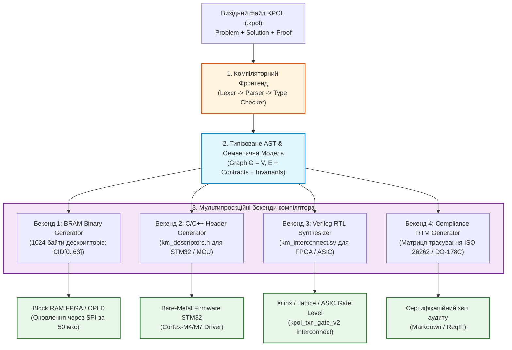

# Специфікація проблемно-орієнтованої мови KPOL v0.5 (Kuzmin Problem-Oriented Language)

* **Версія стандарту:** KPOL v0.5 (The Compiler, BRAM Descriptor Code Generation & Multi-Target Synthesis)  
* **Дата затвердження:** 2026-11-08  
* **Статус:** Офіційна нормативна специфікація ядра  
* **Призначення:** Формалізація архітектури першого інженерного компілятора KPOL: наскрізний трансляційний конвеєр, генерація 1024-байтного бінарного образу пам'яті дескрипторів BRAM (64 концепти $\times$ 16 байтів), автоматичний синтез типізованих C-заголовків для мікроконтролерів (STM32 / RISC-V) та апаратного SystemVerilog RTL інтерконекту для FPGA / ASIC.
* **Версія:** 0.5.0
* **Перенесено з:** `drafts/KuzminMachine/03-engineering-software/Kuzmin-Machine-KPOL-Language-v0.5-Specification-UA.md` @ `a4738bc` (2026-11-09)

> **Статус щодо стандартів безпеки:** згадки ISO 26262 / ASIL, DO-178C / DO-254 / DAL, IEC 61508 / SIL, IEC 62304 та ISO/SAE 21434 у цьому документі означають цільові домени й припущення, а не досягнуту відповідність. Зовнішніх вимог за цими стандартами немає; аналіз небезпек, цілі безпеки, кваліфікація інструментів і незалежне оцінювання не виконувалися. Див. [позицію проєкту](../../process/standards-position.md).

---

## 1. Архітектура компілятора KPOL v0.5

Компілятор KPOL v0.5 реалізує канон **Multi-Target Projection** (одна абстрактна семантична модель транслюється у декілька взаємоузгоджених апаратних і програмних цілей):



---

## 2. Специфікація образу пам'яті BRAM (Бекенд 1)

Бекенд 1 транслює стан концептів у строго бінарний образ місткістю рівно **1024 байти** (256 слів по 32 біти), сумісний з апаратним модулем `km_concept_bram.sv`.

### 2.1. Формат 128-бітного дескриптора концепту (16 байтів)
Кожен концепт $\text{CID} \in [0, 63]$ займає 4 послідовні 32-бітні слова у форматі Little-Endian:

```
+0x00: [ VALUE_LO (32 біти)                                   ]
+0x04: [ VALUE_HI (32 біти)                                   ]
+0x08: [ SubscriptionMask[31:16] | BigDot[9] | Init[8] | Size[7:4] | TypeID[3:0] ]
+0x0C: [ STATUS_WORD / PREDICT_VECTOR (32 біти)               ]
```

* **Word 0 (`VALUE_LO`):** Молодші 32 біти початкового значення (`initial`). Для `Int32`, `Bool` чи фіксованої крапки $Q16.16$.
* **Word 1 (`VALUE_HI`):** Старші 32 біти для `U64` або $0$ для 32-бітних типів.
* **Word 2 (`META_WORD`):**
  * `[3:0]` **TypeID:**
    * `0x0` = `Int32`
    * `0x1` = `Float` (фізична розмірність)
    * `0x2` = `Bool`
    * `0x3` = `U64`
    * `0x4` = `Pin`
  * `[7:4]` **SizeMask:** розмір даних у байтах (`1`, `2`, `4` або `8`);
  * `[8]` **InitializedFlag:** `1` — значення визначено, `0` — стан `Unknown`;
  * `[9]` **BigDotFlag:** `1` — активний стан варти ('!'), `0` — блокування ('¬');
  * `[31:16]` **SubscriptionMask:** 16-бітна бітова маска подій, на які підписаний цей концепт.
* **Word 3 (`STATUS_WORD`):** Предикатний вектор природних властивостей числа МК:
  * Біт 0: `Null` (значення == 0);
  * Біт 1: `Positive` (значення > 0);
  * Біт 2: `Negative` (значення < 0);
  * Біт 3: `Even` (парне);
  * Біт 4: `Uneven` (непарне).

---

## 3. Специфікація кодогенератора C-заголовків (Бекенд 2)

Бекенд 2 генерує стандартизований заголовний файл `C99` для взаємодії з апаратурою або автономного виконання на мікроконтролерах STM32 / RISC-V:

* **Структура згенерованого файлу:**
  1. Захисні макроси включення (`#ifndef KM_<MODULE>_H`, `#define ...`);
  2. Перерахування ідентифікаторів концептів:
     ```c
     typedef enum {
         CID_CoreTemp = 0,
         CID_CorePressure = 1,
         CID_EmergencyTrip = 2,
         CID_PumpActive = 3,
         KM_TOTAL_CONCEPTS = 4
     } km_concept_id_t;
     ```
  3. Статичний константний масив ініціалізації BRAM:
     ```c
     static const uint32_t KM_BRAM_INITIAL_IMAGE[256] = {
         /* CID 0 (CoreTemp): val_lo, val_hi, meta, status */
         0x0000004B, 0x00000000, 0x00010141, 0x00000002,
         ...
     };
     ```
  4. Макроси читання/запису для MMIO-мосту (`km_mcu_fpga_bridge.c`).

---

## 4. Специфікація кодогенератора Verilog RTL (Бекенд 3)

Бекенд 3 синтезує апаратну обв'язку зв'язків між шлюзами для FPGA:
* Модуль `km_<module>_interconnect.sv`:
  - Інстанціює модулі `kpol_txn_gate_v2` для кожного критичного концепту;
  - З'єднує строби подій із паралельними шинами;
  - Формує виходи `committed_o`, `rejected_o`, `hazard_blocked_o` та `alert_observed_o`;
  - Забезпечує детерміністичний час відгуку $10.0\text{ нс}$ на частоті $100\text{ МГц}$.

---

## 5. Специфікація RTM матриці відповідності (Бекенд 4)

Як допоміжний артефакт для можливого майбутнього аудиту функціональної безпеки (наприклад, за ISO 26262 чи DO-178C) компілятор автоматично формує звіт трасування вимог. Сам звіт відповідності стандартам не забезпечує:

$$\text{RTM: Requirement ID} \longleftrightarrow \text{Rule / Phase Gate (•)} \longleftrightarrow \text{Proof Assert / Scenario}$$

Якщо хоча б одна вимога `Problem` не покрита правилом `Solution` або сценарієм `Proof`, компілятор попереджає про дірку в трасуванні (*Uncovered Requirement Warning*).
