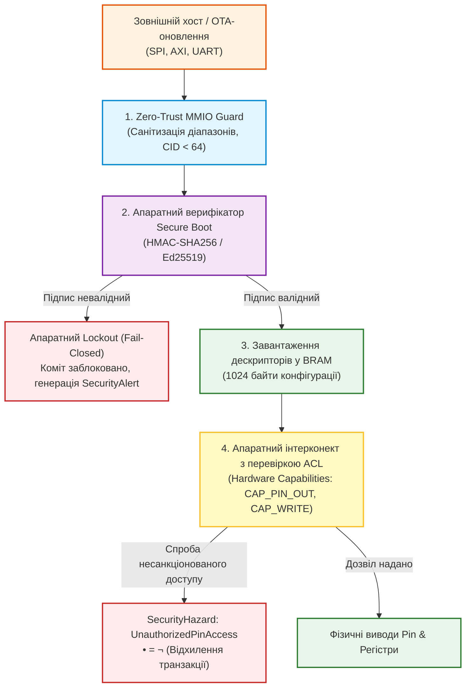

# Специфікація проблемно-орієнтованої мови KPOL v0.6 (Kuzmin Problem-Oriented Language)

* **Версія стандарту:** KPOL v0.6 (CyberSecurity, Hardware Capabilities ACL & Secure Boot)  
* **Дата затвердження:** 2026-11-08  
* **Статус:** Офіційна нормативна специфікація ядра безпеки  
* **Призначення:** Формалізація механізмів кібербезпеки та довіреного середовища виконання Машини Кузьміна (МК). Захист дескрипторів BRAM від підробки (*Tamper Resistance*), апаратні списки контролю доступу (*Hardware Capabilities ACL*), криптографічний підпис конфігурації (*Secure Boot Payload*) та Zero-Trust фільтрація зовнішніх подій на межі MMIO.
* **Версія:** 0.6.0
* **Перенесено з:** `drafts/KuzminMachine/03-engineering-software/Kuzmin-Machine-KPOL-Language-v0.6-Specification-UA.md` @ `a4738bc` (2026-11-09)

---

## 1. Загрози безпеки та філософія Zero-Trust у Машині Кузьміна

Традиційні ПЛК та вбудовані контролери є вразливими до атак класу *Stuxnet* — несанкціонованої підміни логіки керування або ін'єкції невалідної телеметрії через шини польового рівня (CAN, Modbus, AXI).  
KPOL v0.6 переносить довіру з операційного рівня на криптографічний і апаратний рівні:



### Засади безпеки KPOL v0.6:
1. **Криптографічна автентичність образу (Secure Boot):** Ядро МК не переходить у робочий стан `RUN`, доки образ конфігурації BRAM не пройде валідацію криптографічним дайджестом (HMAC-SHA256 або Ed25519).
2. **Апаратна ізоляція повноважень (Hardware Capabilities ACL):** Кожен концепт має жорстко зафіксовані біти привілеїв. Концепт не може маніпулювати фізичними пінами `Pin<Out>` або викликати переривання, якщо цей дозвіл не прописаний у його дескрипторі.
3. **Zero-Trust санітизація MMIO:** Зовнішній мікроконтролер (STM32/ESP32) розглядається як потенційно скомпрометоване середовище. Всі вхідні пакети перевіряються апаратним шлюзом на межі інтерфейсу.

---

## 2. Специфікація Secure Boot Image (1088 байтів)

Образ завантаження KPOL v0.6 складається з **64-байтного блоку криптографічного заголовка безпеки** (*Security Header*) та **1024-байтної таблиці дескрипторів BRAM**.  
Загальний розмір файлу конфігурації становить рівно **1088 байтів**.

### 2.1. Структура Secure Boot Header (64 байти, Little-Endian)

| Зсув (Offset) | Поле | Розмір | Опис |
| :--- | :--- | :--- | :--- |
| `+0x00` | `MAGIC` | 4 байти | Магічне число `0x4B504F4C` (ASCII рядок `"KPOL"`) |
| `+0x04` | `FORMAT_VER` | 2 байти | Версія формату: `0x0006` (v0.6) |
| `+0x06` | `FLAGS` | 2 байти | Прапорці криптографії та політик:<br/>• Біт 0: `ALG_HMAC_SHA256` (1 = активний)<br/>• Біт 1: `ALG_ED25519` (1 = асиметричний підпис)<br/>• Біт 2: `LOCKOUT_ON_TAMPER` (апаратне блокування при підробці)<br/>• Біт 3: `ENFORCE_ACL` (апаратна перевірка привілеїв) |
| `+0x08` | `PAYLOAD_LEN` | 4 байти | Довжина тіла дескрипторів: фіксовано `0x00000400` (1024 байти) |
| `+0x0C` | `KEY_ID` | 4 байти | Ідентифікатор ключа розробника / сертифіката підпису |
| `+0x10` | `NONCE_SALT` | 16 байтів | Криптографічний Nonce/Salt для захисту від Replay-атак |
| `+0x20` | `AUTH_TAG` | 32 байти | Криптографічний підпис / імітовставка (HMAC-SHA256 дайджест від `Header[0x00..0x1F] + Payload[0..1023]`) |

```
 0                   1                   2                   3
 0 1 2 3 4 5 6 7 8 9 0 1 2 3 4 5 6 7 8 9 0 1 2 3 4 5 6 7 8 9 0 1
+-+-+-+-+-+-+-+-+-+-+-+-+-+-+-+-+-+-+-+-+-+-+-+-+-+-+-+-+-+-+-+-+
|                       MAGIC = 0x4B504F4C                      |
+-+-+-+-+-+-+-+-+-+-+-+-+-+-+-+-+-+-+-+-+-+-+-+-+-+-+-+-+-+-+-+-+
|       FORMAT_VER (0x0006)     |          FLAGS                |
+-+-+-+-+-+-+-+-+-+-+-+-+-+-+-+-+-+-+-+-+-+-+-+-+-+-+-+-+-+-+-+-+
|                      PAYLOAD_LEN (1024)                       |
+-+-+-+-+-+-+-+-+-+-+-+-+-+-+-+-+-+-+-+-+-+-+-+-+-+-+-+-+-+-+-+-+
|                           KEY_ID                              |
+-+-+-+-+-+-+-+-+-+-+-+-+-+-+-+-+-+-+-+-+-+-+-+-+-+-+-+-+-+-+-+-+
|                                                               |
+                     NONCE_SALT (16 байтів)                    +
|                                                               |
+-+-+-+-+-+-+-+-+-+-+-+-+-+-+-+-+-+-+-+-+-+-+-+-+-+-+-+-+-+-+-+-+
|                                                               |
+                    AUTH_TAG (32 байти)                        +
|             (HMAC-SHA256 або нижня частина Ed25519)           |
|                                                               |
+-+-+-+-+-+-+-+-+-+-+-+-+-+-+-+-+-+-+-+-+-+-+-+-+-+-+-+-+-+-+-+-+
|                                                               |
|                 1024-БАЙТНИЙ PAYLOAD ДЕСКРИПТОРІВ BRAM        |
|                                                               |
```

---

## 3. Апаратні списки контролю доступу (Hardware Capabilities ACL)

У дескрипторі концепту BRAM (слово `+0x08`, байти 14–15) резервується поле маски прав доступу `ACL_CAP_MASK`:

| Біт | Назва можливості | Призначення |
| :--- | :--- | :--- |
| `0x01` | `CAP_READ` | Дозвіл читати стан даного концепту іншими концептами |
| `0x02` | `CAP_WRITE` | Дозвіл змінювати стан концепту через зовнішню шину MMIO |
| `0x04` | `CAP_PIN_OUT` | Дозвіл фізичного керування дискретними виводами `Pin<Out>` |
| `0x08` | `CAP_CSP_TX` | Дозвіл надсилати повідомлення в канали CSP Rendezvous |
| `0x10` | `CAP_INTERRUPT`| Дозвіл генерації апаратного переривання мікроконтролера |
| `0x80` | `CAP_LOCKED` | Замок конфігурації: стан не може бути скинутий без апаратного перезавантаження |

### Правило валідації ACL:
Якщо транзакція koncept $C_i$ намагається записати значення у фізичний пін (`Pin<Out>`), апаратний інтерконект перевіряє умову:
$$\text{ACL}(C_i) \ \& \ \text{CAP\_PIN\_OUT} \neq 0$$
Якщо біт дорівнює нулю, оператор Великої Крапки переходить у стан `• = ¬` (Fail-Closed Abort), транзакція відхиляється, і генерується аварійна подія `SecurityHazard: UnauthorizedPinAccess`.

---

## 4. Zero-Trust валідація на межі MMIO

Апаратний шлюз `km_mmio_guard` здійснює попередню фільтрацію кожного вхідного пакету запису/події:
1. **Перевірка адресації:** $\text{CID} < 64$. Звернення до неіснуючого концепту повертає апаратну помилку шини `AXI SLVERR`.
2. **Перевірка діапазону значень:** якщо тип концепту визначено як `Int32` з діапазоном $[V_{\min}, V_{\max}]$, значення поза діапазоном негайно відкидається зі статусом `RejectedInput`.
3. **Захист від спуфінгу подій:** зовнішній хост не може ініціювати внутрішні події концептів, якщо для цього коду події не встановлено біт `CAP_WRITE`.

---

## 5. Програмний інтерфейс компілятора (API)

Компілятор KPOL v0.6 розширюється такими еталонними функціями:

1. `compile_signed_bram_image(module: KpolModule, secret_key: bytes, key_id: int = 1, nonce: bytes = None) -> bytes`:
   - Генерує 1024-байтний двійковий образ BRAM;
   - Формує 64-байтний заголовок `KpolSecurityHeader`;
   - Обчислює криптографічний код автентифікації HMAC-SHA256 від заголовка та тіла;
   - Повертає конкатенований 1088-байтний захищений образ.

2. `verify_bram_signature(signed_image: bytes, secret_key: bytes) -> tuple[bool, str]`:
   - Здійснює constant-time верифікацію дайджесту (`hmac.compare_digest`);
   - Перевіряє розмір (1088 байтів), магічне число `KPOL` та версію `0x0006`;
   - Повертає `(True, "OK: Valid signature")` або детальну причину відхилення.

3. `check_module_security_acl(module: KpolModule) -> list[str]`:
   - Статичний аналіз AST: перевіряє, чи кожен концепт, що керує виходами `Pin<Out>`, має відповідні привілеї безпеки.

---

## 6. Висновок

KPOL v0.6 перетворює Машину Кузьміна на криптографічно захищену, стійку до вторгнень апаратну платформу, готову до розгортання на об'єктах критичної інфраструктури згідно з вимогами NIST SP 800-193 (Firmware Resiliency) та IEC 62443.