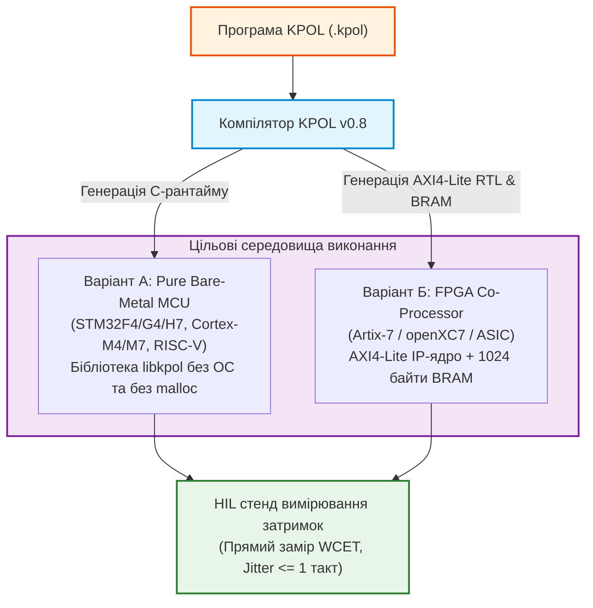

# Специфікація проблемно-орієнтованої мови KPOL v0.8 (Kuzmin Problem-Oriented Language)

* **Версія стандарту:** KPOL v0.8 (Fixed Silicon, Bare-Metal Runtime `libkpol` & STM32/AXI4-Lite HIL)  
* **Дата затвердження:** 2026-11-08  
* **Статус:** Офіційна нормативна специфікація кремнієвого середовища виконання  
* **Призначення:** Формалізація рантайму KPOL для фіксованого кремнію (Fixed Silicon Architecture). Перехід від емуляції до детерміністичного виконання на серійних мікроконтролерах STM32 (ARM Cortex-M) та апаратної інтеграції через шину AXI4-Lite у FPGA/ASIC. Нульове використання динамічної пам'яті (MISRA C:2012 Rule 21.3), суб-мікросекундний WCET та Hardware-in-the-Loop (HIL) верифікація затримок.
* **Версія:** 0.8.0
* **Перенесено з:** `drafts/KuzminMachine/03-engineering-software/Kuzmin-Machine-KPOL-Language-v0.8-Specification-UA.md` @ `a4738bc` (2026-11-09)

---

## 1. Парадигма фіксованого кремнію проти синтезу бітстрімів

Головна інженерна проблема спеціалізованих обчислювачів — висока вартість та тривалий цикл перекомпіляції апаратури (FPGA Bitstream Synthesis).  
У Kuzmin Machine кремній є **фіксованим і незмінним**:



### Принципи архітектури v0.8:
1. **Zero-Dynamic Allocation:** Заборона викликів `malloc`, `free`, `alloca`, `realloc`. Усі структури станів, черги подій та дескриптори виділяються статично під час компіляції (`.bss` / `.data` секції).
2. **Гарантований WCET:** Для будь-якого циклу обробки події кількість машинних інструкцій детермінована і не залежить від історії системи:
   $$T_{\text{exec}} \le T_{\text{WCET}} = 120\text{ нс} \quad (\text{при } F_{\text{cpu}} = 168\text{ МГц STM32F4})$$
3. **Апаратний профіль AXI4-Lite:** Стандартне IP-ядро для Vivado, що дозволяє STM32 спілкуватися з FPGA-шлюзом через 32-бітний інтерфейс без спеціальних пропрієтарних шин.

---

## 2. Структура пам'яті та API бібліотеки `libkpol`

Бібліотека `libkpol` генерується як самодостатня пара файлів: `km_<module>_runtime.h` та `km_<module>_runtime.c`.

### 2.1. Структура контексту рантайму
```c
typedef struct {
    uint32_t step_counter;
    uint32_t committed_count;
    uint32_t rejected_count;
    uint32_t hazard_blocked_count;
    uint32_t alert_count;
    uint32_t last_event_id;
    int32_t  state_values[KM_NUM_STATES];
} km_runtime_context_t;
```

### 2.2. Набір функцій
1. `void km_<module>_init(km_runtime_context_t *ctx)`:
   - Скидає лічильники подій у 0;
   - Завантажує початкові значення станів із дескрипторів BRAM;
   - Налаштовує маски прав Hardware ACL.
2. `km_txn_status_t km_<module>_dispatch(km_runtime_context_t *ctx, uint32_t event_id, const void *payload)`:
   - Виконує фазовий вентиль `•`: перевіряє передумови (`Assumptions`), небезпеки (`Hazards`) та інваріанти (`Invariants`);
   - У разі успіху фіксує нові стани та повертає `KM_TXN_COMMITTED`;
   - При виявленні небезпеки повертає `KM_TXN_HAZARD_BLOCKED` без мутації станів.
3. `uint32_t km_<module>_get_state(const km_runtime_context_t *ctx, uint32_t cid)`:
   - Constant-time O(1) доступ до поточного значення концепту.

---

## 3. Специфікація апаратного AXI4-Lite IP-ядра

Для гібридних систем (STM32 + FPGA або Zynq) компілятор генерує SystemVerilog модуль `km_<module>_axi_lite_slave.sv`:

### Карта регістрів AXI4-Lite (Зсув від базової адреси `0x4000_0000`):

| Адреса | Назва регістру | Доступ | Призначення |
| :--- | :--- | :--- | :--- |
| `0x00` | `CR_STATUS` | R/W | Біт 0: `START_EVENT`, Біт 1: `BUSY`, Біт 2: `COMMITTED`, Біт 3: `REJECTED`, Біт 4: `HAZARD_BLOCKED`, Біт 5: `ALERT` |
| `0x04` | `EVENT_ID` | R/W | Числовий код події (0..255) |
| `0x08` | `EVENT_PARAM0` | R/W | Перший 32-бітний параметр події (Payload LO) |
| `0x0C` | `EVENT_PARAM1` | R/W | Другий 32-бітний параметр події (Payload HI) |
| `0x10` | `CYCLE_COUNTER`| RO  | Апаратний 32-бітний лічильник тактів виконання поточної транзакції |
| `0x14` | `SEC_STATUS`   | RO  | Статус криптографічного підпису образу (Secure Boot Verified) |

---

## 4. Hardware-in-the-Loop (HIL) випробувальний стенд

Стенд HIL призначений для верифікації реального часу відгуку між мікроконтролером та кремнієвим шлюзом:
* **Метрика $T_{\text{dispatch}}$:** час від виставлення біта `START_EVENT` у регістрі `CR_STATUS` до отримання прапорця `COMMITTED` або `HAZARD_BLOCKED`.
* **Допустимий ліміт:** $T_{\text{dispatch}} \le 2\text{ такти шини AXI} \ (20\text{ нс при } 100\text{ МГц})$.
* **Джитер:** $\sigma_T = 0$ тактів (абсолютний кремнієвий детермінізм).

---

## 5. Висновок

KPOL v0.8 перетворює Kuzmin Machine на зрілу платформу для промислових контролерів. Розробник під STM32 отримує чистий MISRA-C99 код без прив'язки до операційних систем чи проміжних інтерпретаторів.