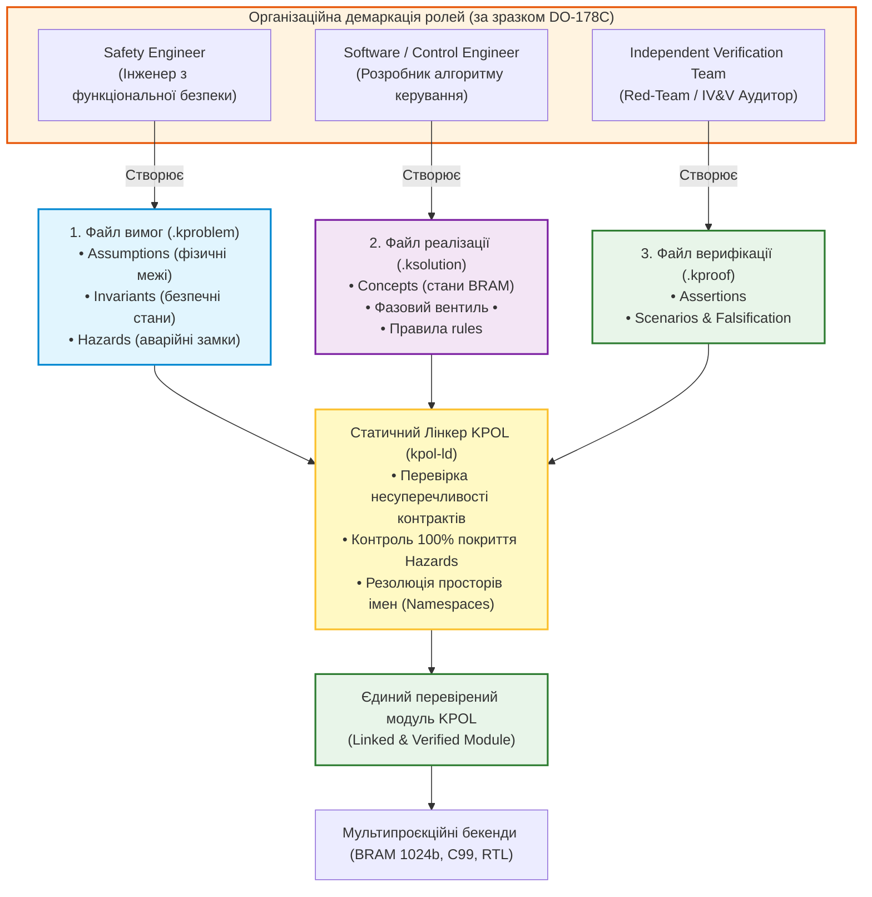

# Специфікація проблемно-орієнтованої мови KPOL v0.9 (Kuzmin Problem-Oriented Language)

* **Версія стандарту:** KPOL v0.9 (Modular Decomposition, Headers-as-Code & Multi-File Linker `kpol-ld`)  
* **Дата затвердження:** 2026-11-08  
* **Статус:** Офіційна нормативна специфікація модульності та лінковки  
* **Призначення:** Формалізація модульної декомпозиції мови KPOL. Розділення монолітного файлу `.kpol` на незалежні файли артефактів (`.kproblem`, `.ksolution`, `.kproof`) щоб технічно підтримати розділення ролей, якого вимагають правила незалежності верифікації у **DO-178C** (DAL A) та **ISO 26262** (ASIL D). Пункти стандартів не звірено; відповідність не оцінювалася. Введення просторів імен (`namespaces`), правил імпорту контрактів та статичного лінкера модулів `kpol-ld`.
* **Версія:** 0.9.0
* **Перенесено з:** `drafts/KuzminMachine/03-engineering-software/Kuzmin-Machine-KPOL-Language-v0.9-Specification-UA.md` @ `a4738bc` (2026-11-09)

> **Статус щодо стандартів безпеки:** згадки ISO 26262 / ASIL, DO-178C / DO-254 / DAL, IEC 61508 / SIL, IEC 62304 та ISO/SAE 21434 у цьому документі означають цільові домени й припущення, а не досягнуту відповідність. Зовнішніх вимог за цими стандартами немає; аналіз небезпек, цілі безпеки, кваліфікація інструментів і незалежне оцінювання не виконувалися. Див. [позицію проєкту](../../process/standards-position.md).

---

## 1. Проблема незалежності верифікації в авіоніці та автопромі

На найвищих рівнях критичності (DO-178C DAL A, ISO 26262 ASIL D, IEC 61508 SIL 4) стандарти вимагають незалежності верифікації: для низки цілей перевірку має виконувати не автор коду. Окремі файли KPOL — технічний засіб підтримати таке розділення; самі по собі вони незалежності не забезпечують:
* **Independence Invariant:** особа, що реалізує вимогу, не повинна мати права змінювати специфікацію вимоги або критерії її приймання.

KPOL v0.9 формалізує принцип **Headers-as-Code / Triad Separation**:



---

## 2. Формат роздільних файлів Тріади

### 2.1. Файл вимог `.kproblem`
Містить виключно декларацію контракту модуля та простору імен:
```kpol
namespace Avionics::FlightControl;

Problem PitchController {
    Assumptions {
        ValidSensor on GyroUpdate: PitchRate >= -50.0 and PitchRate <= 50.0;
    }
    Invariants {
        SafeEnvelope: PitchAngle >= -30.0 and PitchAngle <= 30.0;
    }
    Hazards {
        StallRisk on GyroUpdate to ElevatorLock: PitchAngle > 25.0;
    }
}
```

### 2.2. Файл реалізації `.ksolution`
Реалізує логіку, імпортуючи відповідну проблему:
```kpol
namespace Avionics::FlightControl;

import Avionics::FlightControl::PitchController;

Solution PitchController {
    event GyroUpdate(PitchRate: Float<degC>);
    state PitchAngle: Float<degC> = 0.0;
    state ElevatorLock: Bool = false;

    rule on_gyro on GyroUpdate when PitchAngle <= 25.0 {
        set PitchAngle := PitchAngle + 1.0;
    }
    rule on_stall on GyroUpdate when PitchAngle > 25.0 covers StallRisk {
        set ElevatorLock := true;
    }
}
```

### 2.3. Файл верифікації `.kproof`
Незалежний доказ, створений командою верифікації:
```kpol
namespace Avionics::FlightControl;

import Avionics::FlightControl::PitchController;

Proof PitchController {
    scenario NormalFlight {
        step GyroUpdate(PitchRate: 5.0);
        expect ElevatorLock == false;
    }
    assert StallLockout on GyroUpdate {
        when PitchAngle > 25.0 expect ElevatorLock == true;
    }
}
```

---

## 3. Простори імен (`namespaces`) та правила імпорту

1. **Декларація простору імен:**
   `namespace Identifier (:: Identifier)*;`
2. **Повне кваліфіковане ім'я (FQCN):**
   `Avionics::FlightControl::PitchController`
3. **Імпорт сигналів і контрактів:**
   `import Namespace::TargetName;`
   Лінкер гарантує, що не виникає циклічних залежностей ($A \to B \to A$) та колізій ідентифікаторів у таблиці концептів.

---

## 4. Алгоритм роботи лінкера `kpol-ld`

Статичний лінкер виконує такі етапи обробки:
1. **Збір символів (Symbol Collection):** завантаження всіх AST частин `Problem`, `Solution`, `Proof`.
2. **Матчинг контрактів (Contract Matching):** для кожного `Solution(M)` перевіряється наявність авторизованого `Problem(M)`. Реалізація без специфікованої проблеми є забороненою (`UnspecifiedSolutionError`).
3. **Повнота покриття (Coverage Check):** 100% небезпек `Hazards` повинні бути покриті правилами `covers <HazardName>`.
4. **Перевірка розділення ролей (за зразком DO-178C):** перевірка того, що `Proof` не був створений або змінений тими самими контрольними сумами коміту, що й `Solution` (при використанні VCS метаданих).
5. **Агрегація BRAM адрес:** концептам присвоюються глобальні унікальні `CID` у межах [0..63].

---

## 5. Програмний інтерфейс компілятора (API)

Модуль компілятора розширюється функціями лінкування:

1. `parse_triad_files(problem_src: str, solution_src: str, proof_src: str) -> Module`:
   - Парсить окремі тексти файлів;
   - Об'єднує вимоги, події, стани, правила та докази в цілісний `Module`;
   - Виконує повну перевірку `check_module()`.

2. `link_modules(modules: list[Module]) -> Module`:
   - Об'єднує незалежні підсистеми у єдину систему;
   - Перевіряє сумарний ліміт концептів ($\le 64$ для BRAM);
   - Автоматично призначає префікси просторів імен для уникнення колізій.

---

## 6. Висновок

KPOL v0.9 усуває останні перешкоди на шляху до найсуворішої сертифікації в авіації та автономному транспорті. Завдяки фізичному розділенню файлів розробники та аудитори можуть працювати в ізольованих репозиторіях і рев'ю-пайплайнах, гарантуючи нульову упередженість верифікації.